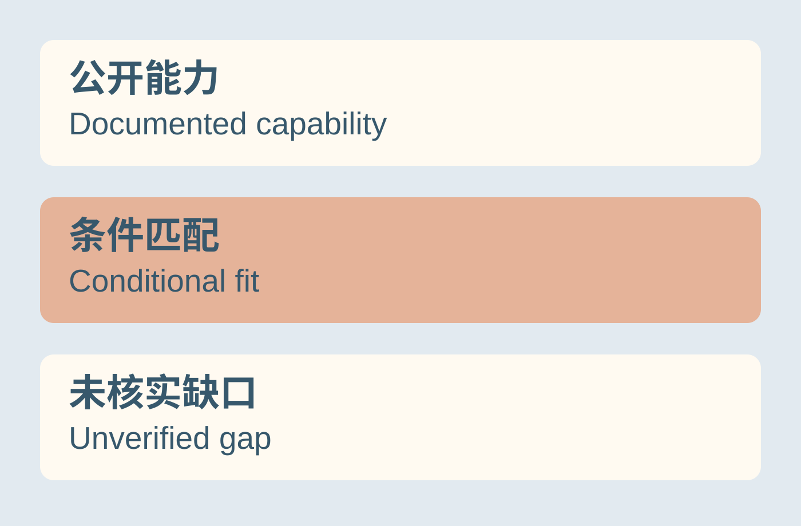

# CreatorIQ 优劣怎样按证据讨论

状态：本地审阅稿；正式发布日期待确认。

评估 CreatorIQ 的优势与局限，先把供应商公开能力、品牌实际需求与仍待验证的事项分开，再形成有依据的适合性判断。

QuickKOL 编辑图形；不呈现真实账号指标或平台界面。

CreatorIQ company strengths weaknesses 应按具体达人项目判断。公开资料显示它把达人发现、内容审阅、活动管理与付款等工作放在同一产品体系中；这些能力可能适合需要多团队协作的品牌。局限评估则要问采用、资料整理、当前版本、市场资格与总成本是否符合自己的任务，不能把尚未测试的事项写成已证实缺陷。本篇基于官方公开资料，不声称实际试用、内部财务审查或独立性能测试。

## 先定义评估的是哪类项目

一个只需完成一条演示视频的品牌，与同时管理地区、代理和财务的团队，需要不同工具。先写出真实任务、参与角色与最容易出错的交接，再讨论能力是否有价值。

[CreatorIQ 商业与采购指南](https://www.quickkol.com/zh/blog/creatoriq-pricing-commercial-scope-questions/#answer)可以帮助组织具体询问。本篇重点是优势和局限的证据范围，不把所有采购项目都变成相同演示脚本。

评估结果可以是适合继续了解、某项需要确认或当前任务不需要。没有必要为显得客观而给每个产品硬凑同样数量的优缺点，更不应把未知写成负面事实。

## 发现能力：研究相关作品

[CreatorIQ 的发现功能说明](https://www.creatoriq.com/influencer-marketing-solution/creator-search)介绍按内容、关键词、过滤条件与推荐寻找创作者。对需要从 Brief 研究作品的团队，这可能减少在多个界面之间寻找线索的步骤。

这是供应商对能力的说明，不是本文验证所有公开账号都被收录，或每项受众信息都完整准确。研究仍需要原始作品、数据范围和本人确认。

条件性优势是让相关内容更容易进入候选讨论；条件性局限是团队必须知道资料来自哪里、能支持什么问题。找到一个候选人不等于已经确认档期、身份、合作意愿或商业适合性。

## 活动管理：集中交接

[CreatorIQ 的活动管理说明](https://www.creatoriq.com/influencer-marketing-solution/influencer-campaign-management)介绍入驻、内容审阅、沟通、合同付款流程与报告。多团队如果目前靠分散消息协调，这类集中记录可能对应真实需要。

不能由功能存在推断品牌一定节省多少时间，也不能把营销页中的即时表述当成所有数据没有延迟。需要在具体版本和工作流程中确认刷新、状态和覆盖。

优势应写成能力与任务的关系，例如让审阅意见找到同一内容记录。局限则包括品牌仍需明确谁确认事实、谁决定用途与谁处理异常；软件不能自行决定团队尚未定义的责任。

## 付款能力：区分付款方与收款市场

[CreatorIQ 的付款产品更新](https://www.creatoriq.com/whats-new-in-creatoriq/global-payments)说明新版本的付款安排，并将美国、加拿大法律实体的当前可用性，与其他地区后续计划和收款市场分开。不能把可向多个市场付款，理解成任何地区的品牌都已能采用同一方案。

品牌应确认自己的法律实体、产品版本、资金安排和财务接手方式。本文不提供税务判断，也不把公开产品介绍当成实际付款成功记录。

能力可能有助于让活动与财务看见对应状态，但“已批准”“已处理”和“已到账”仍应按实际定义阅读。具体资格和条件需要供应商确认，不用市场数量替代。

优势需要对应任务，未知需要对应核验。

## 采用负担取决于团队准备

集中系统需要可用资料和清楚流程。旧联系人、作品版本、历史使用范围与付款状态如果本来就混乱，导入不会自动让这些事实变得正确。

这是品牌采用任何管理工具都应评估的工作，不是本篇测得 CreatorIQ 难用。先确定要带入哪些记录、谁确认、哪些保留未知，再判断采用计划是否可行。

同样，培训不只是学按钮。内容、采购和财务需要理解同一状态意味着什么。若品牌目前没有相关负责人，先解决责任，比购买后期待系统自动补齐组织更实际。

## 更多能力不一定是本次需要

对于一项小型合作，复杂协调功能可能暂时没有实际用途。这说明当前任务与产品范围不匹配，不证明产品对所有品牌都太复杂或太贵。

把必须完成、偶尔需要与暂不需要的工作分别列出。功能演示再丰富，也应回到本次问题：它能让哪个达人任务更容易被准确完成？

如果团队预计扩大，说明依据与时间，不用模糊未来可能需要来代替当前判断。选择可以保留弹性，但采购理由需要真实，不把规模化当作所有品牌都必须追求的目标。

## 数据范围要能支持具体结论

品牌希望比较表现时，应询问资料来源、更新范围、自然与付费、缺失项和实际指标定义。平台报告让数据集中，不代表所有来源已经可直接相加。

[达人成功衡量指南](https://www.quickkol.com/zh/blog/measure-influencer-success-contribution-review/#answer)帮助把记录对应到决策。若数据只支持观察互动，就不将它自动解释为独立人数或销售因果；缺少业务输入，也不能靠报告界面补出真实 ROI。

这是一项评估要求，不是断言 CreatorIQ 报告错误。供应商说明、实际样本与品牌自己的数据条件应分别保留，才能判断某项报告能做什么。

## 未知事项应写成待确认问题

没有实际账户测试，就不声称界面顺畅或难用；没有当前报价，就不编写年度费用；没有经核验问题，就不写成稳定性缺陷。

可以把未知转为有范围的问题，例如目标语言作品如何检索、地区团队能看到哪些资料、某项付款产品是否适用。问题越具体，供应商越容易给出可检查答复。

保留答复日期、适用版本和仍未回答的部分。不要因为一次销售沟通积极，就把所有能力写成通过；也不要因为暂未答复，就推断功能不存在。

## 把总成本对应到实际工作

评估可以纳入产品费用、采用、资料整理、培训和品牌人员时间，但只记录实际报价和可说明的假设。不同范围的价格不能在没有调整时直接比较。

本篇没有当前适用报价，不提供精确价格或回报期。品牌可以先要求对应自己任务的范围，再判断哪些费用包括、哪些额外、哪些由内部承担。

成本的意义在于能否完成工作，而不是功能数量除以一个起步价格。即使某项能力很强，若本次不需要，也不能自动形成节省；若缺少关键接手工作，低价也不等于任务完成。

## 用两个假设团队说明适合性

假设团队甲同时管理地区、创意审阅与财务，最容易丢失的是活动到付款的交接。它有理由进一步研究集中管理与符合资格的付款能力。

团队乙只需要一位达人完成一次演示，已有发布负责人。它可以先明确制作与用途，不需要因为甲需要复杂协调就购买相同范围。

两个例子没有真实客户结果，也不是替团队推荐购买。它们说明优势随任务而变化，局限也需要具体说明；同一产品可以对不同团队有不同价值，而不必给出统一高低分。

## 交付一份有依据的适合性结论

最终意见应包括任务、供应商公开能力、已确认条件、未知事项与下一步。不要把营销页变成独立测试，也不把未测试的担忧变成已证实事实。

CreatorIQ company strengths weaknesses 的有用答案，可以是某项能力值得进一步确认、某项范围暂不匹配，以及谁负责核对。它无需给公司整体贴一个简单标签。

让结论回到达人合作：作品是否可研究，审阅是否可接手，付款与数据是否有合适责任。工具评估服务实际工作，品牌才能据此决定继续、调整或暂缓。

例如内容负责人能否看到所需资料，财务能否接住确认过的付款事项，需要在真实职责下分别核对，不能仅凭销售演示的一次操作就替整个团队确认。

## 把优缺点评价改成有依据判断

| 公开能力 | 可能价值 | 需要确认 |
| --- | --- | --- |
| 内容优先发现 | 相关作品进入候选研究 | 覆盖、来源与本人安排 |
| 集中活动记录 | 审阅与交接有共同位置 | 团队责任与采用工作 |
| 新版本付款 | 活动与财务协调 | 法律实体、资格与产品版本 |
| 报告 | 有范围的共同观察 | 定义、时效与缺失项 |

基于供应商公开说明的条件性分析，不是实际试用、性能排名或公司内部审查。

## 给评估负责人六个问题

每个问题对应一项达人工作。

- [ ] 当前最需要解决哪个交接？
- [ ] 哪些公开能力与它相关？
- [ ] 什么由供应商实际确认？
- [ ] 品牌需要准备哪些资料？
- [ ] 哪些价格与资格仍未知？
- [ ] 下一项核验由谁完成？

## 研究日期与使用边界

资料核验于 2026 年 11 月 17 日。文中方法、表格和决策规则为编辑建议，标为假设的示例不是实际客户结果或行业基准。外部资料的适用地区与时期按各段说明。

## 从任务开始达人研究

用 QuickKOL 理解 Brief、发现相关达人并研究作品与联系路径；数据、合作条件和结果仍需核验。

[了解 QuickKOL](https://www.quickkol.com/#capabilities)

## 来源

- [CreatorIQ：达人发现](https://www.creatoriq.com/influencer-marketing-solution/creator-search)
- [CreatorIQ 的活动管理说明](https://www.creatoriq.com/influencer-marketing-solution/influencer-campaign-management)
- [CreatorIQ 的付款产品更新](https://www.creatoriq.com/whats-new-in-creatoriq/global-payments)
