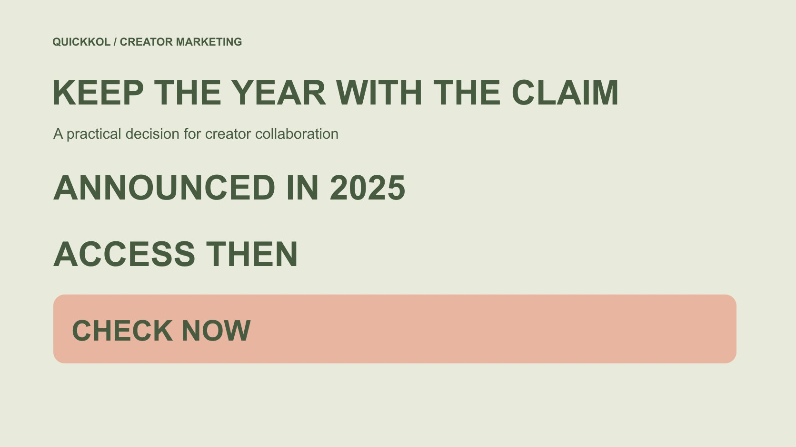
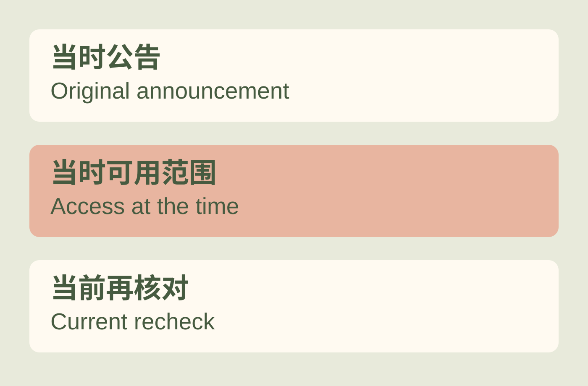

# Digital Marketing Trends 2025: Review Creator Tool Changes

Status: local review draft; confirm the publication date before release.

Review 2025 changes to creator production, discovery and shopping tools through official announcements, separating publication, historical scope and actual availability in 2026.

QuickKOL editorial graphic; not actual account metrics or a platform interface.

A useful review of digital marketing trends 2025 examines specific changes to creator production tools, partnership discovery and content-led shopping. Meta’s Edits, additions to TikTok One and Google’s India shopping announcement provide dated primary examples rather than a ranking covering every market. Separate launched, rolling out, testing and planned statements, then check the current project’s market, account and permissions. The useful brand conclusion identifies the creator work affected, the owner needed and what an old announcement still cannot establish.

## Give the historical review a defined question

A search for 2025 trends should not produce a current feature list with its year changed. Define whether the question concerns what happened then and how it affected creator partnerships. Historical facts and present access require separate checks.

The [creator-marketing technology transition guide](https://www.quickkol.com/blog/technology-disruption-influencer-marketing-change-register/#answer) examines workflow instead of treating each new name as a strategy. This review selects three related tasks: production, discovery and shopping. It does not cover every digital-marketing change or rank popularity without a suitable sample.

Suppose a brand wants to explain why an old brief uses a different platform name. A dated announcement preserves context; starting work today additionally needs current help and account checks. A clear research question prevents a roadmap from becoming an operational promise. It also keeps the review useful for a new colleague who was not present during the transition and needs to know which part of the earlier working process was actually affected.

## Check the original year behind a new name

[TikTok’s 2024 World announcement](https://newsroom.tiktok.com/tiktok-world-2024?lang=en) already introduced TikTok One. Separate the platform’s earlier appearance from additions described in 2025. A concentration of coverage during one year does not establish that the name or product originated then.

This distinction changes how a brand describes an older workflow: identify the additions supported by the 2025 announcement rather than classify every existing task as a new capability from that year. Without sufficient historical evidence, retain the limitation instead of supply an apparently precise but unverified migration date. The review can still explain the work affected and the question to confirm, without inventing a complete change history or implying that every market and account moved together.

## Edits: distinguish launch capabilities from later updates

[Meta’s 2025 Edits announcement](https://about.fb.com/news/2025/04/introducing-edits-streamlined-video-creation-app/amp/) was originally published on April 22 and introduced mobile video creation and editing tools. The page also retains a December 17 update and future directions in the original passage, so its entire contents cannot be described as available in April.

For creator partnerships, examine how production and feedback might be arranged. A brand can investigate reduced tool switching while still confirming the project, export and review process. An official launch does not establish a measured reduction in production time.

For a feature used in an earlier project, locate evidence appropriate to that period. Today’s updated description does not prove access in the account at that time. Preserve original and update dates so continued page maintenance does not erase the historical boundary. This lets the review distinguish what was announced from the team’s own experience, with an actual project record needed before claiming that a specific capability changed how its creators worked.

## TikTok One: inspect the specific added tasks

[TikTok’s 2025 World announcement](https://newsroom.tiktok.com/tiktok-world-2025?lang=en) describes added TikTok One capabilities, including content discovery and partnership routes, and identifies Partner Exchange as a new name for TikTok Creative Exchange. It should not be used to describe TikTok One itself as first appearing in 2025.

A brand can investigate handoffs between finding creators, identifying content and arranging production. Discovering public material does not establish advertising permission, and provider performance language does not guarantee the same result in every assignment.

Retain task changes the announcement actually supports. Do not fill an unverified migration deadline or account threshold from forums or a secondary checklist. A bounded, accurate transition note is more useful for handoff than a complete-looking timeline assembled from rumors. The practical next question is which existing record, permission or working owner must move with a task, rather than whether the team has replaced every old product name in its presentation slides.

## YouTube: retain geography and future language

[Google’s 2025 India shopping announcement](https://blog.google/intl/en-in/products/platforms/fueling-the-next-era-of-creator-led-shopping-experiences-in-india/), dated October 10, discusses local merchant partnerships and tools while describing some capabilities as rolling out, to be tested or coming soon. Neither the Indian context nor those different statements of timing should disappear.

For example, its future wording about Shorts brand-deal links does not prove universal availability that day, nor establish that the feature remains unavailable now. Historical statements and current judgments need separate evidence rather than one undated conclusion.

The graphic separates announcement, access at the time and current recheck. Tools bringing a route closer to content still need product information, a destination and a response owner. An announcement provides capability and direction leads without replacing real collaboration arrangements. The review can describe the operational question a new route creates without adopting the provider’s survey or advertising results as a general forecast for the brand’s own creators.

Launched, rolling out, testing and planned statements carry different meanings.

## Implication one: production needs clearer handoffs

These examples support examining connected production tasks, not a claim that every team underwent the same transformation. Editing, export or feedback capability still leaves owners to confirm facts, consolidate changes and identify the deliverable version.

Test the implication through a hypothetical assignment: a creator produces on a phone, the brand supplies consolidated comments through an agreed route and an editor delivers the corresponding version. To assess improvement, record actual waiting, repeated changes and delivery instead of count installed tools.

If a tool change prevents an owner continuing their work, resolve that handoff. Repeated switching in pursuit of a trend can create version confusion; adoption should return to the real task rather than a provider’s simpler-work claim being reported as an achieved team benefit. A useful historical review identifies the change the brand might test while leaving the outcome open until its own production records support a conclusion.

## Implication two: separate discovery from permission

Additional discovery routes can make research leads easier to find, but work, contribution and an appropriate contact path still need checking. A result, profile card or video mentioning a brand is not a confirmed partnership.

As discovery and advertising use sit closer together inside tools, owners should identify the current stage precisely. Finding content, obtaining permission, editing and paid distribution are different states. A saved record cannot replace mutual confirmation.

This does not require an elaborate process every time; it makes the next action accurate. A team can ask an appropriate public business contact about a specified use rather than put discovered content directly into an advertising plan. Tools provide possibilities while brand and creator define the actual work. The review should therefore retain which decision remains outside the tool, helping a new user distinguish something they can inspect from something they are entitled to publish or promote.

## Implication three: content-led commerce needs version alignment

As product routes enter content, brands need earlier alignment among the item, link and availability. Explaining one product while the viewer opens another choice undermines understanding even when both components work technically.

Include the shopping route in the brief without making the creator responsible for every transaction. Identify who updates information, handles orders and decides when content needs adjustment. Record commission separately from completed production.

A 2025 announcement can explain why these responsibilities entered team discussion, but cannot establish that a new route necessarily improves return. Retain actual action records and attribution boundaries instead of substitute platform growth for project results. The operational lesson is a check the team can perform: follow the content’s route to the actual choice offered and confirm where a viewer with a question would be directed, with any mismatch assigned to someone able to correct it.

## Make the 2026 recheck a new record

[TikTok One’s advertiser guide](https://ads.tiktok.com/resources/help/article/about-tiktok-one?lang=en) is currently marked updated June 2026. It helps describe present official capabilities but cannot prove that each existed in 2025, and it is not a record of account testing for this article.

For work today, record the review date, market, account and actual access. Without account testing, describe the work as official-source research rather than tested performance. Another owner can then see which question still needs an operational check.

Updating a historical article need not erase its original period. Preserve what happened in 2025 and separately identify what needs checking now. Readers receive two clear questions instead of a latest-trends list blending several periods without boundaries. This also prevents a current menu label being retroactively inserted into an old project explanation, where it could make the earlier workflow appear more complete or available than the evidence establishes.

## Hand over one change worth testing

The [TikTok Shop creator-route guide](https://www.quickkol.com/blog/tiktok-shop-creator-affiliate-content-route/#answer) gives an example of current task separation. Historical trend research should likewise propose a specific next step: test a review method, check a discovery route or confirm a product destination rather than adopt every tool.

Give each recommendation evidence, an owner and an assessment criterion. Without results, retain it as a proposed test; without suitable access, do not list it as an achieved capability. Present provider promotion, editorial recommendations and the team’s own findings separately.

Within influencer marketing, digital marketing trends 2025 is useful for understanding why work changed and preparing the next partnership more accurately. The year bounds facts, and the actual assignment directs research. A concise handoff can therefore preserve the source date, the affected task and the remaining question, giving the next owner something concrete to verify instead of a collection of trend labels with no operational meaning.

## Three dated 2025 tool-change leads

| Lead | Primary-source period | Brand question |
| --- | --- | --- |
| Edits | April original announcement and December update | Which production task the relevant period supports |
| TikTok One additions | June World announcement | How discovery, production and permission connect |
| YouTube shopping in India | October geographically scoped announcement | What was rolling out versus described as future |
| Current recheck | November 2026 review | Whether the actual project has access and can proceed |

Scoped historical research, not a global trend ranking, current account test or performance guarantee.

## Checklist for reading an older announcement

Keep time, geography and task connected.

- [ ] Retain original and update dates.
- [ ] Separate launch, testing and plans.
- [ ] Keep market and account scope.
- [ ] Connect capability changes to creator work.
- [ ] Recheck separately with current resources and the account.
- [ ] Use actual project evidence for outcomes.

## Research date and limitations

Sources reviewed November 17, 2026. Methods, tables and decision rules are editorial recommendations. Hypothetical examples are not actual client results or industry benchmarks. Source geography and periods are specified where relevant.

## Start creator research with a clear task

Use QuickKOL to interpret a brief, discover relevant creators and research their work and contact routes. Verify data, commercial terms and outcomes at their source.

[Explore QuickKOL](https://www.quickkol.com/#capabilities)

## Sources

- [TikTok’s 2024 World announcement](https://newsroom.tiktok.com/tiktok-world-2024?lang=en)
- [Meta’s 2025 Edits announcement](https://about.fb.com/news/2025/04/introducing-edits-streamlined-video-creation-app/amp/)
- [TikTok World 2025 official announcement](https://newsroom.tiktok.com/tiktok-world-2025?lang=en)
- [Google’s 2025 India shopping announcement](https://blog.google/intl/en-in/products/platforms/fueling-the-next-era-of-creator-led-shopping-experiences-in-india/)
- [TikTok One’s advertiser guide](https://ads.tiktok.com/resources/help/article/about-tiktok-one?lang=en)
