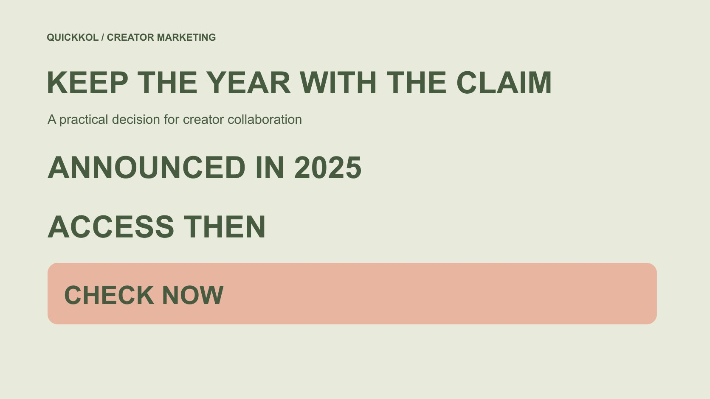
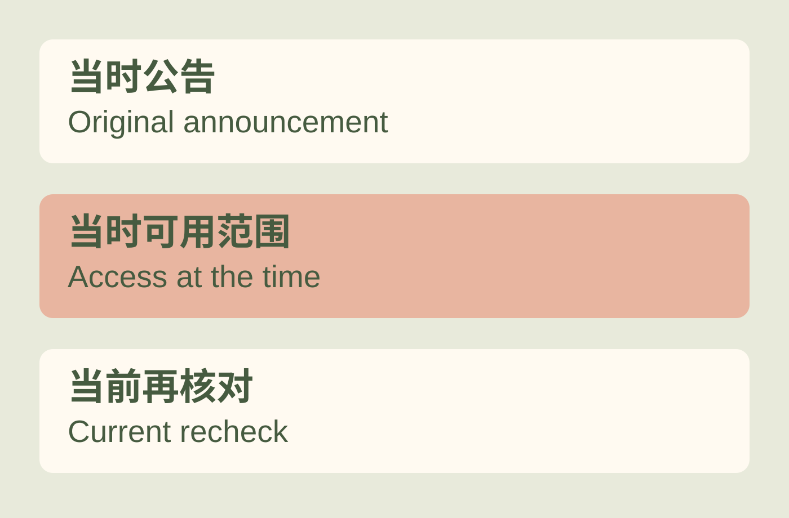

# 2025 年达人营销工具怎样改变

状态：本地审阅稿；正式发布日期待确认。

以 2025 年官方公告复盘达人制作、发现与内容购物工具的变化，分开当时发布、当时范围和 2026 年实际可用条件。

QuickKOL 编辑图形；不呈现真实账号指标或平台界面。

复盘 digital marketing trends 2025，可以关注达人制作工具、合作发现入口与内容购物路径在当年的具体变化。Meta 的 Edits、TikTok One 的新增能力和 Google 的印度购物公告提供有日期的一手例子，但不是全部市场的趋势排名。把公告中的已推出、正在推广、测试与未来计划分别保存，再核对今天项目的地区、账号与权限。对品牌真正有用的结论，是哪项变化影响了达人工作、需要谁接手，以及什么仍然不能由一篇旧公告证明。

## 用历史问题限定趋势复盘

搜索 2025 年趋势，不应得到改了年份的现行功能清单。先说明想理解的是当年发生什么，以及这些变化如何影响达人合作。历史事实和今天能否使用是两次核验。

[达人营销工具转变指南](https://www.quickkol.com/zh/blog/technology-disruption-influencer-marketing-change-register/#answer)帮助从流程看技术，而不是把每个新名称都当成新策略。本文选择制作、发现与购物三类相连任务，不声称覆盖所有数字营销变化，也不提供没有样本依据的热门程度排名。

假设品牌要解释为什么旧 Brief 的平台名称与今天不同，历史公告可以保留变化背景；若要今天开工，则必须继续看当前帮助和账号。让研究问题清楚，才不会用一份路线图替负责人承诺实际能力。

## 先核对新名称的原始年份

[TikTok 的 2024 年 World 公告](https://newsroom.tiktok.com/tiktok-world-2024?lang=en)已经介绍 TikTok One。因此，2025 年的新增能力与此前的平台出现应分开。看到当年许多报道，不足以证明名称或产品始于当年。

这一区别影响品牌怎样解释旧流程：可以说 2025 年公告描述了哪些变化，不能把全部既有任务都归为当年新能力。如果没有充分历史证据，保留范围，不补写一个看起来精确却未经核验的迁移日期。

## Edits：区分推出时能力与后续更新

[Meta 的 2025 年 Edits 公告](https://about.fb.com/news/2025/04/introducing-edits-streamlined-video-creation-app/amp/)最初发表于 4 月 22 日，介绍手机视频制作与编辑工具。该页面还保留 12 月 17 日更新，并在最初段落中列出未来方向，因此不能把整页所有功能都说成四月已经具备。

对达人合作，重点是制作与反馈怎样安排。品牌可以研究是否有助于减少工具转换，但仍需确认实际项目、导出与审阅方式，不能从官方发布直接推导出制作时间减少多少。

如果旧项目使用某个功能，要找到对应时期的依据。今天页面更新后的描述，不自动证明当时账号能够访问。保持原始日期与更新日期，让历史复盘不因为页面持续维护而失去时间边界。

## TikTok One：看具体新增任务

[TikTok 的 2025 年 World 公告](https://newsroom.tiktok.com/tiktok-world-2025?lang=en)介绍 TikTok One 的新增能力，包括内容发现与合作入口，并把 Partner Exchange 说明为 TikTok Creative Exchange 的新名称。不能因此把 TikTok One 本身写成首次在 2025 年出现。

品牌可据此研究发现达人、找到相关内容与安排制作之间的交接。发现公开内容不等于获得广告使用许可，平台对效果的宣传也不代表每个项目都会有同样结果。

历史复盘保留公告真正支持的任务变化。没有可读的一手资料支持的迁移期限或账号门槛，不从论坛或二手清单补写。一个准确、范围有限的转变说明，比包含所有传闻的完整时间线更适合交接。

## YouTube：把地区与未来语气保留下来

[Google 的 2025 年印度购物公告](https://blog.google/intl/en-in/products/platforms/fueling-the-next-era-of-creator-led-shopping-experiences-in-india/)发表于 10 月 10 日，讨论当地商品合作与新工具，并将部分能力表述为正在推广、将测试或即将提供。印度背景和这些不同语气都不能省略。

例如当时关于 Shorts 品牌合作链接的未来表述，不证明当天所有达人已经可以使用；也不能据此说今天仍然不可用。历史说法与当前判断要分别找证据，不把两者合成一个无日期结论。

图形将当时公告、可用范围与当前核对分开。对品牌来说，工具使路径更靠近内容，仍需要产品资料、目的地与回应负责人。技术公告提供的是能力与方向线索，不能代替这些真实合作安排。

已推出、正在推广、测试与未来计划，应保留不同含义。

## 趋势一：制作工作需要更清楚的交接

这些例子支持关注制作任务如何连接，但不证明所有团队都完成了同一种转型。一个工具能剪辑、导出或提供反馈，团队仍要决定谁确认事实、谁整理修改，以及哪一版可以交付。

可以用假设项目检查变化：达人在手机上制作短片，品牌通过约定方式给出集中意见，编辑交付对应版本。要衡量是否更顺畅，应记录实际等待、重复修改和交付，而不只统计安装了几个工具。

若工具变化让某位负责人无法继续访问，先解决交接。为了追随趋势而不断换工具，可能增加版本混乱；是否采用，应回到真实任务，而不是因为官方公告说了更简单就把它写成团队已经实现的收益。

## 趋势二：分开发现与授权

发现入口变多，可以让品牌更容易找到研究线索，但线索仍需要核对作品、实际贡献与合适联系路径。搜索结果、资料卡或已提及品牌的视频，不自动变成已确认合作。

当发现与广告使用在一个工具里靠得更近，负责人更应清楚当前到了哪一步。找到内容、取得许可、制作修改与付费投放，是不同状态。不要用一个已经收藏的记录替代双方真实确认。

这不是要求每次都增加复杂流程，而是让下一步准确。例如可以先向适当公开商务入口询问一项具体用途，而不是把发现的内容直接放入广告计划。工具负责提供可能，品牌与达人负责定义实际工作。

## 趋势三：保持商品版本一致

当商品路径进入内容，品牌需要更早核对实物、链接与可供安排。达人说明一种产品，观众打开另一选择，会破坏理解，即使两个环节各自技术上正常。

可以把购物路线放进 Brief，但不让达人承担所有交易责任。谁更新商品信息、谁处理订单问题、什么情况下需要调整内容，都应明确。佣金收入与制作完成也需要分别记录。

2025 年的公告可以帮助解释为什么团队开始讨论这些环节，不能证明某条新路线一定带来更高回报。复盘应保留观众行动的实际记录与归因边界，不用平台总体增长代替单个项目效果。

## 把 2026 年复核写成新的记录

[TikTok One 的广告主说明](https://ads.tiktok.com/resources/help/article/about-tiktok-one?lang=en)当前标注 2026 年 6 月更新，可帮助理解现行官方能力描述，但不能反过来证明每项能力在 2025 年已经具备。它也不是本文实际测试账号的记录。

今天准备合作时，记录核验日、地区、账号与实际可访问情况。若没有账号测试，就明确停留在官方资料研究，不写已实测。这样另一位负责人知道哪项还需要操作确认。

对历史文章，更新不必抹掉原文时间。可以保留 2025 年发生什么，再单独说明当前要核对什么。读者得到两个清楚问题，比一份混合多个时期、却没有日期边界的最新趋势列表更有用。

## 交付一项可以测试的改变

[TikTok Shop 达人路线指南](https://www.quickkol.com/zh/blog/tiktok-shop-creator-affiliate-content-route/#answer)提供了当下任务拆分的例子。历史趋势研究最后也应提出具体下一步，例如测试一种审阅方式、核对新的发现入口或确认某个商品路径，而不是要求团队采用全部工具。

每项建议写清依据、负责人与判断标准。没有结果，就保留为待测试；没有合适访问，就不把它列入已完成能力。官方宣传、编辑建议与团队自己的结果应分别呈现。

Digital marketing trends 2025 在达人营销框架中最有价值的用途，是帮助品牌理解工作为什么改变，并更准确地准备下一项合作。年份为事实提供范围，实际任务为研究提供方向。

## 三条 2025 年工具变化线索

| 线索 | 一手时期 | 品牌要问 |
| --- | --- | --- |
| Edits | 4 月原始公告与 12 月更新 | 对应时期能支持什么制作任务 |
| TikTok One 新能力 | 6 月 World 公告 | 发现、制作与许可怎样交接 |
| YouTube 印度购物 | 10 月有地区范围的公告 | 哪些已推广、哪些仍是未来语气 |
| 当前复核 | 2026 年 11 月研究时点 | 实际项目是否可访问与执行 |

有范围的历史研究，不是全球趋势排名、当前账号实测或效果保证。

## 读取旧公告时的清单

让时间、地区与任务保持对应。

- [ ] 保存原始发布与更新日期。
- [ ] 区分推出、测试和未来计划。
- [ ] 保留地区与账号范围。
- [ ] 把能力变化连接到实际达人工作。
- [ ] 用当前资料与账号另行复核。
- [ ] 将效果留给真实项目证据。

## 研究日期与使用边界

资料核验于 2026 年 11 月 17 日。文中方法、表格和决策规则为编辑建议，标为假设的示例不是实际客户结果或行业基准。外部资料的适用地区与时期按各段说明。

## 从任务开始达人研究

用 QuickKOL 理解 Brief、发现相关达人并研究作品与联系路径；数据、合作条件和结果仍需核验。

[了解 QuickKOL](https://www.quickkol.com/#capabilities)

## 来源

- [TikTok 的 2024 年 World 公告](https://newsroom.tiktok.com/tiktok-world-2024?lang=en)
- [Meta 的 2025 年 Edits 公告](https://about.fb.com/news/2025/04/introducing-edits-streamlined-video-creation-app/amp/)
- [TikTok World 2025 官方公告](https://newsroom.tiktok.com/tiktok-world-2025?lang=en)
- [Google 的 2025 年印度购物公告](https://blog.google/intl/en-in/products/platforms/fueling-the-next-era-of-creator-led-shopping-experiences-in-india/)
- [TikTok One 的广告主说明](https://ads.tiktok.com/resources/help/article/about-tiktok-one?lang=en)
