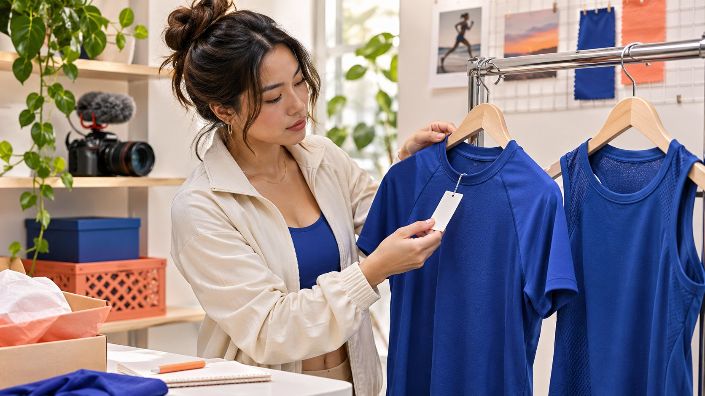
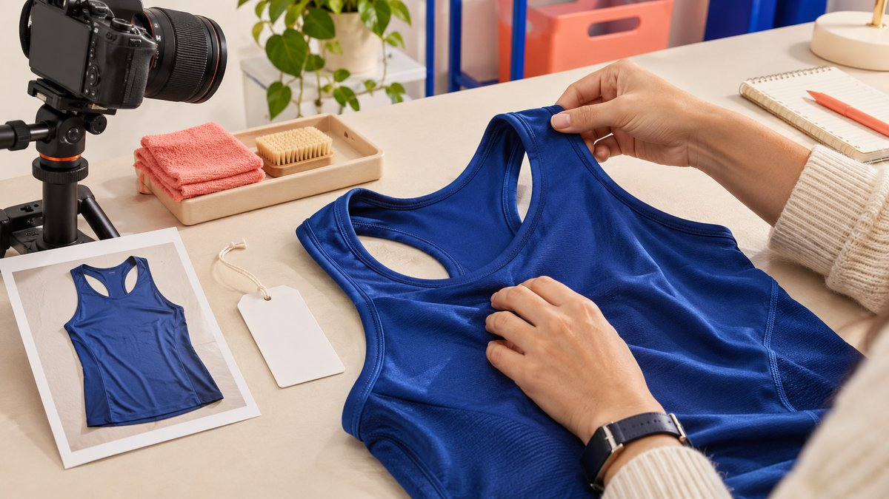

# Exercise Clothing Brands: Hand Off Creator Samples

Status: local review draft; confirm the publication date before release.

Give exercise-clothing creator shoots a sample identity, arrival check, care information and return plan, keeping fitting samples, filming samples and sale versions distinct.

Exercise clothing brands should manage creator-shoot samples as production items with an identity and condition. Confirm the style, size, color and version; supply relevant care and product information; and agree who receives, uses, replaces and returns them. A fitting sample is not automatically ready for every shot: shipping creases, cleaning changes and another batch can affect presentation. The purpose of sample handoff is to help the creator portray the actual collaboration product accurately and let the brand identify which garment appears in the finished work.

## Distinguish fitting samples from filming samples

A fitting sample helps establish whether a garment suits the assignment; a filming sample must support the agreed shots. They can be the same item, but condition should be checked rather than assumed. Retain information about earlier wear, cleaning or transfers.

The [creator clothing-fit guide](https://www.quickkol.com/blog/gym-clothing-brands-kol-fit-test/#answer) addresses suitable movement and expression; this article concerns handoff from the brand to production. Explain whether the sample supports product details, styling or everyday-use storytelling before deciding how many items, in what condition and under whose care.

A complete-outfit assignment needs more than the main top followed by a request that the creator improvise everything else. Conversely, sending an outfit does not establish a purchased recommendation or publication for each item. Keep the physical delivery and commercial task distinct. This gives a receiving producer a concrete way to check completeness without inferring the contract from whatever happened to arrive in a parcel, and lets the creator raise a missing component before filming has been scheduled.

## Keep an identifiable record for each garment

Use the brand’s existing style identifier where available, with color, size, version and assignment added. Personal creator information need not enter a public document; keep garment identity and receiving arrangements separately according to their practical purpose.

[FTC’s textile-label guide](https://www.ftc.gov/business-guidance/resources/threading-your-way-through-labeling-requirements-under-textile-wool-acts) explains fiber, origin and responsible-business information for most covered products in the United States. It is a reason to retain actual product information rather than substitute a stylist’s nickname or color photograph for a composition statement.

A production list does not replace applicable labeling requirements. Where a sample lacks final information, the brand should supply a verifiable version; the creator should not infer composition by touch or present a temporary shoot tag as worldwide compliance evidence. The practical question is whether this garment corresponds to the product described. A small identity photograph can help distinguish similar items during production, but it should sit beside the written identifier rather than become the sole basis for an important product claim.

## Check arrival condition that could affect the content

On arrival, check completeness, version and visible damage, marks or packaging changes. Describe observations objectively, such as a crease at a particular point, without assigning responsibility before checking. Give any issue a named owner.

The check concerns the shot, not unrelated judgments about the recipient’s body. If a sample does not suit the assignment, discuss another size, an adjusted explanation or a different garment rather than require an uncomfortable performance to fulfill a promise.

For example, two tops in the same color may be intended for fitting and final filming respectively. If their packaging order has changed, compare the style and version record rather than infer identity from position. That small check keeps the next stylist from treating an already used fitting sample as an unused filming backup.

Where useful, take a garment-only condition photograph for the project discussion. Do not publish an address, shipping label or private environment to prove receipt. A photograph helps both parties understand an issue but does not establish every property of the garment or justify excessive repeated testing. If the item needs replacing, preserve the original observation and record what was changed so a later reviewer can understand why the filmed version differs from the first package without treating that difference as an unexplained production mistake.

## Get care information to the person handling the item

[FTC’s garment care-label guide](https://www.ftc.gov/business-guidance/resources/clothes-captioning-complying-care-labeling-rule) explains that covered manufacturers and importers in the United States need a reasonable basis for care instructions. Supply information appropriate to the actual sample rather than leave a creator to infer cleaning, ironing or drying from habit.

Shipping creases may need attention before filming, but urgency should not lead to an unconfirmed treatment. A short handoff can identify the handler, care information and condition afterward without pretending an ordinary production record is a laboratory report.

The photograph shows the action of checking a garment and its tag. It connects information with the physical item rather than prove a cleaning outcome. If treatment changes the item, record it and ask the brand whether to continue or obtain a replacement. The production owner should also check whether the planned schedule leaves enough time for appropriate care and drying. Otherwise a rushed workaround may create an avoidable difference between the garment the brand approved and the one the camera eventually records.

Bring the item, version and care information into preparation together.

## Check replacements against the product and shot

A similar color or another batch is not necessarily an interchangeable sample. Confirm appearance, size and assignment fit, especially when some shots are already complete. The brand should identify differences that need another review.

Do not ask a creator to buy an approximately similar replacement to avoid delay and describe it as the original collaboration item. Even the same brand may offer a different product. If replacement creates new preparation or filming, agree on that work rather than hide the change.

Suppose an unboxing shows one blue top and a later demonstration uses a nearby-looking style. Smooth editing does not establish continuity of product facts. Decide whether to reshoot, identify the version or change the sequence. This is a hypothetical version issue, not a claim about a real brand. Keeping the replacement decision beside the shot list helps an editor understand which footage still belongs together instead of relying on visual similarity when selecting the final cut.

## Separate gifting, loans and publication obligations

Agree whether the garment is retained or returned. Delivery alone does not establish acceptance of a publication assignment, and a loan should not be presented as a personal purchase. Both the item relationship and work scope need accuracy.

[FTC’s influencer disclosure guide](https://www.ftc.gov/business-guidance/resources/disclosures-101-social-media-influencers) explains, in the United States, that connections such as free products can require clear disclosure. Check the actual relationship and applicable requirements rather than assume that absence of cash removes the question of viewer understanding.

Record filming purpose, retention or return and content deliverables separately. Then an inquiry about the garment can be answered from its custody status, while an inquiry about campaign completion can be answered from agreed work. “We sent clothing” cannot replace what both parties actually confirmed. This is particularly useful when one colleague manages samples and another commissions creators: the two teams can share the necessary project facts without turning a dispatch record into a statement that a creator has accepted an undefined commercial obligation.

## Keep a usable handoff across a production team

Samples may pass between the brand, producer, stylist and creator. Each transfer needs the recipient, item, current condition and next action rather than a large set of fields that does not help production.

For another location, confirm packaging, transit time and receiving responsibility early. One person finishing a shoot does not mean the item can immediately enter another project; it may need care, inspection or return under the original arrangement.

A shared record should not expose private receiving information to everyone. Give necessary logistics to the handler and version-to-shot information to the editor. Matching information with responsibility helps work proceed while reducing unrelated circulation. If a garment is needed simultaneously in two places, the record reveals a genuine scheduling conflict. The team can then arrange another sample or change the sequence, rather than discover on the morning of filming that both creators were promised the same physical item.

## Confirm returns and project closure

Before closure, identify items to return, packaging, transport ownership and what completes the handoff. Follow the real arrangement rather than apply a universal damage charge or compensation rule to every brand.

At return, record visible condition and included components. Describe any issue factually and let the appropriate people establish what happened instead of accusing an individual from one photograph. Production completion and sample closure can have different dates.

Retain the product record needed to explain the finished content without keeping every temporary logistics detail indefinitely. If the brand later considers asset reuse, it can identify the filmed version and conditions still applicable; returning the garment should not remove the ability to understand the content. A final note can therefore close the physical task while leaving a concise connection between the item and approved footage, supporting future editorial decisions without treating the creator’s home or delivery history as part of the permanent public campaign record.

## Make the next sample assignment easier to execute

Review specific steps: missing information, a condition that affected a shot or replacement timing. The [activewear movement-evidence guide](https://www.quickkol.com/blog/activewear-apparel-brands-movement-evidence/#answer) connects clothing presentation with actual movement, while the sample process gets the corresponding item into place.

If several creators encounter the same issue, inspect the brand’s handoff before concluding that each person handled the item incorrectly. Improvement might be one clear style photograph, earlier arrival confirmation or more usable care information.

For exercise clothing brands, a creator partnership can begin with one well-managed sample. The brand knows what was dispatched, the creator knows what to show and production knows how to proceed. That gives the finished explanation a stronger basis for accuracy. The process is successful when it helps people make the next concrete decision, rather than when it produces the largest possible spreadsheet about an ordinary garment.

## Key sample handoff states

| Stage | Confirm | Next action |
| --- | --- | --- |
| Dispatch | Style, size, version and purpose | Tell the recipient what to expect |
| Arrival | Completeness and visible condition | Resolve differences before filming |
| Filming | Actual version and care | Record replacements against shots |
| Closure | Retention or return arrangements | Close logistics and retain product evidence |

Editorial production framework, not a performance test or legal conclusion about a partnership.

## A short pre-dispatch checklist

Make the physical item usable by the next owner.

- [ ] Distinguish fitting, filming and sale versions.
- [ ] Record style, color, size and condition.
- [ ] Supply relevant product and care information.
- [ ] Agree replacement, shipping and response owners.
- [ ] Separate gifting or loans from work scope.
- [ ] Retain product evidence needed for the finished content.

## Research date and limitations

Sources reviewed November 17, 2026. Methods, tables and decision rules are editorial recommendations. Hypothetical examples are not actual client results or industry benchmarks. Source geography and periods are specified where relevant.

## Start creator research with a clear task

Use QuickKOL to interpret a brief, discover relevant creators and research their work and contact routes. Verify data, commercial terms and outcomes at their source.

[Explore QuickKOL](https://www.quickkol.com/#capabilities)

## Sources

- [FTC’s textile-label guide](https://www.ftc.gov/business-guidance/resources/threading-your-way-through-labeling-requirements-under-textile-wool-acts)
- [FTC’s garment care-label guide](https://www.ftc.gov/business-guidance/resources/clothes-captioning-complying-care-labeling-rule)
- [FTC’s influencer disclosure guide](https://www.ftc.gov/business-guidance/resources/disclosures-101-social-media-influencers)
