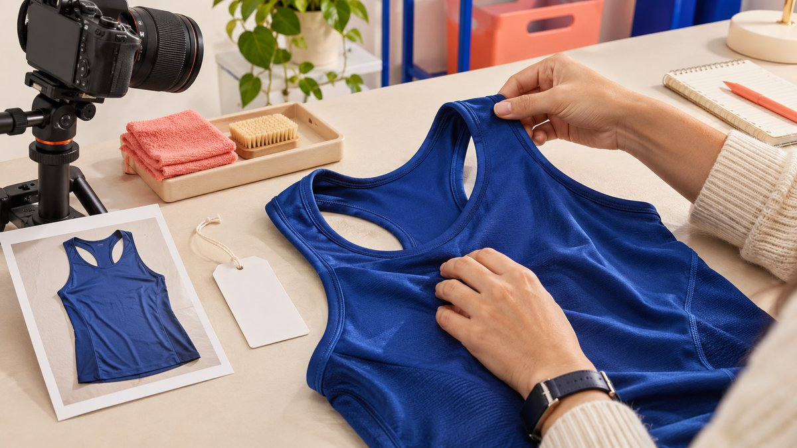

# 运动服品牌怎样交接达人拍摄样品

状态：本地审阅稿；正式发布日期待确认。

为运动服达人拍摄建立样品身份、到件检查、护理信息与归还安排，避免把试穿样、拍摄样和实际在售版本混在一起。

运动服品牌安排达人拍摄时，应把样品当作有身份和状态的制作物品管理。确认具体款式、尺码、颜色与版本，提供适用的护理和产品资料，并约定谁接收、何时使用、是否需要替换以及怎样归还。试穿合适不代表样品可以直接用于所有镜头；运输褶皱、清洗变化或不同批次都可能影响展示。对于 exercise clothing brands，样品交接的目的，是让达人准确呈现实际合作产品，并让品牌知道成片使用了哪一件衣服。

## 先区分试穿样与拍摄样

试穿样帮助确认款式与任务是否适合，拍摄样则需要能够支持约定镜头。两者可以是同一件，但品牌不能不经检查就默认状态一致。此前已经穿着、洗护或转交过的样品，应保留相关信息。

[运动服达人试穿指南](https://www.quickkol.com/zh/blog/gym-clothing-brands-kol-fit-test/#answer)讨论适合什么动作与表达；本篇关注衣物从品牌到制作现场的交接。品牌先说明样品要支持产品细节、造型搭配还是日常使用叙事，才能决定需要几件、哪种状态和谁保管。

如果任务要求显示整套搭配，不能只寄主要上衣，再让达人临时猜其他服装。反过来，单独寄了一套衣服，也不代表品牌已经采购每件的推荐或账号发布。把物品交付与商业任务分别写清。

## 为每件样品保留可识别记录

样品记录可以使用品牌已有款式编码，再补充颜色、尺码、版本和对应任务。没有必要把达人的个人资料放进公开文件；衣物身份与收件安排按实际需要分别保存。

[FTC 的纺织品标签指南](https://www.ftc.gov/business-guidance/resources/threading-your-way-through-labeling-requirements-under-textile-wool-acts)在美国场景下说明多数适用产品的纤维、产地与负责企业等标签信息。这提醒团队保留真正的产品资料，不用造型师写的简称或一张颜色照片替代材质说明。

本地拍摄清单不取代适用标签要求。若样品缺少正式信息，品牌提供可核对版本；达人不应凭触感写成分，也不能把拍摄前的临时标签解释成全世界通用的合规证明。真正需要确认的，是这件衣服与品牌所述产品是否对应。

## 检查影响内容的到件状态

到件时先核对是否收齐、是否对应版本，以及明显的破损、污渍或包装变化。记录应客观，例如某处有折痕，而不是未经核查判断是谁造成。需要处理的状态交给明确负责人。

检查与镜头有关，不要求对收件人做无关的身体评价。样品与任务不适合时，讨论更换尺码、调整表达或另选衣物；不要要求达人用不舒服的方式完成承诺。

例如，两件同色上衣可能分别用于试穿与最终镜头。接收人发现包装次序改变时，先按款式和版本记录核对，而不是凭摆放位置判断。这个简单核对能避免下一位造型师把已经使用过的样品当作未使用的拍摄备份。

必要时拍一张只包含衣物的状态照片，供后续沟通。不要为了证明送达而公开住址、面单或私人环境。照片能帮助双方理解具体问题，但不能单独证明整件衣物的所有性能，也不应成为要求达人重复过度测试的理由。

## 把护理信息交到实际操作的人手里

[FTC 的服装护理标签指南](https://www.ftc.gov/business-guidance/resources/clothes-captioning-complying-care-labeling-rule)在美国适用范围内强调制造商和进口商护理说明需要合理依据。品牌应提供该样品实际适用的信息，而不是让达人凭惯例推断如何清洁、熨烫或干燥。

拍摄前可能需要处理运输褶皱，但不宜因为赶进度就使用未经确认的方法。操作人、护理信息与处理后状态，都可以纳入简短交接；不需要把普通制作记录写成实验室检测报告。

配图展示检查衣物与标签的动作。它说明资料与实物要在同一工作流程里，不证明某种洗护效果。若清洗后与原来有变化，先记录并询问品牌，再决定是否适合继续拍摄或需要新样品。

让实物、版本与护理资料一起进入拍摄准备。

## 替换样品要回到产品与镜头

不同颜色或批次的衣服看起来接近，也不一定适合直接替换。确认外观细节、尺码与任务是否仍对应，尤其是已经完成部分镜头时。品牌应明确哪些差异需要重新审阅。

不要让达人为了避免延期而自己购买“差不多”的替代物，再把它描述为原合作款。即便同品牌也可能是不同产品。替换导致新的准备或拍摄，要明确工作安排，而不是隐去变化。

假设开箱镜头用了蓝色上衣，随后演示却换成近似的另一款，剪辑连续并不代表产品事实连续。团队应确认能否重拍、说明版本或改变镜头组合。本例展示版本问题，不是任何品牌真实产品差异。

## 赠送、借用与发布义务分开

样品需要归还还是可以保留，应明确约定。物品送达不自动证明达人已经接受发布任务；借用也不表示可以把收到物品描述为自己购买。物品关系与工作范围都需要准确。

[FTC 的达人披露指南](https://www.ftc.gov/business-guidance/resources/disclosures-101-social-media-influencers)针对美国商业关系说明，赠品等联系可能需要向观众清晰披露。品牌与达人应检查实际关系及适用要求，不因为没有现金报酬就忽略观众理解。

把拍摄用途、保留或归还与需要交付的内容分别记录。这样后续有人问样品在哪里，团队能回答物品状态；有人问合作是否完成，也能回到约定工作，而不会用“已经寄了衣服”代替双方真正确认过的事情。

## 多人制作时怎样交接样品

样品可能由品牌、制片、造型师与达人接力使用。每次转交只要记录谁接收、什么物品、当前状态与下一步；避免重复填写大量无助于制作的字段。

若需要跨地点使用，提前确认包装、运输时间和接收人。一个人已经完成拍摄，不代表物品可立刻送去下一个项目，可能还需要护理、检查或按原约定归还。

共享记录不应让所有人看到私人收件信息。对负责衣物的人提供必要安排，对负责剪辑的人提供版本与镜头对应即可。把职责和资料范围匹配，能让工作顺畅，也减少与合作无关的信息在多人之间流转。

## 归还与结束也需要确认

结束前核对哪些物品应归还、怎样包装、由谁安排运输，以及什么状态算交接完成。具体条件按真实约定，不在这里替任何品牌设统一赔偿或收费规则。

归还时记录看得到的状态与随附配件。发现问题应描述事实，再由相关负责人了解经过，不仅凭一张照片对个人作指责。制作结束与样品交接结束可以有不同日期。

最终保留能解释成片的产品记录，不必永远保存所有临时物流资料。若品牌未来要复用素材，可以知道当时拍的是哪一版、哪些条件仍适用；不因为实物已经归还就失去对内容的理解。

## 让下一次寄样更容易执行

复盘关注具体环节：哪项资料缺失、哪个状态影响镜头、替换是否及时。[运动服动作证据指南](https://www.quickkol.com/zh/blog/activewear-apparel-brands-movement-evidence/#answer)帮助把服装展示与实际动作连接，而样品流程负责把对应实物送到位。

如果多位达人反复遇到同一问题，先检查品牌交接资料，不直接推断每个人都未按要求处理。改善可以是一张明确款式照片、一次更早的到件确认或更清楚的护理说明。

Exercise clothing brands 的达人合作可以从一件管理清楚的样品开始。品牌知道寄了什么，达人知道要展示什么，制作团队知道如何继续，内容就更有基础保持准确。

## 样品交接的关键状态

| 阶段 | 确认内容 | 下一步 |
| --- | --- | --- |
| 寄出 | 款式、尺码、版本与用途 | 让接收人知道预期物品 |
| 到件 | 收齐与可见状态 | 处理差异后再安排镜头 |
| 拍摄 | 实际使用版本与护理 | 记录替换和镜头关系 |
| 结束 | 保留或归还条件 | 关闭物流任务并保留产品依据 |

编辑制作框架，不是服装性能检测或针对某项合作的法律结论。

## 寄样前的简短清单

让下一位负责人能继续处理实物。

- [ ] 区分试穿、拍摄与在售版本。
- [ ] 记录款式、颜色、尺码与状态。
- [ ] 提供适用产品与护理信息。
- [ ] 约定替换、运输与回应责任。
- [ ] 把赠送或借用与工作范围分开。
- [ ] 结束后保留成片需要的产品依据。

## 研究日期与使用边界

资料核验于 2026 年 11 月 17 日。文中方法、表格和决策规则为编辑建议，标为假设的示例不是实际客户结果或行业基准。外部资料的适用地区与时期按各段说明。

## 从任务开始达人研究

用 QuickKOL 理解 Brief、发现相关达人并研究作品与联系路径；数据、合作条件和结果仍需核验。

[了解 QuickKOL](https://www.quickkol.com/#capabilities)

## 来源

- [FTC 的纺织品标签指南](https://www.ftc.gov/business-guidance/resources/threading-your-way-through-labeling-requirements-under-textile-wool-acts)
- [FTC 的服装护理标签指南](https://www.ftc.gov/business-guidance/resources/clothes-captioning-complying-care-labeling-rule)
- [FTC 的达人披露指南](https://www.ftc.gov/business-guidance/resources/disclosures-101-social-media-influencers)
