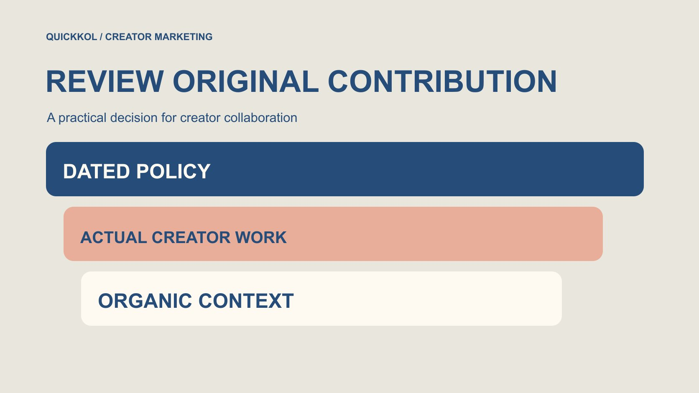
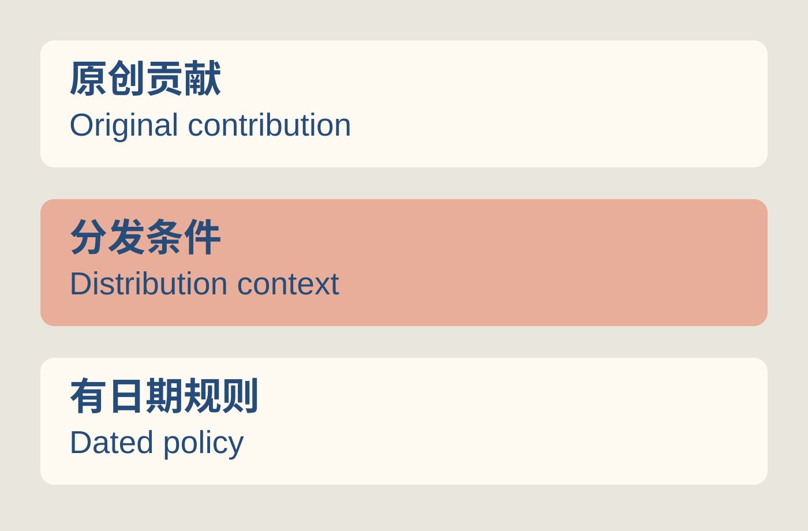

# Facebook Algorithm 2025: Learn From Original Creator Content

Status: local review draft; confirm the publication date before release.

Review 2025 Facebook creator work through dated announcements: relevant descriptions, original contribution and useful stories give brands a practical basis for execution.

QuickKOL editorial graphic; not actual account metrics or a platform interface.

For facebook algorithm 2025 best practices for organic development, begin with official material actually published in 2025. Meta’s anti-spam and originality announcements addressed unrelated descriptions, flooding and low-value repetition while supporting creators’ own work and substantive contributions. Brands can improve creator briefs, material handling and responses accordingly, without turning those directions into guaranteed organic reach. Identify 2026 clarifications as later guidance rather than retroactively presenting them as rules already announced in 2025.

## Establish the period being reviewed

The keyword explicitly names 2025, so distinguish that year's announcements, later revisions and current execution. An easier-to-find 2026 article should not become evidence that its precise wording was announced a year earlier.

Record publication and update dates and identify the claim each supports. A planned rollout is not identical access for every account on announcement day, and a platform-wide summary is not a test result for this brand.

A review can learn from later material while identifying it separately. Establish what could be known at the time before planning the next collaboration. This makes historical conclusions and current recommendations assessable. A useful review note may identify a 2025 production decision, the guidance available then and a later clarification that now warrants a different brief, without declaring the original team ignored a rule that had not yet been published.

## Make the description and image concern the same subject

[Meta’s 2025 anti-spam announcement](https://about.fb.com/news/2025/04/cracking-down-spammy-content-facebook/) discusses long distracting descriptions, excessive hashtags and descriptions completely unrelated to the content. It does not mean every long description violates a rule or supply one character threshold for every assignment.

For a partnership, make the description explain the product, action and conditions shown. A floral demonstration should lead to relevant information rather than unrelated material inserted to borrow another topic's visibility.

Ask whether someone seeing only the image and someone reading only the description would understand the same task. If not, repair the connection before discussing keywords and typography. Relevance makes content useful without promising an algorithmic reward. It also helps the brand retain essential conditions when adapting a creator's spoken explanation into a shorter description, rather than replace useful context with a block of generic promotional language.

## Assess originality through the actual contribution

[Meta’s 2025 originality announcement](https://about.fb.com/br/news/2025/07/combatendo-conteudo-nao-original-para-proteger-e-elevar-criadores-no-facebook/amp/), published on its official Portuguese-language site, addresses repeated improper reuse of others' videos, images or text and discusses original production and meaningful improvements. A watermark or clip assembly alone should not become a brand's definition of a new contribution.

A creator assignment may involve filming, experience, analysis or a valuable reorganization of explanation. Define the contribution before treating a change to brand colors as complete creative work.

This is context from 2025, not a judgment about enforcement on an individual account. Sources and production records help a team understand contribution without guaranteeing the platform's decision. A reviewer can ask what the viewer learns from the commissioned version that the borrowed material alone did not communicate, giving the creator a concrete creative question instead of a vague instruction to make a repost look original.

## Separate permission from creative value

Permission addresses an agreed use without proving the new work adds substantive creative value. Conversely, adding narration does not automatically resolve every right associated with third-party material.

The [U.S. Copyright Office’s copyright overview](https://www.copyright.gov/what-is-copyright/) explains protection for original photographs and videos. A brand needs the actual source, allowed uses and editing scope rather than equate public visibility with download permission.

The brief should distinguish brand-supplied material, creator-produced work and external material awaiting confirmation. Review can then examine facts, rights and contribution together instead of allowing one approval to stand for every decision. This matters when a producer proposes adapting an existing demonstration: the team may have permission for a specific file while still needing a new explanation, another shot or a different use agreement for the planned version.

Read guidance by announcement date, then define the actual creative contribution.

## Give the creator story a viewer question to complete

Original content need not become impractically elaborate. A creator demonstrating wrapping can begin with the step viewers need to understand, retain the relevant conditions and explain the result without editing away what makes the conclusion supportable.

Let the creator propose an appropriate story while the brand checks facts. A slogan can appear in a brief without replacing observation and explanation; a brand should not ask someone to pretend to have experience it has not enabled.

Before filming, identify an achievable ending: does the viewer understand an action, difference or next step? A complete explanation is easier to review accurately than fragments produced only to increase output counts. This does not establish a preferred platform duration; it gives production a clear task and allows the team to judge whether a proposed shortening preserves the meaning of the actual demonstration.

## Organic distribution does not guarantee one sequence

[Meta’s 2023 ranking explanation](https://about.fb.com/news/2023/06/how-ai-ranks-content-on-facebook-and-instagram/) describes multiple predictions and personalization. It is historical context, not a precise table of weights for 2025 or today, and does not support fixed points for a particular action.

A creator series can have complementary parts without assuming everyone sees the first item first. Retain necessary product conditions and relationship context in the item that needs them rather than place all prerequisites elsewhere.

Review each planned release as something encountered on its own. Series organization helps further exploration but an earlier post does not repair a misleading current item. This is especially important when a creator supplies a short excerpt from a longer demonstration: the excerpt needs enough context to support its own claim, even when the complete original remains available through another route.

## Give repeated distribution an actual purpose

A brand may want several Pages to share a partnership, but repetition count is not independent value. Establish account roles, regional conditions and response capacity rather than create indistinguishable versions to fill a calendar.

The 2025 anti-spam announcement addresses flooding and manipulation; it should not become a claim that every ordinary share by a brand is prohibited. Preserve the behavior and context instead of reducing everything to repetition causes reduced reach.

The [multi-account version-management guide](https://www.quickkol.com/blog/multiple-social-accounts-creator-version-control/#answer) helps synchronize facts while retaining platform differences. Each version needs a reason to exist. Cancel unnecessary copies and direct effort toward missing explanation and actual response. This improves the assignment's clarity without presenting an internal efficiency decision as a proven way to increase distribution or implying that a specific number of shared posts automatically determines enforcement.

## Prepare actual responses to engagement

Organic development involves more than publishing and waiting for numbers. When creator work raises questions, prepare accurate information and a receiving owner, particularly for product conditions, orders and service, instead of shifting every follow-up task to the creator.

Responses should address the question without unrelated conversation added only to lengthen a thread, or every disagreement being labeled malicious. Creators explain experience while brands handle the facts and business matters they own.

The [Facebook brand-service workflow](https://www.quickkol.com/blog/facebook-marketing-page-service-workflow/#answer) helps assign receiving responsibilities. Observe recurring questions before commissioning supplementary content or changing information. More comments do not automatically mean more genuine customers, and conversation cannot replace missing purchase evidence. This gives a future brief a useful input: the specific explanation people still needed, with a responsible source able to confirm the answer before another creator is asked to communicate it.

## Read 2026 guidance as a later clarification

[Meta’s 2026 originality update](https://about.fb.com/news/2026/03/rewarding-original-creators-on-facebook/amp/) provides more specific descriptions of original work and low-value changes. It is identified here as later material, not proof that every detail already existed in the same form during 2025.

For a new partnership today, check currently applicable material and actual account conditions. For a historical review, retain the basis available then. The brand need not rewrite the past as if later information had always been known.

Platform-wide changes also cannot become this brand's results. Record the commissioned work and actual observations to decide what needs improvement; announcements provide context while project evidence supports project conclusions. A review can therefore recommend a new check for the next assignment while accurately describing what the earlier campaign did, instead of merging historical guidance, later outcomes and a planned future change into one unsupported causal narrative.

## Turn the review into the next creator brief

Suppose a brand previously asked a creator only to add a logo to an old clip and republish it. After review, the next brief commissions an actual demonstration of one step, supported by brand-confirmed conditions and owned question handling.

The team checks whether the explanation is complete, material use is defined and the receiving route works before comparing scoped observations. This hypothetical guarantees no exposure, monetization or sales and does not establish causation from one change.

Facebook algorithm 2025 best practices for organic development can support dated, task-specific learning rather than an unsourced list of tricks. The useful output is a concrete improvement to the next creator assignment. Identify the changed task, the evidence to observe and the remaining uncertainty so the review can guide work without becoming a retrospective promise that the next campaign must achieve a particular distribution result.

## Separate three kinds of review comments

Record factual errors, creative suggestions and new uses separately. An incorrect dimension needs correction; another demonstration angle may need filming; moving from organic publication to advertising needs use-scope review. Calling all three ordinary edits hides different work.

The owner can assign factual confirmation, production and commercial discussion accordingly. Preserve the reason and target version for each comment so the creator knows what to do and the brand knows which change awaits another team's input. A dated review becomes useful when it produces a specific, owned next action rather than only a general instruction to improve originality.

## Apply the dated material to a partnership

| Material | Supported check | Does not support |
| --- | --- | --- |
| 2025 anti-spam announcement | Relevant descriptions; avoid manipulation and flooding | A universal character or reach formula |
| 2025 originality announcement | Own production and meaningful improvement | A logo establishing originality |
| 2023 ranking context | Caution about assumed viewing order | Exact current weights |
| 2026 later update | Review current material for a new task | Backdating it as a 2025 rule |

Editorial application guidance, not an enforcement judgment or organic-reach guarantee.

## Review a 2025 creator partnership

Retain the year, contribution and actual observations.

- [ ] Identify announcement and later update dates.
- [ ] Check image-description relevance.
- [ ] Define the creator contribution.
- [ ] Review material use separately.
- [ ] Assign a brand question owner.
- [ ] Use project evidence for project results.

## Research date and limitations

Sources reviewed November 17, 2026. Methods, tables and decision rules are editorial recommendations. Hypothetical examples are not actual client results or industry benchmarks. Source geography and periods are specified where relevant.

## Start creator research with a clear task

Use QuickKOL to interpret a brief, discover relevant creators and research their work and contact routes. Verify data, commercial terms and outcomes at their source.

[Explore QuickKOL](https://www.quickkol.com/#capabilities)

## Sources

- [Meta’s 2025 anti-spam announcement](https://about.fb.com/news/2025/04/cracking-down-spammy-content-facebook/)
- [Meta: protecting original creators in 2025](https://about.fb.com/br/news/2025/07/combatendo-conteudo-nao-original-para-proteger-e-elevar-criadores-no-facebook/amp/)
- [the U.S. Copyright Office’s copyright overview](https://www.copyright.gov/what-is-copyright/)
- [Meta’s 2023 ranking explanation](https://about.fb.com/news/2023/06/how-ai-ranks-content-on-facebook-and-instagram/)
- [Meta’s 2026 originality update](https://about.fb.com/news/2026/03/rewarding-original-creators-on-facebook/amp/)
