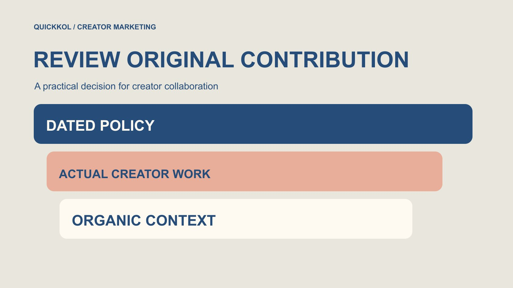
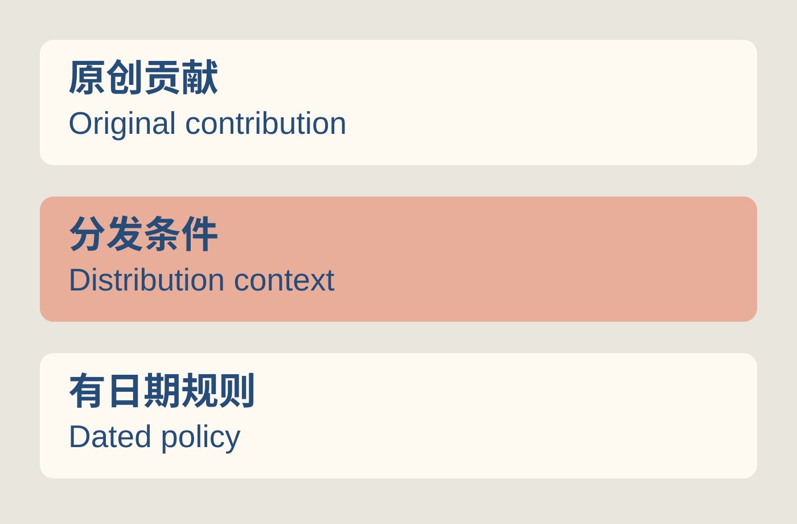

# 2025 Facebook 原创内容怎样复盘

状态：本地审阅稿；正式发布日期待确认。

按真实公告日期复盘 2025 Facebook 达人内容：相关说明、原创贡献与有用叙事，比追逐没有出处的排序配方更适合品牌执行。

QuickKOL 编辑图形；不呈现真实账号指标或平台界面。

复盘 facebook algorithm 2025 best practices for organic development，应先使用真正发表于 2025 年的官方资料。Meta 当年的反垃圾和原创内容公告强调减少无关说明、刷屏与低价值重复，支持创作者自己的作品与实质贡献。品牌可以据此改进达人 Brief、素材处理和后续回应，但不能把这些方向写成保证自然曝光的公式。2026 年的新定义要标明年份，不能倒填成 2025 年已经存在的规则。

## 先确定复盘的是哪一年的规则

关键词明确写 2025，文章就需要区分当年公告、后续更新与今天的执行。不要因为 2026 资料更容易找到，就把其中具体措辞写成 2025 已经发布。

记录发布日期和页面更新日，并说明本段用它支持什么。公告说未来上线，不等于宣布当天所有账号已经相同；平台总结也不等于本品牌测试结果。

品牌复盘可以同时学习后续资料，但需要分别标明。先理解当时能知道什么，再判断下次合作怎样安排，才能让历史结论和当前建议都保持准确。

## 说明与画面讲同一件事

[Meta 的 2025 年反垃圾内容公告](https://about.fb.com/news/2025/04/cracking-down-spammy-content-facebook/)讨论冗长分散注意的说明、过多标签与完全无关的说明。这不等于每一条长说明都会违规，也没有给品牌一个适用于所有项目的字符阈值。

达人合作的实际做法，是让说明解释画面中的产品、动作与条件。观众看见花艺演示，就应找到与演示有关的说明，而不是为蹭无关话题添加另一套内容。

审稿时问一句：只看画面和只看说明，是否仍然理解为同一任务？若不是，先修正关联，再讨论关键词和排版。相关性让内容有用，不承诺算法奖励。

## 原创先从实际贡献判断

[Meta 的 2025 年原创内容公告](https://about.fb.com/br/news/2025/07/combatendo-conteudo-nao-original-para-proteger-e-elevar-criadores-no-facebook/amp/)在葡萄牙语官方页面说明，重复不当使用别人的视频、照片或文字会受到处理，也提到原创拍摄与有实质意义的改进。只加水印或拼接片段，不应被品牌当成足够的新贡献。

达人任务可以是自己拍摄、说明经验、提供分析或重新组织有价值的解释。先明确贡献是什么，而不是把“换成我方配色”当成完整创作。

这段是 2025 年资料背景，不是对具体账号处罚的判断。原始来源与实际制作记录能帮助团队理解贡献，但不能保证平台对每条内容的最终处理。

## 把素材许可与内容价值分开

获得素材使用许可，解决的是相应用途安排，不自动证明新内容有实质贡献。反过来，增加解说也不自动解决第三方素材的所有权利问题。

[美国版权局的版权说明](https://www.copyright.gov/what-is-copyright/)说明原创照片与视频等作品受到版权保护。品牌需要核对具体来源、允许用途与修改范围，而不是把公开可见当成下载许可。

达人收到的 Brief 应区分品牌可提供的素材、需要本人制作的部分与待确认的外部内容。这样审稿能够同时检查事实、权利和贡献，不让其中一项批准代替其他判断。

按公告日期阅读，再把原创贡献落实到具体任务。

## 让达人叙事完成一个观众问题

原创内容不必复杂到无法执行。一位达人展示包装动作，可以从观众需要看清的步骤开始，保留关键条件，再解释结果，不需要为了节奏删去让结论成立的部分。

让创作者提出适合自己表达的叙事，再由品牌核对事实。统一口号可以放进 Brief，但不应代替实际观察和说明；品牌提供不了的体验，不能要求达人假装已经获得。

拍摄前看故事有没有可完成的结束：观众是否理解动作、差异或下一步？一个完整解释比为了追求发布数量而拆成许多缺少语境的片段，更容易被准确审阅。

## 自然分发不保证统一观看顺序

[Meta 的 2023 年排序说明](https://about.fb.com/news/2023/06/how-ai-ranks-content-on-facebook-and-instagram/)介绍多种预测与个性化，是理解背景的历史资料，不是 2025 或今天的精确权重表。品牌不能据此推导固定加分动作。

达人系列可以互相补充，但不能假设每位观众都先看第一条。关键产品条件与关系说明，应出现在需要的内容中，不把理解前提完全放在另一条帖子。

设计发布计划时，逐条检查独立遇见是否仍准确。系列组织有助于继续了解，但不能用“上一条已经说过”解释当前一条容易造成的误解。

## 重复分发要有真实用途

品牌可能希望多页面分享同一合作，但重复数量不是独立价值。先确认各账号的实际角色、地区条件与接收能力，不为填满日历创建许多无区别版本。

2025 反垃圾公告针对刷屏与操纵行为，不能由此断言品牌自己的正常分享一律不允许。判断应保留具体行为与语境，而不是用一句“重复会限流”概括所有情况。

[多账号版本管理指南](https://www.quickkol.com/zh/blog/multiple-social-accounts-creator-version-control/#answer)帮助同步共同事实并保留平台差异。每个版本都应能说明为什么存在；不需要的复制可以取消，让团队把资源用在补充解释和实际回应上。

## 给互动准备真实回应

自然发展不只是发布后等待数字。达人内容提出问题后，品牌应准备准确资料和接收人，尤其是产品条件、订单与服务问题，不把所有后续工作推给达人。

回应应针对问题，不用无关话题拉长评论，也不把不同意见一概解释为恶意。达人可以说明自己的体验，品牌处理它负责的事实与业务。

[Facebook 品牌服务工作流](https://www.quickkol.com/zh/blog/facebook-marketing-page-service-workflow/#answer)可以帮助安排接收责任。观察哪些问题反复出现，再决定补充内容或修订资料。如果只是评论多，不能自动写成更多真实顾客；如果没有销售数据，也不能用对话热度补上购买结论。

## 2026 更新作为后续资料阅读

[Meta 的 2026 年原创内容更新](https://about.fb.com/news/2026/03/rewarding-original-creators-on-facebook/amp/)给出更具体的原创和低价值改动说明。本篇把它标为后续资料，不能用它证明 2025 每条规则已经以同样形式存在。

如果今天准备新的合作，应核对当前适用资料与账号实际状态；如果复盘过去，就保留当时依据。品牌无需把历史报告改成假装早已知道后续信息的故事。

平台公布的整体变化也不能移用为本品牌效果。记录本次作品与实际观察，才能判断什么需要改进；公告提供背景，项目证据支持项目结论。

## 把历史建议转成下一次 Brief

假设品牌过去只让达人把旧片加上标志再发布。复盘后，下一次 Brief 改为由达人实际演示一个步骤，品牌提供条件与资料，并安排具体问题回应。

团队先检查内容是否完成解释、素材用途是否明确和接收路径是否可用，再比较相同范围下的实际观察。这个假设没有保证曝光、变现或销售，也不把一次变化当成已证明因果。

Facebook algorithm 2025 best practices for organic development 可以形成有日期、有任务的学习，而不是一串没有来源的技巧。最有用的产出，是下一次达人合作具体要做得更好的那一项工作。

## 审阅时把三种意见分开

事实错误、创意建议与新增用途应分别记录。尺寸说错需要准确更正；希望增加一个演示角度可能需要补拍；希望从自然发布改为广告则需要重新核对使用范围。不要把它们都称为普通修改。

负责人可以据此安排事实确认、制作和商业讨论。每条意见保留原因与目标版本，达人才能判断要做什么，也让品牌知道哪个变化仍在等待其他团队输入。

## 2025 资料怎样用于合作

| 资料 | 支持的检查 | 不支持 |
| --- | --- | --- |
| 2025 反垃圾公告 | 说明相关，避免操纵与刷屏 | 统一字符或曝光公式 |
| 2025 原创公告 | 自己制作与实质改进 | 加标志即完成原创 |
| 2023 排序背景 | 谨慎假设观看顺序 | 当前精确权重 |
| 2026 后续更新 | 为新任务核对当前资料 | 倒填为 2025 规则 |

编辑应用建议，不是平台处罚判断或自然触达保证。

## 复盘一项 2025 达人合作

保留年份、贡献和实际观察。

- [ ] 标明公告与后续更新日期。
- [ ] 检查说明与画面是否相关。
- [ ] 说清达人增加的贡献。
- [ ] 分别核对素材用途。
- [ ] 安排品牌问题接收人。
- [ ] 只用项目证据说明项目结果。

## 研究日期与使用边界

资料核验于 2026 年 11 月 17 日。文中方法、表格和决策规则为编辑建议，标为假设的示例不是实际客户结果或行业基准。外部资料的适用地区与时期按各段说明。

## 从任务开始达人研究

用 QuickKOL 理解 Brief、发现相关达人并研究作品与联系路径；数据、合作条件和结果仍需核验。

[了解 QuickKOL](https://www.quickkol.com/#capabilities)

## 来源

- [Meta 的 2025 年反垃圾内容公告](https://about.fb.com/news/2025/04/cracking-down-spammy-content-facebook/)
- [Meta：2025 年保护原创创作者](https://about.fb.com/br/news/2025/07/combatendo-conteudo-nao-original-para-proteger-e-elevar-criadores-no-facebook/amp/)
- [美国版权局的版权说明](https://www.copyright.gov/what-is-copyright/)
- [Meta 的 2023 年排序说明](https://about.fb.com/news/2023/06/how-ai-ranks-content-on-facebook-and-instagram/)
- [Meta 的 2026 年原创内容更新](https://about.fb.com/news/2026/03/rewarding-original-creators-on-facebook/amp/)
