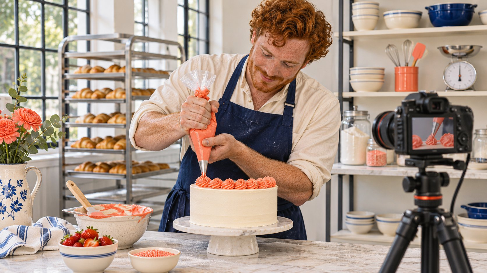
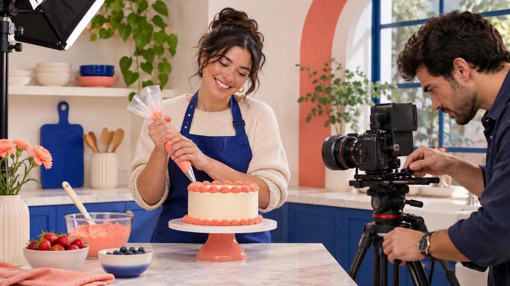

# Famous Bakers: Research a Product Demonstration Partner

Status: local review draft; confirm the publication date before release.

Start with official work from Cupcake Jemma, John Kanell and Nadiya Hussain to research baking-creator demonstration roles without treating fame as availability, audience or performance evidence.

Brands researching famous bakers can start with official work from Cupcake Jemma, Preppy Kitchen founder John Kanell and Nadiya Hussain. Their work offers different leads for demonstration, explanation and storytelling, not a universal ranking or evidence of availability, agreement or audience percentages. Begin with the baking action the assignment needs and relevant work, then confirm product, production conditions, use scope and a public business inquiry. This article provides no recipe instructions, unverified availability or quoted fees.

## Turn a name list into a collaboration question

A brand may need a clear utensil action, an explanation of operating conditions or a complete story. Define that contribution before deciding which work from a known baking creator deserves research.

The [food-creator partnership guide](https://www.quickkol.com/blog/food-bloggers-brand-partnerships/#answer) supplies related assignment context. This article focuses on baking-demonstration roles rather than rank everyone by follower size or infer social-production capability from one television appearance.

A candidate record should identify work, relevant action, supporting evidence and open questions. The name list is a starting point; the value lies in explaining why the brand wants to discuss a specific assignment with this person. That explanation also helps avoid an invitation centered only on fame, giving the creator a meaningful creative problem to assess instead of an undefined request to lend their reputation to a product.

## Cupcake Jemma: inspect the demonstration material

[Cupcake Jemma’s official work page](https://cupcakejemma.com/) presents baking videos, technique resources and recipes, offering an entry point for studying demonstration. Continue to the work relevant to the task rather than treat homepage categories as proof of familiarity with every utensil.

For a decorating assignment, examine camera clarity, explanation and retained conditions. That research direction comes from the task; this article has not confirmed the creator can film this assignment.

Official material supports identity and work leads without establishing present availability, fees or audience geography. Describe the requirement and let the creator or team confirm the next step. A brand can keep a specific observation about a useful visual approach while leaving capability with its particular product open, avoiding an unsupported leap from an existing tutorial to a promised performance with different equipment or ingredients.

## John Kanell: research explanatory teaching

[John Kanell’s official biography](https://preppykitchen.com/about-us/meet-the-team/meet-john/) identifies him as Preppy Kitchen's founder and explains how teaching and recipe development shape his work. A brand can research how an action connects with a reason rather than examine the finished-food photograph alone.

If an equipment assignment needs an observed difference explained, inspect how relevant work establishes conditions. A teaching background does not prove every brand claim or justify asking a creator to supply unsupported product-performance conclusions.

This article verifies no availability or quote and does not use a changeable combined follower total as the selection basis. Relevant work and the proposed assignment remain the next step. The research can identify an explanatory approach worth discussing while leaving room for the creator to assess the actual product, necessary preparation and limits of what one demonstration could establish.

## Nadiya Hussain: research storytelling and content roles

[Nadiya Hussain’s official biography](https://www.nadiyahussain.com/about-me/) records her 2015 Great British Bake Off win and work involving baking, books and television. That supports work research, not confirmation of this commercial assignment.

A brand can inspect relevant storytelling, on-camera presence and explanation. For content involving a home-baking setting, study public work rather than infer every viewer's interests or purchasing ability from the person's identity.

Books, television and social work have different rights and production conditions. Selecting a work reference does not permit direct copying of its images, recipe expression or program clips. Confirm the actual use separately. A useful approach identifies the proposed storytelling role and the product information the brand can provide, giving the creator's team a concrete inquiry rather than an assumption that a known public figure can accept any format on the same terms.

## Three leads are not a universal ranking

The three official sources provide different work entry points rather than a standardized capability test. Shorter videos or published books do not produce one common ranking of partnership value.

Compare work relevant to the same task, such as demonstrations requiring a visible operation, while retaining contextual differences. Views, television recognition and actual production arrangements should not be collapsed into one score.

If a brand needs local execution, a language or experience with particular equipment, confirm it separately. Continue research if none fits instead of choosing the most recognizable name by default. A shortlist can be useful with unresolved questions provided they are explicit, while a confident ranking based on unlike evidence can hide the very production requirement that determines whether the collaboration can be completed.

## Write the brief around the action viewers need to see

Explain which equipment action must be visible, the conditions in which the product appears and where viewers can learn more. A finished-food reference alone should not leave the creator inventing all supporting facts.

Separate action from claim. A shot can show mixing or decorating without establishing universal durability, suitability for every ingredient or superiority to every competitor. The brand needs support for conclusions requiring evidence.

Let the creator propose an expression grounded in experience. This article concerns commissioned content, not baking recipes or operating instructions; the actual work needs appropriate professional judgment and preparation. A clear brief gives creative freedom within known facts, allowing the creator to explain what the proposed demonstration can honestly show rather than treating an attractive final image as proof of every performance statement.

## Prepare ingredients, equipment and the setting

Preparing baking content involves more than shipping one product. Equipment version, necessary accessories, setting and brand information affect readiness; ingredient-related information needs accuracy where relevant.

Define who supplies what instead of silently assigning every last-minute purchase and delay to the creator. A real demonstration needs preparation time, and edited running time does not measure production effort.

If the product or setting changes, discuss whether the content needs adaptation. Retain version decisions when combining old footage with a new product rather than imply a continuous demonstration that never occurred. This gives the producer a concrete readiness check and lets the brand decide whether to wait, change the assignment or supply missing inputs before asking the creator to commit to a filming date dependent on unavailable material.

## Make the shot clear without changing its meaning

The photograph places a camera near a specific decorating action without depicting a named creator as having joined this assignment. A real production needs confirmed people and work.

Detail shots can clarify hands and equipment while editing retains important conditions rather than make a product appear to need no preparation. The creator reviews expression and the brand checks product facts as separate responsibilities.

If an action cannot be shown clearly under the agreed conditions, discuss another filming approach or scope instead of using misleading assembly to conceal the limitation. Clarity and accuracy belong together in acceptance. The viewer should be able to understand the relevant action while the team remains able to explain what was actually filmed, which product was used and whether a later edit introduced a different condition.

Use detail shots for the action viewers need to see; confirm the actual partnership separately.

## Separate work references from asset permission

The [U.S. Copyright Office’s copyright overview](https://www.copyright.gov/what-is-copyright/) explains protection for original works including photographs, videos and text. Researching a public tutorial does not permit downloading its shots, images or expression for an advertisement.

If recipes, demonstration scripts, likeness or program material are needed, confirm the relevant rights and scope. A creator appearing in a program does not necessarily have authority to license all program footage personally.

The [creator-material permission guide](https://www.quickkol.com/blog/what-is-whitelisting-creator-ad-permissions/#answer) distinguishes production, creator publication and advertising reuse. A reference supports discussion of an approach while the actual assets still need confirmation; possession of a file is insufficient. Keeping these separate also helps a brand commission a new demonstration inspired by a clear creative task without copying the protected presentation of an existing work.

## Make an inquiry without assuming endorsement

Identify the brand, why the work was relevant, the proposed contribution and practical arrangements. Use a business route made public by the creator or team rather than search for private contact details.

[FTC’s influencer disclosure guide](https://www.ftc.gov/business-guidance/resources/disclosures-101-social-media-influencers) addresses actual experience and material connections in applicable US contexts. Commissioned content needs its real relationship preserved; a brand should not request guarantees of an unexperienced result.

An initial inquiry is not endorsement, and a person's name should not enter a brand case study before agreement. Retain accurate candidate and proposed-task statuses until confirmation. This gives both parties room to decide and helps a producer distinguish a reference image used internally for discussion from a public statement that a particular person represents the brand.

## Compare two hypothetical assignments

Suppose assignment A needs viewers to see a detail on a utensil, while assignment B needs a fuller story explaining a production process. A prioritizes detail demonstrations and B narrative organization; they may examine different work.

The brand takes the requirement to the appropriate team and confirms product, setting and use. Without evidence, it supplies neither audience-country percentages nor guaranteed clicks and sales, and a similar task does not justify copying an earlier agreement unchanged.

This example confirms neither capability nor willingness for the three named people. It shows selection beginning with actual work, with a familiar-name list supporting research instead of replacing judgment. A recommendation should state which observed work justified the next inquiry and which essential conditions still need the person's own confirmation.

## Record delivery separately from performance

Delivery can check a clear action, accurate conditions, consistent information and use, and the published version. Performance requires corresponding observations and business records rather than outcomes inferred from fame.

Brand research on famous bakers should deliver relevant work, a role hypothesis and next action, not names alone. Retain outstanding confirmation as pending rather than present candidates as a signed roster.

When the brand knows the need, the creator can assess contribution and an owner receives product and business questions, the baking topic becomes a real creator-marketing assignment. The next decision can then rest on work and confirmed conditions instead of a general celebrity profile with no connection to what the brand actually needs to commission.

## Three creator research entry points

| Lead | Official work basis | Next research question |
| --- | --- | --- |
| Cupcake Jemma | Baking videos and technique resources | How relevant actions are made visible |
| John Kanell | Preppy Kitchen and explanatory teaching | How actions connect with reasons |
| Nadiya Hussain | Baking, books and television work | Which storytelling role fits the task |

Research leads, not rankings, availability, quotes, audience guarantees or confirmed partnerships.

## When researching a baking creator

Move from work to a defined assignment.

- [ ] Define the action to explain.
- [ ] Inspect relevant official work.
- [ ] Confirm product and production inputs.
- [ ] Retain experience and material conditions.
- [ ] Confirm likeness and asset uses separately.
- [ ] Discuss through a public business route.

## Research date and limitations

Sources reviewed November 17, 2026. Methods, tables and decision rules are editorial recommendations. Hypothetical examples are not actual client results or industry benchmarks. Source geography and periods are specified where relevant.

## Start creator research with a clear task

Use QuickKOL to interpret a brief, discover relevant creators and research their work and contact routes. Verify data, commercial terms and outcomes at their source.

[Explore QuickKOL](https://www.quickkol.com/#capabilities)

## Sources

- [Cupcake Jemma’s official work page](https://cupcakejemma.com/)
- [John Kanell’s official biography](https://preppykitchen.com/about-us/meet-the-team/meet-john/)
- [Nadiya Hussain’s official biography](https://www.nadiyahussain.com/about-me/)
- [the U.S. Copyright Office’s copyright overview](https://www.copyright.gov/what-is-copyright/)
- [FTC’s influencer disclosure guide](https://www.ftc.gov/business-guidance/resources/disclosures-101-social-media-influencers)
