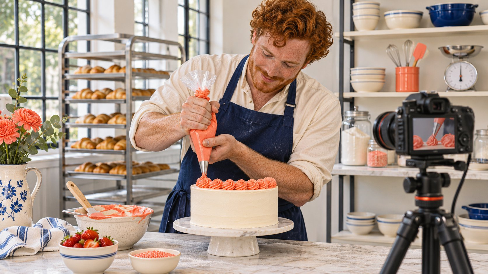
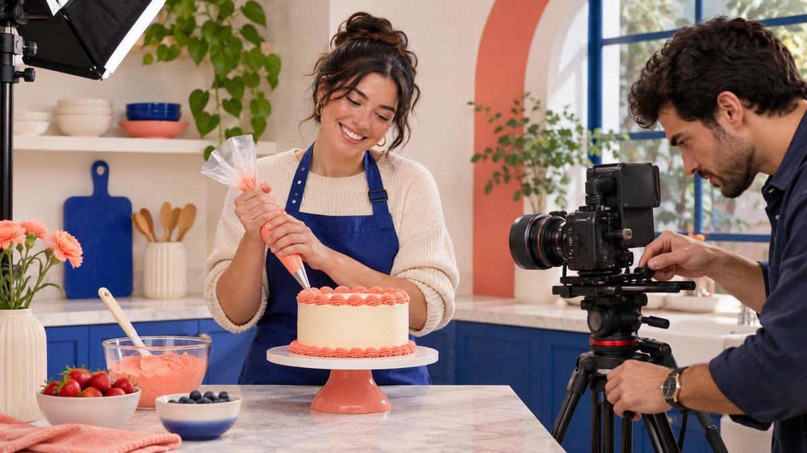

# 知名烘焙达人怎样按任务研究

状态：本地审阅稿；正式发布日期待确认。

从 Cupcake Jemma、John Kanell 与 Nadiya Hussain 的官方作品出发，研究烘焙达人能为品牌完成哪类演示，不把知名度当作档期、受众或效果保证。

品牌搜索 famous bakers，可以先研究 Cupcake Jemma、Preppy Kitchen 创办人 John Kanell 和 Nadiya Hussain 的官方作品。它们提供不同的演示、讲解和叙事线索，不是本文评出的统一名次，也不说明三位已接受合作或具有某种受众比例。选择先看本次需要解释的烘焙动作与实际作品，再确认产品、拍摄条件、使用范围和公开业务接洽。本篇不提供食谱步骤或未经核验的档期与报价。

## 先把知名名单转成合作问题

品牌需要的可能是看清器具动作、理解操作条件或听一个完整故事。先定义这一项贡献，再判断知名烘焙创作者的哪些作品值得研究。

[食品创作者合作指南](https://www.quickkol.com/zh/blog/food-bloggers-brand-partnerships/#answer)提供相关任务背景。本篇聚焦烘焙演示的角色研究，不根据粉丝规模给所有人排相同顺序，也不因一次电视出现就推断社交内容能力。

候选记录应包括作品、相关动作、支持依据和待确认事项。名单只是起点；真正有用的是品牌能够解释为什么希望与这位创作者讨论一项具体任务。

## Cupcake Jemma：查看具体演示材料

[Cupcake Jemma 的官方作品页](https://cupcakejemma.com/)呈现烘焙视频、技巧资源与食谱等内容，可作为研究演示表达的入口。品牌应继续打开与任务有关的实际作品，不把主页分类直接当成对所有器具的熟悉证明。

如果需要展示装饰动作，可以观察镜头是否清楚、语言怎样解释、条件怎样保留。这个研究方向来自任务，不表示本文替创作者确认本次可以拍摄。

官方材料支持身份和作品线索，不支持推断当前档期、合作价格或受众地区。接洽时说明具体需求，由本人或团队确认能否继续。

## John Kanell：研究原理讲解

[John Kanell 的官方介绍](https://preppykitchen.com/about-us/meet-the-team/meet-john/)确认他是 Preppy Kitchen 创办人，并介绍教学与食谱开发如何影响讲解。品牌可以由此研究他怎样连接动作与原因，而不只看成品照片。

例如某项器具合作需要解释观察到的差异，就应查看相关作品怎样交代条件。不能把教学背景直接写成任何品牌主张都能被证明，也不应要求创作者替产品提供未经支持的性能结论。

本文没有核对本次合作档期或报价，也不引用可能变化的跨平台粉丝总数作为选人依据。实际作品与相关任务仍是下一步。

## Nadiya Hussain：研究叙事与内容角色

[Nadiya Hussain 的官方介绍](https://www.nadiyahussain.com/about-me/)记录她获得 2015 年 Great British Bake Off 冠军，并介绍烘焙、图书和电视相关工作。这支持作品研究，不代表本次商业合作已确定。

品牌可以进一步查看与任务有关的叙事、出镜和解释方式。若需要一段与家庭烘焙场景有关的内容，先研究公开作品，而不是从个人身份猜测所有观众的兴趣或购买能力。

书籍、电视和社交作品有不同权利与制作条件。选择具体作品作为参考，不表示品牌可以直接复制其中画面、食谱表达或节目片段。实际用途仍需另行确认。

## 三条线索不构成统一排名

这三位的官方资料呈现不同作品入口，并不是同一口径的能力考试。不能因为一人的视频更短、另一人有图书，就给品牌合作价值排统一高低。

先比较与任务有关的同类作品，例如同样需要看清操作的演示，再保留背景差异。播放、电视知名度与实际制作安排不能混成一个分数。

如果品牌需要当地执行、某种语言或特定器具经验，应另行确认。没有适合线索，就继续研究，而不是强行从知名名单选一个看起来最有名的人。

## 拍摄 Brief 写需要看见的动作

品牌可以说明需要看清哪项器具如何使用、产品在什么条件下出现，以及观众接下来哪里了解更多。不要只给一张完成品照片，再要求创作者自行补出所有事实。

把动作与主张分开。镜头能显示搅拌或装饰，不自动证明普遍耐用、适合所有食材或效果优于全部竞品。需要依据的结论由品牌提供相应资料。

让创作者提出合适表现方法，保留实际经验。本文讨论的是委托内容，不提供烘焙配方或操作建议；具体作品需要相关专业判断与实际准备。

## 为原料、器具与场景准备输入

烘焙内容的准备不只是寄一个产品。实际器具版本、必要配件、拍摄场景和品牌资料会影响工作能否开始；涉及原料时，相关信息需要准确。

品牌应确认由谁准备什么，不把所有临时采购和等待隐含交给创作者。真实演示需要适当时间，不能只按剪辑后片长推算制作工作量。

如果产品或场景变化，先讨论是否需要调整内容。旧画面与新产品混用时，保留版本判断，避免让观众理解成一项实际上没有完成的连续演示。

## 镜头清楚也要保持真实语境

配图展示相机靠近具体装饰动作，而不把某位具名创作者画成已经参与本次合作。正式拍摄需要使用实际确认的人物与作品。

细节镜头可以帮助看清手部和器具，但剪辑不能删掉重要条件，让产品看起来无需原本准备。创作者审阅实际表达，品牌核对产品事实，两者分别完成。

如果某个动作无法在约定条件下清楚展示，就讨论替代拍法或任务范围，不要求通过不真实拼接弥补。清晰与准确需要一起成为验收条件。

细节镜头服务需要看清的动作，正式合作仍需实际确认。

## 作品参考与素材使用分开

[美国版权局的版权说明](https://www.copyright.gov/what-is-copyright/)介绍照片、视频与文字等原创作品保护。研究一个公开教程，不表示品牌可以下载它的镜头、照片或具体表达作为广告。

如果需要配方、演示脚本、人物形象或节目相关素材，核对实际权利和使用范围。不得只因创作者出现在某个节目，就假设其个人能授权节目整段画面。

[达人素材许可指南](https://www.quickkol.com/zh/blog/what-is-whitelisting-creator-ad-permissions/#answer)帮助把制作、本人发布与广告复用分开。参考作品支持讨论方法，实际素材仍需确认，文件存在不能替代授权。

## 邀请说明任务，不假设背书

联系时说明品牌、为何研究这项作品、希望讨论的贡献与实际安排。使用创作者或团队公开业务路径，不需要挖掘私人联系方式。

[FTC 的达人披露指南](https://www.ftc.gov/business-guidance/resources/disclosures-101-social-media-influencers)说明适用美国情境下真实体验和重要商业关系的表达。合作内容需要保留实际关系，品牌不能要求创作者保证未体验的结果。

初步询问不是已经获得背书，也不应在联系前把人名放进品牌合作案例。对方确认之前，使用候选与拟讨论任务等准确状态，给双方留下真实决定空间。

## 用两项不同任务比较选择理由

假设任务甲需要观众看清器具上的一个细节，任务乙希望用较完整叙事解释一次制作过程。甲优先研究细节演示，乙研究叙事组织，两者可能选择不同作品继续了解。

品牌向合适团队提出实际需求，再确认产品、地点与使用安排。没有证据时，不给出受众国家比例或保证点击销售，也不因任务相似就复制之前合同。

这个例子没有为三位创作者确认能力或接单意愿。它说明选择应从真实工作开始，知名名单服务研究，而不是替代具体判断。

## 交付与效果分别记录

交付可以核对动作是否清楚、条件是否准确、资料和用途是否一致，以及实际发布版本。表现则需要对应观察与业务数据，不能从名气直接补出结果。

Famous bakers 的品牌研究应交付相关作品、角色假设与下一步，而不只是名字。没有完成的确认保留待处理，不把候选名单写成已合作阵容。

品牌知道需要什么，创作者能够判断贡献，负责人接住产品与业务问题，烘焙主题才真正进入达人营销工作，而不是脱离网站主旨的普通名人介绍。

## 三位创作者的研究入口

| 线索 | 官方作品依据 | 后续研究问题 |
| --- | --- | --- |
| Cupcake Jemma | 烘焙视频与技巧资源 | 相关动作怎样拍清楚 |
| John Kanell | Preppy Kitchen 与解释型教学 | 怎样连接动作与原因 |
| Nadiya Hussain | 烘焙、图书与电视作品 | 哪类叙事适合本次任务 |

研究线索不是排名、当前档期、报价、受众保证或合作确认。

## 研究烘焙达人时

从作品进入具体任务。

- [ ] 写清需要解释的动作。
- [ ] 打开本人官方相关作品。
- [ ] 确认产品与制作输入。
- [ ] 保留体验与重要条件。
- [ ] 分别确认人物与素材用途。
- [ ] 通过公开业务路径讨论。

## 研究日期与使用边界

资料核验于 2026 年 11 月 17 日。文中方法、表格和决策规则为编辑建议，标为假设的示例不是实际客户结果或行业基准。外部资料的适用地区与时期按各段说明。

## 从任务开始达人研究

用 QuickKOL 理解 Brief、发现相关达人并研究作品与联系路径；数据、合作条件和结果仍需核验。

[了解 QuickKOL](https://www.quickkol.com/#capabilities)

## 来源

- [Cupcake Jemma 的官方作品页](https://cupcakejemma.com/)
- [John Kanell 的官方介绍](https://preppykitchen.com/about-us/meet-the-team/meet-john/)
- [Nadiya Hussain 的官方介绍](https://www.nadiyahussain.com/about-me/)
- [美国版权局的版权说明](https://www.copyright.gov/what-is-copyright/)
- [FTC 的达人披露指南](https://www.ftc.gov/business-guidance/resources/disclosures-101-social-media-influencers)
