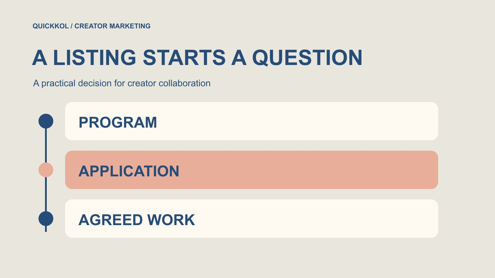
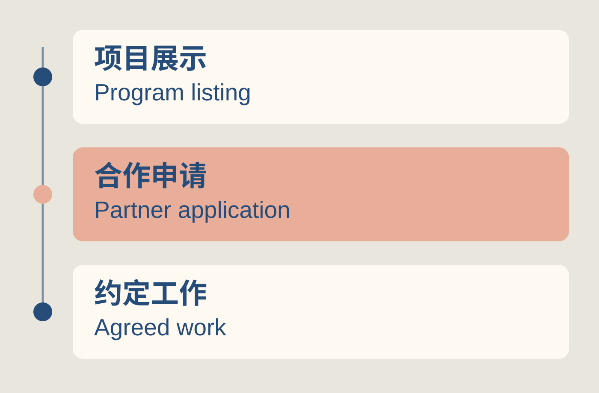

# GrowthHero Marketplace: From Program Listing to Creator Fit

Status: local review draft; confirm the publication date before release.

GrowthHero Marketplace offers affiliate-program discovery. Brands still need to connect a listing, application review and actual creator assignment instead of equating listing with collaboration or sales.

QuickKOL editorial graphic; not actual account metrics or a platform interface.

GrowthHero marketplace is an affiliate-program discovery route rather than a list of fully verified creators. A brand can present a program to prospective partners, then confirm relevant work, contribution, product conditions and scope. Links and commission administration support execution, but a listing guarantees neither suitable applications, completed content nor sales. Separate discovery, program acceptance, content work and commission processing to understand the actual partnership stage and its next owner.

## Understand what the Marketplace presents

[GrowthHero’s Marketplace introduction](https://www.growthhero.io/affiliate_program_marketplace/) describes a place to discover and join online businesses' affiliate programs. That is program discovery, not a creator database with confirmed availability, content capability and willingness.

The brand should decide who needs to find the program: creators with relevant work, publishers or other suitable partners. Several roles can participate in affiliate arrangements without sharing identical production capabilities.

A public program supplies a lead while application review and agreement determine the next step. A page existing does not establish recruited creators or business results; status needs corresponding records. This distinction helps the team write an appropriate listing and assess responses without expecting every person interested in an affiliate offer to perform the same role as a commissioned on-camera creator.

## Make the listing assessable for a prospective partner

Identify the product category, applicable markets, proposed collaboration and inquiry route. A high-earnings invitation without enough information about the product and work is difficult for a creator to assess.

If compensation primarily concerns referred results, distinguish commission from a fixed production fee. Define separately any work requiring a committed deliverable rather than reveal extra filming after application.

Preserve real limitations as well. Products, prices and service markets can change, requiring an owner to update information. Clarity supports fit assessment without guaranteeing a type or volume of applications. A prospective creator should be able to tell whether the program is a relevant referral opportunity, a possible commissioned assignment or a combination requiring further discussion, rather than infer those obligations from broad language about becoming a partner.

## Review applications through relevant work

Interest in a program does not qualify an applicant for every task. Examine work related to the product and viewer question, distinguishing demonstration, explanation, review, publication and referral.

The [affiliate-partnership role guide](https://www.quickkol.com/blog/affiliate-marketing-companies-commercial-roles/#answer) separates commercial contributions. Apply that distinction to a listing: define the work needed, then research what the applicant can actually contribute instead of deciding only by follower size.

Retain uncertainty where work or identity is unconfirmed and continue through a business contact supplied by the person. Program acceptance, a defined content assignment and a confirmed publication date should be recognizable separate states. A clear review can explain why an applicant is promising for one contribution while still needing discussion about another, avoiding a blanket approval that silently includes all production and publishing responsibilities.

## Confirm referral and content production separately

A brand may offer an affiliate opportunity alone or separately commission content. Commission terms do not automatically include video counts, revisions, source files and advertising uses.

Where both apply, record fixed work and compensation dependent on actual referral records. Potential commission is not guaranteed creator income, and a fixed payment does not automatically cover every continuing responsibility.

Commercial discussion should match the task and agreed terms. This article supplies no universal rate, and a listing does not replace specific confirmation. Knowing what has been accepted is more useful than a general instruction to promote actively. It also gives the brand a fair basis for checking delivery without making a creator's completed production work disappear merely because referral outcomes remain uncertain or arrive on a different schedule.

A listing supports discovery; specific confirmation enables execution.

## Understand the Partner Portal handoff

[GrowthHero’s Partner Portal description](https://www.growthhero.io/features/partner-portal/) includes links, discount codes, clicks, orders, sales, due and paid commissions, resources and contact routes. These are provider-described capabilities rather than independently tested accuracy for every program.

A brand can use such a route for current product information, resources and question handling, while explaining allowed uses. Placing a file in the portal does not resolve every permission associated with third-party material or creator likeness.

Partners also need to know whom to ask about a record. Product facts, link issues, orders and commission questions can belong to different owners instead of all becoming matters for a creator to explain publicly. A useful program connects the displayed information with someone able to confirm or correct it, rather than make the dashboard itself the final answer to every operational question.

## Check the actual link and product version

An affiliate link should reach the product, language and conditions described in the content. A page opening does not establish that it fulfills the invitation or is purchasable everywhere.

The [creator-code attribution guide](https://www.quickkol.com/blog/influencer-discount-codes-offer-attribution/#answer) discusses offer expression and records. This program still needs the actual route, conditions and version checked; a code does not automatically identify distinct customers or incremental sales.

When the product changes, update content information and destinations. Editing only the listing while active creators retain old conditions leaves a gap. Identify affected partners and content so an accurate correction can be arranged. This also helps distinguish a destination issue controlled by the brand from a creative problem in the creator's explanation, allowing the appropriate owner to make the change without unnecessarily commissioning another video.

## Commission status is not the whole business result

Read due, processed and received according to the current system and program definitions. A recorded order is not necessarily a final retained order; returns, cancellations and agreed terms can affect handling.

Explain reconciliation and inquiry routes without requiring partners to expose private financial details through public screenshots. Provide only relevant records for a check instead of circulating unrelated customer information.

A report can distinguish referral records, confirmed commission and pending items. Without full evidence, a commission statement should not become net profit or complete incremental return, and a pending receipt should not automatically become an accusation of nonpayment. This keeps both brand and creator able to investigate the actual stage of a transaction rather than argue from a status label whose meaning has not been established.

## Compare plans against the current task

[GrowthHero’s plan page](https://www.growthhero.io/pricing/) distinguishes partner sales, fixed-fee payouts, administrator seats and Marketplace promotion. These are different units; one limit should not become a limit for every function.

This article does not reproduce exact prices or promise lasting terms. Check current billing, plan and management needs before total cost; a public starting price is not the whole cost of this partnership.

A simple program listing can need a different scope from a multi-team operation. Separate essential and occasional capabilities before requesting confirmation, instead of purchasing only because one option has more features. The comparison should also retain brand-side work such as supplying product information, reviewing applications and answering partner questions, which does not disappear merely because a software subscription supports part of the workflow.

## Connect stages in a hypothetical organizer program

Suppose a brand lists an organizer affiliate program. A creator experienced in organization content applies. The brand reviews relevant demonstrations before discussing whether to commission a separate video.

After product and task confirmation, it supplies the actual link and use conditions. The creator completes content, the brand receives dimension questions, and referred orders enter the corresponding commission process. Each step has a record; application does not automatically become a completed video.

If the creator accepts the affiliate program but has not confirmed the separate video, the owner should keep that production pending rather than use program acceptance as permission to commission it. A clear status lets both parties continue discussing the actual deliverable without assuming a task was already included.

This hypothetical contains no sales or platform result. It shows how Marketplace discovery connects with work review, assignment confirmation and business handoff. None of those stages should be compressed into a claim that listing produces income. The team can identify a delay at the actual stage, such as an unanswered product question, without blaming the discovery route for work that has not yet been enabled.

## Maintain information partners can continue using

A program can encounter discontinued products, changed conditions or a new owner after launch. Keep current information and a notification route so partners producing or already publishing content know what needs review.

At closure, identify responsibility for links, existing records and inquiries. Ending recruitment does not automatically change old content or close every earlier commission matter.

Maintenance need not create unlimited creator work. Identify affected content and actual obligations before arranging an appropriate update. Clear closing conditions reduce confusion and prevent the listing becoming a static advertisement no one owns. They also let a future program manager distinguish an active offer from a historical partnership and route questions without asking the creator to reconstruct the brand's internal decisions from old messages.

## Turn a listing into a handoff-ready partnership

The final handoff should distinguish listing, application, acceptance, content, links and commission status. Provider material supports research while actual program records establish completion; the two are not interchangeable.

The value of GrowthHero marketplace in influencer marketing depends on a program helping suitable partners understand the task, with real people continuing confirmation and handling. It is not a label guaranteeing recruitment, income or sales.

Starting with contribution lets creators understand what they accepted and owners manage follow-up. That gives the program a basis for continued execution and places improvements at the stage actually affected. A concise closing record can identify the next decision and responsible person, avoiding a broad platform verdict when the evidence instead shows a specific unresolved product, content or payment question.

## Keep program stages separate

| Stage | Record | Cannot establish alone |
| --- | --- | --- |
| Listing | Current program description | Guaranteed suitable applications |
| Application | Interest and relevant work | Acceptance of all content tasks |
| Content | Confirmed scope and delivery | Sales or unlimited use |
| Commission | Defined order and status | Net profit or guaranteed receipt |

Editorial handoff framework, not a program result or provider performance test.

## Before listing an affiliate program

Make the actual work assessable for creators.

- [ ] Define product, markets and collaboration.
- [ ] Separate referral commission and content work.
- [ ] Arrange work review and confirmation.
- [ ] Check links, conditions and version.
- [ ] Explain commission status and inquiry routes.
- [ ] Assign update and closure ownership.

## Research date and limitations

Sources reviewed November 17, 2026. Methods, tables and decision rules are editorial recommendations. Hypothetical examples are not actual client results or industry benchmarks. Source geography and periods are specified where relevant.

## Start creator research with a clear task

Use QuickKOL to interpret a brief, discover relevant creators and research their work and contact routes. Verify data, commercial terms and outcomes at their source.

[Explore QuickKOL](https://www.quickkol.com/#capabilities)

## Sources

- [GrowthHero’s Marketplace introduction](https://www.growthhero.io/affiliate_program_marketplace/)
- [GrowthHero’s Partner Portal description](https://www.growthhero.io/features/partner-portal/)
- [GrowthHero’s plan page](https://www.growthhero.io/pricing/)
