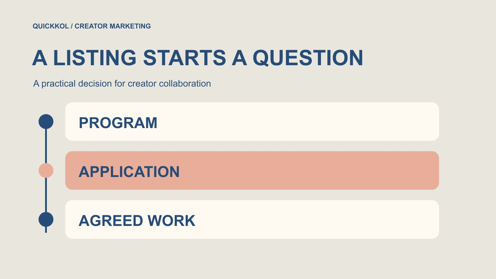
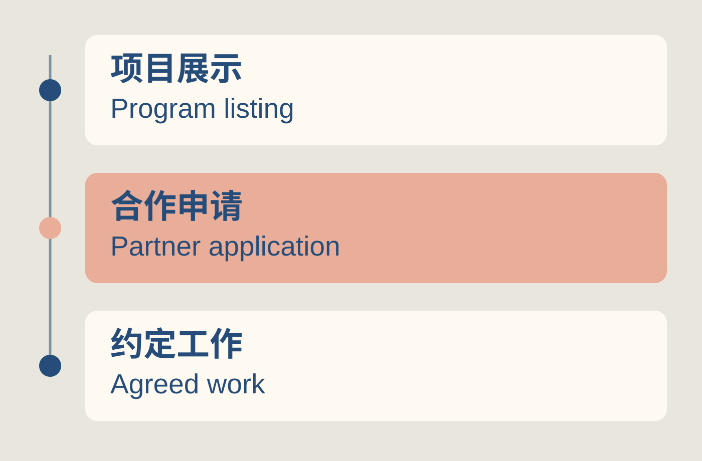

# GrowthHero Marketplace 怎样接收合作申请

状态：本地审阅稿；正式发布日期待确认。

GrowthHero Marketplace 提供联盟项目发现入口。品牌需要把项目展示、申请筛选和实际达人内容任务连接起来，不能把上架直接当成合作与销售。

QuickKOL 编辑图形；不呈现真实账号指标或平台界面。

GrowthHero marketplace 是联盟项目发现入口，不是所有申请者已核验的达人名单。品牌可以通过项目展示吸引合适伙伴，再确认创作者作品、实际贡献、商品条件与合作范围。链接和佣金管理帮助执行，但项目上架不保证收到适合申请、完成内容或产生销售。把发现、接受项目、内容制作和佣金处理分开，才能判断本次达人合作究竟到哪一步，以及下一步由谁负责。

## 先理解 Marketplace 展示什么

[GrowthHero 的 Marketplace 介绍](https://www.growthhero.io/affiliate_program_marketplace/)把它描述为寻找和加入在线商家联盟项目的入口。这是项目发现，不应被改写成已确认档期、内容能力和合作意愿的达人数据库。

品牌先决定想让谁发现项目：已有相关作品的创作者、内容发布者或其他合适伙伴。不同角色可以参与联盟合作，但不会因此拥有相同的内容能力。

公开项目说明提供线索，申请与双方确认决定能否继续。不要把一个项目页面存在，写成已经招募到多少达人或取得业务结果；实际状态需要对应记录。

## 让伙伴看懂项目是否相关

写清产品类别、适用地区、希望讨论的合作方式与接洽路径。不能只写高收益机会，却不给创作者理解商品与工作的信息。

如果项目主要按推荐结果支付佣金，应明确它与固定内容制作费不同。需要承诺交付的工作，另外确认范围，不让创作者在申请之后才发现被要求承担额外拍摄。

项目说明也应保留真实限制。商品、价格或可服务市场可能变化，负责人需要更新对应资料。清楚信息帮助双方判断适合性，不保证项目会吸引某类人或产生多少申请。

## 申请筛选回到相关作品

申请者愿意了解项目，不等于已经适合所有任务。查看与商品和观众问题有关的作品，区分演示、讲解、评测、发布与推荐等贡献。

[联盟合作角色指南](https://www.quickkol.com/zh/blog/affiliate-marketing-companies-commercial-roles/#answer)帮助区分不同商业工作。本篇把它应用到项目列表：先说本次需要什么，再研究申请者实际能做什么，不能只按粉丝规模决定。

没有作品或身份确认的部分保留未知，使用本人提供的公开业务联系继续讨论。接受项目、确定内容任务与确认发布时间应是可识别的不同状态。

## 联盟推荐与内容委托分别确认

品牌可以只提供联盟机会，也可以另外购买内容。前者的佣金条款不自动涵盖视频数量、修订、素材文件和广告用途。

若同时安排，记录哪些是固定工作、哪些取决于实际推荐记录。不要把佣金潜力当成保证创作者一定得到的报酬，也不把一项固定费自动解释为所有长期工作。

付款讨论应对应实际任务和双方条款。本文不提供统一费率，项目页面也不能代替具体确认。让伙伴知道自己接受的是什么，比笼统要求积极推广更接近可执行合作。

列表支持发现，具体确认让合作进入执行。

## Partner Portal 支持哪些交接

[GrowthHero 的 Partner Portal 说明](https://www.growthhero.io/features/partner-portal/)介绍链接、折扣码、点击、订单、销售、应付与已付佣金、资源和联系入口。这些是供应商描述的功能，不是本文测试过每个项目的数据准确性。

品牌可以用这类入口提供当前商品资料、内容资源与问题接收方式，但应说明哪些资源可以如何使用。文件放进门户，不自动解决第三方素材和达人形象的所有权限。

伙伴看到记录后，还应知道问题找谁。内容事实、链接问题、订单与佣金争议可能由不同人处理，不必全部让创作者在公开评论区解释。

## 检查实际链接与商品版本

联盟链接需要到达与内容相符的商品、语言和条件。能打开网页不代表已经完成邀请，也不代表所有地区都能购买。

[达人折扣码与归因指南](https://www.quickkol.com/zh/blog/influencer-discount-codes-offer-attribution/#answer)讨论优惠表达和记录。本项目仍应检查实际路径、适用条件与对应版本，不把一个码自动解释为独立顾客或增量销售。

产品变更时，更新内容资料与链接入口。不要只修改列表介绍，让已经接手的创作者继续使用旧条件；把受影响伙伴和内容一起找到，才能安排准确更正。

## 佣金状态不等于全部业务结果

应付、已处理与实际到账需要按当前系统和项目定义阅读。记录中的订单也不必然是最终保留订单，退款、取消和实际条款可能影响处理。

品牌应说明对账与问题路径，不要求伙伴通过公开截图暴露私人财务信息。需要核对时，提供与问题有关的必要记录，不传播无关客户资料。

报告可分别说明推荐记录、已确认佣金与仍在等待的事项。没有完整证据，不把佣金报表改写成净利润或全部增量回报，也不把暂未到账直接指控为不付款。

## 方案比较要对应当前任务

[GrowthHero 的方案页面](https://www.growthhero.io/pricing/)区分伙伴销售、固定费付款、管理员席位与 Marketplace 展示等项目。各项数量不是同一个单位，不能把其中一个限制当成所有功能限制。

本文不复制具体价格或保证长期条款。品牌应检查当前账期、实际方案和需要的管理能力，再核对整体成本；一个公开起步价格不等于本次合作的全部费用。

如果只需展示项目，与需要多个团队协作的安排，可能有不同需求。把必须功能与偶尔需要分开，再向供应商确认范围，避免购买理由只剩“功能更多”。

## 用收纳项目连接各阶段

假设品牌展示一项收纳产品联盟项目。一位擅长整理内容的创作者申请后，品牌查看相关演示，再讨论是否需要单独委托视频。

双方确认产品与任务后，提供实际链接和使用条件。创作者完成内容，品牌接住尺寸问题；推荐订单进入对应佣金处理。每一步都有记录，不把申请自动写成已完成视频。

如果创作者已接受联盟项目，却尚未确认额外视频，负责人应把视频保留为待讨论，而不是用项目接受状态代替制作确认。

本例没有实际销量或平台成绩。它展示 Marketplace 可以连接发现，但实际合作还需要作品判断、任务确认与业务接手。品牌不应把其中任何一步省略成上架即可产生收入。

## 项目维护让伙伴继续获得正确资料

项目开始后仍可能出现商品停供、条件更新或负责人变化。保留当前资料与通知路径，让正在制作和已发布内容的伙伴知道哪些需要复查。

结束项目时说明后续链接、已产生记录和问题由谁处理。停止招募不等于所有旧内容自动改变，也不等于此前佣金事项已经结束。

维护不需要无限增加创作者工作。先确认受影响内容与实际义务，再安排合适更新。清楚结束条件能减少误解，也避免把项目列表当成无需再管的静态广告。

## 把项目列表变成可接手的合作

最终交接应说明项目展示、申请、接受、内容、链接与佣金分别处于什么状态。供应商资料提供研究依据，实际项目记录说明完成情况，两者不能混同。

GrowthHero marketplace 对达人营销的价值，取决于项目能否让适合伙伴理解任务，并有实际的人继续确认与接手。它不是保证招募、收入或销售的标签。

品牌从具体贡献开始，创作者知道接受了什么，负责人能够处理后续问题，项目才具备持续执行的基础。下一次改进也能回到真正受影响的阶段。

## 不要把项目阶段混在一起

| 阶段 | 对应记录 | 不能直接推断 |
| --- | --- | --- |
| 展示 | 当前项目说明 | 适合申请一定到来 |
| 申请 | 意向与相关作品 | 所有内容任务已接受 |
| 内容 | 实际确认范围与交付 | 销售或无限用途 |
| 佣金 | 定义清楚的订单与状态 | 净利润或到账保证 |

编辑交接框架，不是实际项目成绩或供应商效果测试。

## 发布联盟项目之前

让潜在达人能判断实际工作。

- [ ] 写清商品、地区与合作方式。
- [ ] 区分推荐佣金与内容委托。
- [ ] 安排作品研究与本人确认。
- [ ] 检查链接、条件与版本。
- [ ] 说明佣金状态与问题路径。
- [ ] 指定更新与项目结束负责人。

## 研究日期与使用边界

资料核验于 2026 年 11 月 17 日。文中方法、表格和决策规则为编辑建议，标为假设的示例不是实际客户结果或行业基准。外部资料的适用地区与时期按各段说明。

## 从任务开始达人研究

用 QuickKOL 理解 Brief、发现相关达人并研究作品与联系路径；数据、合作条件和结果仍需核验。

[了解 QuickKOL](https://www.quickkol.com/#capabilities)

## 来源

- [GrowthHero 的 Marketplace 介绍](https://www.growthhero.io/affiliate_program_marketplace/)
- [GrowthHero 的 Partner Portal 说明](https://www.growthhero.io/features/partner-portal/)
- [GrowthHero 的方案页面](https://www.growthhero.io/pricing/)
