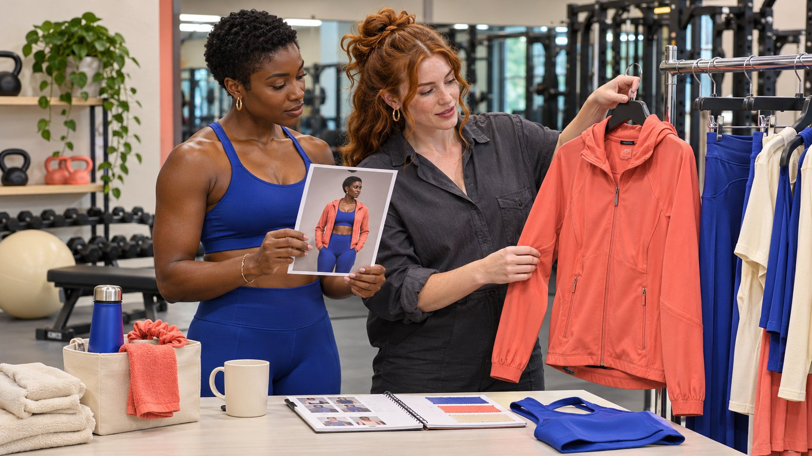
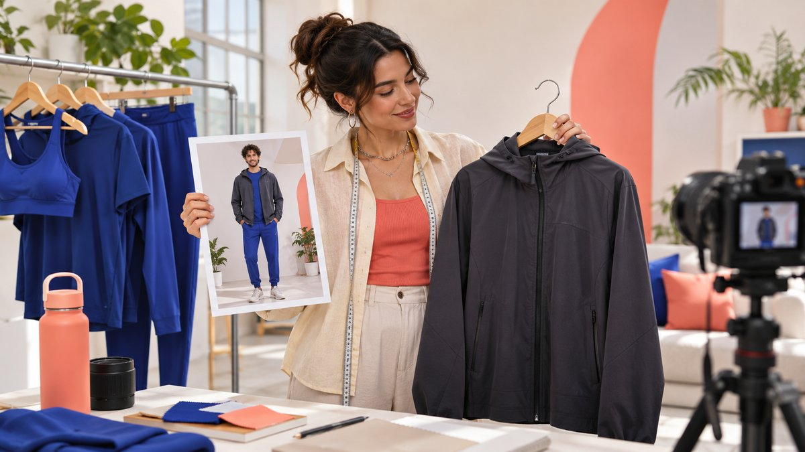

# Gym Fashion Brands: Brief Creator Wardrobe Continuity

Status: local review draft; confirm the publication date before release.

Start gym-fashion creator work with a reproducible outfit, identifying garment combinations, shot continuity, visible branding and changes instead of another fit ranking.

Gym fashion brands commissioning creator styling should define an outfit that can actually be reproduced: which garments are collaboration products, which are supporting pieces, what the shots need to show and who approves a changed combination. A concise garment list and reference image can preserve cuffs, zips, footwear and accessories across filming sessions. Styling can be creative while avoiding substitutions presented as the specified product or every visible brand being described as a partner. Viewers should understand the creator’s styling choice, and the brand should know which outfit version appears in the finished content.

## Distinguish styling from performance demonstration

Gym-fashion content can concern color, layers, transitions between settings or personal expression. A material-performance claim needs corresponding facts and a suitable demonstration; a gym setting does not supply professional test evidence by itself.

The [clothing-fit collaboration guide](https://www.quickkol.com/blog/gym-clothing-brands-kol-fit-test/#answer) addresses garment fit and relevant movement. This article focuses on accurate portrayal of an outfit combination rather than use the same fitting checklist for every activewear keyword. Define the styling choice viewers should understand, then find creators with relevant work.

For a transition from a training setting to everyday use, show which pieces remain and which are added. The camera’s task can be to explain a styling process without implying improved athletic performance or evaluating whether the creator’s body matches an ideal. This distinction helps a brand review the concept fairly: a creative change to the outfit can be judged on whether the intended combination remains understandable instead of being mistaken for a claim about comfort, durability or technical suitability that the project never set out to establish.

## Identify featured and supporting pieces

One outfit may contain the featured top, personally owned trousers, a borrowed jacket and ordinary accessories. Explain each item’s role rather than present every piece as brand-supplied or available to purchase. If one garment must remain visible, raise that during concept planning.

[FTC’s textile-label guide](https://www.ftc.gov/business-guidance/resources/threading-your-way-through-labeling-requirements-under-textile-wool-acts) points to corresponding information such as fiber content for covered U.S. products. A styling record can use an accurate style identifier without transferring another garment’s composition or description merely because the color looks similar.

The creator can propose a combination while the brand confirms the actual promoted item. Unverified supporting pieces do not need invented model names. Separating known items from unconfirmed details is more useful than a seemingly complete shopping list that production cannot reproduce. It also allows the team to explain a supporting piece’s limited role: an item may help the visual composition without the creator making a product recommendation for it or the commissioning brand acquiring any rights to represent its maker.

## Use references to record styling, not prescribe a body

A reference can record an open or closed jacket, rolled sleeves, a tucked top and accessory position. It helps restore the agreed outfit for another filming session without requiring a creator to imitate another person’s body or an unsuitable pose.

The [U.S. Copyright Office’s copyright overview](https://www.copyright.gov/what-is-copyright/) explains that photographs and other expression can be protected. Finding a styling image can inform research into an idea without granting direct copying, publication or use as an obtained commercial asset. Actual use needs an appropriate basis.

Once the collaboration is defined, retain a reference from the project itself and identify its outfit version. A reference helps production; a finished asset addresses viewers. An effective internal photograph is not automatically cleared for public advertising. Keep its role clear when sharing it with the next team member, so the image is used to restore garment details rather than mistakenly enter a publication folder or become an unagreed example of the creator’s endorsement.

## Preserve continuity according to the shot

Full-length shots and closeups need different details. A wide shot may depend on layers, while a closeup can reveal a cuff, zip or strap that differs from the preceding image. Examine the edit relationship before deciding what must remain consistent.

For example, opening a jacket may be filmed first in a wide shot and then as a sleeve closeup. A changed sleeve roll in the second session can confuse the action even when the product is unchanged. Restore the earlier state or choose a shot that does not need to connect, resolving the specific problem without redesigning the entire outfit.

Record actual changes between takes. If a jacket is removed to show the top and needed again later, check the appropriate reference rather than rely on memory. Continuity supports viewer understanding; it does not mean nothing can change during a shoot.

The photograph shows comparing a garment with a reference. If the sequence deliberately presents two outfits, make the transition understandable; if it shows one continuous action, avoid an unexplained clothing change. Distinguish the two before choosing a reshoot or edit. A simple note about the intended transition can save unnecessary correction work because an editor will know whether a different layer is an intentional styling choice or a mistake that disrupts the explanation.

A continuity record helps restore an outfit and identify intentional changes.

## Keep visible branding consistent with the actual relationship

Clothing and accessories can carry visible marks. Check them against the agreed concept and actual relationships, without describing another maker as a partner simply because a logo enters the frame. Discuss any exclusivity conditions specifically during preparation.

[FTC’s influencer disclosure guide](https://www.ftc.gov/business-guidance/resources/disclosures-101-social-media-influencers) explains clear disclosure in a U.S. commercial-connection context. Viewers need to understand the actual endorsement relationship; a broad styling-share label cannot replace necessary information, while unrelated possessions need not be called sponsorships.

Review subtitles, tags and product descriptions with the image. A supporting item described in copy as a collaboration product creates a factual problem distinct from visual continuity. Confirm the relationship before deciding how to express it. The creator should be able to identify which part of the statement concerns their own styling preference and which concerns the commissioned product, allowing the brand to correct a misleading association without rewriting every personal choice in the outfit.

## Give styling changes a version and owner

A brand may request another color, or a creator may find that a combination does not suit the real setting. Change is normal; identify affected shots, information and work rather than send a new photograph and leave everyone guessing whether it replaces the whole earlier version.

One owner should consolidate confirmation and state where the new outfit applies. Camera, editing and copy teams need the accepted version and unresolved points rather than every discussion. Resolve conflicting requests before passing them on.

Suppose a top changes from blue to coral. Reusing its earlier closeups depends on the actual product and narrative; digital recoloring does not establish that the versions are equivalent. Do not conceal product changes through editing. Reshoot or revise the sequence where needed. The decision should explain what remains usable, giving the creator a bounded revision request instead of an open instruction to make the whole film match a concept that changed after the original filming.

## Check styling priorities across formats

A full outfit may have different visible areas in vertical and horizontal formats. If the featured item is a top, check that cropping and subtitles do not hide it; if the task explains layers, a face-and-chest closeup may lose the point.

Format adaptation does not require repeating every action. First check whether existing footage supports the composition before commissioning another shot. Every export size is not a new concept, and one file is not automatically suitable everywhere.

Review actual mobile presentation, especially the relationship between lower text, interface coverage and full-length pieces. One preview does not establish identical display on every device. Preserve the main action and necessary garment details rather than fill the edges with more slogans. This review is most effective while changes are still practical: identifying a missing lower-body shot before the outfit is returned is easier than asking a creator to reconstruct the entire wardrobe after the assignment has otherwise ended.

## Make the handoff usable for later editing

Retain the outfit version, matching shots, featured items and use conditions in the final handoff. Another editor should know which shots belong together without interpreting filenames called final and final-new.

Confirm the scope if material later moves to owned channels or advertising. Approval of a styling version does not include every possible use. Another product name, campaign claim or combination can change viewer understanding and needs review in the new finished expression.

At closure, record which combination served this narrative, what caused a reshoot and what should be prepared next time. Describe working facts rather than general judgments about the creator’s taste or appearance. This makes the record useful when another creator receives a similar brief: the transferable lesson may concern a missing reference or unclear featured item, not a requirement that the next person reproduce someone else’s personal styling or body presentation.

## Organize the collaboration around styling, not a list of brands

The [exercise-clothing sample handoff guide](https://www.quickkol.com/blog/exercise-clothing-creator-sample-custody/#answer) helps prepare the physical items; a styling process turns them into intentional content. They connect without replacing each other: complete delivery does not establish concept approval, and an attractive outfit does not establish accurate product information.

For gym fashion brands, choose creators by how relevant work explains combinations, actions and settings, rather than visual attractiveness alone. A specific assignment gives the creator room for a suitable expression and the brand a usable review basis.

A completed styling collaboration helps viewers understand the choice, keeps the version understandable to production and aligns public expression with real products and relationships. That is more relevant to QuickKOL’s influencer-marketing scope than adding a fashionable list of brand names without explaining what a creator could contribute or how the resulting work would be commissioned and assessed.

## Match a styling question to a check

| Question | Inspect | Owner confirms |
| --- | --- | --- |
| Which item is featured | Style and collaboration scope | Supporting items are not presented as sponsors |
| Whether shots connect | Cuffs, layers and accessories | Intentional change or correction |
| Whether a new version replaces one | Product and existing shots | What needs another shot |
| Whether a format fits | Actual mobile composition | Featured item and action remain clear |

Editorial production method, not a brand ranking, body assessment or garment-performance finding.

## Confirm an outfit before filming

Connect the concept to physical items.

- [ ] Define the styling choice to explain.
- [ ] Identify featured and supporting pieces.
- [ ] Save a version-specific reference.
- [ ] Distinguish continuity from an intentional outfit change.
- [ ] Consolidate changes and affected shots.
- [ ] Review actual formats and public copy.

## Research date and limitations

Sources reviewed November 17, 2026. Methods, tables and decision rules are editorial recommendations. Hypothetical examples are not actual client results or industry benchmarks. Source geography and periods are specified where relevant.

## Start creator research with a clear task

Use QuickKOL to interpret a brief, discover relevant creators and research their work and contact routes. Verify data, commercial terms and outcomes at their source.

[Explore QuickKOL](https://www.quickkol.com/#capabilities)

## Sources

- [FTC’s textile-label guide](https://www.ftc.gov/business-guidance/resources/threading-your-way-through-labeling-requirements-under-textile-wool-acts)
- [the U.S. Copyright Office’s copyright overview](https://www.copyright.gov/what-is-copyright/)
- [FTC’s influencer disclosure guide](https://www.ftc.gov/business-guidance/resources/disclosures-101-social-media-influencers)
