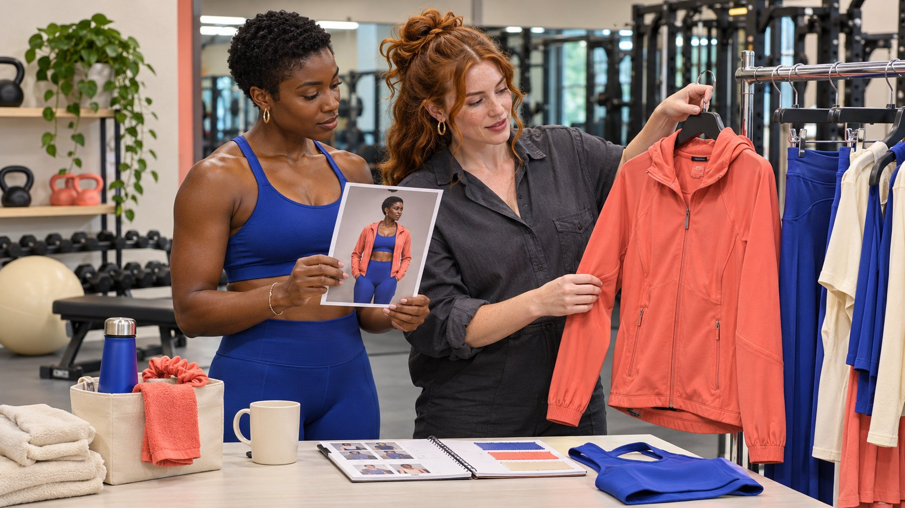
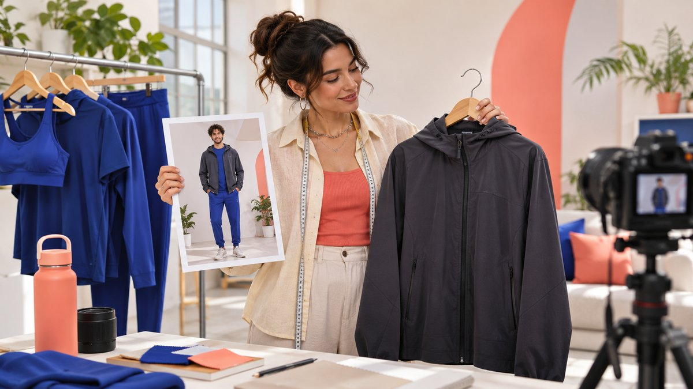

# 健身造型合作怎样保持服装连续

状态：本地审阅稿；正式发布日期待确认。

让运动造型达人合作从一套可复现的穿搭开始，明确衣物组合、镜头连续性、可见标识与变更，而不把所有运动服选题写成试穿排名。

Gym fashion brands 与达人制作穿搭内容时，先确认一套真正能复现的造型：哪些衣物属于合作产品，哪些只是搭配，镜头要展示什么，以及改变组合时由谁确认。用简短衣物清单和拍摄参考保存袖口、拉链、鞋袜与配件状态，能帮助分次拍摄保持连续。造型可以有创意，但不能让相似款冒充指定产品，也不能把所有可见品牌都写成合作方。最后应让观众看懂达人如何搭配，而品牌知道成片呈现了哪一版造型。

## 把穿搭任务与性能展示分开

运动时尚内容可以关注配色、层次、场景转换或个人表达。若品牌想讲面料性能，则需要对应事实与适合的演示，不能因为衣物出现在健身空间就自动拥有专业测试依据。

[运动服试穿合作指南](https://www.quickkol.com/zh/blog/gym-clothing-brands-kol-fit-test/#answer)讨论衣物适配与相关动作。本篇把任务限定在造型组合如何被准确呈现，避免用相同试穿清单回答所有运动服关键词。品牌先说需要看懂哪项穿搭选择，再选择相关作品的达人。

例如从训练前到日常外出的造型变化，需要看清哪些单品保持、哪些增加。镜头任务可以是展示搭配过程，不必暗示衣物改善运动表现，也不需要评论达人的身体是否符合某个理想标准。

## 标出主推单品与搭配单品

一套造型可能包含合作上衣、自有裤装、借用夹克与普通配件。说明每件在任务中的角色，而不是把它们全部写成品牌提供或全部可购买。品牌若希望某件始终可见，应在概念阶段说明。

[FTC 的纺织品标签指南](https://www.ftc.gov/business-guidance/resources/threading-your-way-through-labeling-requirements-under-textile-wool-acts)提醒美国适用产品的材质等信息有对应依据。造型清单可以使用准确款式标识，却不应凭相似颜色把另一件衣物的成分或产品描述套过来。

达人可以提出自己的组合，但品牌需要确认所推广的实物是否对应。未核对的搭配件不必填入虚构型号。把已知与未确认分开，比一张看似完整、实际上无法复现的购物清单更有助于制作。

## 用参考照片记录穿搭状态

参考照片可以记录外套开合、袖子卷法、上衣是否扎入和配件位置。它帮助下一次拍摄还原已确认的造型，不要求达人模仿另一个人的身材或不适合自己的姿势。

[美国版权局的版权说明](https://www.copyright.gov/what-is-copyright/)介绍照片等表达可能受到保护。搜到一张穿搭图，可以帮助研究某种想法，却不代表品牌能够直接复制、发布或把它当成已获得的商业素材。实际使用需要合适依据。

最好在合作确定后保存自己项目的造型参考，并说明它对应哪个版本。参考与成片的作用不同：参考帮助制作，成片面向观众。不要因为内部照片拍得清楚，就默认它已经获得公开广告使用安排。

## 按镜头需要保存连续性

全身镜头和近景需要关注的细节不同。全身变化可能影响层次，近景则可能暴露袖口、拉链或肩带与前一镜头不一致。先看剪辑关系，再决定哪些细节必须保持。

例如，同一段拉开夹克的动作先拍全身，再拍袖口特写。补拍时袖子卷法改变，即使产品没有替换，也可能让观众误解动作顺序。先恢复原来的状态，或明确选择不需要接续的镜头，就能解决这个具体问题，而无需重做整套造型。

拍摄间隙记录实际变化。例如为了展示上衣细节取下夹克，下一段仍需要夹克时，应回到对应参考确认，而不是凭记忆猜。连续性是帮助观众理解动作，不是要求整场拍摄不能改变任何东西。

配图展示把衣物与参考图比较的过程。若顺序故意展示两套搭配，应让转换清楚；若是同一连续动作，就要避免无解释的服装变化。团队应区分这两种情况，再决定补拍还是调整剪辑。

连续性记录帮助还原同一造型，也说明何处故意改变。

## 可见标识与真实合作关系一致

衣服和配件可能带有标识。品牌要确认这些是否符合约定创意与实际关系，但不能只因标识进入画面，就声称对方也是合作方。存在排他条件时，应在准备阶段讨论具体范围。

[FTC 的达人披露指南](https://www.ftc.gov/business-guidance/resources/disclosures-101-social-media-influencers)在美国商业关系场景下说明清晰披露的要求。观众需要理解实际推荐关系；不能用一句宽泛的“穿搭分享”代替必要信息，也不必把没有关系的所有物品写成赞助。

审稿时连同字幕、标签和商品说明一起看。画面里是搭配件，文案却把它列为合作商品，会制造与衣物连续性不同的事实问题。先核对关系，再确认怎样对观众表达。

## 造型变化要有版本与负责人

品牌可能要求换色，达人可能发现某个搭配不适合实际场景。变化本身很正常，关键是确认影响哪些镜头、产品资料和工作安排。不要只发一张新照片，让其他人猜它是否替代全部旧版本。

由一位负责人汇总确认，说明新造型从哪里开始适用。摄影、剪辑与文案不一定需要看到全部讨论，但需要知道最终版本和仍未确认的部分。多个互相冲突的意见应先在团队内部解决。

假设上衣由蓝色换为珊瑚色，原有细节镜头是否能用，要看实际产品与叙事，而不是只调颜色就假定相同。数字修改不应掩盖产品版本，必要时重新拍摄或改变成片组合。

## 在不同画幅中确认造型重点

一个全身搭配在竖屏与横屏中可能有不同可见范围。品牌若主要推广上衣，就要确认剪裁与字幕没有把关键部分挡住；若任务是整套层次，则不能只剩脸部与胸前特写。

适配画幅不必让达人重演所有动作。先看原素材是否支持所需构图，再决定额外镜头。不要把每一种导出尺寸都当作全新创意，也不要认为同一个文件自动适合所有位置。

将手机实际显示纳入审阅，尤其是下方文字、界面覆盖与全身单品之间的关系。预览只能说明该版本的呈现，不能证明全部设备都一样；保留主要动作和必要产品细节，比在边缘堆放更多标语更有帮助。

## 交付说明要能支持后续剪辑

最终交付保留造型版本、对应镜头、合作单品和使用条件。另一位剪辑师可以据此知道哪些镜头能接在一起，不必从文件名里的最终版、最终新版中推断。

若后续素材要用于品牌自有账号或广告，确认实际范围。已经审核的造型，不说明所有用途都包括；新产品名、活动主张或组合可能改变观众理解，需要看新的成片表达。

任务结束后可以保留简短结论：什么组合适合这项叙事，什么原因导致重拍，以及下一次准备什么。把经验写成工作事实，不写成对达人审美或个人外表的泛化评价。

## 用造型组织达人合作，而非堆品牌名

[运动服样品交接指南](https://www.quickkol.com/zh/blog/exercise-clothing-creator-sample-custody/#answer)可以帮助准备实物，造型流程则让这些物品成为有意图的内容。两者连接，但不能互相替代：衣物收齐，不等于创意已经确认；造型好看，也不说明产品信息准确。

对 gym fashion brands，选择达人应看相关作品如何讲清搭配、动作与场景，而不只看照片是否漂亮。任务写得具体，达人更容易提出自己的合理表达，品牌也有明确审阅依据。

完成一项造型合作，是让观众看懂选择，让团队理解版本，并让公开表达符合真实产品与关系。这比把一串流行品牌名放进文章，更贴近 QuickKOL 的达人营销主旨。

## 造型问题对应什么检查

| 问题 | 检查对象 | 负责人确认 |
| --- | --- | --- |
| 哪件是主推产品 | 款式与合作范围 | 不把搭配件写成赞助 |
| 镜头能否连续 | 袖口、层次与配件 | 变化是故意还是需要修正 |
| 新版能否替换 | 产品与已有镜头 | 哪些需要补拍 |
| 画幅是否适合 | 实际手机构图 | 主推单品与动作仍清楚 |

编辑制作方法，不是品牌排名、身体评价或服装性能结论。

## 开拍前确认一套造型

把创意与实际物品连接起来。

- [ ] 明确穿搭需要解释什么。
- [ ] 标出合作单品与搭配件。
- [ ] 保存对应版本的参考。
- [ ] 区分连续动作与故意换装。
- [ ] 汇总变化并明确影响镜头。
- [ ] 检查实际画幅与公开文案。

## 研究日期与使用边界

资料核验于 2026 年 11 月 17 日。文中方法、表格和决策规则为编辑建议，标为假设的示例不是实际客户结果或行业基准。外部资料的适用地区与时期按各段说明。

## 从任务开始达人研究

用 QuickKOL 理解 Brief、发现相关达人并研究作品与联系路径；数据、合作条件和结果仍需核验。

[了解 QuickKOL](https://www.quickkol.com/#capabilities)

## 来源

- [FTC 的纺织品标签指南](https://www.ftc.gov/business-guidance/resources/threading-your-way-through-labeling-requirements-under-textile-wool-acts)
- [美国版权局的版权说明](https://www.copyright.gov/what-is-copyright/)
- [FTC 的达人披露指南](https://www.ftc.gov/business-guidance/resources/disclosures-101-social-media-influencers)
