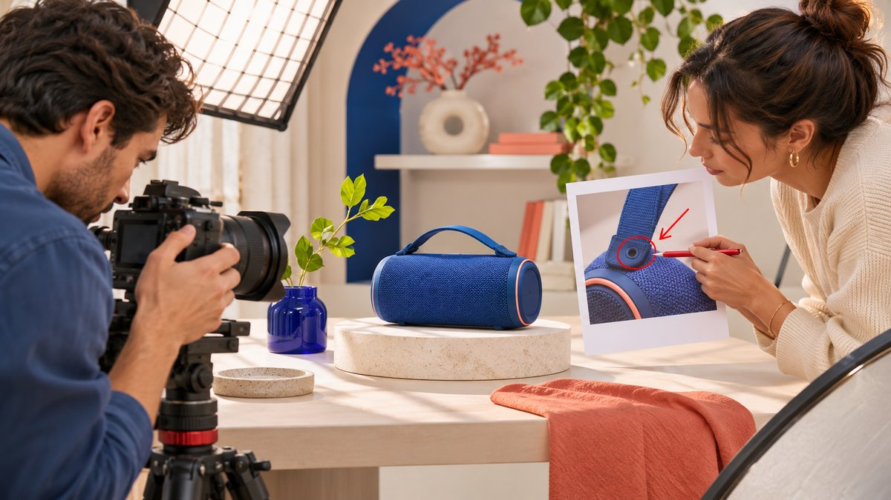

# Instagram Ad: Commission a Creator Revision

Status: local review draft; confirm the publication date before release.

When an Instagram creator ad needs revision, distinguish factual correction, creative change and new use before arranging shots, commercial discussion and the accepted version.

When an Instagram ad using creator content needs revision, identify the actual issue and target version first. Correct factual errors accurately; another opening, setting or claim may be new creative work, while a new advertising use needs scope confirmation. Brand and creator can then agree on work, timing and related fees before checking the finished ad, description and destination together. Technical access to an asset does not establish that a revision is included commercially, or guarantee improved performance.

## Identify the exact expression that needs changing

A revision note should identify the file, moment and issue. Instead of asking for more appeal, explain which action remains unclear or why a sentence conflicts with product information.

The [Instagram-ad preflight guide](https://www.quickkol.com/blog/instagram-ads-creator-placement-preflight/#answer) covers initial release checks. This article addresses commissioning a revision after content exists, rather than sending the entire original brief back and making the creator guess what failed.

State the viewer question and available evidence, then let the creator propose an expression. A request becomes something both parties can assess instead of an unlimited preference-based workload. For a visual problem, include the relevant frame and describe the intended understanding; for a factual problem, identify the source the correction must match, keeping those two kinds of input distinct.

## Separate correction, new creative work and new use

An incorrect product dimension is different from requesting another filming location. One needs factual correction; the other can add preparation, filming and editing. A changed advertising use additionally needs review of existing permission.

The categories explain the work rather than decide contractual cost allocation in advance. Actual arrangements depend on agreed terms and this request, not a casual description of a small edit.

Separate required corrections, creative proposals and scope awaiting discussion. Resolve the necessary factual question before allocating production resources. This reduces avoidable loops and prevents new work hiding among punctuation comments. It also allows a creator to suggest a simpler solution, such as a clear additional detail shot, when the brand's proposed full reshoot is not the only way to explain the product accurately.

## Distinguish partnership advertising from file delivery

[Meta’s 2024 creator-collaboration announcement](https://about.fb.com/news/2024/02/creator-marketplace-for-brands-and-creators-to-collaborate-on-instagram/) describes partnership ads amplifying content with a creator or other partner's handle, and distinguishes existing organic content from newly created ads. It provides dated product context rather than confirmation that this account meets every current condition.

Specify the actual version and use in the revision request. A brand-owned ad file, creator organic post and ad carrying a creator identity are not identical deliverables just because the image is the same.

If use changes, give the creator a concrete scope before checking present platform support and the agreement. A public post or available file is not automatic permission for every advertising format. This keeps the conversation focused on the intended placement instead of asking for an abstract approval that leaves both parties with different understandings.

## Resolve facts before choosing another claim

If the brand wants another selling point, supply verifiable information and applicable conditions. A sentence looking more suitable for an ad does not justify asking the creator to describe a result they did not experience.

[FTC’s influencer disclosure guide](https://www.ftc.gov/business-guidance/resources/disclosures-101-social-media-influencers) addresses actual experience and material connections in applicable US contexts. Revised language should preserve experience and commercial context rather than allow a shorter, stronger line to change the facts.

Where evidence supports only defined conditions, retain them. Without support, choose an observable action or accurate explanation instead of asking the creator to deliver an unsupported outcome guarantee. A revision note can identify the claim the brand wants, the evidence available and the remaining limitation, giving the creator a practical basis for proposing wording rather than a demand to sound more confident.

## Identify the inputs a reshoot actually needs

Another shot may need the original product, accessories, location, wardrobe and light. Confirm availability before promising a date rather than assume the creator can complete every reshoot by immediately picking up a phone.

The photograph shows a producer and creator checking a product detail angle. Give the shot a defined task, such as making a button position visible, instead of asking vaguely for a more premium appearance.

If the product version changed, do not silently insert new footage into an old demonstration and continue describing it as one unchanged experience. Record differences so editing and factual review can identify usable material. This also helps determine whether a simple insert is appropriate or the changed product requires a new explanation that cannot honestly be assembled from the previous performance.

Define the reshoot through the action and conditions viewers need to understand.

## Preserve continuity within the demonstration

Editing can alter pace without misrepresenting sequence, conditions or results. If removing a step makes preparation appear unnecessary, reconsider the explanation and footage together.

Compare the original with the proposed finished version and identify the meaning of retained, removed and added material. A shorter edit is not sufficient if it no longer supports the statement.

The creator reviews the expression while the brand confirms facts. These reviews complement each other; one approval should not imply the other task is complete. Preserve the specific accepted version rather than continue editing under an old approval. For example, removing a close-up may be harmless visually while removing the accompanying qualification changes the claim. A useful reviewer explains that distinction so the editor can solve the real problem without reversing every creative decision.

## Review rights for the actual modification

The [U.S. Copyright Office’s copyright overview](https://www.copyright.gov/what-is-copyright/) describes protection for original video and photographs. Opening an editing project does not establish every new use of its music, images, performances and third-party material.

The [creator-ad permission guide](https://www.quickkol.com/blog/what-is-whitelisting-creator-ad-permissions/#answer) separates material use from platform access. Specify the permitted changes, advertising scope and period for this revision rather than extend one authorization into control over the account or all future work.

Check sources and uses before adding external material. Keep unresolved components pending instead of allowing temporary placeholders into a release. Convenient file delivery does not replace confirmation. A practical handoff should identify which assets are approved for this version and which depend on another agreement, helping the publisher avoid treating everything present on the timeline as equally ready for advertising.

## Connect commercial discussion to the added work

For example, specify whether a reshoot includes product preparation, restoring the lighting setup and another review, so both parties can assess the complete request. A revision list can identify new shots, reusable files and added languages or uses. The parties then discuss concrete work instead of deciding emotionally who should cooperate without limit.

This article supplies no universal revision price or contractual interpretation. Fees, timing and included rounds depend on actual terms; a defined scope makes the response assessable.

If the budget cannot support every proposal, prioritize necessary factual corrections and the most useful explanation together, leaving other ideas for another assignment. A limited budget does not make production and new uses costless. A clear request also allows the creator to suggest alternatives, such as an additional spoken clarification using the existing setting, while the brand assesses whether that option actually resolves the issue rather than choosing it only because it appears easier.

## Work through a hypothetical button-detail revision

Suppose an ad shows a speaker but viewers cannot clearly see the switching button. The brand identifies an unclear operating location rather than asking the creator to guarantee a higher click-through rate.

The parties confirm one hand-detail shot with the same product version and retain necessary conditions. The brand checks facts, the creator checks expression and the editor delivers a clearly named version. Any advertising use outside the original scope receives separate confirmation.

This hypothetical describes work without a client result. It turns a vague not good enough into a finite action and an acceptance question: can the viewer now see where the button is? The team can resolve that production question before collecting performance observations, rather than make payment or acceptance depend on an improvement neither party can promise from one additional shot.

## Review the description and destination with the file

The revised description and destination may need to change with the file. A new product version should not continue opening an unrelated default product page.

Record the actual advertising version and confirmation status. Internal acceptance is not publication, and an identical filename does not establish that the same content is being used in the advertising account. An authorized publisher needs to inspect the actual appearance.

If the result is a local preview, describe it as such. This distinction helps the brand and creator understand completed work and what remains with the advertising owner, rather than call a delivered file a live result. It also creates a usable reference if another adaptation is commissioned later, since the team can identify the version actually released instead of reconstructing it from several similar drafts.

## Use observations for the next supported request

Performance review needs organic or paid status, advertising scope, time and the actual version. A before-and-after change cannot all be attributed to the new shot when other conditions differ.

Record the expression problem resolved, the work completed and the explanation still needed next time. Without business evidence, a clearer creative should not become a claimed sales increase.

An Instagram ad revision should make collaboration concrete: the brand raises a supported issue, the creator makes an identifiable contribution and the owner publishes the corresponding version. That handoff gives the next assignment a clear starting point. It also distinguishes a useful production improvement from a broader performance hypothesis, allowing the team to recognize completed work while remaining precise about what the available observations can establish.

## Three revision requests

| Type | Example | Confirm first |
| --- | --- | --- |
| Factual correction | Incorrect dimension or model | Accurate source and affected version |
| New creative work | Another action shot or opening | Inputs, timing and work scope |
| New use | Added language or advertising scope | Permission and commercial arrangement |

Editorial categories; they do not predetermine contract interpretation, fees or performance.

## Before sending revision notes

Make the work assessable and completable.

- [ ] Identify file, moment and issue.
- [ ] Separate correction, creative work and use.
- [ ] Supply factual support and inputs.
- [ ] Confirm reshoot, timing and commercial scope.
- [ ] Review the specific ad and destination.
- [ ] Retain the actual advertising version.

## Research date and limitations

Sources reviewed November 17, 2026. Methods, tables and decision rules are editorial recommendations. Hypothetical examples are not actual client results or industry benchmarks. Source geography and periods are specified where relevant.

## Start creator research with a clear task

Use QuickKOL to interpret a brief, discover relevant creators and research their work and contact routes. Verify data, commercial terms and outcomes at their source.

[Explore QuickKOL](https://www.quickkol.com/#capabilities)

## Sources

- [Meta’s 2024 creator-collaboration announcement](https://about.fb.com/news/2024/02/creator-marketplace-for-brands-and-creators-to-collaborate-on-instagram/)
- [FTC’s influencer disclosure guide](https://www.ftc.gov/business-guidance/resources/disclosures-101-social-media-influencers)
- [the U.S. Copyright Office’s copyright overview](https://www.copyright.gov/what-is-copyright/)
