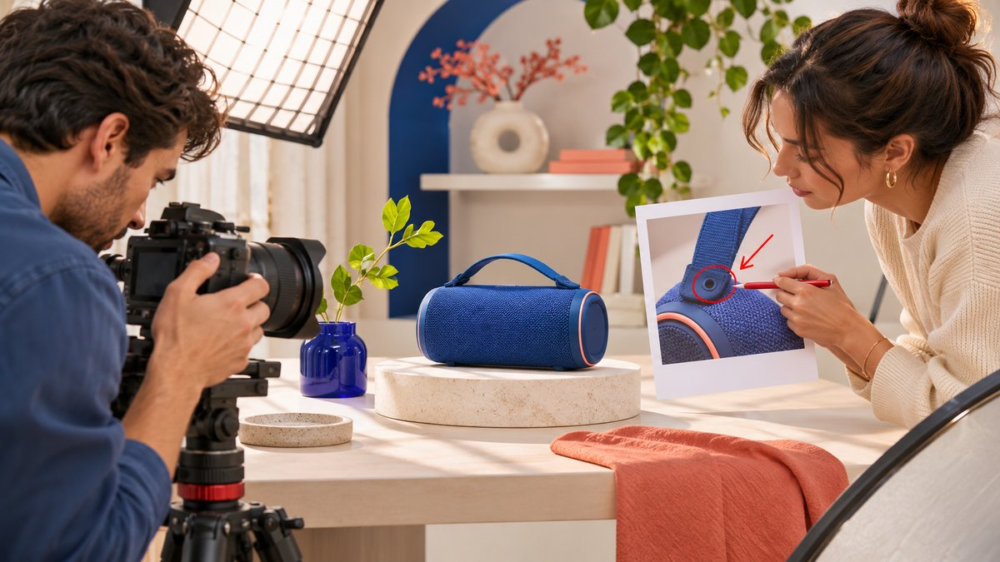

# Instagram 广告怎样安排达人修订

状态：本地审阅稿；正式发布日期待确认。

Instagram 达人广告需要修改时，先说明是事实更正、创意变化还是新用途，再安排镜头、费用讨论与确认版本。

Instagram ad 使用达人内容需要修订时，先指出实际问题与目标版本。事实错误需要准确更正；新的开场、场景或主张可能是新增创作；把原本内容用于新广告范围则需要重新确认用途。品牌与达人应据此商定工作、时间与相关费用，再检查成片、说明和目的地是否一致。广告后台可以操作某项素材，不代表该修改已经包含在商业安排中，也不能保证修改一定改善表现。

## 先指出需要改变的具体表达

修改意见先标明文件、时间点和问题。与其说“更有吸引力”，不如说明观众还没看清哪个动作，或当前一句话为什么与产品资料不一致。

[Instagram 广告上线准备指南](https://www.quickkol.com/zh/blog/instagram-ads-creator-placement-preflight/#answer)讨论初次发布检查。本篇处理内容形成后怎样委托修订，不把原来的整体 Brief 原封不动发回达人，让对方猜哪里出了问题。

负责人应说明要解决的观众问题与可用依据，再让创作者提出表达方法。这样修改可以被接受或讨论，而不是依靠个人偏好无限增加工作。

## 把更正、新创作与新用途分开

把产品尺寸说错与要求换一个拍摄场景，不是同一类变化。前者需要事实更正，后者可能增加准备、拍摄与剪辑。改变投放用途还需要讨论已有许可是否覆盖。

分类是为了让双方知道工作内容，不是预先替合同决定谁承担费用。实际安排仍按双方条款与本次确认，不能凭一句“只是小改”判断。

可以把意见分成必须修正、创意建议与待商议范围，先完成必要事实判断，再安排资源。这个顺序能减少反复，也避免把新增任务混在标点修改中。

## 区分合作广告与文件交付

[Meta 的 2024 年创作者合作公告](https://about.fb.com/news/2024/02/creator-marketplace-for-brands-and-creators-to-collaborate-on-instagram/)介绍伙伴广告可以使用创作者或其他合作方的身份扩大内容，也区分已有自然内容与新广告制作。它提供有日期的产品背景，不证明本次账号已经满足当前所有条件。

因此修订请求应明确实际使用版本和方式。品牌自己的广告文件、达人自然帖子和带达人身份的广告，不能只因为画面相同就当成同一项交付。

如果用途改变，向达人提供具体范围，再检查当前平台支持与双方安排。不把公开帖子或一个可用文件当成所有广告形式的自动许可。

## 先解决事实，再选择新主张

品牌希望新增卖点时，应提供可核对资料和适用条件。不能仅因一句话看起来更适合广告，就要求达人讲述自己没有获得的结果。

[FTC 的达人披露指南](https://www.ftc.gov/business-guidance/resources/disclosures-101-social-media-influencers)说明在适用美国情境下，达人不能声称自己有未获得的体验，也需要表达重要关系。修订后的语言应保持真实体验与商业背景，不让更短更强的台词改变事实。

如果资料只支持有限条件，保留条件。没有依据时，可以调整为可观察动作或准确说明，而不是让创作者替品牌完成未经支持的效果保证。

## 判断补拍需要哪些真实输入

新增镜头可能需要原产品、相同配件、地点、服装与光线。先确认这些是否仍可用，再给时间；不要把补拍当成随时拿起手机就能完成。

配图展示制片与创作者检查产品细节角度。新镜头的任务应足够具体，例如看清按钮位置，而不是含糊要求再拍得高级一点。

如果产品版本已换，补拍不能悄悄拼入旧画面并继续声称是同一演示。记录新旧版本差异，让编辑和事实审阅都能判断哪些素材仍适合使用。

把补拍请求写成需要看清的动作与条件。

## 保留同一演示的连续语境

剪辑可改变节奏，但不能让操作顺序、前提或结果产生错误理解。若删去一步会让演示看起来无需准备，就需要重新判断说明和镜头。

修订时可以对照原始内容和目标成片，标明保留、删除和新增的意义。不要只看新版本是否更短，忽略它是否仍然支持原本主张。

创作者审阅实际表达，品牌确认事实。两种审阅互相补充，不能由任何一方单独批准文件就推断另一部分已完成。保留确认的具体版本，避免继续改动后仍使用旧批准。

## 素材修改仍要看实际权利

[美国版权局的版权说明](https://www.copyright.gov/what-is-copyright/)介绍原创视频与照片等作品的保护。品牌能够打开工程文件，不代表其中音乐、照片、表演与第三方内容的所有新用途都包含。

[达人广告许可指南](https://www.quickkol.com/zh/blog/what-is-whitelisting-creator-ad-permissions/#answer)帮助区分素材使用与平台权限。本次修订应明确可改哪些内容、实际投放范围与时间，不把一个广告授权扩大为对整套账号或所有未来创作的控制。

需要新增外部素材时先确认来源和用途。没有确定安排的部分，保留为待处理，不把临时占位素材带入最终发布。文件交付方便，不能代替权利确认。

## 把费用讨论对应到新增工作

例如补拍是否包含产品准备、灯光恢复与重新审阅，可以逐项说明。修订清单可以说明需要多少新镜头、哪些现有文件可用、是否增加语言或用途。这样双方讨论的是具体工作，不是凭情绪判断谁应该无限配合。

本文不提供统一修订价格，也不替双方解释合同。费用、期限与包含轮次由实际约定决定，先明确范围，才能得到可评估答复。

如果预算无法支持全部变化，可以共同选择必要事实更正和最有价值的解释，其他创意留待下一次。不能用预算不足要求创作者假装新拍摄和新用途没有成本。

## 用一项按钮演示修订作例子

假设广告展示一款音响，但观众难以看清切换按钮。品牌先说明问题是操作位置不清，而不是要求创作者保证更高点击率。

双方确认补拍一段手部细节，使用相同产品版本，并保留原有必要条件。品牌检查产品事实，达人检查实际表达，再由编辑交付明确命名的成片。新增广告用途若超出原范围，另行确认。

这是假设工作过程，没有实际客户成绩。它让修订从模糊的“不够好”变成具体可完成的动作，也给最终验收一个明确问题：观众现在能否看清该按钮在哪里？

## 发布前同时检查说明与目的地

修订成片后，广告说明和入口也可能需要改变。新画面展示另一版本产品，就不能仍然默认打开不对应的商品页。

记录实际投放版本与确认状态。已通过内部审稿不等于已发布，文件名相同也不能证明后台实际使用同一内容。由授权发布人检查实际出现的广告。

如果只是本地预览，应准确说成预览。这个区分有助于品牌和达人知道哪些工作已经完成、哪些仍由投放负责人接手，而不是把交付文件直接称为上线效果。

## 用观察支持下一次请求

表现评估应保留自然与付费、投放范围、时间和实际版本。一次修改前后数据变化，不能在其他条件不同的时候全部归因于新镜头。

可以记录这次解决了什么表达问题、用了什么工作，以及下一次还需要解释什么。没有业务证据，就不把创意更清楚直接写成销售提升。

Instagram ad 修订应让合作变得具体：品牌提出有依据的问题，达人完成可确认贡献，负责人发布对应版本。这样的交付更容易接手，也让下一次合作有清楚起点。

## 三类修订请求

| 类型 | 例子 | 先确认 |
| --- | --- | --- |
| 事实更正 | 尺寸或型号说错 | 准确资料与受影响版本 |
| 新创作 | 补拍动作或新开场 | 输入、时间与工作范围 |
| 新用途 | 增加语言或广告范围 | 实际许可与商业安排 |

编辑分类，不预先决定合同解释、费用或表现。

## 发出修订意见前

让对方能判断和完成工作。

- [ ] 标明文件、时间点与问题。
- [ ] 区分更正、创意与用途。
- [ ] 提供事实依据与必要输入。
- [ ] 确认补拍、期限与商业范围。
- [ ] 审阅具体成片与目的地。
- [ ] 保留实际投放版本记录。

## 研究日期与使用边界

资料核验于 2026 年 11 月 17 日。文中方法、表格和决策规则为编辑建议，标为假设的示例不是实际客户结果或行业基准。外部资料的适用地区与时期按各段说明。

## 从任务开始达人研究

用 QuickKOL 理解 Brief、发现相关达人并研究作品与联系路径；数据、合作条件和结果仍需核验。

[了解 QuickKOL](https://www.quickkol.com/#capabilities)

## 来源

- [Meta 的 2024 年创作者合作公告](https://about.fb.com/news/2024/02/creator-marketplace-for-brands-and-creators-to-collaborate-on-instagram/)
- [FTC 的达人披露指南](https://www.ftc.gov/business-guidance/resources/disclosures-101-social-media-influencers)
- [美国版权局的版权说明](https://www.copyright.gov/what-is-copyright/)
