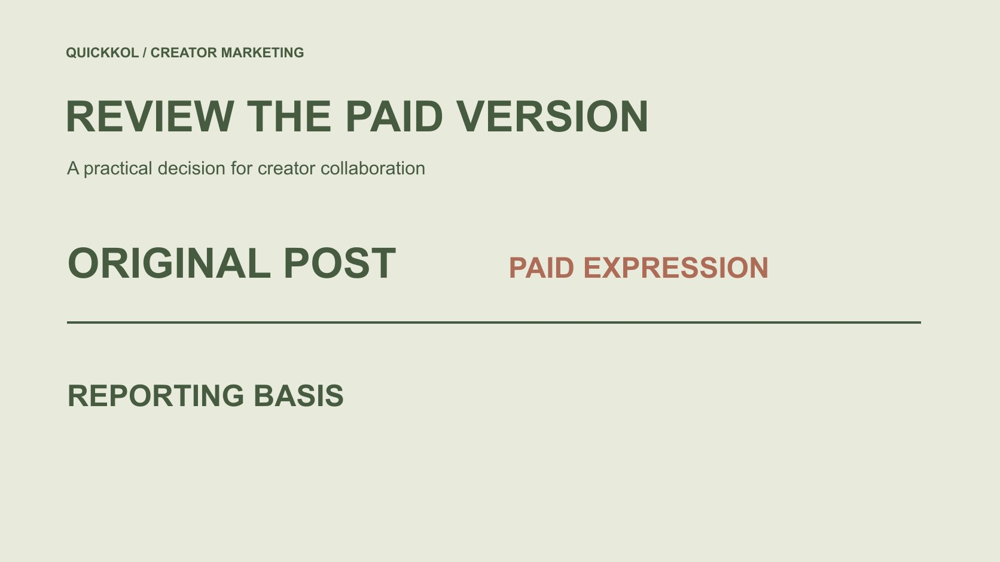
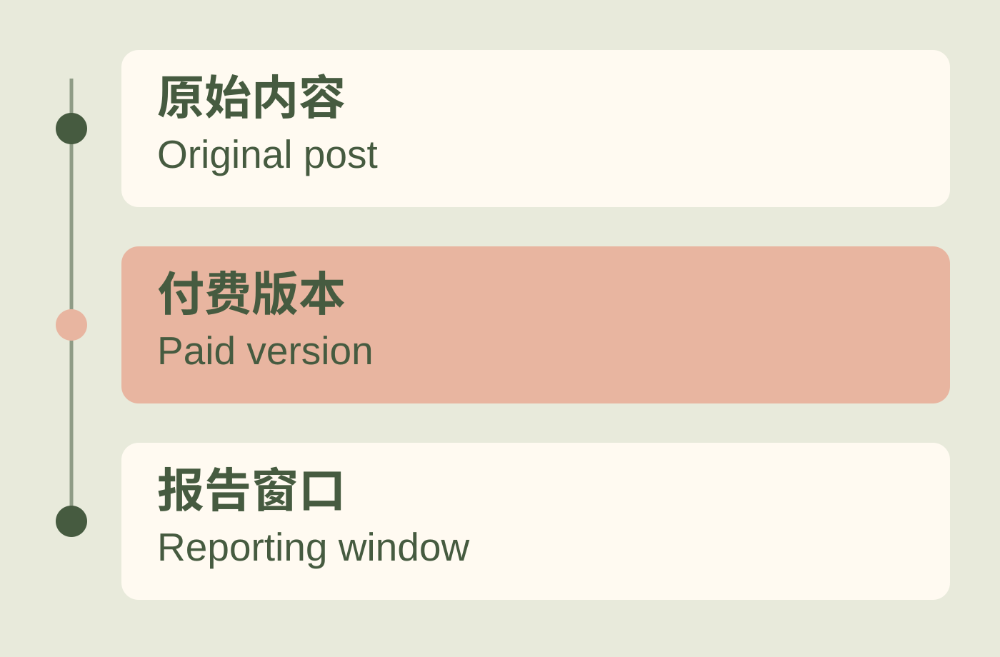

# LinkedIn Ads Manager: Review a Thought Leader Ad

Status: local review draft; confirm the publication date before release.

When reviewing creator sponsorship in LinkedIn Campaign Manager, separate the original post, actual ad version and reporting scope, including gradually available headlines, buttons and destinations.

QuickKOL editorial graphic; not actual account metrics or a platform interface.

A search for linkedin ads manager generally concerns LinkedIn Campaign Manager. Creator work through Thought Leader Ads requires more than reviewing the original post: inspect the actual sponsored version, any added ad elements, destination and reporting scope. LinkedIn’s member guidance describes gradually available sponsored-version additions while warning that not every advertiser has access, so one interface cannot be assumed for all accounts. Preserve the author’s meaning and distinguish paid reporting from combined observations on the member post for accurate review.

## Identify the content being reviewed

A company Page post, member original and sponsored member content are different objects. Confirm the address, author and proposed advertising role before combining brand-written ads with a creator’s public expression.

[LinkedIn’s Campaign Manager creation guide](https://www.linkedin.com/help/lms/answer/a5979260) describes requesting sponsorship of a member post and waiting for approval. This article concerns version review within that route; no private advertising account was tested, and this is not a tutorial covering every format.

The [LinkedIn advertising-handoff guide](https://www.quickkol.com/blog/linkedin-campaign-manager-kol-ad-handoff/#answer) helps prepare operational responsibilities, while review still needs the exact expression shown. A file passing editorial review does not establish that its author has seen every additional advertising element. Identify the object first so comments reach the correct version. The record should make it possible to locate the member post and distinguish its accepted wording from a later paid presentation, rather than let a generic asset name stand for several different things.

## Inspect the sponsored version actually available

[LinkedIn’s member sponsorship-request guide](https://www.linkedin.com/help/lms/answer/a5981274) describes gradually available ad headlines, action buttons, destinations and forms that appear only on the sponsored version without changing the original. It does not guarantee availability in every account.

A brand should neither insist that buttons never exist because of an older tutorial nor promise them to every project because new guidance mentions them. The current owner needs to confirm the actual interface, content type and access in the applicable account.

Retain the version observed for project review with its date. Without access, leave confirmation pending instead of creating a simulated platform screenshot presented as verification. An actual preview gives a better basis for understanding how the author’s expression enters paid presentation than a complete-looking concept file. The creator and brand can then discuss the available version rather than argue about features neither has confirmed for the assignment.

## An added headline should preserve the author’s meaning

An original post may describe conditional experience while a new headline compresses it into a universal promise. Read the elements together to retain necessary qualifications and avoid turning personal experience into an unsupported result guarantee.

For example, an author describing a device’s usefulness in their filming setting should not become a headline promising suitability for every professional assignment. The original can remain unchanged while the overall advertisement means something different. This hypothetical assesses no real product.

Write review comments as a specific issue and suggested expression so the author understands the effect. A request for more conversion power without supported facts leaves the creator guessing. Useful review retains a clear commercial invitation while keeping experience attributable to the person who actually had it. It also distinguishes an editorial shortening from a new factual claim, helping the team see which change needs more than a simple wording approval.

## Make the destination fulfill the actual invitation

An added route can send viewers from creator content to a brand page or another action. Match the destination to the particular statement and audience rather than direct every ad to an existing homepage. Watching an explanation and submitting business details are different levels of action.

For a form, make the advertisement and destination clear about what follows and who responds. The creator need not collect or handle every inquiry; the brand owns the receiving route and suitable arrangements.

The diagram separates original post, paid version and reporting window. Connect destination review to the actual paid version, especially when the original does not contain the same route. The post URL alone cannot establish that the whole invitation was checked. A reviewer should follow the available next step and see whether it completes the promise made beside the creator’s words, rather than inspect a destination independently without its advertising context.

Review the whole paid expression and identify the reporting source and scope.

## Separate permission status from editorial review

A platform sponsorship request relates to the parties’ understanding of work, uses and commercial conditions without being the same record. Approval of a platform request should not cause every added use to be described as included.

Retain request status, the actual version and open questions. When a brand changes the destination or claim, assess whether the author should confirm the whole meaning again rather than assume nothing changed because the original remains intact.

Appropriate account users perform operations, creators review their expression and brand owners confirm product facts and receiving routes. Match confirmation to responsibility instead of let several approval clicks obscure who substantiated a new headline. A concise handoff can identify the accepted expression and the decision still pending, allowing work to continue without the next operator treating a platform status label as evidence for a factual or commercial question it does not answer.

## Separate paid reports from combined post observations

[LinkedIn’s Thought Leader Ads guide](https://www.linkedin.com/help/lms/answer/a1450002) distinguishes Campaign Manager ad performance from aggregated organic-and-paid impressions and reach on the member original, noting that the latter excludes Audience Network metrics. Do not call that combined observation purely organic.

Specify source, object, period and field in the report. Interfaces can have different scopes, so subtracting two impression columns does not automatically reveal all organic activity. Confirm definitions and update timing first.

Separate the author’s expressive contribution from media distribution too. More impressions after expanded paid delivery do not establish changed organic influence, and a change on the original cannot automatically be assigned to an added headline. Match each conclusion to its records. If the data needed to separate components is unavailable, report the available component accurately rather than manufacture a complete organic-versus-paid result for the sake of a finished-looking presentation.

## Test version and reporting through a hypothetical project

Suppose an industry creator explains preparing a device demonstration in an original post. A brand wants to sponsor it and add a learn-more route where its account supports one. Retain the original, then check the added headline and destination instead of treating post approval as clearance of the whole ad.

For review, the brand retains its Campaign Manager ad record and the author retains scoped observations from their interface. If coverage differs, do not force a subtraction into a complete organic total. This hypothetical includes no actual advertising outcome.

The next action can be correcting an inaccurate destination explanation or confirming a field’s scope rather than assigning a growth guarantee the creator cannot establish from the records. The example connects version and measurement without promising every advertising format in every account. It also shows why a version record should travel with reporting: someone seeing only a final number cannot assess which expression and invitation were delivered.

## Record changes and stopping separately

A partnership may change with timing, product or author arrangements. When sponsorship should stop, an appropriate owner needs to confirm the actual state rather than a creator infer continued advertising from a public post remaining visible.

After an operation, record the particular ad or request status and observation time. An ad, ad set, other material and original post do not necessarily disappear together. Know which component was handled instead of report a partial change as closure of the entire campaign.

Retain an appropriate business route for remaining questions without collecting unrelated personal details or interpreting a stop as unreliability. Record facts that can be confirmed and leave unexplained motives unknown. This helps the next review distinguish an agreed schedule change from a technical status issue, rather than try to infer the whole commercial relationship from a single screen or a post that remains publicly accessible.

## Turn review findings into specific revisions

A review should deliver executable comments: a headline removed a condition, a route does not match the product or a report mixes scopes. Not good enough or poor results leaves the creator guessing what to change.

The [LinkedIn lead-readiness guide](https://www.quickkol.com/blog/linkedin-ads-b2b-lead-preflight/#answer) helps prepare receiving responsibilities, but content review still concerns the actual version’s accuracy. A page collecting information does not justify a creator’s promise of a business outcome, and report numbers do not establish every explanation.

Record accepted changes and unfinished work for the next operator. Separate factual corrections, creative suggestions and added uses rather than hide a new commercial request inside a copy edit. Identifying the type supports discussion of time and scope. It also keeps review focused: the creator can correct their expression, while a destination or reporting owner addresses the part they control instead of waiting for one person to solve every issue in the route.

## Understand LinkedIn ads manager through the actual version

Within creator partnerships, Campaign Manager is part of operations and reporting while the original and author’s contribution remain identifiable. A platform name should not become shorthand for all content, permission and outcomes being confirmed.

Check current official guidance and actual access before starting, inspect the whole paid expression during review and explain scope during reporting. Gradually available functions particularly need dates rather than one account’s interface being presented as everyone’s permanent route.

The practical value of LinkedIn ads manager is enabling brand and creator to proceed through an actual version, defined roles and interpretable records. A clear next action is more useful than inflated organic-performance claims or supposed account testing that never occurred. The record should leave another owner able to identify what was seen, what was accepted and what still needs confirmation before changing the collaboration.

## Review three distinct objects

| Object | Inspect | Do not confuse |
| --- | --- | --- |
| Member original | Author expression and post URL | Does not represent every added ad element |
| Actual sponsored version | Available headline, button and destination | Gradual rollout is not universal access |
| Ad report | Fields, dates and distribution scope | Not identical to combined post observations |
| Follow-up operation | Specific ad and request status | A component stop is not whole-campaign closure |

Based on official resources read November 17, 2026; no private account tested, and actual functions and scope need project verification.

## Before reviewing creator sponsorship

Connect expression, destination and reporting.

- [ ] Identify the original and actual version.
- [ ] Check elements available in the actual account.
- [ ] Preserve author meaning in added headlines.
- [ ] Follow the destination and inspect the invitation.
- [ ] Separate paid and combined reporting scopes.
- [ ] Assign revisions to suitable owners.

## Research date and limitations

Sources reviewed November 17, 2026. Methods, tables and decision rules are editorial recommendations. Hypothetical examples are not actual client results or industry benchmarks. Source geography and periods are specified where relevant.

## Start creator research with a clear task

Use QuickKOL to interpret a brief, discover relevant creators and research their work and contact routes. Verify data, commercial terms and outcomes at their source.

[Explore QuickKOL](https://www.quickkol.com/#capabilities)

## Sources

- [LinkedIn’s Campaign Manager creation guide](https://www.linkedin.com/help/lms/answer/a5979260)
- [LinkedIn’s member sponsorship-request guide](https://www.linkedin.com/help/lms/answer/a5981274)
- [LinkedIn’s Thought Leader Ads guide](https://www.linkedin.com/help/lms/answer/a1450002)
