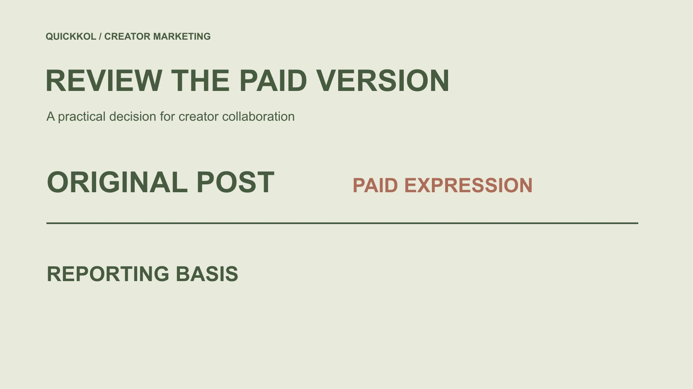
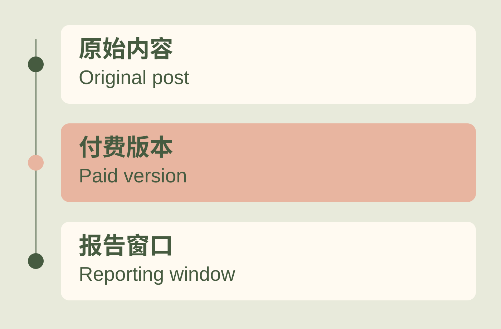

# LinkedIn 达人广告怎样核对版本

状态：本地审阅稿；正式发布日期待确认。

在 LinkedIn Campaign Manager 中审阅达人赞助内容时，把原帖、实际广告版本和报告范围分开，特别核对逐步开放的新增标题、按钮与目的地。

QuickKOL 编辑图形；不呈现真实账号指标或平台界面。

搜索 linkedin ads manager 时，品牌通常需要的是 LinkedIn Campaign Manager。与达人合作使用 Thought Leader Ads，不只是批准一条原帖：要核对实际赞助版本、可能新增的广告元素、目的地与报告范围。LinkedIn 的成员说明已描述逐步开放的赞助版标题、按钮等功能，同时提醒并非所有广告主可用，因此不能给每个账号套同一界面。品牌应保留作者认可的原意，并分开付费报告与个人帖子上的合并观察，才能准确审阅和复盘。

## 先确定审阅的是哪种内容

品牌页面帖子、成员原帖与赞助成员内容不是同一对象。先确认实际内容地址、作者和拟议广告角色，避免让团队把品牌自己写的广告与达人公开表达混在一起。

[LinkedIn 的 Campaign Manager 创建指南](https://www.linkedin.com/help/lms/answer/a5979260)介绍从成员帖子发起赞助请求并等待批准的路径。本文聚焦这条路径里的版本审阅，不声称测试了私人广告账号，也不提供覆盖所有格式的操作教程。

[LinkedIn 广告交接指南](https://www.quickkol.com/zh/blog/linkedin-campaign-manager-kol-ad-handoff/#answer)可以帮助准备操作职责；当前审核还要确认屏幕上具体显示了什么。一个文件已经通过内容审稿，不表示广告中的所有新增表达也已让作者看过。把对象先找准，后续意见才能落到正确版本。

## 核对账号实际提供的赞助版本

[LinkedIn 的成员赞助请求说明](https://www.linkedin.com/help/lms/answer/a5981274)描述了逐步开放的新增广告标题、行动按钮、目的地与表单，并说明这些只显示在赞助版本，原帖不因此改变。这不是所有账号都已能使用的保证。

因此，品牌不能只看旧教程断言一定没有按钮，也不能因为新说明出现就承诺每个项目都具备。实际界面、内容类型与访问条件，需要当前负责人在适用账号确认。

把看到的实际版本留作项目审阅依据，注明观察日。没有访问时保留待确认，不用制作一个仿真平台截图假装已经验证。真实预览比一张看起来完整的创意稿更能说明作者表达如何进入付费展示。

## 新增标题不能改变作者的意思

原帖可能解释一个有条件的经验，新增广告标题却可能把它缩成普遍承诺。审阅时把两者连在一起读，确认没有省略关键限定，也没有让个人体验变成品牌未支持的结果保证。

例如作者说明某个设备在自己的拍摄环境下有用，品牌不应把新增标题写成适合所有专业项目。即使原帖本身不改，广告整体也可能产生不同含义。假设例子不评价任何具体产品。

把修改意见写成具体问题与建议表达，让作者能够理解影响。不要只要求更有转化力，却不说明可以依据哪些事实。有效审稿应保留清楚的商业邀请，同时让真实经验仍然属于实际经历过的人。

## 让目的地完成广告邀请

新增入口可能让观众从达人内容进入品牌页面或其他动作。确认页面对应具体主张与对象，而不是因为品牌主页存在就把所有广告都导向那里。观看一段讲解与提交商务资料，是不同程度的行动。

需要表单时，让广告与页面准确说明接下来发生什么，以及由谁回应。达人没有必要收集或处理所有业务咨询，品牌应负责实际接收路径与适当安排。

图示把原始帖子、付费版本和报告窗口分开。目的地审阅也要与实际付费版本相连，尤其当原帖中没有同样入口时。不能只用原帖地址证明整个广告邀请已经被检查。

审阅整体付费表达，报告注明具体来源与范围。

## 把授权状态与内容审阅分开

平台赞助请求与双方对工作、使用和商业条件的理解相关，但不是同一记录。作者批准某次平台请求，不应该让团队把所有新增用途都写成已经包含。

保留当前请求状态、实际版本和仍需讨论的部分。品牌更换目的地或主张时，判断是否需要再次让作者确认整体含义，而不是因为原帖没有改就认为完全没有变化。

账号操作由适当权限的人完成，创作者可以审核自己的表达，品牌负责人确认产品与接收路径。让每项确认对应具体职责，避免多人都按过通过，最后却没有人知道一个新标题是谁提供依据。

## 付费报告与帖子合并数字分开

[LinkedIn 的 Thought Leader Ads 说明](https://www.linkedin.com/help/lms/answer/a1450002)区分 Campaign Manager 的广告表现与成员原帖上的自然、付费合并展示和触达，并提醒后者不反映 Audience Network 指标。不要把成员看到的合并数字称为纯自然结果。

报告应说明来源、对象、时段与字段。不同界面不一定具有相同范围，不能看到两列都叫展示就直接相减，声称得到全部自然量。先确认定义与更新时间是否对应。

品牌也要区分作者表达的贡献与媒体分发。扩大付费范围后总展示增加，不单独证明达人自然影响力改变；原帖数字变化，也不能自动归给某项新增标题。每个结论需要符合所用记录的范围。

## 用假设项目检查版本与报告的关系

假设一位行业创作者在原帖中解释如何准备设备演示，品牌希望赞助它，并在可用账号中添加了解更多入口。团队先保留原帖，再核对新增标题和实际目标页，不直接把原帖审核当作全广告通过。

报告时，品牌保留 Campaign Manager 对应广告记录，作者保留自己界面的有范围观察。若两者覆盖不同位置，不强求相减后得出完整自然数值。本例没有真实投放结果。

下一步可以是修改不准确的入口说明，或确认某个字段范围，而不是给达人一个无法依据资料完成的增长保证。这个例子展示版本和测量怎样连接，不承诺任何具体广告格式在全部账号可用。

## 变化与停止要分别记录

合作可能因时间、产品或作者安排变化而调整。需要停止某项赞助时，由适当负责人核对实际状态，不让创作者仅凭公开帖子还在就判断广告继续投放。

平台操作完成后，记录具体广告或请求状态及观察时间。广告、广告组、其他素材和原帖不一定同时消失；品牌要知道自己处理了哪一部分，避免在报告中把局部变化说成整个活动结束。

保留适当业务联系与问题路径，让双方能处理后续疑问。不要为了复盘收集不相关个人资料，也不把一次停止解释为创作者不可靠。记录能支持确认的事实，原因不清楚时保持未知。

## 把审阅发现转成具体修改

一次审阅应交付能执行的意见，例如某标题删除了适用条件、某入口没有对应产品，或某项报告混合不同范围。不要只写不够好或效果不好，让达人猜测需要改什么。

[LinkedIn 潜客准备指南](https://www.quickkol.com/zh/blog/linkedin-ads-b2b-lead-preflight/#answer)可以帮助安排后续接收责任，但内容审阅仍要看实际版本是否准确。页面能收到信息，不表示创作者应该承诺某个商业结果；报告有数字，也不代表所有解释都成立。

记录接受的修改与仍未完成部分，让下一位操作负责人继续。可以分开事实修正、创意建议与新增用途，避免把一项新的商业请求藏在普通改字意见中。明确类型有助于双方讨论时间与范围。

## 用实际版本理解 LinkedIn ads manager

在达人合作中，Campaign Manager 是操作与报告的一部分，原帖和作者贡献仍需要清楚保留。不要把平台工具名称当作所有内容、权限与结果都已确认的简写。

开工前核对当前官方资料与实际访问，审阅时看整体付费表达，复盘时说明记录范围。功能逐步开放时尤其要保留日期，不把一个账号看见的界面写成所有人的固定路径。

LinkedIn ads manager 的实用价值，是让品牌与创作者可以围绕真实版本、明确角色与可解释报告继续合作。一个清楚的下一步，比夸大自然表现或假装已经完成所有账号测试更有用。

## 三个对象分别核对

| 对象 | 需要看什么 | 不应混淆 |
| --- | --- | --- |
| 成员原帖 | 作者表达与内容地址 | 不代表全部新增广告元素 |
| 实际赞助版本 | 可用标题、按钮与目的地 | 逐步开放不等于人人可用 |
| 广告报告 | 字段、时间与分发范围 | 不等同于原帖合并观察 |
| 后续操作 | 具体广告与请求状态 | 局部停止不是全部活动结束 |

依据 2026 年 11 月 17 日已读官方资料；未测试私人账号，实际功能和范围仍需项目核对。

## 审阅达人赞助版本之前

把表达、入口与报告连接起来。

- [ ] 确认成员原帖与实际版本。
- [ ] 核对当前账号可用元素。
- [ ] 让新增标题保留作者原意。
- [ ] 跟随入口检查真实邀请。
- [ ] 分开付费与合并报告范围。
- [ ] 把修改交给合适负责人。

## 研究日期与使用边界

资料核验于 2026 年 11 月 17 日。文中方法、表格和决策规则为编辑建议，标为假设的示例不是实际客户结果或行业基准。外部资料的适用地区与时期按各段说明。

## 从任务开始达人研究

用 QuickKOL 理解 Brief、发现相关达人并研究作品与联系路径；数据、合作条件和结果仍需核验。

[了解 QuickKOL](https://www.quickkol.com/#capabilities)

## 来源

- [LinkedIn 的 Campaign Manager 创建指南](https://www.linkedin.com/help/lms/answer/a5979260)
- [LinkedIn 的成员赞助请求说明](https://www.linkedin.com/help/lms/answer/a5981274)
- [LinkedIn 的 Thought Leader Ads 说明](https://www.linkedin.com/help/lms/answer/a1450002)
