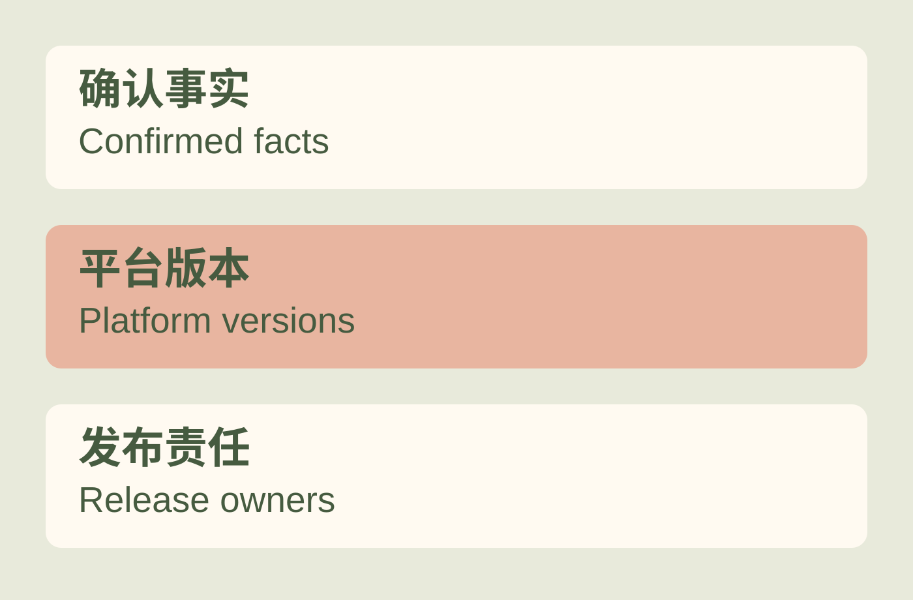

# Manage Multiple Social Media Accounts Without Version Drift

Status: local review draft; confirm the publication date before release.

Separate shared facts, platform expressions and actual operators so a multi-account creator campaign can change accurately instead of copying one file everywhere.

To manage multiple social media accounts, establish who owns each account and what it contributes to the creator campaign. Then coordinate facts, versions, publication and responses. The brand confirms shared product and commercial information while accounts express it in appropriate formats; each proposed release has an owner and current status. Scheduling tools reduce operations without independently confirming permission, product accuracy or the effects of a change. Defining those responsibilities is more useful than optimizing only for publishing everywhere at once.

## Map the accounts actually involved

List brand, regional, product-series and creator accounts with a reason for each account's participation. A creator publishing account is not automatically an account the brand can operate, nor every channel using a similar name.

The [account-identity mapping guide](https://www.quickkol.com/blog/instagram-accounts-collaboration-identity-map/#answer) helps check public identity and collaboration contact. This workflow adds who produces, publishes and handles follow-up, rather than treat discovery as management permission.

A product demonstration might involve an original creator video, a brand explanation and a regional service update. Each has a purpose without doing the same work. Remove redundant versions before adding more scheduling complexity. An account register should include the actual public destination and responsible organization, making it possible to distinguish a regional adaptation from an accidental duplicate or an unrelated profile before anyone prepares a release.

## Give shared facts an identifiable source

Product names, actual versions, applicable conditions and campaign dates need an identifiable person able to confirm them. A shared fact record includes its source, scope and update time instead of relying on something said somewhere in a conversation.

Record regional differences separately. Stock or service information for one market cannot become another market's promise through copying. A creator can describe experience while the brand remains responsible for accurate business facts.

Retain information needed for the assignment. Content staff need to know which version applies without receiving customer personal records or complete private-account information. A bounded record is easier to understand and update. It also helps a reviewer distinguish a change to the underlying offer from a creative wording preference, preventing a factual correction from being lost among comments about color, music or pace.

## Let each platform version do its own job

The same fact can support different content without requiring identical lines and edits. Short video, long video, still posts and live sessions arrange information differently while retaining essential qualifications.

Give a version a recognizable name with language, format, main action and destination. Naming everything final leaves people guessing from message order which file can actually go out.

Multiple versions should preserve the creator's contribution. A brand can define facts and objectives without making different creators sound identical. Review accuracy and task completion before deciding whether another shoot is needed, rather than overlay a uniform template on useful expression. Where an adaptation removes a demonstration step, check whether the remaining content still supports the statement; a shorter file is not automatically an equivalent account version just because it uses footage from an approved original.

## Assign access according to the task

[Meta’s Instagram business-asset documentation](https://developers.facebook.com/docs/business-management-apis/business-asset-management/guides/instagram-accounts) distinguishes content, messaging, community, advertising and analysis tasks. That official structure supports separating operational responsibilities; this article has not configured a reader's business account.

Give comment responders, file producers and advertising operators the access their actual work needs. A creator partnership does not require the brand to surrender a complete password set or the creator to disclose personal-account credentials.

Confirm capabilities before work and review access that is no longer needed afterward. Keep platform permissions separate from commercial use: entering an account does not establish unlimited use of every asset. This makes offboarding a practical part of the assignment, with someone responsible for checking both remaining access and any continuing obligation to answer questions about published content.

Keep shared facts consistent while confirming expression and operations per account.

## Check each tool rather than assume common access

[YouTube’s channel-permissions guide](https://support.google.com/youtube/answer/9481328?hl=en) describes role-based access without sharing a Google password, with role and platform limitations. Importing another platform's assumptions can leave a planned action impossible to perform.

[TikTok’s 2024 Studio announcement](https://newsroom.tiktok.com/helping-creators-bring-creativity-to-life-with-tiktok-studio?lang=en) describes creation, management and analytics while distinguishing app and web capabilities. This is dated product context rather than a guarantee that every current account has identical functions.

Confirm the actual account and tool capabilities before assigning an operator. A common dashboard does not justify excessive access, and an unsupported action should not be marked published. In a mixed-platform campaign, a person may prepare a version without having the ability to release it; record the handoff explicitly so an internal approval is not mistaken for a platform action that still requires another authorized owner.

## Check dependencies before scheduling

A calendar time is not evidence of readiness. Product facts, creator confirmation, use scope and the destination should reach the state required for that version before release is scheduled.

A supply delay in one region can change its version without forcing other accounts to copy incorrect information. Record the dependency, confirmer and next action instead of attributing every delay to content staff.

The [social-post scheduling workflow](https://www.quickkol.com/blog/social-media-schedule-creator-launch-dependencies/#answer) helps organize preparation and release. Multiple accounts additionally need version relationships so a factual change can be traced to affected scheduled content. Reminders support execution while the responsible people make the decision. This is particularly useful when the video is ready but its destination is not: the team can identify an unresolved receiving step instead of commissioning an unnecessary creative revision that leaves the same release dependency untouched.

## Confirm the version that actually appeared

Approved, scheduled and published are different states. After release, record the actual link, account and version, checking the image, description, commercial context and destination together.

Do not check one account and automatically mark the rest complete. Formats, languages and manual operations can introduce independent differences. If the observed content diverges from the record, route it to the person responsible for that version.

Assign responses by account as well. Creators describe personal experience, brands confirm product facts and regional teams handle local service. Viewers do not need the internal organization chart, but their question needs someone able to continue. A release record should therefore identify a receiving owner as well as the person who pressed publish, especially where the publishing operator's involvement ends before campaign questions stop arriving.

## Rehearse the workflow with one hypothetical change

Suppose an organizer partnership involves an English demonstration, brand still content and a regional supplement. Before filming, a dimension is corrected. The fact owner identifies the change and applicable product version, then notifies the three content owners.

The English script needs a number changed, the brand visual needs its explanation updated, and the regional item may need no edit if it does not mention dimensions. Record that review rather than remake everything to demonstrate activity or update only the first file encountered.

This hypothetical includes no client outcome. It shows how one change reaches affected content with a reason for the decision. Useful management allows the next person to understand why a version can proceed without reconstructing the project. The same method also handles an already published item, though its owner must decide the appropriate correction for the actual content and platform rather than assume replacing a local file changes the live post.

## Keep account and version scope in measurement

Keep platform, account, format, organic or paid status and observation time in a multi-account report. Identical metric names can have different definitions, and adding views or interactions does not produce a count of distinct people.

Operational records can show versions completed, facts corrected and questions received; performance records show observed actions. Without the necessary business evidence, operational efficiency should not become a claimed sales increase.

The practical answer to how to manage multiple social media accounts is a traceable relationship between factual updates, platform expression, authorized operations and actual responses. This reduces repeated work while preserving meaningful differences between creators and accounts. Review can then identify a specific improvement, such as clarifying a receiving owner or changing a version name, rather than demand more automation without knowing which part of the collaboration is actually causing confusion.

## Handle one change across two languages

Suppose the brand changes an English statement from fitting every drawer to asking viewers to check internal dimensions first. The Chinese version should not retain the old promise and pass merely because its file has a newer date. A bilingual reviewer needs to compare meaning, not only filenames.

Language review also checks product names, units, tone and necessary conditions. Where local service differs, record the reason rather than require word-for-word identity. Separate the factual confirmer from the language reviewer so factual approval is not mistaken for complete translation acceptance.

The final record identifies which versions changed, which destinations need corresponding updates and which language is still awaiting confirmation. This prevents every language entering release status just because a master file is complete. It also gives the creator a precise revision request, rather than a vague instruction to make the local version match a source that has itself continued changing.

## Keep a receiving owner after the handoff

A temporary operator can leave while published content continues receiving questions. Handoff should retain a working receiving route and live links rather than only unpublished files.

Identify any continuing use scope and expiry arrangement. A later brand edit does not become automatically permissible because the original operator is unavailable; someone able to assess the actual change needs responsibility.

If the partnership requires no continuing maintenance, still identify retained content, necessary correction handling and how access ends. Completion means responsibilities have reached a defined end, not that every record disappears. A concise closing note can explain outstanding product questions, an approaching replacement date or a destination controlled by another team, giving the ongoing account owner information they can use without reopening every production conversation.

## Four layers of an account record

| Layer | Record | Update owner |
| --- | --- | --- |
| Facts | Version, conditions, source | Brand fact owner |
| Content | Language, format, file | Assigned creator or editor |
| Operations | Access, status, link | Authorized publisher |
| Response | Questions and receiving route | Person able to continue |

Editorial management guidance, not a feature list available on every platform.

## Before a multi-account release

Make a version accurately handoff-ready.

- [ ] Confirm account ownership and task.
- [ ] Retain sources for shared facts.
- [ ] Name each platform version clearly.
- [ ] Check access and ownership by task.
- [ ] Review scheduled content affected by changes.
- [ ] Record actual links and response routes.

## Research date and limitations

Sources reviewed November 17, 2026. Methods, tables and decision rules are editorial recommendations. Hypothetical examples are not actual client results or industry benchmarks. Source geography and periods are specified where relevant.

## Start creator research with a clear task

Use QuickKOL to interpret a brief, discover relevant creators and research their work and contact routes. Verify data, commercial terms and outcomes at their source.

[Explore QuickKOL](https://www.quickkol.com/#capabilities)

## Sources

- [Meta: Instagram business assets and task permissions](https://developers.facebook.com/docs/business-management-apis/business-asset-management/guides/instagram-accounts)
- [YouTube’s channel-permissions guide](https://support.google.com/youtube/answer/9481328?hl=en)
- [TikTok’s 2024 Studio announcement](https://newsroom.tiktok.com/helping-creators-bring-creativity-to-life-with-tiktok-studio?lang=en)
