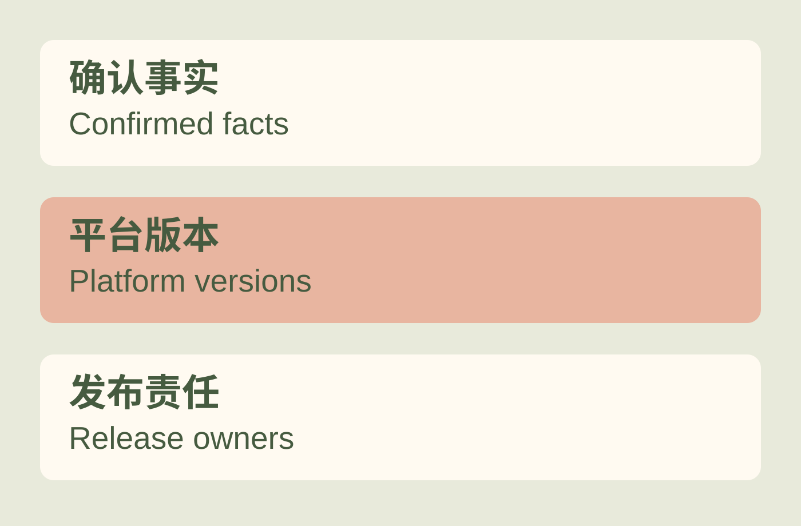

# 多账号合作怎样保持达人版本一致

状态：本地审阅稿；正式发布日期待确认。

把共同事实、各平台表达与实际操作人分开管理，让多账号达人合作能准确更新，而不是把同一文件复制到所有地方。

管理多个社交媒体账号，先明确每个账号属于谁、承担什么达人合作任务，再管理事实、版本、发布与回应。品牌共同确认产品和商业条件，各账号按自己的内容形式表达；每个待发布版本有负责人和当前状态。排期工具可以减少操作，但不会自动确认授权、产品事实或变更影响。把这些责任写清，比单纯追求一次发布到所有账号更有用。

## 先画出实际合作账号

列出品牌、地区、产品系列和达人账号，说明每个参与本次合作的理由。一个达人发布账号不等于品牌团队可以直接操作的账号，也不等于其他同名频道。

[账号身份地图指南](https://www.quickkol.com/zh/blog/instagram-accounts-collaboration-identity-map/#answer)帮助核对公开身份与合作联系。这里进一步记录谁制作、谁发布、谁处理后续问题，不把发现一个账号当成取得管理权限。

例如一个产品演示可能有达人原始视频、品牌补充说明和地区服务更新。三者各有任务，不必全部做同一件事。先删去没有实际作用的复制版本，团队才容易管理真正需要的内容。

## 共同事实只确认一次来源

产品名称、实际版本、适用条件和活动期限，应找到能确认的人。共同事实记录包含来源、适用范围与更新时间，而不是把“已经在聊天里说过”当成可执行依据。

如果地区条件不同，就分别记录。一个市场的库存或服务说明不能随复制自动变成其他市场承诺。达人可以讲述体验，但品牌仍负责提供准确业务事实。

记录只保留合作需要的信息。内容团队需要知道哪个版本可用，不需要得到客户个人资料或整套私人账户信息。资料范围明确，更新才容易被理解和使用。

## 各平台版本保留自己的任务

同一事实可以进入不同内容，不代表需要同一句台词和同一段剪辑。短片、长视频、图文和直播需要不同信息安排，但都不能改变关键限定。

给版本一个可识别名称，记录语言、画幅、主要动作与目的地。不要只把最终文件称为 final，再用聊天顺序猜哪一个可以发。

多版本还应保留达人的实际表达。品牌可以明确事实和目标，不必让不同创作者听起来完全一样。审核看表达是否准确、任务是否完成，再判断是否需要新的拍摄，而不是用统一模板盖过贡献。

## 权限按实际任务分配

[Meta 的 Instagram 商业资产说明](https://developers.facebook.com/docs/business-management-apis/business-asset-management/guides/instagram-accounts)把内容、消息、社区、广告与分析列为不同任务。这个官方结构说明操作权限可以按工作区分，不代表本文已经替读者配置了某个商业账户。

让回应评论的人、制作文件的人和管理广告的人拥有实际需要的权限。达人合作也不要求品牌交出整套密码，或要求达人交出私人账户凭据。

开始前确认谁能做什么，结束后检查不再需要的访问。权限设置与商业使用范围分开：能进入后台不等于已经获得任何素材的无限用途，不能把技术访问当成全部合作授权。

共同事实保持一致，表达和操作按账号分别确认。

## 别把工具支持当作统一权限

[YouTube 的频道权限说明](https://support.google.com/youtube/answer/9481328?hl=en)介绍无需共享 Google 密码的角色访问，同时不同角色和平台存在限制。把其他社交平台的做法直接套在频道上，可能让计划中的操作无法完成。

[TikTok 的 2024 年 Studio 公告](https://newsroom.tiktok.com/helping-creators-bring-creativity-to-life-with-tiktok-studio?lang=en)介绍创作、管理和分析，并区分应用与网页能力。这是有日期的产品背景，不是所有当前账号功能完全相同的保证。

因此，先确认本次账号与实际工具支持哪些动作，再安排负责人。不需要为了使用一个统一仪表盘而给出超范围权限，也不要在工具不支持时默认某项内容已经发布。

## 排期前检查依赖是否完成

日历上的时间不是准备完成的证据。产品事实、达人确认、使用范围和实际入口应达到本次版本需要的状态，才进入发布安排。

如果某个地区延迟供货，可以调整该版本，不必让其他地区复制错误信息。排期表记录等待什么、由谁确认与下一步，不把所有延期简单归咎于内容团队。

[社交排期工作指南](https://www.quickkol.com/zh/blog/social-media-schedule-creator-launch-dependencies/#answer)可以帮助组织准备与发布。多账号合作还需要一份版本关系，知道一项事实变化会影响哪些已排期内容。工具提醒支持执行，实际判断仍由负责的人完成。

## 发布后核对实际出现的版本

已审批、已排期和已上线是不同状态。发布后记录实际链接、账号和版本，检查画面、说明、商业关系与目的地是否对应。

不要只检查一个账号，再把同批其他内容自动写成通过。不同画幅、语言或手工操作都可能出现独立变化。实际内容与记录不同，就找负责该版本的人处理。

回应也按账号安排。达人讲述个人体验，品牌确认产品事实，地区团队处理当地服务。观众不需要理解内部组织图，但每个问题应能找到有能力继续处理的人。

## 用一次变化演练更新过程

假设一个达人收纳系列涉及英语演示、品牌图文和地区补充。产品尺寸在拍摄前得到修正，事实负责人注明变化与适用版本，再通知三个版本的负责人。

英语脚本需要改数字，品牌图文需要换说明，地区补充若没有涉及尺寸，则记录检查后不需修改。不能为了证明忙碌而全部重做，也不能只改最先看见的文件。

这个假设没有实际客户结果。它展示如何从一项变化找到受影响内容，并保留检查理由。真正有价值的管理，是让下一位接手的人知道为什么某个版本可以继续，而不必重新猜测整个项目。

## 测量时保留账号与版本范围

多账号报告先保留平台、账号、内容类型、自然或付费与观察时间。相同指标名称也可能有不同定义，不要把所有观看或互动直接加成独立人数。

工作记录可以说明多少版本完成、哪些事实被修正、哪些问题被接住；表现记录说明观察到什么。没有完整业务证据，就不把操作效率写成销售提升。

How to manage multiple social media accounts 的核心，是让事实更新、平台表达、授权操作与实际回应形成可追踪关系。团队可以减少重复劳动，同时保留每位达人与每个账号真正需要的差异。

## 两种语言怎样处理同一变化

假设品牌在英语说明中把“适合所有抽屉”改成“请先核对内部尺寸”。中文版本不能只保留旧承诺，再因为文件日期较新就标成通过。负责双语的人需要核对实际意思，而不只是比较文件名。

语言审阅同时确认产品名称、单位、语气和必要条件。当地服务信息有差异时，记录差异原因，不强求逐字相同。把品牌事实负责人和语言负责人分开，事实确认才不会被误当成完整翻译验收。

最终记录指出哪些版本改变、哪些入口需要同步，以及哪个语言仍在等待确认。这样不会因为一个主文件完成，就让所有语言自动进入发布状态。

## 交接结束后仍保留接收人

一个临时运营人员离开后，账号里的内容仍可能继续收到问题。交接时留下有效接收路径和已发布链接，而不是只交出未发布文件。

同时标明仍有效的使用范围与到期安排。品牌后续更改素材，不能仅因原操作人不在就假设无需再次确认；实际变化应由能判断的人接手。

如果合作无需继续维护，也应说明哪些内容保留、谁处理必要更正，以及访问如何结束。完成状态需要对应实际责任结束，不是把所有记录清空。

## 多账号记录分四层

| 层次 | 记录什么 | 更新责任 |
| --- | --- | --- |
| 事实 | 版本、条件、来源 | 品牌事实负责人 |
| 内容 | 语言、形式、文件 | 对应创作者或编辑 |
| 操作 | 权限、状态、链接 | 授权发布人 |
| 回应 | 问题与接收路径 | 能继续处理的人 |

编辑管理建议，不是所有平台均提供的功能清单。

## 多账号发布前核对

让一个版本可以被准确接手。

- [ ] 确认账号归属与实际任务。
- [ ] 为共同事实保留来源。
- [ ] 给每个平台版本明确名称。
- [ ] 按任务核对权限与负责人。
- [ ] 检查变化影响的排期内容。
- [ ] 记录实际链接与回应路径。

## 研究日期与使用边界

资料核验于 2026 年 11 月 17 日。文中方法、表格和决策规则为编辑建议，标为假设的示例不是实际客户结果或行业基准。外部资料的适用地区与时期按各段说明。

## 从任务开始达人研究

用 QuickKOL 理解 Brief、发现相关达人并研究作品与联系路径；数据、合作条件和结果仍需核验。

[了解 QuickKOL](https://www.quickkol.com/#capabilities)

## 来源

- [Meta：Instagram 商业资产与任务权限](https://developers.facebook.com/docs/business-management-apis/business-asset-management/guides/instagram-accounts)
- [YouTube 的频道权限说明](https://support.google.com/youtube/answer/9481328?hl=en)
- [TikTok 的 2024 年 Studio 公告](https://newsroom.tiktok.com/helping-creators-bring-creativity-to-life-with-tiktok-studio?lang=en)
