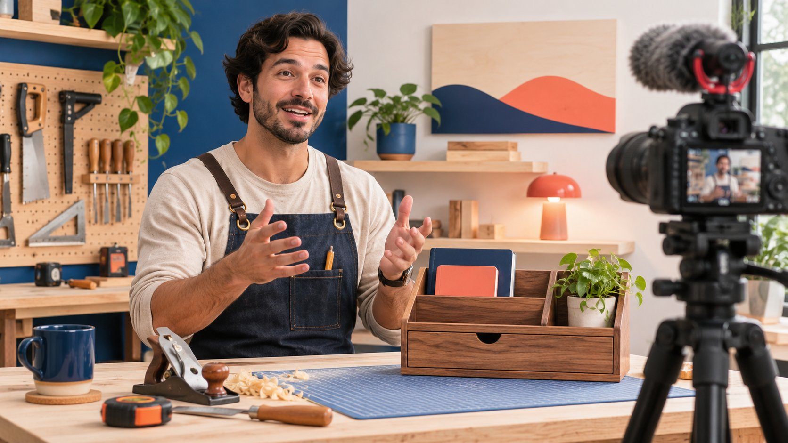
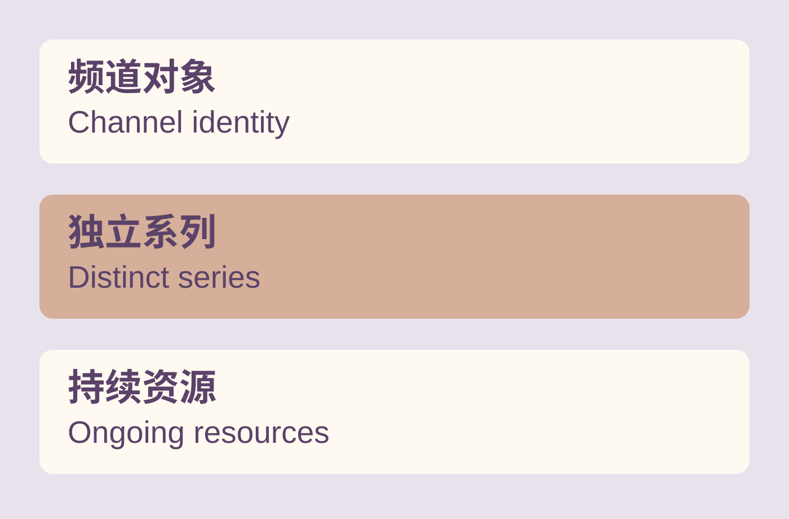

# Create a New YouTube Channel for a Distinct Creator Series

Status: local review draft; confirm the publication date before release.

Choose a channel or playlist for a new creator series before following official creation steps and assigning its ongoing theme, roles, viewer route and resources.

Before a new creator series, decide whether it needs an ongoing distinct channel identity or a playlist within an existing channel will serve. YouTube’s official creation routes involve signing in, selecting the appropriate route and setting a picture, name and handle, with personal and business-name arrangements distinguished. Then assign the series theme, layout, publication and continuing response. Answering how to create a new YouTube channel means more than completing an account action: confirm that the brand and creators can maintain the new content commitment.

## Define what the new channel represents

A short partnership and a continuing creator series need different arrangements. State whether the channel represents the brand, a creator or a defined series and why viewers would return, rather than assume that inventing a name establishes a distinct need.

If content still serves the existing channel’s audience question, consider a playlist or section first. The [multi-creator playlist-maintenance guide](https://www.quickkol.com/blog/youtube-playlist-multi-creator-release-maintenance/#answer) offers a lighter organization route. A new channel needs a clear theme and continuing roles rather than make one activation appear larger.

A brand regularly inviting woodworking creators to explain small household projects may define a distinct series promise; three existing works may need only a collection. This is an editorial choice, not a distribution guarantee. Assess it through the actual viewer task and resources instead of treat every new campaign as a reason to create another identity that nobody has agreed to maintain afterward.

## Choose the creation route for the actual identity

[YouTube’s channel-creation guide](https://support.google.com/youtube/answer/1646861?hl=en) distinguishes personal channels from business or other names. The personal route on a computer or mobile site uses profile picture, Settings, Account, Add or manage channel(s), then Create a channel, followed by picture, name, handle and confirmation.

The business-name route begins from the channel list and a new-channel choice. Handle existing Brand Accounts according to what actually appears rather than assume selection always creates instead of switches. No private account was operated here.

Confirm the name and role first rather than register a personal identity the creator has not agreed to represent. If a function is unavailable or differs, check current official conditions instead of describe an unsuccessful creation as an established channel. Retain the actual resulting URL and identity so later work begins with the channel created, not an intended name that might refer to another account.

## Give the series a sustainable content scope

A series can organize around one class of question without promising every subject. Define what belongs, what needs another specialist and how product partnerships enter, rather than let each invitation redefine the channel’s theme.

Creators should know whether they contribute one episode, a segment or an ongoing role. One appearance does not establish permanent hosting or unlimited use of their likeness as the channel’s representative. Confirm series identity and individual work separately.

For a woodworking series about organization and making, the brand supplies support for relevant product facts. Expansion should not assign unrelated subjects to the existing presenter automatically. A clear scope makes relevant work easier to find for later collaborations. The series can evolve through explicit decisions, with a new role or topic discussed on its own merits rather than quietly added to an earlier contributor’s obligations because their first episode appeared under the new channel name.

## Use layout to make the series understandable

[YouTube’s channel-layout guide](https://support.google.com/youtube/answer/3219384?hl=en) describes a Home tab, trailer, featured video and sections including playlists. These can organize a series entrance without configuration guaranteeing views or subscriptions.

For example, the homepage can introduce an already released season while describing the next one as planned. Do not place every guest in a permanent team description that implies continuing participation.

Viewers should understand where to begin, what exists and how the channel relates to creators. Names, descriptions and the homepage should not imply that every guest is a permanent member or that unreleased work is already available.

The diagram connects channel identity, a distinct series and ongoing resources. Plan actual available content before visual decoration. An attractive empty shell does not replace series preparation, while a few uploaded videos do not establish an accurate homepage. Review the entry as a new viewer would: the promise made in the introduction should correspond to something they can actually locate, with planned future material described as planned rather than used to disguise the current collection’s size.

A new channel needs a distinct promise and actual maintenance; creation is one step.

## Use permissions for actual work

[YouTube’s channel-permissions guide](https://support.google.com/youtube/answer/9481328?hl=en) describes role-based access without sharing a Google Account password. Give production, publication or reporting users suitable access and check actual role and platform limits rather than grant full control to every series participant.

The [channel-collaboration ownership guide](https://www.quickkol.com/blog/create-youtube-channel-kol-series-ownership/#answer) provides further management context. This architecture decision still needs an ongoing owner first; permissions support the work without replacing commercial or asset arrangements.

Brand and creator can retain their actual work confirmation separately. Upload capability does not authorize publication of every item, and reporting access does not authorize public disclosure of everything visible. Define the task before access and maintain it when work ends or a person changes. This lets the series continue without confusing the public face of an episode with the person responsible for maintaining the channel’s operational identity.

## Retain the scope of each episode

A series can share visual style and theme while each contributor still needs a specific brief. Define the explanation, actual product or information, factual reviewer and required versions rather than send only the channel link and expect a guest to infer the assignment.

After an episode, confirm assets and descriptions reflect the real role. One appearance does not establish endorsement of all later material or make another contributor’s statements the guest’s views.

A new advertising or language use returns to the actual scope. Brand management of the channel does not make every individual contribution unlimited. These boundaries preserve creator work as the series grows. They also improve commissioning: the next guest can assess a defined contribution instead of agree to an open-ended channel relationship whose future content, uses and response demands have not yet been described.

## Ongoing resources include work after release

A new channel may need more than filming: organizing routes, answering questions, updating product facts and handling older work. Assign owners according to the task rather than copy a fixed daily-upload frequency.

With a one-activation budget, discuss what follows. The channel can retain an accurate archive or stop new additions, but its description should not continue promising an unattended regular program. Guest follow-up needs an appropriate scope too.

Resource arrangements can adapt. Observe what one assignment requires before expanding rather than treat creation itself as proof of continuing production capacity. A clear promise the team can maintain is more useful than regular output with inaccurate content. The decision record should show who updates the channel if a featured product changes or a project ends, making long-term maintenance a real responsibility instead of a vague expectation placed on whichever creator first appeared.

## Decide through a hypothetical series

Suppose a brand prepares three woodworking-creator videos answering one household organization question without a continuing program. A clear playlist on the existing channel may suffice instead of a new channel created for the series name alone.

Alternatively, a continuing project may invite different creators to explain household work with a distinct identity, information and maintenance team. Evaluate a new channel while confirming resources rather than let an idea replace ownership arrangements.

Neither hypothetical contains client results or supplies a universal recommendation. Structure follows the theme and ongoing work, judged through the viewer promise and team capacity rather than a new channel seeming more official or a playlist sounding too small. The comparison can leave the decision open until the brand confirms who maintains the series, giving a practical reason to choose one route rather than an assumption that greater structural complexity produces a better partnership.

## Assess the structure without calling creation growth

Successful creation can establish identity, URL and settings, not viewer understanding or guaranteed growth. Separate structural completion, content delivery and viewing observations rather than call configuration a business result.

After release, inspect whether viewers can locate relevant content, repeated questions reveal missing introductions and maintenance has an owner. Use appropriate records and scope for performance rather than attribute every change to a channel switch.

If the structure does not fit, assess a concrete improvement such as the homepage, playlist organization or narrower theme. Do not immediately demand every creator reshoot or infer restriction because views disappoint. Connect findings to executable action. The series can improve through a clearer entry or more accurate description even when the available evidence cannot establish a broader effect on audience growth, leaving the larger outcome question separate from a directly observed navigation problem.

## Choose the structure, then create and hand over

The practical steps for how to create a new YouTube channel follow official guidance; whether to create one needs the series identity, viewer task and continuing resources established first. Answer those questions separately.

Prepare the theme, roles, route and ongoing owner, then check creation and public presentation. A new name should not automatically create permanent relationships for all guests or turn technical access into every commercial permission.

The resulting channel can become a maintainable creator-marketing space. The brand understands its promise, creators understand their contribution and the next owner understands the handoff instead of receive only an empty address. Creation then serves a defined content architecture rather than become an end in itself, with future additions commissioned and reviewed as actual work instead of assumed to follow automatically from the platform setup.

## Choose a structure around the series need

| Arrangement | Situation to discuss | Ongoing responsibility |
| --- | --- | --- |
| A video on an existing channel | One defined creator assignment | Content facts and use |
| Playlist on an existing channel | Related work needs a shared route | Entries, visibility and updates |
| Section within an existing channel | Theme still serves the same identity | Homepage and content scope |
| A new channel | A distinct continuing series with resources | Identity, publication and maintenance |

Editorial architecture choices, not distribution or income forecasts; confirm actual account eligibility and functions.

## Six checks before a new channel

Make the structure serve creator work.

- [ ] Define the distinct identity and viewer promise.
- [ ] Compare a video, playlist and new channel first.
- [ ] Choose the creation route for the actual identity.
- [ ] Prepare real content and the homepage route.
- [ ] Assign continuing publication, response and access.
- [ ] Separate completed creation from business outcomes.

## Research date and limitations

Sources reviewed November 17, 2026. Methods, tables and decision rules are editorial recommendations. Hypothetical examples are not actual client results or industry benchmarks. Source geography and periods are specified where relevant.

## Start creator research with a clear task

Use QuickKOL to interpret a brief, discover relevant creators and research their work and contact routes. Verify data, commercial terms and outcomes at their source.

[Explore QuickKOL](https://www.quickkol.com/#capabilities)

## Sources

- [YouTube’s channel-creation guide](https://support.google.com/youtube/answer/1646861?hl=en)
- [YouTube’s channel-layout guide](https://support.google.com/youtube/answer/3219384?hl=en)
- [YouTube’s channel-permissions guide](https://support.google.com/youtube/answer/9481328?hl=en)
