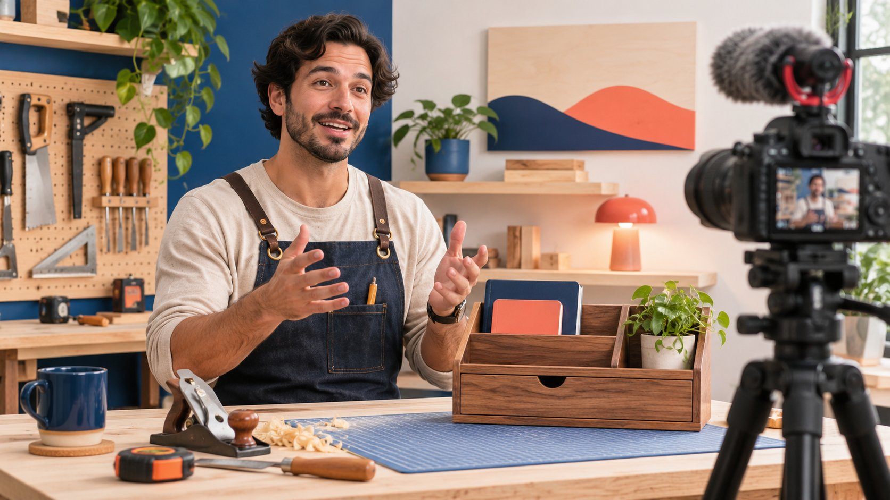
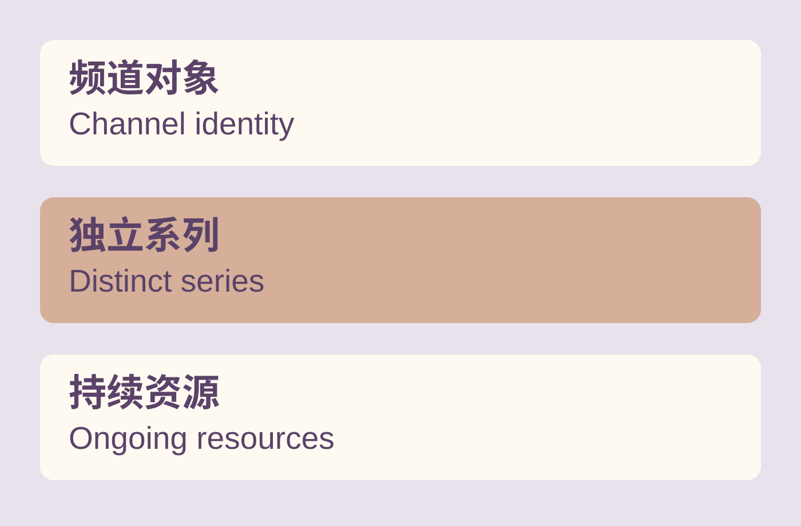

# 新达人系列是否需要单独频道

状态：本地审阅稿；正式发布日期待确认。

为新的达人系列先选择频道或播放列表，再按官方路径创建，并安排持续主题、实际角色、内容入口与维护资源。

准备新的达人系列时，先判断是否需要持续独立的频道身份，还是现有频道里的播放列表已经足够。YouTube 官方创建路径要求登录、选择对应创建入口，再设置头像、名称与 Handle；个人和业务名称路径应按实际需要区分。创建后，还要安排系列主题、布局、发布与长期回应。回答 how to create a new YouTube channel，不只是完成一个账号动作，而是确认品牌和达人能够持续维护这项新的内容承诺。

## 先说明新频道要代表什么

一项短期合作与一个长期达人系列，需要不同内容安排。品牌应先说明频道属于品牌、创作者还是具体系列，以及观众为什么会持续回来，不从起一个新名称就假定有独立需求。

如果内容仍服务原频道同一观众问题，可以先考虑列表与栏目。[多达人播放列表维护指南](https://www.quickkol.com/zh/blog/youtube-playlist-multi-creator-release-maintenance/#answer)提供较轻的组织方式。新频道应有清楚的主题与持续角色，而不是为了让一次活动看起来更大。

假设品牌长期邀请不同木作达人解释家庭小项目，独立系列可以有明确承诺；若只是三条现有作品的集合，先核对列表是否足够。这是编辑选择，不保证某种结构一定得到更多分发。

## 按实际身份选择创建入口

[YouTube 的频道创建说明](https://support.google.com/youtube/answer/1646861?hl=en)区分个人频道与业务或其他名称。个人路径是在电脑或移动网站登录后，进入头像、Settings、Account、Add or manage channel(s)，再 Create a channel，设置头像、名称与 Handle 并确认。

业务或其他名称路径则从频道列表选择创建新频道，按说明设置资料。已有 Brand Account 的情况要按实际显示处理，不能假定同一入口总是新建而非切换。本文未操作私人账号。

创建前让负责人确认名称与角色，不替达人注册一个其并未同意承担的个人身份。若功能不适用或界面不同，查看当前官方条件；不要为了完成进度，把未创建成功写成已经有正式频道。

## 系列需要可持续的内容范围

新系列可以围绕一种问题组织，不必承诺所有领域都覆盖。明确什么内容属于系列、哪些需要其他专业角色，以及产品合作怎样进入，不让商业邀请不断改变频道本来主题。

达人需要知道自己贡献的是一期、一个栏目还是持续角色。出演一次，不等于长期担任主持，也不说明可以无限使用其形象作为频道代表。系列身份与单项工作分别确认。

例如木作系列可以讨论物品整理与制作过程，涉及产品事实时由品牌提供依据。不要为了扩展主题，把不相关业务都交给原来的出镜人。范围越清楚，越容易选择真正有相关作品的人继续合作。

## 频道布局帮助观众理解系列

[YouTube 的频道布局说明](https://support.google.com/youtube/answer/3219384?hl=en)介绍 Home tab、预告片、精选视频和包含列表的分区。品牌可以据此组织系列入口，但页面配置不是观看或订阅增长保证。

例如首页可以准确介绍已上线的第一季，而下一季仍在准备时单独注明计划。不要把所有来宾姓名放进频道长期团队介绍，让读者误以为每个人都持续参与。

观众应能看懂从哪里开始、当前有哪些内容，以及频道与达人是什么关系。名称、简介和首页不要暗示所有来宾都是固定成员，也不要把尚未上线内容介绍为已经完整可看。

配图把频道身份、独立系列与持续资源连接起来。设计首页时，先安排真实可提供内容，再选择视觉装饰。一个漂亮空壳不能替代系列准备；反过来，已有几条影片也不代表首页说明已经准确。

新频道需要独立承诺和真实维护，创建只是其中一步。

## 权限安排服务真实工作

[YouTube 的频道权限说明](https://support.google.com/youtube/answer/9481328?hl=en)介绍按角色授予访问，无需分享 Google 账号密码。给制作、发布或查看资料的人安排适合权限，并核对不同角色与平台的实际限制，不因为对方参与系列就授予全部控制。

[频道协作所有权指南](https://www.quickkol.com/zh/blog/create-youtube-channel-kol-series-ownership/#answer)可以帮助继续讨论管理责任。本篇的结构选择仍要先明确谁长期维护，权限是支持这项工作，不是解决所有商业与素材问题的替代品。

品牌与达人可以分别保留实际工作确认。能上传不代表可以发布所有内容，能看报告也不说明可以对外公开全部资料。安排权限前把任务说清，结束或换人时由适当负责人维护访问。

## 每期合作保留自己的任务边界

系列可以共享视觉与主题，但每期达人仍需要具体 Brief。说明要讲清什么、实际产品或资料是什么、谁审阅事实，以及品牌需要哪些版本。不要只发频道链接让来宾自行猜测。

一期完成后，确认素材与公开说明是否符合真实角色。参与某一集，不说明其认可所有后来内容；系列中其他创作者的说法，也不能自动成为该来宾的观点。

当品牌希望把某一期改成新广告或新语种用途，按实际范围继续确认。频道归品牌管理，不等于所有个人贡献都已无限使用。这样的边界能让系列扩大时仍保留每位达人的真实工作。

## 持续资源包括发布后的工作

新频道需要的可能不仅是拍摄，还包括整理入口、回应问题、更新产品事实和处理旧内容。根据实际任务安排负责人，不必照搬一个固定日更频率。

若品牌只有一次活动预算，应讨论活动后怎样继续维护。可以保持准确归档，也可以停止新增，但不要让频道简介继续承诺无人提供的持续节目。对来宾的后续回应也应有适当范围。

资源安排可以随着实际情况调整。先观察一项工作需要什么，再决定增加系列，而不是把新频道存在本身当作团队已经具备长期生产能力的证明。能够维护的清楚承诺，比持续发布却内容失准更适合合作。

## 用一个假设系列决定是否新建

假设品牌准备三条木作达人视频，全部回答同一个家庭整理问题，没有长期新节目安排。现有频道里的清楚列表可能足够，不必为了一个系列名称新建独立频道。

另一种情况是品牌持续邀请不同创作者讲解家庭项目，有明确独立身份、资料与维护团队。此时可以评估新频道，但仍需按实际资源确认，不因为已经有内容创意就省略责任。

两种情况没有真实客户结果，也不是统一推荐。它们展示结构决定应跟随主题与持续工作。判断标准是观众承诺和团队能力，而不是新频道看起来更正式或播放列表听起来不够大。

## 创建后怎样评估新结构

创建成功可以核对身份、地址与资料，不能证明内容已经被理解或频道一定会增长。报告应分开结构完成、内容交付与实际观看观察，不把一次设置当作商业结果。

上线后可以检查观众能否找到相关内容，重复问题是否说明入口或介绍缺失，以及维护工作是否有人完成。需要分析表现时，再使用对应资料与范围，避免把所有变化归因于换了频道。

如果结构不适合，先判断能改善哪里，例如调整首页、整理列表或收窄主题。不要立即要求所有达人重拍，也不因播放未达希望就推断新频道被限制。让发现对应实际可执行动作。

## 先选结构，再创建与交接

How to create a new YouTube channel 的实际步骤，可以按官方路径执行；是否应该新建，则需要先理解达人系列的独立身份、观众任务和长期资源。两项问题要分别回答。

准备好主题、角色、入口与后续负责人，再核对创建结果和公开呈现。不要让一个新名称自动变成所有来宾的长期关系，也不把技术访问当作全部商业权限。

这样的新频道才是能够继续维护的达人营销内容空间。品牌知道承诺什么，创作者知道贡献什么，下一位负责人知道如何接手，而不是只收到一个已经创建的空地址。

## 按系列需要选择结构

| 安排 | 适合讨论的情况 | 仍需负责 |
| --- | --- | --- |
| 现有频道单条内容 | 一次明确达人任务 | 内容事实与使用 |
| 现有频道播放列表 | 相关作品需要共同入口 | 条目、可见性与更新 |
| 现有频道栏目 | 主题仍服务同一身份 | 首页与内容范围 |
| 新频道 | 独立持续系列与资源 | 身份、发布与长期维护 |

编辑结构选择，不是分发或收入预测；实际账号资格和功能按当前情况确认。

## 新建频道之前的六项确认

让结构服务于达人内容任务。

- [ ] 明确独立身份与观众承诺。
- [ ] 先比较视频、列表与新频道。
- [ ] 按实际身份选择创建路径。
- [ ] 准备真实内容与首页入口。
- [ ] 安排持续发布、回应与权限。
- [ ] 区分创建完成与业务结果。

## 研究日期与使用边界

资料核验于 2026 年 11 月 17 日。文中方法、表格和决策规则为编辑建议，标为假设的示例不是实际客户结果或行业基准。外部资料的适用地区与时期按各段说明。

## 从任务开始达人研究

用 QuickKOL 理解 Brief、发现相关达人并研究作品与联系路径；数据、合作条件和结果仍需核验。

[了解 QuickKOL](https://www.quickkol.com/#capabilities)

## 来源

- [YouTube 的频道创建说明](https://support.google.com/youtube/answer/1646861?hl=en)
- [YouTube 的频道布局说明](https://support.google.com/youtube/answer/3219384?hl=en)
- [YouTube 的频道权限说明](https://support.google.com/youtube/answer/9481328?hl=en)
