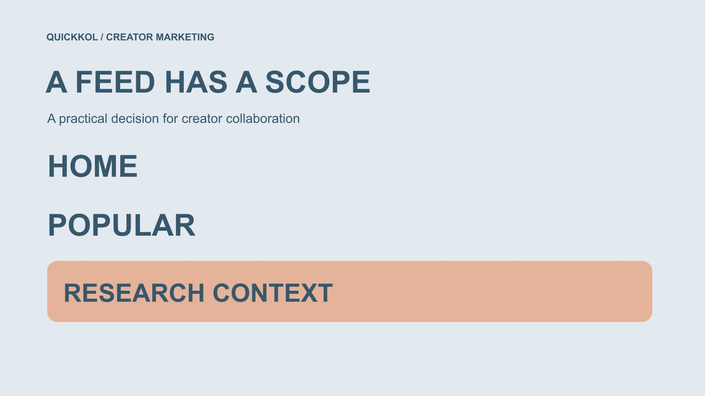
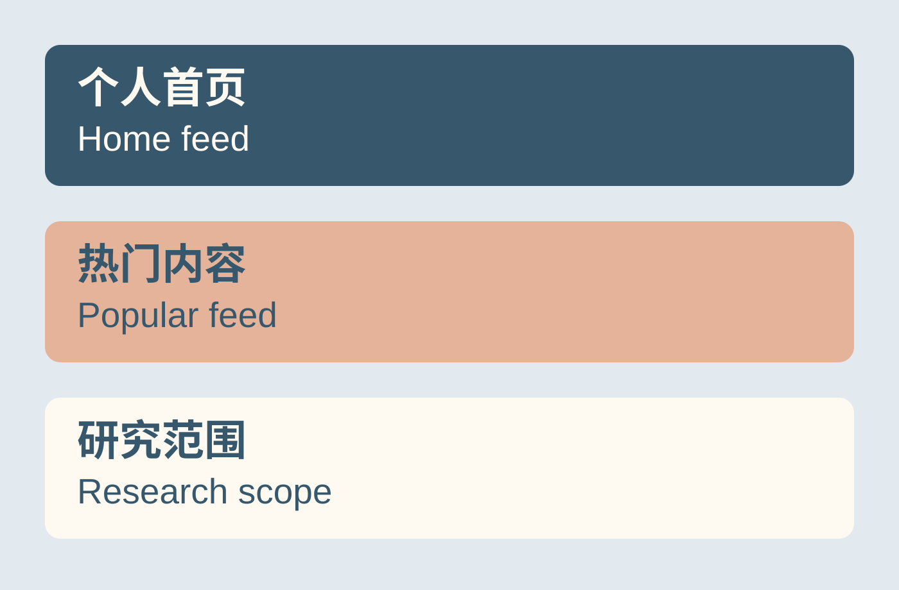

# Reddit Front Page: Keep Creator Research in Context

Status: local review draft; confirm the publication date before release.

The Reddit front page offers discovery leads rather than a universal creator ranking. Separate the current feed, original community and actual contribution before further partnership research.

QuickKOL editorial graphic; not actual account metrics or a platform interface.

Reddit front page is an informal description of homepage content, not a fixed creator ranking everyone sees. The official November 2026 update describes the rollout of For You and Following, with experiments affecting the Popular entry point. Brands can discover questions or expression through a feed, then return to the original community and discussion to verify contribution, date and context before researching partnership fit. One visible post does not establish commercial availability, audience characteristics or repeatable exposure.

## Record which feed you are actually viewing

[Reddit’s November 2026 update](https://support.reddithelp.com/hc/en-us/articles/55472297340308-Changelog-November-10-2026) describes For You as joined communities plus interest-related recommendations, and Following as joined communities only. The rollout began October 27, while some naming and Popular placement remain experimental.

Record the date, device and actual entry point instead of calling a screenshot the common homepage for all Reddit. Another account need not see identical content.

Research can begin with an interesting explanation while preserving the scope of discovery. Seen in this feed is more accurate than something all Reddit users care about, and it gives another researcher a route back to the original material. The observation remains useful without becoming a market-wide claim, particularly when the team's own interests or joined communities could have helped bring that item into view.

## Distinguish Popular from the older r/all route

[Reddit’s feed-difference guide](https://support.reddithelp.com/hc/en-us/articles/360043043552-What-s-the-difference-between-r-all-r-popular-news-and-my-home-feed) describes Popular as a stream of popular posts and distinguishes device-specific routes. Its earlier Home wording needs to be read alongside the November update rather than override a later change.

[Reddit’s April 2026 changelog](https://support.reddithelp.com/hc/en-us/articles/47822249050132-Changelog-April-2-2026) says r/all links in the modern experience redirect to Home while the old experience retains access. It is not a universal current option in an identical location for everyone.

Brand research does not need a whole-site front-page label to make an item worth reviewing. Retain the link and actual entry point, whether Popular, a recommendation or a community. That is enough to continue inspection without implying a precise level of platform-wide exposure or describing an older interface as a feature every present-day researcher can reproduce.

## Return to the post before judging contribution

A feed card carries only part of the original discussion context. Open the post to inspect what the author actually contributed, whether it links elsewhere and how discussion adds to or challenges it. Avoid treating a reposter as the original author.

The [Reddit community-context guide](https://www.quickkol.com/blog/what-is-reddit-brand-community-context/#answer) explains why communities and conversation matter. Here that principle applies to feed discovery: trace the work and discussion before placing someone on a creator-research list.

Contribution may involve explanation, experience, demonstration or curation without every active user becoming an influencer. If authorship remains unclear, keep a work lead instead of inventing identity, commercial history or follower characteristics. This distinction helps the brand ask a relevant question later, rather than approach someone for a capability that belonged to the source they happened to share.

## Translate community questions into research questions

A much-discussed post can reveal a product condition people find hard to understand without representing its prevalence in the target market. Ask which question belongs in a creator brief, then check its actual relationship to the brand's product.

A discussion about retrieving stored objects might lead to research on continuous-action demonstrations. It does not establish purchase intent or qualify one author to represent every user.

Keep the original question, context and proposed verification together. The creator then receives an explainable assignment rather than a request to imitate a popular post. Expression can provide inspiration while facts and creative execution need independent confirmation. A useful brief identifies what the brand can substantiate and what the creator would actually need to experience before making a statement about the product.

A feed provides a lead; the original discussion provides context.

## Expand through search instead of following only visibility

[Reddit’s search-sorting guide](https://support.reddithelp.com/hc/en-us/articles/19695706914196-What-filters-and-sorts-are-available) distinguishes Relevance, Hot, Top, New and comment count, with time filters. Different search purposes can produce different orders; sorting is not a common quality score.

Searching around a specific question can find older work that still explains something useful. Record query, period and sort before reading relevant posts rather than selecting partners only through the highest visible interaction.

Popularity can reflect controversy or news rather than product-demonstration suitability. Let the research question determine the work needed, then examine whether an author has sustained relevant contributions. Search supplies additional leads without confirming the person's partnership capability. Comparing a few relevant examples can also reveal whether the useful feature was the author's explanation, a linked source, or the surrounding community's corrections rather than the visible vote total alone.

## Verify identity within public boundaries

A Reddit username does not automatically identify a same-named account elsewhere or establish a legal name, nationality or profession. Public connections made by the person and appropriate confirmation support cross-platform identity.

Do not dig for private information to develop a partnership lead. Research public work, a supplied business contact and the actual collaboration route, retaining uncertainty where necessary. A community role does not establish authority to accept commercial work for the whole community.

An inquiry should identify the public contribution and proposed task, allowing the person to decide whether to continue. Avoid turning a comment section into repeated outreach or asking for unrelated private details. A clearly bounded invitation also makes it easier for someone to explain that the work was a one-time contribution or that the relevant commercial contact belongs elsewhere.

## Read community rules before commercial participation

If a brand or commissioned creator plans to participate in a community, read its actual rules and moderator guidance. Appearing in a feed does not mean the community accepts promotion, and no brand can guarantee moderators will retain commercial content.

Separate research, an ordinary response and a planned partnership post. They are different actions requiring different confirmation; payment does not confer editorial control over a community.

Keep the actual relationship clear and the contribution relevant. If the rules do not fit the planned publication, choose another appropriate channel rather than make that community a compulsory exposure target. Respecting the conversation supports a more accurate partnership decision. It also prevents a creator from being commissioned against an assumed placement promise that neither the creator nor the brand has authority to make.

## Build a research handoff from one hypothetical question

Suppose a team sees travel-storage discussion in a recommendation feed. It records the entry point and date, then finds the useful contribution is the author's demonstration rather than the linked product itself.

The researcher retains an action description and relevant work, checks a publicly supplied business contact and drafts an invitation to explain retrieval. Without audience-geography evidence, no country percentage is added; without agreement, the person is not marked signed.

This is a method example, not an exposure or sales result. A handoff preserves verifiable leads and open questions so the next owner can continue without accepting every assumption attached to a contextless screenshot. If the original contribution later disappears or cannot be verified, the team can retain a limited research note without presenting an inaccessible item as current evidence of the creator's work.

## Bring the feed lead back to the creator assignment

The [creator-discovery task guide](https://www.quickkol.com/blog/influencer-discovery-tool-brief-to-candidates/#answer) helps research work, identity and contact routes from a brief. The Reddit front page is one discovery entry point rather than proof of ranking, commercial credentials or partnership results.

Distinguish what appeared, what was traced, what the person confirmed and what remains unknown. An interaction count does not independently become audience size, sales or a number of genuine supporters.

The practical value of the Reddit front page in influencer marketing is revealing a question or expression worth investigating, followed by original work and actual collaboration confirmation. Context makes the lead useful over time. A final recommendation should name the task the person might help with and the evidence still needed, allowing the brand to continue deliberately instead of treating a fleeting feed position as a complete creator-selection decision.

## Preserve observation age when comparing sessions

A post appearing at different times does not independently prove its exposure rose or fell. Entry point, sorting and account context may change, while interactions have time to accumulate. A team needs comparable records for a defined question rather than derive a trend from two screenshots.

If the purpose is finding a demonstration method, retain relevant work without tracking minute-by-minute position. If visible records genuinely need comparison, preserve time and scope and separate interface changes from content changes.

The conclusion should state what this inspection supports. Without complete coverage, absence from a session is not proof that something does not exist; without confirmation, failure to encounter a post is not an account diagnosis. This keeps the research proportionate to the creator-selection task and prevents incidental feed movement from becoming an unsupported judgment about a person's reliability.

## Separate commercial contribution from community endorsement

If an author later accepts a partnership, describe the actual arrangement rather than transform earlier community interaction into community endorsement of the brand. Payment does not purchase participants' positions.

A creator may provide explanation or demonstration while expressing actual experience and limitations. The brand supplies information and reviews facts without requiring every disagreement to disappear as a condition of completion.

A handoff can record commissioned content and observations without presenting a community name as a client or supporter. Research can therefore support a commercial task while retaining the distinction between public conversation and commissioned work. That also helps an approver assess the proposed claim: a useful creator explanation can stand on its own without relying on an unearned implication that a whole community approved the product or the partnership.

## What feed discovery can establish

| Record | Can support | Still needed |
| --- | --- | --- |
| Feed card | A lead seen in this session | Original discussion and date |
| Author contribution | Specific explanation or demonstration | Identity and sustained relevant work |
| Public business contact | A route for an inquiry | Willingness and task scope |
| Visible interaction | Visible record for that post | Audience, business results and repeatability |

Not a platform-exposure promise or a commercial assessment of a named user.

## Keep a handoff-ready Reddit lead

Move from discovery to a specific inquiry.

- [ ] Record actual feed, date and device.
- [ ] Open the original post and discussion.
- [ ] Distinguish original and shared contributions.
- [ ] Connect the question to a brand task.
- [ ] Use a publicly supplied business contact.
- [ ] Retain uncertainty without promising front-page exposure.

## Research date and limitations

Sources reviewed November 17, 2026. Methods, tables and decision rules are editorial recommendations. Hypothetical examples are not actual client results or industry benchmarks. Source geography and periods are specified where relevant.

## Start creator research with a clear task

Use QuickKOL to interpret a brief, discover relevant creators and research their work and contact routes. Verify data, commercial terms and outcomes at their source.

[Explore QuickKOL](https://www.quickkol.com/#capabilities)

## Sources

- [Reddit’s November 2026 update](https://support.reddithelp.com/hc/en-us/articles/55472297340308-Changelog-November-10-2026)
- [Reddit’s feed-difference guide](https://support.reddithelp.com/hc/en-us/articles/360043043552-What-s-the-difference-between-r-all-r-popular-news-and-my-home-feed)
- [Reddit’s April 2026 changelog](https://support.reddithelp.com/hc/en-us/articles/47822249050132-Changelog-April-2-2026)
- [Reddit’s search-sorting guide](https://support.reddithelp.com/hc/en-us/articles/19695706914196-What-filters-and-sorts-are-available)
