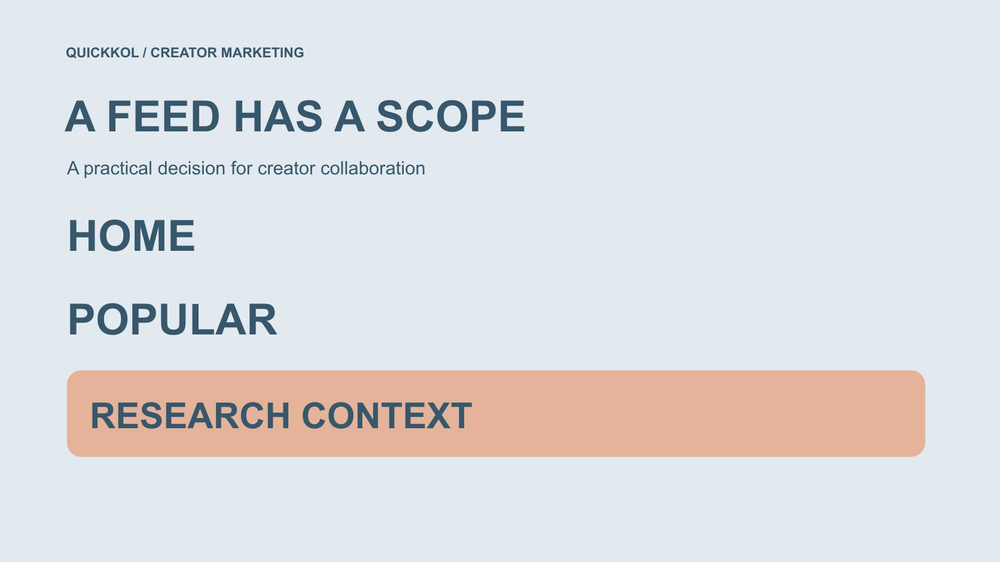
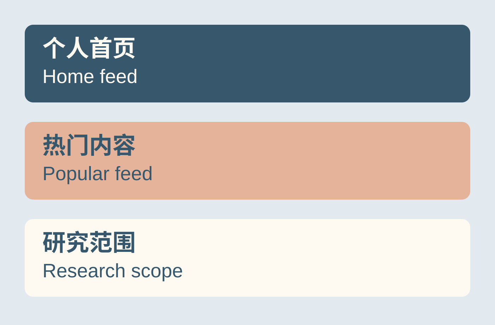

# Reddit 首页怎样用于达人研究

状态：本地审阅稿；正式发布日期待确认。

Reddit 首页提供发现线索，不是统一达人榜单。区分当前信息流、原始社区与实际贡献，再决定品牌合作研究是否值得继续。

QuickKOL 编辑图形；不呈现真实账号指标或平台界面。

Reddit front page 是对首页内容的通俗说法，不是固定、人人相同的达人榜单。2026 年 11 月官方更新介绍 For You 与 Following 的上线过程，并说明 Popular 入口仍有实验变化。品牌可以从看到的内容发现问题或表达方式，但需要返回原始社区与讨论，确认作者贡献、时间和语境，再研究是否适合达人合作。一次热门帖不能证明作者愿意接单、拥有某种受众或能复制同样曝光。

## 先记录看到的是什么信息流

[Reddit 的 2026 年 11 月更新](https://support.reddithelp.com/hc/en-us/articles/55472297340308-Changelog-November-10-2026)说明，For You 包含已加入社区与兴趣推荐，Following 只显示已加入社区内容；这轮上线从 10 月 27 日开始。部分命名和 Popular 的位置仍在实验。

因此研究记录需要说明时间、设备和实际入口，不把一张截图叫作整个 Reddit 的共同首页。也不假设另一个账号会看到完全相同的内容。

研究可以从一个有意思的解释开始，但结论应保留入口范围。“在本次信息流看到”比“Reddit 用户都在关注”准确，也更方便另一位研究者回到原始资料核验。

## 分清 Popular 与旧版 r/all

[Reddit 的信息流区别指南](https://support.reddithelp.com/hc/en-us/articles/360043043552-What-s-the-difference-between-r-all-r-popular-news-and-my-home-feed)把 Popular 描述为热门帖子流，并说明不同设备存在不同入口。该页较早的 Home 描述要结合 11 月更新阅读，不能覆盖更新后的变化。

[Reddit 的 2026 年 4 月变更](https://support.reddithelp.com/hc/en-us/articles/47822249050132-Changelog-April-2-2026)说明现代体验中的 r/all 链接转向 Home，同时旧版体验仍可访问 r/all。它不是所有用户当前都能在同一位置找到的统一选项。

品牌研究不需要为了证明内容重要而强行给它贴“全站首页”标签。保留实际链接与入口名称，说明是在 Popular、推荐或某个社区看到，已经能支持后续查看。

## 返回原帖再判断贡献

信息流卡片只呈现部分语境。打开原帖，查看作者具体说了什么、是否链接其他来源、讨论怎样补充或质疑，避免把转载者当成原作者。

[Reddit 社区语境指南](https://www.quickkol.com/zh/blog/what-is-reddit-brand-community-context/#answer)说明社区与对话的重要性。本篇把这个原则用于首页发现：先追溯作品与讨论，再决定是否把某人加入达人研究清单。

记录贡献可以是解释、经验、演示或整理，不必把每位活跃用户都称作达人。若实际作者无法确认，先保留作品线索，不编写身份、商业经历或粉丝情况。

## 把社区问题转成品牌研究问题

一个高讨论帖子可能揭示观众难以理解的产品条件，但不能直接代表目标市场比例。先问哪些问题值得在达人 Brief 中解释，再核对它与品牌产品的实际关联。

例如讨论集中在收纳物品能否快速取出，品牌可以研究谁擅长连续动作演示。它不证明讨论者会购买，也不证明某位作者适合代表所有用户。

可以把原始问题、语境与拟验证内容并排记录。这样达人收到的是可解释任务，而不是“照着热门帖拍一条”。表达方式可以受启发，事实与创意仍需要独立确认。

信息流提供线索，原始讨论提供语境。

## 用搜索补充首页线索

[Reddit 的搜索排序说明](https://support.reddithelp.com/hc/en-us/articles/19695706914196-What-filters-and-sorts-are-available)区分 Relevance、Hot、Top、New 和评论数量，并说明时间过滤。搜索目的不同，看到的顺序也可能不同，不宜把排序当成统一质量评分。

围绕具体问题搜索，可以发现较早但仍有解释价值的内容。记录搜索词、时间范围与排序，再阅读相关帖，而不是仅按最高互动挑合作对象。

热门内容也可能来自争议或新闻，不一定适合商品演示。让研究问题决定要找什么，再看作者是否有持续相关作品。搜索提供补充线索，无法直接替代本人确认合作能力。

## 身份核验保留公开边界

Reddit 用户名不自动对应其他平台同名账号，也不说明真实姓名、国籍或职业。只有本人公开建立的联系与适当确认，才支持跨平台身份判断。

不要为了合作线索挖掘私人信息。研究公开作品、作者提供的业务联系与实际合作路径，身份不明时保留未知。一个社区角色也不等于代表整个社区接商业合作。

如果需要联系，说明你看到了哪项公开贡献、希望讨论什么任务，让对方决定是否继续。不要把评论区当成反复投放邀约的位置，也不要求对方证明与任务无关的私人事项。

## 合作进入讨论前先看当地规则

品牌或受委托创作者如果计划参与某个社区，应读取该社区实际规则与版主说明。不能从首页出现一次就推断该社区接受推广，也不能保证版主会保留商业内容。

先区分研究、普通回应与计划中的合作发布。不同动作需要不同确认，品牌付费也不会取得社区的编辑控制权。

真实关系应清楚，内容要与讨论有关。若规则不适合本次发布，可以改用其他合适渠道，不需要把社区当成必须完成的曝光任务。尊重实际对话能帮助团队形成更准确的合作判断。

## 用一个问题示例形成研究交接

假设团队在推荐流看到关于旅行收纳的讨论。先记录入口与日期，回到原帖发现主要价值来自作者演示，而非帖子链接的商品本身。

研究者保留动作描述与相关作品，进一步核对本人公开业务联系，再拟定“解释取放过程”的邀请。没有观众地区资料，就不补写某国受众占比；没有合作确认，也不写成已签达人。

这是方法示例，不是实际曝光或销售结果。交接保留能验证的线索和仍需确认的内容，下一位负责人才能继续研究，不必接受一张无语境截图带来的全部假设。

## 让首页线索回到达人任务

[达人发现任务指南](https://www.quickkol.com/zh/blog/influencer-discovery-tool-brief-to-candidates/#answer)可以帮助从 Brief 出发研究作品、身份与接洽路径。Reddit 首页只是其中一个发现入口，不是达人排名、商业资质或合作结果的证明。

交付时区分看到了什么、追溯到什么、本人确认什么与仍未知什么。不要把互动数字直接写成受众、销售或真实支持人数。

Reddit front page 对达人营销最实用的作用，是让团队看到值得解释的问题和表达，再通过原始作品与实际合作确认决定下一步。保留语境，线索才有持续价值。

## 比较不同时点时保留记录年龄

同一帖子在不同时间出现，不能直接证明其曝光上升或下降。入口、排序和账号可能改变，互动也有累积时间。团队需要相同问题下的可比较记录，而不是用两张截图补出趋势。

如果只是寻找演示方法，可以保留与任务有关的内容，不必追踪每分钟位置。若确实需要比较可见记录，则记录具体时间与范围，并把界面变化与内容变化分开。

结论应说明这次查看支持什么。没有完整覆盖，就不把漏看当成不存在；没有作者确认，就不把一次未出现解释为账号问题。

## 商业贡献与社区认可分开描述

如果某位作者后来接受品牌合作，应准确描述双方实际安排，不能把之前帖子的社区互动转成社区为该品牌背书。品牌付费也不会购买讨论者的立场。

达人可以提供解释或演示，但对方应能真实表达自己的体验与限制。品牌提供资料和审阅事实，不宜要求把所有异议删掉才算完成。

交付可以记录合作内容与实际观察，不把社区名称当作合作客户或品牌支持者。这样研究成果仍能支持商业任务，同时保留公开讨论与委托作品之间的区别。

## 首页发现能说明什么

| 记录 | 可支持 | 仍需确认 |
| --- | --- | --- |
| 信息流卡片 | 本次看到的线索 | 原始讨论与时间 |
| 作者贡献 | 具体解释或演示 | 身份与持续相关作品 |
| 公开业务联系 | 可讨论的接洽路径 | 本人意愿与任务范围 |
| 热门互动 | 该帖当时的可见记录 | 受众、业务结果与可复制性 |

不是平台曝光承诺或具名用户的商业评价。

## 保留一条可交接的 Reddit 线索

从看到内容到形成具体邀请。

- [ ] 记录实际信息流、日期与设备。
- [ ] 打开原帖并阅读讨论。
- [ ] 区分原作者与转发贡献。
- [ ] 把问题对应到品牌任务。
- [ ] 使用本人公开业务联系。
- [ ] 保留未知，不承诺首页曝光。

## 研究日期与使用边界

资料核验于 2026 年 11 月 17 日。文中方法、表格和决策规则为编辑建议，标为假设的示例不是实际客户结果或行业基准。外部资料的适用地区与时期按各段说明。

## 从任务开始达人研究

用 QuickKOL 理解 Brief、发现相关达人并研究作品与联系路径；数据、合作条件和结果仍需核验。

[了解 QuickKOL](https://www.quickkol.com/#capabilities)

## 来源

- [Reddit 的 2026 年 11 月更新](https://support.reddithelp.com/hc/en-us/articles/55472297340308-Changelog-November-10-2026)
- [Reddit 的信息流区别指南](https://support.reddithelp.com/hc/en-us/articles/360043043552-What-s-the-difference-between-r-all-r-popular-news-and-my-home-feed)
- [Reddit 的 2026 年 4 月变更](https://support.reddithelp.com/hc/en-us/articles/47822249050132-Changelog-April-2-2026)
- [Reddit 的搜索排序说明](https://support.reddithelp.com/hc/en-us/articles/19695706914196-What-filters-and-sorts-are-available)
