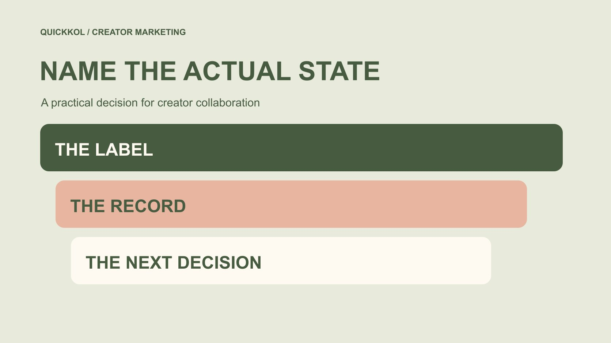
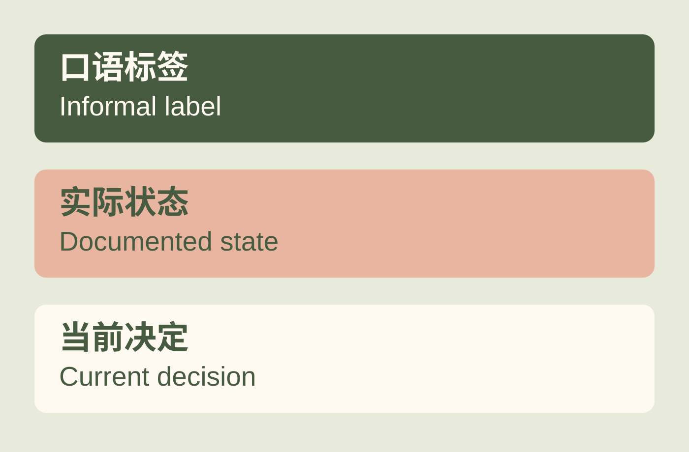

# Shadowban Meaning for Brands

Status: local review draft; confirm the publication date before release.

Translate shadowban in partnership discussions into observations and documented platform states, separating low distribution, review, recommendation eligibility and removal.

QuickKOL editorial graphic; not actual account metrics or a platform interface.

Shadowban is commonly used for content appearing less visible or recommended, but creator partnerships should not treat it as a verified, uniform state across platforms. Low views, review, recommendation ineligibility, removal and account restrictions need separate descriptions. Ask which object, what record, when it was observed and what remains unknown before deciding the effect on the assignment. The practical shadowban meaning is a reason to clarify language rather than infer punishment from one decline or promise recovery after a fixed number of days.

## Ask which object the statement concerns

“This creator is shadowbanned” might concern one video or merely a colleague not seeing it in a recommendation feed. Identify the post, account, surface and observation date before a broad label replaces facts.

The [sponsored-content diagnostic guide](https://www.quickkol.com/blog/shadowbanned-sponsored-post-diagnostic/#answer) helps handle actual access questions; this article focuses on communication and status language. Describe what was observed before deciding its effect on agreed work instead of assigning a punishment label to a person.

A low-view post can be recorded through its count and window without becoming a statement that the whole account is unsuitable for collaboration. The brand needs an assessable next question rather than a stronger word. Without an object, more information may still answer a different issue. The conversation can remain practical by asking which deliverable is affected and what observation would establish whether that particular task can proceed.

## Low distribution is an observation, not a proven cause

Lower views than earlier content establish a recorded difference while its cause may remain unclear. Different periods, formats and distribution contexts prevent a decline alone establishing platform punishment or deliberate concealment by the creator.

[TikTok’s recommendation guide](https://support.tiktok.com/en/using-tiktok/exploring-videos/how-tiktok-recommends-content) describes personalization and several signal types across surfaces. It supports separating a visible result from one assumed cause, not a certain explanation for one post or a formula guaranteeing reach.

Retain the comparison and unknowns. Without an explicit status record, say the cause is unconfirmed instead of call every disappointing result a shadowban. Accurate description helps rather than obstructs action because it identifies the records and owner needed. A team can review the content, destination or agreed distribution separately without pretending those reviews will necessarily uncover a single platform-level reason for the entire performance difference.

## Distinguish review, recommendation eligibility and removal

[TikTok’s content-enforcement guide](https://support.tiktok.com/en/safety-hc/account-and-user-safety/content-violations-and-bans) distinguishes review, removal and For You recommendation eligibility and describes appeals for applicable decisions. These are different states, not interchangeable descriptions of a permanent account ban.

Describe the relevant object and date from an actual notice without demanding complete private-account access. Unrelated information need not enter brand records, and one item’s status should not expand to other unchecked content.

Identify secondhand statements as unconfirmed. Where a specific notice was observed, retain its necessary scope and current handling. A platform state concerns a particular decision or process without explaining all past performance or establishing recovery timing. The team should preserve the wording relevant to the assignment instead of translate every notice into a stronger label, allowing the account owner and brand operator to discuss the same issue without unnecessarily broad claims about the person or their work.

## Eligibility does not guarantee recommendation

Recommendation eligibility concerns entering a distribution consideration, which differs from how many people actually see content. Absence of an observed restriction does not guarantee equal delivery, while failure to see a recommendation does not independently establish ineligibility.

[Meta’s 2023 ranking explanation](https://about.fb.com/news/2023/06/how-ai-ranks-content-on-facebook-and-instagram/) describes multiple predictions combined across personalization systems. It supplies dated background, not verification of every 2026 algorithm or a private account’s state. A historical explanation cannot diagnose a present individual.

The diagram separates an informal label from actual records. Avoid reasoning that a normal status requires a guaranteed view count. Confirm the assignment and expression, then study results through suitable records without making eligibility an outcome promise. This distinction is useful even when the team never learns every ranking influence: it keeps the collaboration from being judged against a distribution certainty that neither party had evidence to offer.

Match language to evidence instead of treating a performance change as proof of punishment.

## Record changes in wording

An early project note may say suspected reduced distribution; a later specific notice should update it to the supported state. Preserve when information became known rather than make the later fact appear previously confirmed or leave the original guess in a handoff title.

For example, an internal note may initially record lower views on one new video. The next day, its author supplies a specific recommendation-eligibility notice for that video. Retain the initial observation and add the notice and date; do not mark every older video restricted or claim that the original view decline has now been completely explained. The update establishes a narrower new fact rather than retrospective certainty.

A short editorial format can record object, observed state, source, date and next question. It is not an official platform diagnostic form; its purpose is reducing shifts in meaning across owners.

Keep an unknown cause unknown. One person’s stronger vocabulary does not establish stronger evidence than another’s cautious description. Ask for conclusions matched to records rather than reward confidence of delivery. This makes updates more useful: another owner can see whether a question was resolved, narrowed or simply repeated in different language, instead of treating every revised status phrase as new factual progress.

## Discuss status separately from delivery obligations

A platform state may affect one publication without answering every commercial question. Completed production, content accuracy and arrangements for change need separate discussion rather than one vague label deciding them all.

Confirm what can continue, such as factual review, asset handoff or other agreed work, and identify what needs to wait. Additional channels, reshoots or substitute publication should not become automatic creator obligations without discussion.

For payment, cancellation or dispute, return to actual arrangements and appropriate support rather than apply a universal penalty from this article. Status records help explain change; they do not justify moral judgments or make one party absorb every distribution uncertainty. A practical response can therefore preserve completed work while assigning the unresolved platform question to its owner, without implying that continued collaboration means the status issue has been disproved or resolved.

## Replace a vague label in a hypothetical conversation

Suppose a colleague calls a creator shadowbanned because the newest video has fewer views. Ask which video, observation window and explicit status notice are involved. If the evidence is only a view change, record the cause as unconfirmed.

In another assignment, a post does have a recommendation-eligibility notice. Record that state, date and current handling without expanding it into ineligibility on every platform. The next action is assessing the task’s effect rather than circulate an unqualified conclusion among candidates.

Neither hypothetical contains client data. They show how precise language supports work without promising every cause can be found, offering fixed recovery periods or equating one notice with a creator’s overall value. The questions remain limited to the assignment, so a request for clarification does not become an invitation to collect unrelated account records or speculate about a person’s intentions.

## One test cannot establish every account state

Personal search, a hashtag page or another phone shows an observation under particular conditions. It can help identify a question without independently covering every audience, surface and distribution state.

A red rating in a third-party tool likewise needs its definition and source. A label alone should not become a public accusation of creator misconduct. Without suitable evidence, state the observation scope and open question.

Do not demand repeated exposure of private information or unrelated tests in pursuit of certainty. Use task-relevant information the person can appropriately provide. Retain limitations for unseen account processes and ranking rather than promise complete diagnosis. The goal is an informed operational decision with suitable evidence, not collecting enough screenshots to make a broad label feel convincing when none of those screenshots actually establishes the state being claimed.

## Give the next owner a specific question

A handoff can identify a post whose current visibility needs checking or a notice whose handling remains pending. Writing shadowban in a status column leaves the next owner guessing whom to contact, what to inspect and whether work can continue.

The [social-media audit guide](https://www.quickkol.com/blog/creator-campaign-social-audit-record-retrieval/#answer) helps organize objects and evidence. Here, match the status word to the actual record and assign an executable action. An uncertain cause does not need stronger wording to complete the field.

If a platform decision changes, update the project record and affected arrangements. Without new evidence, do not repeatedly announce restoration or renewed restriction. Distinguish observation, handling and outcome so brand and creator can discuss actual changes. This makes a concise record more useful than a long speculative explanation: it directs the next piece of work while keeping unestablished causes from becoming assumptions in another person’s brief.

## Answer shadowban meaning through precise description

For influencer marketing, shadowban is an informal label needing clarification, not one verified punishment inferred from low views. Ask about the object, record and scope before the effect on the assignment rather than seek one universal cause.

Recommendation eligibility, ranking results, removal and account limits each need corresponding evidence. Do not turn historical explanations into current diagnoses or apparent eligibility into guaranteed future views and earnings.

Leave a specific next action and genuine unknowns. This language supports factual creator research while keeping production, publication and response work inside appropriate responsibilities. A brand can make a proportionate decision without claiming complete knowledge of platform systems, and a creator can explain the relevant state without being required to defend an undefined label applied to their entire business.

## Replace vague labels with clear records

| Situation | More precise description | Next action |
| --- | --- | --- |
| Views changed | A count changed within a stated window | Keep the cause unconfirmed |
| Review or notice | A particular object has a documented state | Check scope and applicable handling |
| Recommendation eligibility | Describe separately from actual distribution | Do not guarantee future reach |
| Project effect | Which agreed work is actually affected | Assign the appropriate owner |

Editorial communication framework, not an official diagnosis, finding of individual misconduct or recovery guarantee.

## Before using shadowban in a project

Make the actual meaning understandable.

- [ ] Identify the post, account and surface.
- [ ] Retain source, date and observation scope.
- [ ] Separate performance change from a documented state.
- [ ] Do not generalize from one test.
- [ ] Separate platform state from commercial work.
- [ ] Give an owner an action and the unknowns.

## Research date and limitations

Sources reviewed November 17, 2026. Methods, tables and decision rules are editorial recommendations. Hypothetical examples are not actual client results or industry benchmarks. Source geography and periods are specified where relevant.

## Start creator research with a clear task

Use QuickKOL to interpret a brief, discover relevant creators and research their work and contact routes. Verify data, commercial terms and outcomes at their source.

[Explore QuickKOL](https://www.quickkol.com/#capabilities)

## Sources

- [TikTok’s recommendation guide](https://support.tiktok.com/en/using-tiktok/exploring-videos/how-tiktok-recommends-content)
- [TikTok’s content-enforcement guide](https://support.tiktok.com/en/safety-hc/account-and-user-safety/content-violations-and-bans)
- [Meta’s 2023 ranking explanation](https://about.fb.com/news/2023/06/how-ai-ranks-content-on-facebook-and-instagram/)
