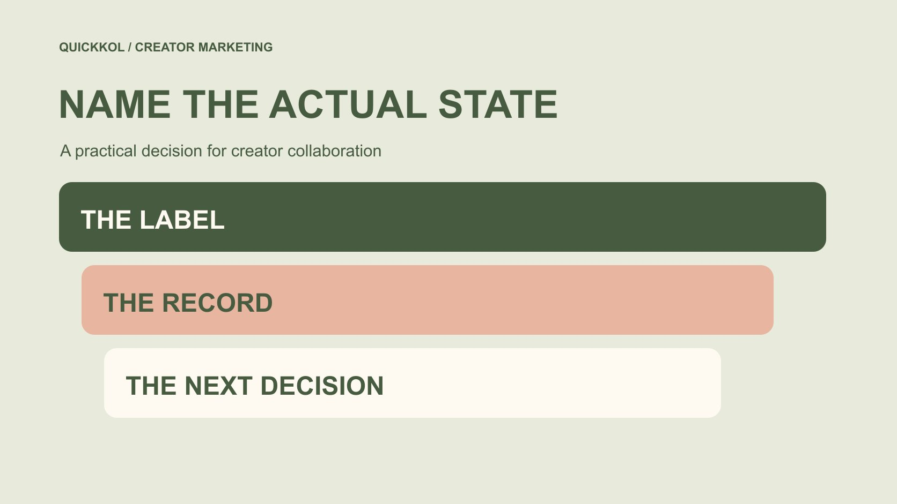
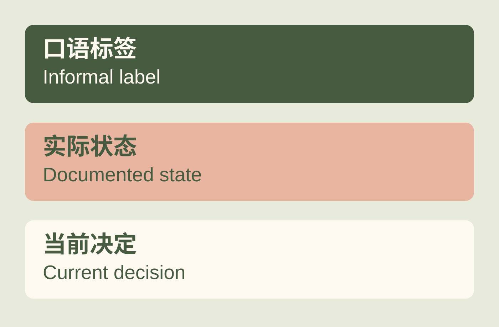

# Shadowban 怎样对应实际分发状态

状态：本地审阅稿；正式发布日期待确认。

把合作沟通中的 shadowban 拆回可观察表现与平台明确状态，区分低分发、审核、推荐资格和移除，让品牌用准确语言继续处理项目。

QuickKOL 编辑图形；不呈现真实账号指标或平台界面。

Shadowban 常被用来描述内容似乎较少被看到或推荐，但在达人合作里，它不应被当作一个已经核实、跨平台统一的状态。低观看、内容正在审核、推荐资格受限、内容被移除和账号限制需要分别说明。品牌应问哪个对象、看见什么记录、何时观察及还有哪些未知，再决定是否影响任务。回答 shadowban meaning，重点是让合作语言准确：不从一次表现下降直接认定处罚，也不向达人承诺某个固定天数后一定恢复。

## 先问这句话指哪一个对象

“这个达人被 shadowban 了”可能指一条视频，也可能只是某位同事没有在推荐流里看到。先确认具体帖子、账号、位置与观察日，不让一个宽泛标签替代事实。

[达人赞助内容诊断指南](https://www.quickkol.com/zh/blog/shadowbanned-sponsored-post-diagnostic/#answer)可以帮助处理实际访问问题；本篇聚焦沟通和状态用词。讨论应先说看见什么，再说它是否影响约定任务，不先给个人贴处罚标签。

例如某条内容观看较少，可以准确记录当前数量与窗口，但不能扩写成整个账号不能合作。品牌需要的不是一个更强烈词语，而是能让下一位负责人继续检查的问题。缺少对象，后续资料再多也可能回答了不同事情。

## 低分发是一项观察，不是原因证明

某条内容比先前少播放，可以说明记录上的变化，但原因仍可能不清楚。时间范围、内容类型与分发环境不同，不能仅凭下降就判断平台处罚或达人有意隐瞒。

[TikTok 的内容推荐说明](https://support.tiktok.com/en/using-tiktok/exploring-videos/how-tiktok-recommends-content)介绍不同位置中的个性化与多类信号。这支持把可见结果与单一原因分开，不提供某条具体内容为何表现变化的确定答案，也不构成保证触达的公式。

品牌可以保留比较依据与未知。若没有明确状态记录，就说尚未确认原因，而不是把所有不理想表现统一叫 shadowban。准确描述并不会阻碍处理，反而让需要查看的数据和负责人更清楚。

## 区分审核、推荐资格与移除

[TikTok 的内容处理说明](https://support.tiktok.com/en/safety-hc/account-and-user-safety/content-violations-and-bans)区分内容审核、移除与 For You 推荐资格相关处理，并介绍对适用决定提出申诉。这些不是同一状态，不能一律改写为账号永久封禁。

报告可以按实际看到的通知描述对应对象与日期，不要求达人交出完整私人后台。与任务无关的信息不需要进入品牌记录，某条状态也不能被扩大到其他未经核对内容。

如果只是同事转述，注明转述与待确认。若看到了具体通知，保留必要范围及当前处理。一个平台状态说明某项决定或流程，不自动解释过去全部表现，也不替品牌确认后续恢复时间。

## 能推荐不等于保证被推荐

推荐资格说明可以进入某种分发考虑，与实际上被多少人看到不同。即使没有观察到某项限制，也不能保证每条内容都有相同分发；同样，没有看到推荐也不能单独证明资格受限。

[Meta 的 2023 年排序说明](https://about.fb.com/news/2023/06/how-ai-ranks-content-on-facebook-and-instagram/)描述不同系统结合多种预测进行个性化。这是有日期的背景，不是本文核验了 2026 年全部算法或某个私人账号的状态。历史解释不提供当前个人诊断。

图形把口语标签与实际记录分开。品牌应该避免“状态正常，所以你必须达到某个播放量”这样的推论。可以确认任务与实际表达，再按合适记录研究表现，不把资格当作结果承诺。

用词跟随证据，不把表现变化直接写成处罚结论。

## 把用词变化写进项目记录

一个项目早期可能写疑似限流，之后得到具体通知，就应更新为能够支持的状态。保留什么时候得知什么，不把后来的事实写成早已确认，也不让旧猜测继续出现在交接标题。

例如内部记录最初只写一条新视频观看较少，第二天作者提供该视频的具体推荐资格通知。更新时应保留最初观察，再增加新通知及日期；不把所有旧视频一起改成受限，也不声称最初少播放已经被完全解释。

可用简短格式记录：对象、所见状态、资料来源、观察日与下一项问题。编辑建议的格式不是平台官方诊断表，作用是减少不同负责人之间的含义漂移。

如果原因仍未知，就保持未知。一个人比较谨慎、另一个人使用强烈词语，不代表后者拥有更多证据。团队可以要求结论对应记录，而不评价谁说得更有把握。

## 状态与交付义务分开讨论

平台状态可能影响某项发布，但不自动回答全部商业问题。达人已完成制作、内容是否准确、约定怎样处理变化，都要按真实任务分别讨论，不以一个模糊标签替代。

品牌可以先确认什么仍可继续，例如事实审阅、素材交接或其他已约定工作，再说明需要等待的部分。新增渠道、重拍或替代发布，不应在没有讨论时自动要求达人承担。

对于付款、取消或争议，回到实际安排与适当支持，不在文章里设统一处罚。状态记录帮助双方理解变化，不是用来给个人作道德判断或让某一方无条件承担全部分发不确定性。

## 用假设对话替换含糊标签

假设品牌同事说某达人被 shadowban，因为最新视频少播放。可以改问：指哪条视频、哪个观察窗口、是否有明确状态通知？若目前只有播放变化，就记录原因未确认。

另一次合作确实有单条推荐资格通知，则把对应状态、日期与当前处理记录下来，不扩写成所有平台都不能推荐。需要的下一步是核对该任务影响，而不是向所有候选人传播一个未经限定的结论。

两种情况都没有真实客户数据。本例说明更准确的用词怎样帮助工作继续。它不保证发现所有原因，不提供固定恢复期，也不把任何一个通知直接等同于创作者整体价值。

## 单个测试不能说明全部状态

个人搜索、某个标签页或另一部手机上的可见结果，只说明特定条件下看到了什么。它们可能帮助发现问题，但不能单独覆盖全部受众、入口和分发状态。

同样，一个第三方工具的红色评分，也应回到定义与资料来源。不能只因工具写了某个标签，就对外宣布达人违规。没有适合证据时，报告观察范围与待确认问题。

品牌不应为了寻找确定答案，让达人反复公开私人资料或接受不相关测试。使用与任务相符、对方能够适当提供的信息即可。对看不到的后台和算法，诚实保留限制，不承诺百分百诊断。

## 给后续负责人一项明确问题

交接可以说明某条内容需要确认当前可见性，或某项通知是否仍待处理。不要只把 shadowban 写在状态栏，让下一位负责人猜测要联系谁、看什么或是否能继续。

[社交媒体审核指南](https://www.quickkol.com/zh/blog/creator-campaign-social-audit-record-retrieval/#answer)帮助整理对象与证据。这里的重点是让状态词与实际记录一一对应，再给合适负责人一个可以完成的动作。仍不确定的原因，不需要用更强烈措辞补齐。

如果平台决定变化，更新项目记录与受影响安排；如果没有新证据，就不反复宣布已经恢复或又被限制。把观察、处理与结果分别说明，品牌和达人就能围绕真实变化继续沟通。

## 用准确描述回答 Shadowban meaning

对达人营销而言，shadowban 是需要进一步澄清的口语标签，不是凭低观看即可确认的统一处罚。品牌先问对象、记录与范围，再讨论任务影响，比追求一个万能原因更实用。

推荐资格、排序结果、移除与账号限制各自需要对应证据。不要把历史说明写成当前诊断，也不要因为某项资格看起来可用，就保证未来观看与收入。

文章最后应留下清楚下一步与真实未知。用这样的语言研究达人合作，可以保护事实准确，也让制作、发布与回应工作在合适边界里继续。

## 把模糊词语换成明确记录

| 情况 | 更准确描述 | 下一步 |
| --- | --- | --- |
| 播放变化 | 在某窗口观察到数量变化 | 原因保持未确认 |
| 审核或通知 | 某对象出现具体状态 | 核对范围与适用处理 |
| 推荐资格 | 与实际分发结果分别说明 | 不保证未来触达 |
| 项目影响 | 哪些约定任务确实受影响 | 由对应负责人继续 |

编辑沟通框架，不是平台官方诊断、个人违规结论或恢复保证。

## 在项目里使用 Shadowban 一词之前

先让对方知道你实际指什么。

- [ ] 指出具体帖子、账号与位置。
- [ ] 保留来源、日期与观察范围。
- [ ] 区分表现变化与明确状态。
- [ ] 不从单个测试扩大结论。
- [ ] 把平台状态与商业任务分开。
- [ ] 给负责人具体动作与未知。

## 研究日期与使用边界

资料核验于 2026 年 11 月 17 日。文中方法、表格和决策规则为编辑建议，标为假设的示例不是实际客户结果或行业基准。外部资料的适用地区与时期按各段说明。

## 从任务开始达人研究

用 QuickKOL 理解 Brief、发现相关达人并研究作品与联系路径；数据、合作条件和结果仍需核验。

[了解 QuickKOL](https://www.quickkol.com/#capabilities)

## 来源

- [TikTok 的内容推荐说明](https://support.tiktok.com/en/using-tiktok/exploring-videos/how-tiktok-recommends-content)
- [TikTok 的内容处理说明](https://support.tiktok.com/en/safety-hc/account-and-user-safety/content-violations-and-bans)
- [Meta 的 2023 年排序说明](https://about.fb.com/news/2023/06/how-ai-ranks-content-on-facebook-and-instagram/)
