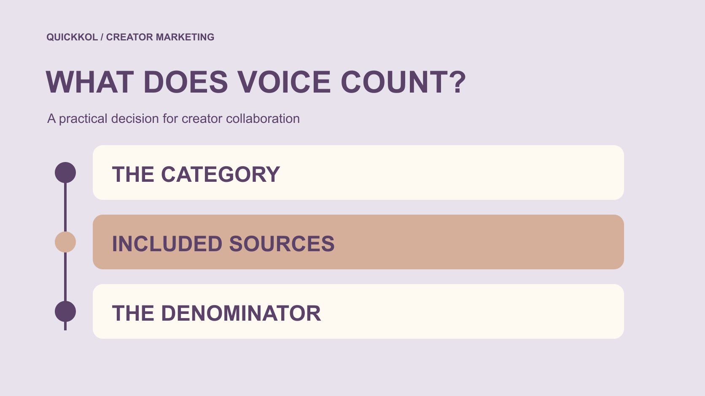

# Share of Voice for Creator Work

Status: local review draft; confirm the publication date before release.

When a report assigns a brand a share of voice, interpret the unit and category before using it for creator selection, a public claim or another content assignment.

QuickKOL editorial graphic; not actual account metrics or a platform interface.

Share of voice generally describes a brand’s proportion of a defined visibility measure within a selected category and observation scope. A creator-marketing report might use brand mentions or another stated unit, but a percentage alone should not imply market share, buyers or approval. Answering what is share of voice requires the unit, comparison set, sources and period together. It can inform research into a brand’s place in relevant conversation; creator selection or a public category-leadership claim needs evidence matching that particular decision.

## Read a percentage as a complete statement

When a report says we own 30% of the conversation, ask what is missing. The object, comparison set, sources and period determine its actual meaning. Without them, a prominent percentage cannot support the next decision.

The [share-of-voice calculation guide](https://www.quickkol.com/blog/share-of-voice-kol-campaign-denominator/#answer) addresses counts and denominators; this article concerns interpreting a claim already presented. Avoid turning a scoped observation into a category-wide conclusion. Locate the original qualifications instead of supply them from a headline.

A fuller statement might describe a brand’s proportion of observed brand mentions under a specified counting rule, source list and period. It is longer but gives a decision-maker the evidence boundary. Shorten wording without removing conditions that change understanding. A reader should be able to distinguish the result actually reported from the broader commercial interpretation proposed by someone presenting it, even when both appear together on a slide.

## Define the unit behind voice

[Brandwatch’s share-of-voice method guide](https://www.brandwatch.com/blog/share-of-voice/) discusses relative brand visibility within an industry or segment and different channel measures. It is a method source, not evidence that every report uses one unit or that all channels can be added.

A creator report may count brand-containing content, mentions or another defined record. These answer different questions. Repeated references, multi-brand content and reposts need actual rules instead of being inferred from the word voice.

A share result therefore first describes records, not everyone’s attitudes. Read the metric name beside the actual field to see whether a familiar term conceals a different object. When no field definition is supplied, the next step is clarification rather than interpretation. A brand can retain the result as a research lead while withholding a stronger claim that depends on knowing exactly what was counted and how another analyst would reproduce it.

## Category scope sets the size of the claim

Comparing three selected brands is not the same as covering an entire category. A study can reasonably choose a limited set without relabeling its result a whole-market share. Similar names or businesses spanning categories can also affect relevant records.

Ask how the category is defined and why the brands belong. Activewear, exercise equipment and broad lifestyle discussions can occupy different spaces. A high share within one group does not establish leadership across the entire sports industry.

For creator selection, make the scope relevant to the assignment. Research into a particular movement explanation does not need all sports entertainment to establish collaboration fit. The useful outcome is relevant expression and questions rather than an enlarged category making the conclusion appear important. A shortlist recommendation should identify the task supported by the observed content, leaving the broader category claim separate unless evidence genuinely covers it.

## Coverage is more than a list of platform names

[Brandwatch’s data-and-network guide](https://www.brandwatch.com/datanetworks/) describes research, management and influencer capabilities across different products. A platform appearing on a provider page does not establish that a particular report contains all its content or that the current account has every access route.

Inspect the material actually used, what is publicly visible, what requires authorization and any time or content limits. Tool capability and this collection’s scope are different questions; a provider feature description cannot replace the method record.

The diagram separates included conversation, category boundaries and share definition. A missing source can change interpretation; confirm the effect before comparing with an earlier report. Retain the gap rather than describe unseen material as nonexistent. This makes coverage a practical review question the data owner can answer, instead of an assumption carried from a product presentation into every result produced with that provider’s name.

Keep the unit and scope attached when interpreting a share.

## Impression share is not social mention share

[Google Ads’ impression-share guide](https://support.google.com/google-ads/answer/2497703?hl=en) defines the measure through received impressions and estimated eligible impressions. Its denominator depends on conditions including targeting and approval, rather than all industry social conversation. It is not directly a creator-mention share.

Two reports both showing 30% can still have different units and opportunity sets. One concerns estimated advertising opportunities; another concerns relevant mentions within selected sources. They should not be added, substituted or ranked directly.

Use each for its appropriate question while retaining name, definition and scope. Placing every share inside one pie can imply partitions of the same whole when no shared denominator exists. The review should ask what total each proportion belongs to before selecting a visual, because a familiar chart can make incompatible measures appear more coherent than the underlying evidence permits.

## More voice does not establish greater approval

Mentions can concern recommendations, questions, disputes, news or service. One count does not establish positive attitudes or justify listing everyone naming the brand as a supporter or partner.

For example, a creator may name a brand while comparing two organizing methods. It can count as a relevant mention under the stated rule without becoming a recommendation testimonial. A later invitation should begin with the actual work and proposed role, rather than tell the person a report has already classified them as an advocate.

If a report interprets sentiment, state classification rules, review responsibility and uncertainty. Automated labels can start research while complex context, irony and quotation may need direct reading. Without a suitable method, do not add an approval rate.

For creator work, read what the relevant item actually says. Naming a brand is not endorsement or advertising permission. Connect the share result to content review so a high percentage is not misused as evidence of broad approval. The team can then distinguish a useful product question from a favorable recommendation and assign different next actions, rather than invite every visible author as if the report had already established a positive commercial relationship.

## Contracted content is not automatically independent advocacy

Commissioned content may enter the observed scope, and readers should understand its role. A brand cannot require scheduled creator output while describing every resulting mention as entirely spontaneous consumer advocacy.

Inspect known contracted content separately from other visible records where useful, without assuming every unmarked item is independent. Describe supported relationships and retain unknowns rather than make unsupported accusations about individuals.

The question is whether the content serves an actual assignment. Contracted expression can be accurate and useful while differing in origin from unarranged discussion. Preserving that distinction recognizes creator delivery without inflating the brand’s organic position across the category. It also prevents a procurement decision being based on a circular argument in which purchased mentions raise a share, and that raised share is then presented as independent proof that purchasing the same work must have generated broader public support.

## Test an inference through a hypothetical claim

Suppose a report assigns brand A 30% of relevant mentions among three specified brands, two listed source types and an observation period. It supports a mention proportion within that scope, not that 30% of consumers purchased or 30% of the intended population heard of the brand.

A public category-number-one claim needs ranking and category coverage suited to that assertion rather than an enlarged version of a limited comparison. For the next content assignment, the team can instead read product questions among the mentions and define a smaller task.

This example contains no real market data. It shows that one result can support bounded research without supporting every promotional statement. Matching claims to evidence lets work continue without every small report becoming a complete industry conclusion. The appropriate next action depends on the decision, not on making the same percentage carry more meanings than its records establish.

## Turn interpretation into a next task

Separate observed findings, questions requiring explanation and the next action. If a type of question appears in the visible conversation, research clearer explanation; if source scope changed, address comparability before discussing growth.

The [social-listening validation guide](https://www.quickkol.com/blog/social-listening-query-sample-validation/#answer) helps inspect queries and samples. In report interpretation, identify judgments grounded in records and recommendations offered editorially. A suggestion worth testing is not an established effect.

Do not require a creator to guarantee a category share outside individual control. Specify relevant content and response responsibilities, then investigate contribution through suitable evidence. The more concrete the assignment, the easier both parties can discuss real work instead of argue over an ambiguous target percentage. A useful handoff names the question, work owner and evidence needed, leaving the share as contextual information rather than a substitute for a commissionable brief.

## Answer share of voice with its scope intact

What is share of voice should not end with whether a brand is talked about frequently. It is a proportion under a chosen unit, comparison set, sources and period, all of which belong in its interpretation. Detached from scope, the number is easily misunderstood.

Use it to research relevant conversation, locate questions and propose a creator assignment, while person selection, work assessment and leadership claims need their own evidence. A proportion does not replace actual work and commercial checks.

Hand over the original report, definition, limitations and a suitable next action. A decision-maker who understands what the result supports and what remains unestablished can turn the metric into a more accurate influencer-marketing decision. The complete definition is therefore part of the practical work, rather than a footnote that can be dropped whenever the percentage moves from an analyst’s document into a brand presentation.

## What a share claim can establish

| Statement | Evidence needed | Do not infer |
| --- | --- | --- |
| A share of relevant mentions | Defined counts, sources and comparison set | The same buyer or approval share |
| Advertising impression share | The platform’s opportunity and field definition | A share of all social conversation |
| Category leadership | Coverage and ranking suited to the claim | A selected comparison covers the whole market |
| Creator contribution | Actual content, role and observations | One person caused every share change |

Editorial interpretation framework; the 30% example is entirely hypothetical, not market data or an industry benchmark.

## Before quoting a share

Preserve what the percentage actually means.

- [ ] Identify the unit of voice.
- [ ] Confirm category, comparison set and period.
- [ ] Establish actual source coverage.
- [ ] Distinguish mentions, approval and sales.
- [ ] Limit the claim to its evidence.
- [ ] Name a next action relevant to creator work.

## Research date and limitations

Sources reviewed November 17, 2026. Methods, tables and decision rules are editorial recommendations. Hypothetical examples are not actual client results or industry benchmarks. Source geography and periods are specified where relevant.

## Start creator research with a clear task

Use QuickKOL to interpret a brief, discover relevant creators and research their work and contact routes. Verify data, commercial terms and outcomes at their source.

[Explore QuickKOL](https://www.quickkol.com/#capabilities)

## Sources

- [Brandwatch’s share-of-voice method guide](https://www.brandwatch.com/blog/share-of-voice/)
- [Brandwatch’s data-and-network guide](https://www.brandwatch.com/datanetworks/)
- [Google Ads’ impression-share guide](https://support.google.com/google-ads/answer/2497703?hl=en)
