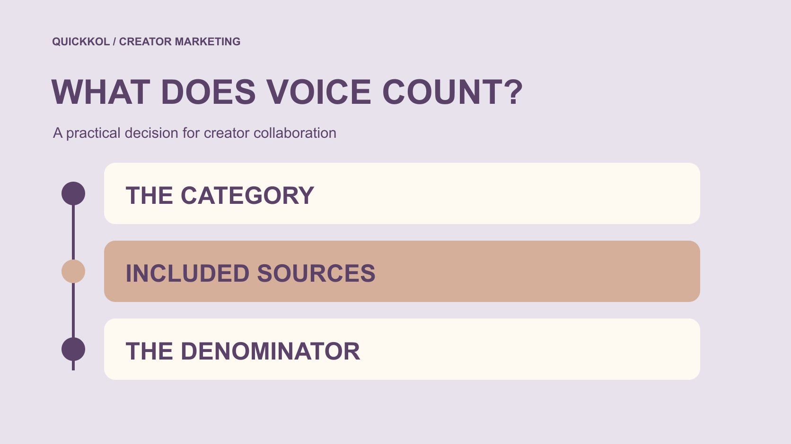
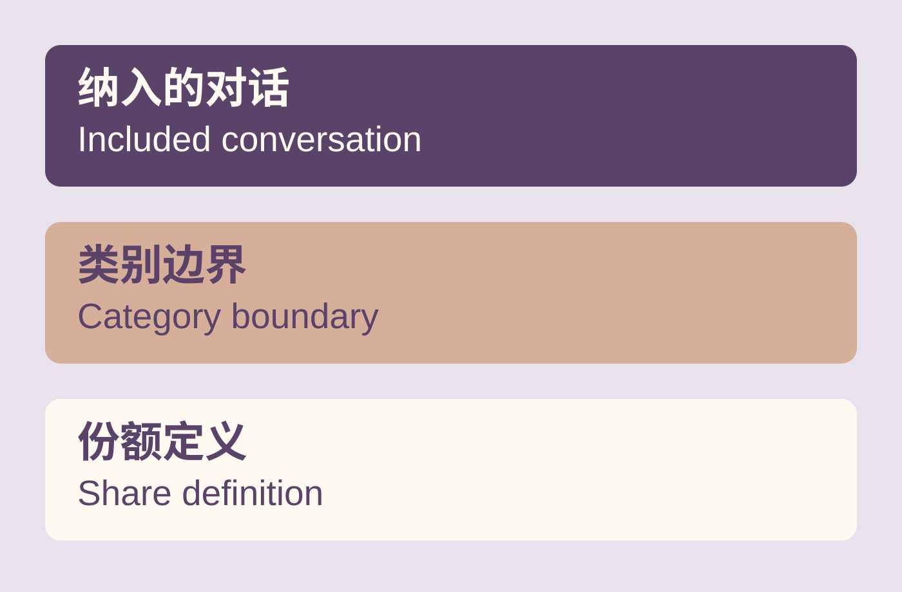

# 怎样读懂达人领域的声量份额说法

状态：本地审阅稿；正式发布日期待确认。

当报告说品牌拥有某个声量份额时，先解释“声音”与品类范围，再判断它能否支持达人选择、对外主张或下一项内容任务。

QuickKOL 编辑图形；不呈现真实账号指标或平台界面。

Share of voice 通常表示品牌在选定品类和观察范围内，占某种可见度记录的比例。达人营销报告可能按品牌提及或其他明确单位衡量，但不能只写一个百分比就让人理解为市场份额、购买人数或好评比例。回答 what is share of voice，应同时说明“声音”是什么、与谁比较、看哪些来源和哪个时期。它可以帮助研究品牌在相关对话中的位置；是否适合选择达人或对外宣布品类领先，还需要与具体主张相符的证据。

## 先把报告里的百分比读成完整句子

看到“我们占据 30% 声量”，先问这句话缺了什么。30% 的对象、比较范围、来源和时期，决定它实际说明什么。没有这些条件，百分比可能很醒目，却无法支持下一项决定。

[声量份额计算指南](https://www.quickkol.com/zh/blog/share-of-voice-kol-campaign-denominator/#answer)讨论如何确定计数与分母；本篇关注读者怎样解释已经出现的报告主张，避免把一个有范围观察变成全品类结论。先找报告原来的限定，不从标题自行补全。

可以改写为：在所列来源与时段中，按指定计数规则观察的品牌提及里，某品牌占一定比例。这个句子较长，但让负责人知道证据边界。缩短时可以精简文字，不能删除真正影响理解的条件。

## 定义声音的单位，而非只解释术语

[Brandwatch 的声量份额方法说明](https://www.brandwatch.com/blog/share-of-voice/)将品牌在行业或细分市场中的相对可见度作为讨论对象，并按渠道介绍不同指标。这是方法来源，不代表所有报告使用同一单位或所有渠道可以相加。

达人报告可以统计包含品牌的内容、提及次数或其他有定义的记录。这些分别回答不同问题。重复提及、跨品牌内容与转发怎样处理，都应有实际规则，不能从“voice”这个词猜测。

因此，一个声量结果首先是对记录的描述，不是对所有人的态度判断。把指标名称和实际字段放在一起看，能发现报告是不是用一个熟悉词语掩盖了完全不同的测量对象。

## 品类范围决定主张能说多大

比较三家被选品牌，与覆盖某个完整品类不是同一范围。研究可以合理选择有限对象，但报告不能因此改写成全市场占比。品牌名称相似或跨品类业务，也可能影响相关记录。

先问品类怎样定义，以及为什么纳入这些品牌。运动服、健身设备与广义生活方式，可能具有不同讨论空间。一个品牌在其中一组占比较高，不能自动说明在全部运动行业领先。

对达人选择，范围要与任务相关。品牌如果研究某种动作讲解，就不需要用所有运动娱乐内容证明合作适合。真正有用的是找到相关表达与问题，不是把范围扩到足够大，让结论看起来更重要。

## 来源覆盖需要确认实际范围

[Brandwatch 的来源与网络说明](https://www.brandwatch.com/datanetworks/)按不同产品描述研究、管理与达人相关能力。某个平台出现在供应商页面，不证明一个具体报告包含该平台全部内容，也不证明当前账号拥有全部访问。

需要查看实际报告使用了什么资料、哪些公开可见、哪些需要授权，以及有没有时间或内容限制。工具功能与本次采集范围是不同问题，不能用官方能力介绍替代方法记录。

图形把纳入对话、品类边界与份额定义分开。一个来源缺失，可能改变解释范围；先确认变化，再决定是否能与旧报告比较。没有资料就保留缺口，不把未见内容写成不存在。

解释一个份额时，让单位与范围跟随数字。

## 展示份额不等于社交提及份额

[Google Ads 的展示份额说明](https://support.google.com/google-ads/answer/2497703?hl=en)把该指标定义为实际展示与估计可获展示的比例。这个分母与目标、批准状态等条件有关，不是全部行业社交对话。因此不能把它直接当成达人提及份额。

即使两份报告都写 30%，单位与机会范围也可能不同。一个是广告记录中的估计机会，另一个是选定来源中的相关提及；二者不宜相加、互相替代或直接排序。

品牌可以分别使用它们回答合适问题，但汇报时保留名称、定义与范围。把所有“份额”放进同一张大饼图，可能让人误以为它们切分同一个整体，实际却没有共同分母。

## 声量增加不说明大家更认可

提及可能是推荐、提问、争议、新闻或客服问题。一个总数不能证明全部正面态度，更不能让品牌把所有出现名字的创作者列为支持者或合作伙伴。

例如，一条达人内容可能只是在比较两种整理方法时提到品牌名称。它可以按规则计入相关提及，却不能因此成为品牌推荐证言。后续若希望讨论合作，应从实际作品与具体角色开始，而不是告诉对方报告已经把他归为支持者。

如果报告需要解释态度，应说明怎样分类、谁核验与哪些内容不确定。自动判断可以成为研究线索，但复杂语境、反讽和转述可能需要人工查看。没有相应方法，就不补出一个好评率。

对达人合作，先读相关作品实际上在说什么。品牌被提到，不代表推荐，也不代表授权广告复用。把声量结果连接到具体内容阅读，能减少一个高百分比被误用为广泛认同的风险。

## 区分合作内容与独立口碑

品牌采购的内容可能进入观察范围，应该让报告读者理解其角色。不能一边要求达人按计划发布，一边把全部相关提及解释成消费者完全自发的口碑。

可以分别查看已知签约内容与其他可见记录，但不从没有标记推断所有其他内容都独立。可确认的商业关系按证据说明，未知关系保留未知，不对个人进行没有依据的指控。

品牌需要判断的是这些内容是否服务具体任务。签约表达可以准确而有用，但它的来源与形成方式不同于未经安排的讨论。保持区别，既能承认达人交付，也能避免夸大品牌在整个品类中的自然地位。

## 用一个假设主张检查推论

假设报告说，在三家指定品牌、两类已列来源和某个观察期内，品牌 A 有 30% 的相关提及。它支持该范围中的提及占比，不证明 30% 消费者买过，也不证明 30% 目标人群听说过。

若团队想对外写“品类第一”，还要核对排序、品类范围和主张所需依据，不能把有限比较直接扩大。若只想研究下一条内容，可以先读相关提及中的使用问题，形成更小的任务。

本例没有真实市场数据。它说明同一个结果可以支持有限研究，却不足以支持所有宣传。让主张与证据相称，品牌就能继续工作，而不需要把每一份小报告包装成完整行业结论。

## 把报告结论写成可继续的任务

可以将结论分成已观察、需要解释与下一步。例如某类问题占据可见讨论，品牌可以研究解释方式；若来源范围改变，则先处理可比性，再讨论增长。

[社交聆听核验指南](https://www.quickkol.com/zh/blog/social-listening-query-sample-validation/#answer)帮助检查查询与样本。当前阅读报告时，还应让负责人说明哪些判断来自记录，哪些只是编辑建议。一个建议值得测试，不表示已经证明一定有效。

不要让达人为一个无法由个人控制的品类份额承担保证。可以明确要求完成相关内容与回应安排，再用适当证据研究贡献。任务越具体，双方越容易讨论真实工作，而不是围绕一个含义不清的目标百分比争论。

## 用范围完整的定义回答 Share of Voice

What is share of voice 的定义，不能只停在品牌说得多不多。它是选定单位、对象、来源和时期中的比例，解释时必须保留这些要素。离开范围，数字很容易被误读。

品牌可以用它研究相关对话、发现问题与提出下一项达人任务，但选择人、评价作品或宣布领先，都需要各自证据。一个比例不替代真实作品和商业条件核对。

交付时给出原报告、定义、限制与合适下一步。负责人既知道结论能支持什么，也知道还不能说什么，才更容易把指标变成准确的达人营销决策。

## 一项份额主张能说明什么

| 说法 | 需要的依据 | 不能自动推导 |
| --- | --- | --- |
| 占相关提及的某比例 | 明确计数、来源与对象 | 相同购买或认可比例 |
| 广告展示份额 | 对应平台的机会与字段定义 | 全部社交对话份额 |
| 品类第一 | 与主张相符的范围与排序证据 | 有限品牌比较等于全市场 |
| 达人贡献 | 实际内容、角色与观察记录 | 个人保证全部份额变化 |

编辑解释框架；文中 30% 为纯假设，不是市场数据或行业基准。

## 引用一个份额之前

让百分比保持原本含义。

- [ ] 找到声音的具体单位。
- [ ] 确认品类、比较对象与时期。
- [ ] 查明实际来源覆盖。
- [ ] 不混淆提及、认可与销售。
- [ ] 把主张限制在证据范围内。
- [ ] 提出与达人工作有关的下一步。

## 研究日期与使用边界

资料核验于 2026 年 11 月 17 日。文中方法、表格和决策规则为编辑建议，标为假设的示例不是实际客户结果或行业基准。外部资料的适用地区与时期按各段说明。

## 从任务开始达人研究

用 QuickKOL 理解 Brief、发现相关达人并研究作品与联系路径；数据、合作条件和结果仍需核验。

[了解 QuickKOL](https://www.quickkol.com/#capabilities)

## 来源

- [Brandwatch 的声量份额方法说明](https://www.brandwatch.com/blog/share-of-voice/)
- [Brandwatch 的来源与网络说明](https://www.brandwatch.com/datanetworks/)
- [Google Ads 的展示份额说明](https://support.google.com/google-ads/answer/2497703?hl=en)
