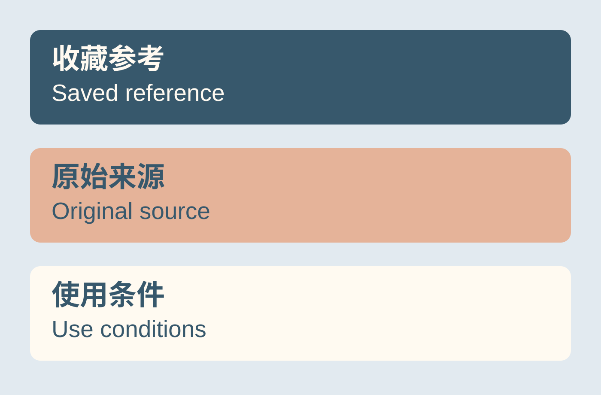

# Social Bookmarking Sites for Creator Reference Research

Status: local review draft; confirm the publication date before release.

Use Pinterest, Raindrop.io and Flipboard to organize creator work and industry leads, retaining original sources, task relevance and use conditions for further research.

Social bookmarking sites can help brands organize creator work, visual references and industry leads. Pinterest supports visual discovery, Raindrop.io organizes links in collections, and Flipboard collects and shares content through magazines; choose around the research task and access arrangement. Retain the original address, author or publisher, relevance to the brief and use conditions still to verify. Saving a link is neither approval of every claim nor permission to reuse the asset. A useful library helps another owner research a particular creator contribution instead of simply accumulating URLs.

## Define the creator task behind the collection

Camera expression, creator-work research and industry background need different records. Do not build a large inspiration library first and ask everyone to find a question that was never defined. Begin with a task in the brief.

For a small-space organizer demonstration, save how an action enters the frame rather than treat every interior photograph as equally relevant. Explain the useful passage and whether it informs expression, production or a person’s role.

The [Pinterest content-planning guide](https://www.quickkol.com/blog/use-pinterest-brand-search-content-planning/#answer) concerns a brand discovery route; this article organizes research references. A public Pin can supply a lead while the original work and actual contribution still need checking. The easier it is to explain why something was saved, the easier a later invitation can move from vague admiration to an assessable collaboration. The library should therefore contain a short research reason, not a score suggesting that every saved creator has already been selected or approved.

## Pinterest: organize visual questions and references

[Pinterest’s official introduction](https://help.pinterest.com/en/guide/all-about-pinterest) describes a visual discovery engine and saving Pins to boards. Use that for researching composition, actions and content questions rather than treat recommendations as a complete creator directory or market survey.

Name a board for a defined task, such as showing a drawer opening in closeup. Distinguish the team’s own project from external work so colleagues know what is a research reference and what is approved production. Do not save only the thumbnail and lose the original address.

Different publishers can recirculate one visual idea. Follow a useful expression back to its work source instead of mistake the collector for its creator. Apparent popularity does not establish brand fit; the work still needs a relationship to the assignment. A reference is most helpful when its accompanying note describes the action to study, allowing another person to understand the idea without being asked to duplicate the image itself.

## Raindrop.io: give links a project context

[Raindrop.io’s collections guide](https://help.raindrop.io/collections) describes grouping bookmarks by topic or project and using different views. It supports understanding link organization, not a claim that this article tested a team account, permissions or a paid plan.

A brand can organize one brief’s creator work, official product information and research questions in a collection. Sharing a collection does not give them equal evidential strength: identify an original work, a news report and personal commentary separately.

Keep a short explanation of the task, verified point and next question for each entry. Organization helps retrieve material without replacing factual assessment. Evaluate whether access and handoff fit actual work rather than judge only card counts or appearance. A useful pilot can ask the next owner to locate one reference and explain its relevance; if they need the original researcher to interpret every entry, the collection still lacks the context that makes it usable.

## Flipboard: curate a readable topic collection

[Flipboard’s magazine-creation guide](https://flipboard.helpshift.com/hc/en/1-flipboard/faq/696-create-a-magazine-1670887759/?p=ios) describes collecting articles, videos, photographs and links in a magazine with a public or private choice. A brand can research a topic’s public expression before deciding whether that form suits project sharing.

A topic collection needs more than accumulated headlines. Explain how a source informs the creator’s field, which statements are the publisher’s views and which need original evidence. Separate the brand’s proposed claims from external material instead of make every saved story appear endorsed.

The diagram separates a saved reference, original source and use conditions. Before public sharing, confirm scope and actual access rather than include internal partnership plans or private contact details. Without account testing, promise no particular collaboration or distribution outcome. The collection’s value can be assessed first by whether a colleague can understand the topic and locate relevant originals, rather than by an unsupported claim that publishing a magazine will produce creator inquiries or campaign sales.

Discovery and saving support research; commercial use needs a corresponding basis.

## Return to the original work

A bookmark card may show only a partial title, thumbnail or old description. Open the original work to confirm expression, publisher, date and relevance before using it for creator research. A cropped passage is not a conclusion about the whole item.

For an unavailable source, record the access limitation and observation time. A cache or repost is not automatically current, and failed access does not establish deliberate deletion or concealment by the author. Status describes what can be observed.

One source may offer person and idea leads without supporting private identity, pricing or audience-geography inferences. Keep research connected to work and a proposed role instead of create a personal dossier unrelated to the brief. This makes later contact more focused: the team can identify the actual contribution it wants to discuss without asking the creator to explain assumptions that were never supported by the saved material.

## Saving and asset use are separate decisions

The [U.S. Copyright Office’s copyright overview](https://www.copyright.gov/what-is-copyright/) describes works such as photographs and videos and their associated rights. Public visibility or saving does not establish arrangements for copying, adaptation or advertising; a particular use needs an appropriate basis.

Internal research can retain source links and the team’s observations without downloading every work into a commercial asset folder. When discussing an expression with a creator, identify the action or use being researched and let them consider how to contribute their own work.

Studying an idea differs from copying another person’s expression. A brand should not ask a candidate to remake an external work without discussing source and creative contribution. The library helps clarify the intended understanding, elements offered only as examples and work actually being commissioned. This gives the creator room to propose a suitable approach rather than interpret a saved reference as a requirement to reproduce everything in it.

## Match access to the material

A public topic collection can contain suitable public research leads, while an internal project may include an unreleased brief or discussion. Inspect the actual material before choosing sharing scope instead of follow the default button alone.

[Pinterest’s private-board guide](https://help.pinterest.com/en/article/secret-boards) describes visibility limited to the owner and invited people. That describes the function’s scope, not a guarantee that every organizational confidentiality need is automatically satisfied; confirm the real organization and account settings.

Private receiving details, negotiated prices or business correspondence do not belong in a public reference library. Give the next owner enough information for their task without exposing every conversation to all participants. Clear access also distinguishes public research leads from an actual commercial discussion. A colleague receiving the collection should know whether they are allowed to share the collection itself, rather than infer that permission from their ability to open it.

## Test the library with one hypothetical entry

Suppose a brand saves a creator’s demonstration of a small drawer. The record can state: research how to show object retrieval in a confined space; original URL and observation date retained; no asset-use permission obtained; next review other relevant work before considering a specific invitation.

This entry invents no followers, private email or willingness to collaborate and does not label the whole work approved. Another owner understands the reason and boundary without the original researcher present.

If the work later becomes inaccessible, update access status while retaining the original observation instead of inventing new evidence. If the brand chooses contact, open a separate assignment record connecting the lead to actual work. This hypothetical is not a client result; it demonstrates how context supports the next action. The useful test is whether a colleague can describe both the contribution being researched and the decision not yet made, without mistaking the bookmarked person for a confirmed commercial partner.

## Maintain the library without turning old leads into new facts

Review irrelevant, duplicate and unavailable records periodically. Retain older items when they explain the research process rather than keep adding for volume or delete all history indiscriminately.

Record what changed: a revised original page, a changed public role or a task that no longer applies. These need different responses. Do not overwrite old information so a later fact appears to have been known at the earlier observation date.

Give someone responsibility for inclusion rules and handoff. Multiple contributors can add material while a defined owner decides what enters the final brief. Presence in a collection is not a selection result and should not become a public partnership list without contact. Maintenance is successful when it helps the next assignment proceed with accurate references, not when the team reports the greatest possible number of saved creators without knowing why they were collected or whether the work is still relevant.

## Turn collection into concrete creator research

The [social-listening sample-validation guide](https://www.quickkol.com/blog/social-listening-query-sample-validation/#answer) emphasizes observation scope, and reference libraries need the same care. Platform recommendations and personal saves cover only part of visible content rather than establish complete industry or creator coverage.

Choose social bookmarking sites around visual organization, project links or readable topic curation, then confirm actual access and maintenance. Material need not be duplicated into every tool; select a simple arrangement that supports the present task.

Deliver records with sources, reasons and next actions. The brand understands the research question, creators have room to offer their own contribution and another owner can distinguish references from decisions. That makes collection useful to influencer marketing rather than an undirected URL list. It also gives the team a sensible stopping point: when the references support a defined conversation or production choice, further saving should serve a new question instead of postpone the work already ready to begin.

## Choose curation around the research task

| Tool | Documented organization | Question to check |
| --- | --- | --- |
| Pinterest | Pins, boards and sections | Whether the visual reference leads to the original |
| Raindrop.io | Collections by project or topic | Whether links retain task and evidence context |
| Flipboard | Topic-based content magazines | Whether scope and access fit the sharing task |

Task comparison based on official resources reviewed November 17, 2026, not a tested ranking, price comparison or distribution guarantee.

## Before saving a creator-research lead

Make the reference useful to the next owner.

- [ ] State the brief question it informs.
- [ ] Find the original and retain the observation date.
- [ ] Separate publisher views from verified facts.
- [ ] Retain use conditions and unknowns.
- [ ] Match sharing scope to the material.
- [ ] Name the next research or discussion task.

## Research date and limitations

Sources reviewed November 17, 2026. Methods, tables and decision rules are editorial recommendations. Hypothetical examples are not actual client results or industry benchmarks. Source geography and periods are specified where relevant.

## Start creator research with a clear task

Use QuickKOL to interpret a brief, discover relevant creators and research their work and contact routes. Verify data, commercial terms and outcomes at their source.

[Explore QuickKOL](https://www.quickkol.com/#capabilities)

## Sources

- [Pinterest’s official introduction](https://help.pinterest.com/en/guide/all-about-pinterest)
- [Raindrop.io’s collections guide](https://help.raindrop.io/collections)
- [Flipboard’s magazine-creation guide](https://flipboard.helpshift.com/hc/en/1-flipboard/faq/696-create-a-magazine-1670887759/?p=ios)
- [the U.S. Copyright Office’s copyright overview](https://www.copyright.gov/what-is-copyright/)
- [Pinterest’s private-board guide](https://help.pinterest.com/en/article/secret-boards)
