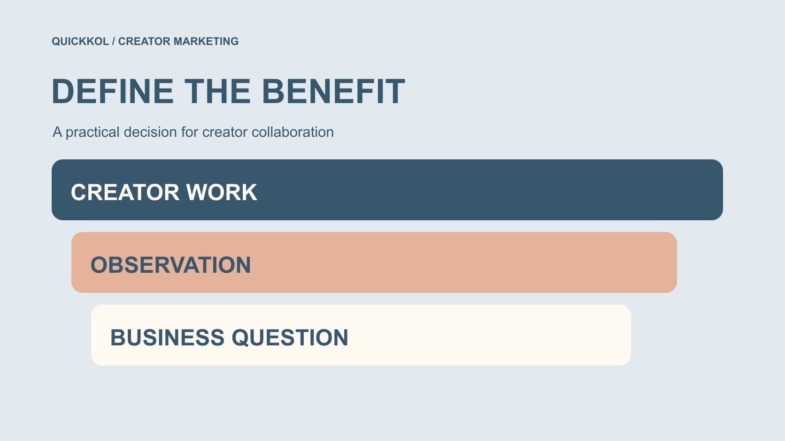
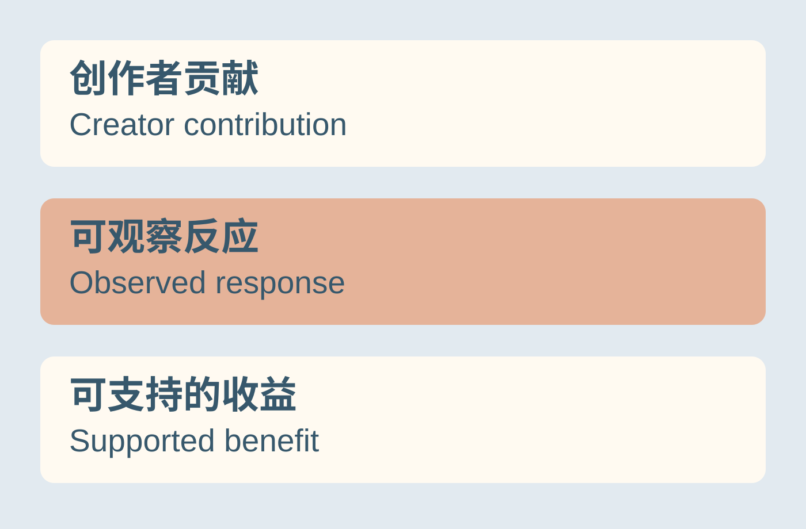

# Benefits of Social Media Marketing Through Creator Work

Status: local review draft; confirm the publication date before release.

Connect creator explanation, feedback and usable assets to brand decisions, choosing evidence for each benefit without turning attention directly into incremental sales.

QuickKOL editorial graphic; not actual account metrics or a platform interface.

The benefits of social media marketing for a creator campaign can include clearer product understanding, useful questions about real use, reusable explanation and a practical next step for interested viewers. Each benefit needs matching evidence: viewing is not understanding, comments do not represent every customer, and clicks do not establish incremental purchases. Define the business question, creator contribution, response owner and measurement method first. Answering “what are the benefits of social media marketing” this way turns broad advantages into assessable assignments rather than combining views, engagement and revenue into one unsupported success claim.

## Turn a proposed benefit into an answerable question

“Increase awareness” is too broad to decide what a creator should demonstrate. Ask whether someone unfamiliar with the product can distinguish two uses instead. That determines the demonstration, limitations to retain and task-relevant feedback to collect.

Start the benefit chain with the creator’s contribution rather than a desired number. A creator can explain a difference through an actual operation, the brand supplies accurate information, and viewers choose whether to learn more. These are distinct responsibilities; the final objective cannot establish that every earlier step occurred.

The [creator-networking strategy guide](https://www.quickkol.com/blog/creator-networking-strategy-peer-conversations/#answer) helps specify the conversation and its purpose. Choose one main question before listing supporting observations. When one post must educate, sell, provide service and recruit simultaneously, review can leave only a strong slogan and remove the explanation that made the partnership useful. A defined question also helps the team reject irrelevant edits: a request for another product mention should explain how it improves the chosen viewer task rather than simply make the brand more visible.

## Benefit one: make a product difference understandable

Creators can translate brand language into an observable action, such as showing whether an organizer opens inside a particular drawer. The benefit comes from making conditions, steps and limitations visible rather than adding more selling points.

Understanding needs observations suited to the task. Inspect whether the finished content retains the critical action, then organize questions about that action. Completing a video, liking it or spending longer with it does not independently establish understanding of dimensions and limitations.

Suppose two creators show the same item in different spaces. Preserve those contextual differences instead of comparing views alone. One version may explain a point more clearly while topic, timing and existing audiences also affect performance; the comparison is not an isolated experiment on creator ability. The brand can still learn which camera angle or wording made a condition easier to inspect. That narrower finding is useful for the next production brief without claiming to have measured a general improvement in every viewer’s product knowledge.

## Benefit two: collect questions worth answering

[YouTube’s community-building guide](https://www.youtube.com/creators/how-things-work/building-community/) describes replying to comments and maintaining audience conversation. It supports arranging a channel for dialogue, not a guarantee that each reply produces growth or a claim that commenters represent all consumers.

Organize feedback by question type: conditions of use, operating steps, service or an unconfirmed product fact. Let the creator answer from actual experience and route technical or service questions to an appropriate owner rather than asking one person to speak for the entire company.

Retain the content and setting behind a question so a quoted sentence does not lose its meaning. Repetition may indicate an unclear original explanation, or later viewers may simply have missed it. Review the context before deciding to reshoot, add an explanation or change a product page. The resulting question record has value even when it contains no favorable testimonial: it identifies work the brand can actually perform and prevents the next creator from receiving the same incomplete information.

## Benefit three: create material that can be reused appropriately

A clear creator demonstration can inform the next brief or explain a recurring question, but public visibility does not grant reuse rights. Production, creator publication, brand reposting and paid advertising uses need specific arrangements.

A useful asset record identifies what a passage explains, which product version it concerns and where it can be used. Do not place a finished video in a folder and discover later that its demonstration shows outdated packaging or functionality.

The diagram separates explanation, observable response and the next decision. Assess an asset first by whether it accurately serves an agreed use instead of treating an estimated advertising equivalent as proof of return. When editing it, check whether the new cut removes a necessary condition. A technically available file may still need an updated product shot, another language or renewed permission before it belongs in a new campaign. Those requirements are part of the practical value assessment, rather than administrative details to discover after reuse has already been promised.

Choose evidence for each step rather than treating sequence as causation.

## Benefit four: help interested viewers take a relevant next step

Creator content can lead to detailed information, booking or purchase, but the destination must answer the question raised. A video explaining one version and a page defaulting to another remain inconsistent regardless of click volume.

Match the next action to the explanation. An instructional post can lead first to dimensions or conditions of use rather than always demand an immediate order. The brand confirms the destination, availability and service capacity so the creator knows which promises are supported.

Name the observed action accurately. A tracked link click is a link click; an observed order still needs its attribution rule, returns and possible influence from other channels explained. Adjacent platform numbers cannot be joined into an unsupported causal chain. The practical benefit may be a clearer route to information, while an incremental-sales claim remains a separate question requiring stronger evidence. This distinction lets the brand improve a destination promptly without waiting for a broad return claim that the available records cannot justify.

## Make the commercial relationship understandable

[FTC’s influencer disclosure guide](https://www.ftc.gov/business-guidance/resources/disclosures-101-social-media-influencers) explains clear disclosure of material connections in the United States. A brand should not edit a paid or gifted statement into apparently independent user opinion and then count it as spontaneous word of mouth.

Commercial content can be useful while making the relationship understandable and retaining actual experience and relevant conditions. Disclosure need not turn each sentence into a contract explanation; it helps viewers understand why the recommendation appears.

For a reused version, check that the relationship remains apparent and the original context survives. Short edits, subtitles and repost descriptions can change interpretation. Include this maintenance in the asset’s value assessment rather than count only how many outputs one shoot produces. A partnership that yields fewer accurate, usable versions can be operationally more useful than one with a large file count that the brand cannot confidently publish. That is a planning judgment, not a claim that disclosure alone produces a measurable commercial advantage.

## Separate observation, attribution and incrementality

A platform report describes recorded activity, an attribution rule assigns an action to an entry point, and incrementality asks what would have happened without the activity. These need different evidence; a conversion column does not establish that the campaign produced every new sale.

[YouTube’s analytics overview](https://support.google.com/youtube/answer/9002587?hl=en) describes channel observations such as views and watch time. Interpret platform data through its actual fields, dates and content scope rather than transferring one platform’s view definition to another.

Without a suitable comparison design, report observed content, actions and limitations honestly. A specific question for the next test is more useful than forcing a whole-brand return claim from one small assignment. Retaining steps that cannot be connected also identifies the measurement that is missing. The report can still recommend correcting a broken destination or clarifying a repeated question because those actions follow directly from the observed problem, without pretending that fixing it guarantees a particular revenue increase.

## Choose evidence for a hypothetical assignment

Suppose an organizer brand hires a creator to explain drawer storage in a small space. The primary question is whether viewers can assess fit for their own drawer; the supporting question concerns dimensions that remain unclear. This is hypothetical, not a client result.

Retain the drawer-opening and item-removal actions, then record relevant questions and brand replies. If people ask about depth, inspect whether the explanation omitted it instead of treating the question count as an excitement score. A later production can change how dimensions are shown, but all performance differences between different posts cannot be assigned to that edit.

Hand over usable passages, questions, recorded actions and unknowns separately. Even without evidence sufficient for incremental revenue, the assignment can produce a concrete next step without inflating numbers to establish its value. The commissioning owner should agree in advance that an accurate finding of confusion is actionable: otherwise the creator is pushed to deliver praise when the brand actually needs a more informative explanation.

## Use the benefit chain to improve the next brief

Write each finding as what was observed, what change follows and what it does not establish. The [influencer-success measurement guide](https://www.quickkol.com/blog/measure-influencer-success-contribution-review/#answer) helps match measures to objectives rather than judge every assignment by the same engagement rate.

Retain the creator’s actual contribution. Finding a clearer demonstration angle and the brand later changing a product page are separate steps. Recognizing joint work makes future scope clearer and avoids assigning every benefit or problem to the publishing account.

The benefits of social media marketing should ultimately appear as clearer explanation, timely answers, usable assets and better decisions. When the brand knows where evidence sits and who owns the next action, it can assess continued collaboration or changed investment. The benefit chain therefore serves as a practical commissioning and review tool: it connects the work a creator can deliver to a business question the team is equipped to answer, with remaining uncertainty visible to the next decision-maker.

## Match a benefit to its evidence

| Proposed benefit | What to inspect | What it does not establish |
| --- | --- | --- |
| Clearer explanation | Visible action, conditions and answered questions | Every viewer understood |
| Useful feedback | Original questions, context and response | All customers think this way |
| Usable content | Actual version, use and permission | Guaranteed positive return |
| Relevant action | Defined click or order record | All activity is incremental |

Editorial planning framework, not an industry benchmark, client result or causal measurement model.

## Define the benefit chain before commissioning

Give each proposed benefit an assessable task.

- [ ] Define one primary business question.
- [ ] Specify the creator contribution.
- [ ] Retain conditions and disclosure.
- [ ] Assign question and destination owners.
- [ ] Separate observation, attribution and incrementality.
- [ ] State the next action and remaining unknowns.

## Research date and limitations

Sources reviewed November 17, 2026. Methods, tables and decision rules are editorial recommendations. Hypothetical examples are not actual client results or industry benchmarks. Source geography and periods are specified where relevant.

## Start creator research with a clear task

Use QuickKOL to interpret a brief, discover relevant creators and research their work and contact routes. Verify data, commercial terms and outcomes at their source.

[Explore QuickKOL](https://www.quickkol.com/#capabilities)

## Sources

- [YouTube: Building your community](https://www.youtube.com/creators/how-things-work/building-community/)
- [FTC’s influencer disclosure guide](https://www.ftc.gov/business-guidance/resources/disclosures-101-social-media-influencers)
- [YouTube’s analytics overview](https://support.google.com/youtube/answer/9002587?hl=en)
