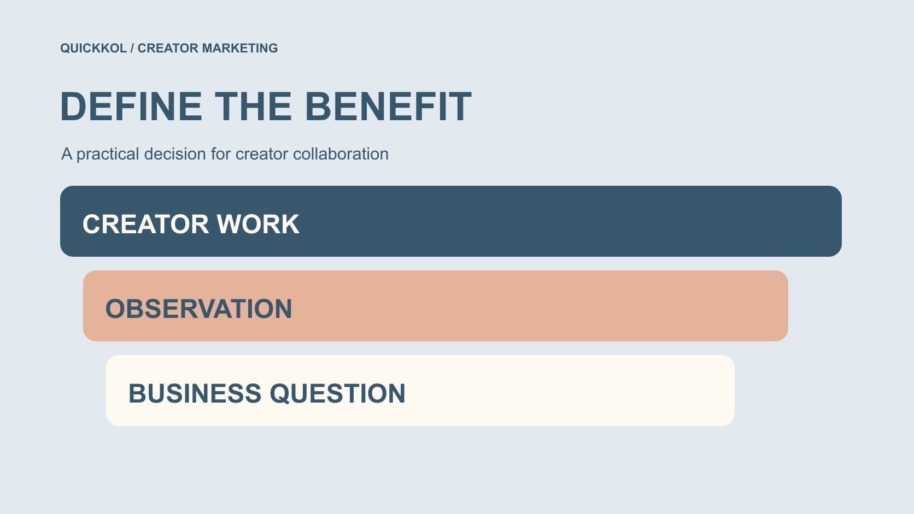
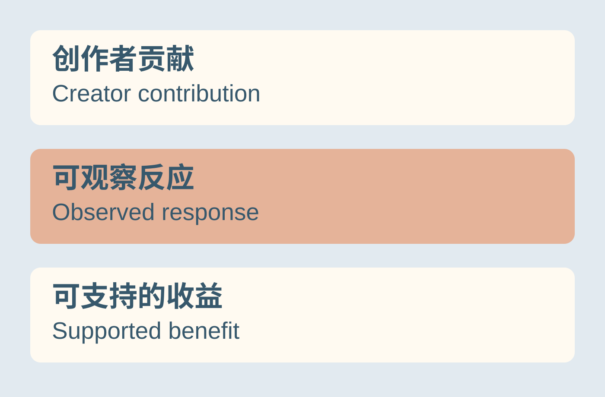

# 社交营销怎样体现达人的贡献

状态：本地审阅稿；正式发布日期待确认。

把达人带来的解释、反馈与可用素材连接到品牌决策，为每项收益选择合适证据，而不把注意力直接写成销售增量。

QuickKOL 编辑图形；不呈现真实账号指标或平台界面。

社交媒体营销对达人项目的价值，可以是让产品更容易理解、发现真实使用问题、积累可复用表达，以及帮助感兴趣的人完成下一步行动。每项价值都需要对应证据：看到内容不等于理解，留言不等于代表所有顾客，点击不等于新增成交。先确定品牌希望改善什么，再安排达人贡献、回应责任与测量方法。这样回答“what are the benefits of social media marketing”，才能把抽象收益变成可判断的合作任务，而不是把播放、互动和收入放进同一项成功声明。

## 把收益写成可回答的问题

“提高品牌认知”太宽，难以决定达人要演示什么。可以改问：不熟悉产品的人能否区分两种使用场景？这决定了演示内容、需要保留的限制，以及怎样收集任务相关反馈。

收益链应从达人贡献开始，而不是从想要的数字开始。达人可以用一次真实操作解释差异，品牌负责提供准确资料，观众选择是否继续了解。每一步都有不同责任，不能用最后一个目标倒推出前面都已发生。

[社交网络达人策略指南](https://www.quickkol.com/zh/blog/creator-networking-strategy-peer-conversations/#answer)可以帮助安排对话的对象与目的。先只选一项主要问题，再列辅助观察。若一条内容同时承担教育、销售、客服和招募，审稿时很容易只留下强烈口号，反而失去真正想解释的内容。

## 收益一：讲清产品差异

达人可以把品牌术语变成具体动作，例如展示收纳盒在哪种抽屉里能打开。这种说明的价值不是多说几个卖点，而是让观众看清条件、步骤和不适用之处。

理解需要与任务相符的观察。品牌可以检查成片是否保留关键动作，再整理观众针对该动作提出的问题。看完视频、点赞或停留较久，都不单独证明观众理解了尺寸与使用限制。

假设两位达人分别在不同空间演示同一物品，品牌应保留场景差异，而不是只比较播放量。一个版本解释得更清楚，也可能因为题材、发布时间或原有观众不同而得到不同表现；这不是对达人能力的单项实验结论。

## 收益二：收集值得回答的问题

[YouTube 的社区建设指南](https://www.youtube.com/creators/how-things-work/building-community/)介绍通过评论回应和持续交流与观众建立联系。这支持把社交渠道用于对话的安排，不保证每次回复都带来增长，也不代表评论是所有消费者的抽样。

品牌可以按问题类型整理反馈，例如适用条件、使用步骤、售后或尚未确认的产品事实。让达人回答亲自体验到的部分，技术或服务问题转给合适负责人，不要求其替整个企业作答。

记录问题来自哪条内容和什么场景，避免截取一句话后失去原意。重复提问可能说明原稿没有讲清，也可能只是后来观众没有看到解释；先看具体上下文，再决定补拍、补充说明或调整商品页。

## 收益三：形成有条件可复用的内容

一段清楚的达人演示，可以帮助品牌下一次准备 Brief 或解释常见问题，但看见公开内容不等于取得复用权。制作、达人发布、品牌转发和付费广告用途需要具体约定。

有用的素材记录应说明哪一段解释了什么、适用什么产品版本，以及可以在哪些渠道使用。不要只把成片塞进文件夹，等未来使用时才发现演示的是旧包装或旧功能。

图示把解释、可见回应与下一步分开。内容资产的价值可先按能否准确服务已约定用途判断，而不是用一个猜测的广告等值金额证明它必然带来回报。修改素材时，还应确认新的剪辑有没有移除原来必需的条件。

每一步选择对应证据，不把前后发生自动当作因果。

## 收益四：帮助有兴趣的人继续行动

达人内容可以把观众带到详细说明、预约或购买入口，但入口必须接得住内容提出的问题。若视频解释一个版本，落地页却默认另一个版本，点击量不会修复这项不一致。

行动设计应与内容任务一致。解释型内容可以先引导查看尺寸或适用条件，而不是每次都要求立即下单。品牌负责确认目的地、库存或服务能力，让达人知道哪些承诺有事实支持。

对实际行动使用恰当名称。追踪到一次链接点击，就报告链接点击；观察到订单，还要说明归因规则、退款和其他渠道可能的影响。不要把平台记录中相邻的数字串起来，写成没有证据支持的完整因果链。

## 明确商业关系，才能判断表达的性质

[FTC 的达人披露指南](https://www.ftc.gov/business-guidance/resources/disclosures-101-social-media-influencers)针对美国商业关系说明清晰披露的重要性。品牌不能把付费或赠样表达剪成没有关系背景的普通用户意见，再把它当作自发口碑收益。

商业内容也可以有用，但应让人知道关系，并保留真实体验和适用条件。披露不是让每句内容都变成合同解释，而是避免观众误解为什么出现这项推荐。

审查复用版本时，检查披露是否仍然可见，原来的语境是否保留。短剪辑、字幕和转发说明都可能改变理解。品牌衡量素材价值时，应包含这种维护成本，而不是只计算一次拍摄能产出多少条内容。

## 把观察、归因和增量分开

平台报告说明某种记录方式下看到了什么，归因规则把行动分配给某个入口，增量问题则问没有这项活动会怎样。三者需要不同证据，不能因为报告有转化列就说活动产生了全部新增销售。

[YouTube 的分析概览](https://support.google.com/youtube/answer/9002587?hl=en)说明观看、观看时长等频道观察维度。使用平台数据时，应按实际字段、时间范围和内容范围解释，而不是把一个平台的观看定义套到另一平台。

如果没有合适的对照设计，可以如实报告观察到的内容、行动和局限。对下一次测试提出更具体问题，比在一次小项目后强行给出全品牌投资回报更有用。保留无法连接的步骤，也能让团队知道该补哪项测量。

## 用一个假设项目选择证据

假设收纳品牌请达人解释小空间里的抽屉整理。主要问题是观众能否判断某个盒子适不适合自家抽屉，辅助问题是哪些尺寸说明仍然不清楚。本例没有实际客户结果。

拍摄时保留打开抽屉与取物动作，发布后记录相关问题及品牌回应。若许多人询问深度，团队先检查说明是否缺失，而不是把问题数当作热度成绩。下次可以改变尺寸展示方法，但不能把两次不同内容的全部表现差异归因于这项修改。

负责人交接时分别提交可用片段、问题清单、实际行动记录与仍未知的部分。这样即使没有足够证据计算增量收入，项目仍然能产生具体的下一步，而不会靠夸大数字来证明有价值。

## 用收益链改进下一次 Brief

把每项发现写成“观察到了什么，因此建议改什么，还不能说明什么”。[达人成功衡量指南](https://www.quickkol.com/zh/blog/measure-influencer-success-contribution-review/#answer)可帮助让指标与目标对应，而不是用同一个互动率评价所有任务。

保留达人的实际贡献。例如对方找到一个更容易理解的演示角度，这与品牌后来修改商品页是两个步骤。承认共同工作，能让下次合作条件更清楚，也避免把所有收益或问题都归给一个发布账号。

社交媒体营销的好处，最后应落实到更清楚的解释、更及时的回答、更合适的素材和更可靠的决策。品牌知道证据在哪里、谁负责下一步，才有基础判断是否继续合作或调整投入。

## 收益与证据如何对应

| 预期收益 | 可检查内容 | 仍不能说明 |
| --- | --- | --- |
| 更清楚的解释 | 动作、条件与问题是否讲清 | 所有观众都理解了 |
| 有用反馈 | 问题原文、场景与回应 | 全体顾客都这样想 |
| 可用内容资产 | 实际版本、用途与许可 | 必然有正投资回报 |
| 相关行动 | 定义明确的点击或订单记录 | 全部来自活动增量 |

编辑规划框架，不是行业基准、实际客户结果或因果测量模型。

## 开工前确定收益链

每项收益保留可判断的任务。

- [ ] 写一项主要业务问题。
- [ ] 说明达人可以贡献什么。
- [ ] 保留适用条件与披露。
- [ ] 安排问题与目的地的负责人。
- [ ] 分开观察、归因和增量。
- [ ] 让结论明确下一步与未知。

## 研究日期与使用边界

资料核验于 2026 年 11 月 17 日。文中方法、表格和决策规则为编辑建议，标为假设的示例不是实际客户结果或行业基准。外部资料的适用地区与时期按各段说明。

## 从任务开始达人研究

用 QuickKOL 理解 Brief、发现相关达人并研究作品与联系路径；数据、合作条件和结果仍需核验。

[了解 QuickKOL](https://www.quickkol.com/#capabilities)

## 来源

- [YouTube：建设社区](https://www.youtube.com/creators/how-things-work/building-community/)
- [FTC 的达人披露指南](https://www.ftc.gov/business-guidance/resources/disclosures-101-social-media-influencers)
- [YouTube 的分析概览](https://support.google.com/youtube/answer/9002587?hl=en)
