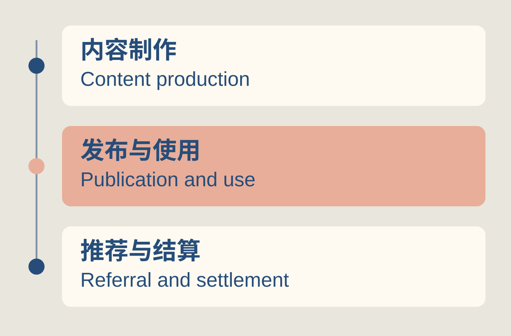

# How to Make Money on Social Media: Price Real Creator Work

Status: local review draft; confirm the publication date before release.

Plan creator income around production, publication, asset use and commission, separating delivery capacity, payment milestones and uncertain earnings.

To make money on social media, turn actual capabilities into work a brand can purchase: content production, publication on your account, permission to use assets or referrals paid under agreed rules. Platform earnings form another route with their own eligibility conditions. Rather than estimate monthly income from followers, establish the deliverable, working time, payment conditions and uncertain amounts. Answering “how to make money on social media” should produce a sustainable creator business arrangement, without treating every possible income stream as money already available this month.

## Choose work you can actually deliver

A brand may need a product-explanation video or a publication addressed to your own audience. Strong production does not require selling account exposure; having an audience does not mean one fee includes every production and later use.

List contributions you can perform, such as on-camera demonstration, filming, editing, hosting or experience with a product category. Use work samples to explain capability and leave other responsibilities with suitable people rather than promise unfamiliar work to appear comprehensive.

The [creator gross-and-net income guide](https://www.quickkol.com/blog/how-much-influencers-make-gross-net-workload/#answer) distinguishes compensation from what remains after costs. Scope comes first because it identifies the time and resources belonging to the assignment. Followers may provide context for a publication task, but cannot replace services, acceptance criteria and payment conditions. This starting point also makes a first commercial conversation more practical: instead of announcing that you want sponsorship, you can explain the specific piece of work you could produce and ask whether that contribution addresses the brand’s actual need.

## Describe production and publication separately

Production compensation concerns filming and delivery; publication compensation concerns a particular appearance on an account. Buying assets alone does not establish that the creator will post, while a publication commitment should identify the version, account, timing and content to retain.

Break the project into understandable stages rather than call everything one video. Product familiarization, concept, filming, editing, review and release each take time. Late information or a replacement product can change the original sequence.

If a partnership needs another product-detail shot, determine whether it corrects an unmet original requirement or adds a new assignment. That distinction affects time and compensation and should be discussable from the beginning. A creator can protect delivery capacity by reserving a defined review period and asking who consolidates brand comments. Otherwise several people may request conflicting changes, consuming the time intended for the next project while everyone still describes the assignment as a single simple video.

## Platform earnings have separate conditions

[YouTube’s monetization guide](https://support.google.com/youtube/answer/72857?hl=en) lists advertising, Shopping, Premium and fan-supported routes and explains that features have separate requirements. It does not mean every account can activate them or support one universal earnings-per-follower forecast.

Record platform earnings separately from brand work. One piece of content can involve several relationships, but advertising share, a production fee and referral commission have different payers, conditions and records. A dashboard estimate is not an amount the brand owes.

For work planning, distinguish what you control. Delivery progress, information accuracy and completion of agreed work are manageable responsibilities; platform distribution, viewer purchases and future rules cannot be guaranteed. Treat platform earnings as a verified business component instead of support for a fixed monthly-income promise. This also prevents a brand negotiation from becoming confused: the fact that a platform might earn advertising revenue from a video does not explain which production tasks or commercial uses the brand expects to purchase from its creator.

## Asset use is a specific commercial scope

In the [U.S. Copyright Office’s copyright overview](https://www.copyright.gov/what-is-copyright/), the guidance distinguishes works, rights and authorized use. For a creator business, delivering a file should not leave either party assuming that every modification, channel and duration has automatically been agreed.

Discuss where an asset will appear, which version, for how long and whether further editing is included. A transfer of rights, limited permission and another advertising use are different arrangements; a vague label cannot replace mutual understanding.

The diagram separates production, publication and use. Organize a proposal around real tasks rather than create a complicated package for every imagined possibility. If the brand later changes market or channel, discuss the actual change and whether it affects production, permission or response responsibilities. Keep the accepted version connected to the permitted use so someone receiving the file later can identify its scope. This is practical project administration; a particular contract or disputed ownership question needs advice appropriate to that situation and jurisdiction.

Connect compensation to actual work and record payment conditions separately.

## Understand when commission is earned and settled

Referral compensation is connected to an agreed attributable action. Confirm how a link or code records activity, which transactions count and how cancellations, returns and review are handled. A click is not automatically a commission.

If the partnership also includes a fixed production fee, keep the two distinct. Calling the whole project affiliate should not erase agreed payment conditions for completed production; a fixed fee likewise does not remove the need for accurate referral records.

Give uncertain income its own status. Expected, awaiting confirmation, payable and received amounts are different stages, not one total for presenting business size. Identify who supplies records and handles questions before the project begins, rather than reach month end with an unexplained screenshot. Where a purchase cannot be connected under the agreed rule, preserve that limitation. Filling a gap with an assumed order may make a short-term estimate look better while leaving both parties unable to settle the actual work confidently.

## Plan a revenue mix around working capacity

Working time includes more than filming. Product preparation, revision communication, publication and maintaining asset scope can compete for the same day. Observe your own process before deciding how many assignments fit, rather than copy another person’s posting frequency.

Suppose a creator has three available working blocks in a week. Two belong to confirmed production and the third must accommodate review and possible reshoots. Another urgent assignment could displace an existing commitment. This is a hypothetical capacity illustration, not a standard workload or income recommendation.

Retain room for real changes and explain what can be completed when a new invitation arrives. Adding revenue routes to a list does not create more time; declining an unsuitable assignment can protect delivery quality. Review the completed project afterward to see which activities took longer than expected. The purpose is to improve the next scope and schedule, without assuming that every unfilled hour should become another paid commitment or that a busy calendar necessarily means a viable business.

## Connect payment records to completed work

Retain scope, accepted versions, acceptance records and payment status for each project. An amount should correspond to an agreed service or use rather than a brand name and a total alone. Record milestones as actually agreed instead of applying one universal rule to every partnership.

For an unpaid amount, distinguish missing submission, ongoing review, a payable amount and a disputed delay. These need different next actions; absence of receipt does not establish another party’s motive.

Business planning can compare money actually received with work still owed, avoiding new production commitments based on unconfirmed commission. This article does not provide individual tax, investment or legal advice; use support suited to your circumstances where needed. A simple, accurate project record is valuable before that stage because it allows you to explain which work was accepted and what question remains, rather than reconstruct an entire collaboration from scattered messages when someone asks about an amount.

## Preserve the actual commercial relationship

[FTC’s influencer disclosure guide](https://www.ftc.gov/business-guidance/resources/disclosures-101-social-media-influencers) explains clear commercial-connection disclosure in the United States. When payment, products or another relevant relationship exists, viewers should understand it instead of receiving a commercial assignment presented as context-free independent advice.

[YouTube’s branded-content disclosure guide](https://support.google.com/youtube/answer/154235?hl=en) also requires applicable commercial content to be declared to the platform and notes other applicable responsibilities. Platform settings, truthful expression and commercial arrangements are distinct; using one label does not resolve every question.

For example, a brand adding a live appearance to an existing shoot should confirm preparation, hosting and response work again. The original asset quote does not establish availability for that additional time or show that the creator has experienced every product the new broadcast would feature.

Include these requirements in delivery. A creator cannot sell a product experience they have not had, and a brand should not insist on a statement inconsistent with actual use. Clear scope helps identify and correct the conflict before publication. If the product changes during review, ask whether the existing experience still supports the revised version rather than simply replace the name in the script. That protects the accuracy of the work the brand is buying and the credibility of the creator delivering it.

## Start with a small, defined assignment

Prepare work evidence relevant to a particular brief, explaining your contribution, available scope and information needed from the brand. The [media-kit review guide](https://www.quickkol.com/blog/what-is-a-media-kit-brand-review/#answer) separates work, audience evidence and terms, giving both parties a practical way to begin discussion.

The first assignment need not include every revenue route. Complete one defined production or publication task, observe the workload and settlement process, then consider additional uses. Expansion needs mutual confirmation rather than arise automatically because a post performs well.

Making money on social media begins by turning creator capability into work another party understands and you can complete. Accurate income records, clear boundaries and executable follow-through provide a basis for choosing which partnerships to continue. They also make a proposal more useful than a promised earnings formula: the brand can assess a real contribution, and the creator can decide whether that contribution fits their available time and business priorities.

## Distinguish four commercial arrangements

| Arrangement | Actual contribution | Confirm |
| --- | --- | --- |
| Production | Filming and delivery of an agreed version | Inputs, revisions and acceptance |
| Publication | Content addressed to an account’s audience | Version, timing and retention |
| Asset use | Permission for specified uses | Channels, duration and editing |
| Referral commission | Compensation for an agreed action | Attribution, returns and settlement |

Editorial business categories, not standard prices, earnings forecasts or individual legal or tax advice.

## Business checks before accepting work

Connect compensation to delivery capacity.

- [ ] Explain contribution with work samples.
- [ ] Separate production, publication and use.
- [ ] Confirm inputs, revisions and acceptance owners.
- [ ] Record uncertain commission separately.
- [ ] Allow time for review and changes.
- [ ] Update payment status against actual terms.

## Research date and limitations

Sources reviewed November 17, 2026. Methods, tables and decision rules are editorial recommendations. Hypothetical examples are not actual client results or industry benchmarks. Source geography and periods are specified where relevant.

## Start creator research with a clear task

Use QuickKOL to interpret a brief, discover relevant creators and research their work and contact routes. Verify data, commercial terms and outcomes at their source.

[Explore QuickKOL](https://www.quickkol.com/#capabilities)

## Sources

- [YouTube’s monetization guide](https://support.google.com/youtube/answer/72857?hl=en)
- [the U.S. Copyright Office’s copyright overview](https://www.copyright.gov/what-is-copyright/)
- [FTC’s influencer disclosure guide](https://www.ftc.gov/business-guidance/resources/disclosures-101-social-media-influencers)
- [YouTube’s branded-content disclosure guide](https://support.google.com/youtube/answer/154235?hl=en)
