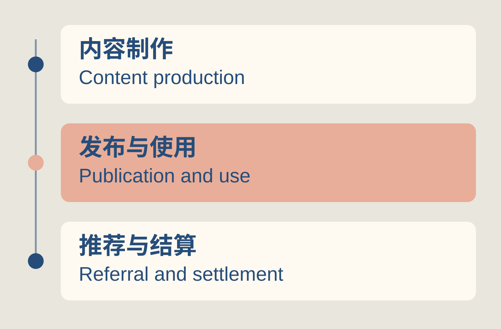

# 达人怎样安排收入与工作容量

状态：本地审阅稿；正式发布日期待确认。

从制作、发布、素材使用和佣金四类工作安排达人收入，把交付能力、付款节点与不确定收入分开。

想通过社交媒体赚钱，可以把自己的实际能力转成品牌能够采购的明确工作：制作内容、在自己的账号发布、许可品牌使用素材，或按约定规则获得推荐佣金。平台收入是另一条有资格要求的路线。不要先用粉丝数估算月收入；先确认能交付什么、要花多少工作时间、什么时候可以结算，以及哪些收入仍不确定。回答“how to make money on social media”，应形成可持续的达人业务安排，而不是把每一条潜在收入都当作本月已经到账的钱。

## 先选择能交付的工作

品牌需要的可能是一段解释产品的短片，也可能是由达人面对自己的观众发布。能制作好内容，不等于必须出售账号曝光；有稳定观众，也不代表一次报价包含所有制作与后续使用。

列出你真正能完成的贡献，例如镜头前演示、拍摄剪辑、主持或某类产品体验。用已有作品说明能力，再把不提供的部分留给其他角色，不必为了看起来全面而承诺不会的工作。

[达人收入的毛额与净额指南](https://www.quickkol.com/zh/blog/how-much-influencers-make-gross-net-workload/#answer)帮助区分报酬和实际留下的部分。先确定业务范围，才知道哪些成本与时间属于这项工作。粉丝数量可以是某种发布任务的背景，却不能代替服务内容、交付标准和支付条件。

## 把制作与发布分别说明

制作费对应实际拍摄与交付，发布费对应账号上的具体内容安排。品牌只采购素材时，不能默认达人也会发帖；达人承诺发布时，也要说明版本、账号、时间安排和需要保留的内容。

可把同一项目拆成明确步骤，而不是把所有事写成“一个视频”。产品了解、概念、拍摄、剪辑、审阅和上线各有时间。品牌迟交资料或替换产品时，原来的制作顺序可能需要调整。

假设一个合作需要重新拍摄产品细节，先判断是修正原本未完成的要求，还是新增加的任务。这个区别会影响时间与报酬，应在合作开始就能讨论，而不是等双方都认为对方理所当然负责时才发现范围不同。

## 平台收入有独立条件

[YouTube 的收入方式说明](https://support.google.com/youtube/answer/72857?hl=en)列出广告、Shopping、Premium 与粉丝支持等途径，并说明不同功能有各自要求。这不表示每个账号都能启用，也不支持用一个统一的每粉丝收入预测未来收入。

平台收入与品牌项目应分别记录。一次内容可能同时涉及不同关系，但广告分成、品牌制作费和推荐佣金的付款方、形成条件与记录方式不同。不要把一个预估面板数字写成品牌欠款。

做工作安排时，确认你能控制什么。可以控制交付进度、资料准确性与是否按约完成工作；平台分配、观众购买与后续规则变化，则不能保证。让平台收益成为经过核对的业务组成，而不是承诺固定月收入的依据。

## 素材使用是具体的商业范围

[美国版权局的版权说明](https://www.copyright.gov/what-is-copyright/)区分作品、权利与授权使用。对达人业务而言，向品牌交付一个文件，不应让双方误以为已经自动约定所有修改、渠道和期限。

说明需要讨论的是哪里使用、使用哪个版本、多久以及是否允许进一步修改。素材买断、有限使用与新增广告用途不是同一件事，实际安排需要双方理解，不靠一个模糊词语代替。

配图把制作、发布和使用分开。可以按真实任务组织报价，不必为每个可能用途先创造一个复杂套餐。如果品牌后来改变市场或渠道，回到具体变化讨论，确认是否影响新的拍摄、授权或回应责任。

收入名称要对应实际工作；不同付款条件分别记录。

## 佣金收入先看形成与结算规则

推荐佣金通常与约定的可归属行动相关。品牌与达人需要确认链接或代码如何记录、哪些交易被计入，以及取消、退款和审核会怎样处理；不能把一次点击直接写成一笔佣金。

如果合作也包括固定制作费，把两者分开。已完成的制作任务，不应因为团队把所有项目都叫“affiliate”就失去原来约定的付款条件；同样，固定报酬也不代表可以忽略推荐活动的真实记录。

给不确定收入单独标记状态。预计、待确认、可结算与已到账是不同阶段，不能合并成展示业务规模的总数。由谁提供记录、疑问交给谁，应在项目开始就清楚，避免月底只有一张截图却无法解释其中金额。

## 用容量安排业务组合

工作时间不只是拍摄。准备产品、沟通修改、处理发布和维护素材范围，都可能占用同一段工作日。先观察自己的实际流程，再决定能同时接多少项目，不照搬别人的发布频率。

假设达人一周有三段可安排的工作时间，已经有两段用于确认过的制作，第三段还要承担审阅与意外重拍。此时再接一个紧急任务，可能挤掉原来承诺的工作。本例是容量说明，不是标准工时或收入建议。

可以保留少量余地给真实变化，并在新邀请到来时说明可完成的范围。把更多收入路线加入清单，并不会自动增加时间；适当放弃不合适的任务，也可能保护已有合作的交付质量。

## 让收款记录对应完成的工作

每个项目保留工作范围、确认版本、验收与结算状态。金额应能对应某项已约定服务或使用，而不是只有一个品牌名称和总价。付款节点按真实约定记录，不在文章里替任何合作设定统一规则。

对尚未付款的部分，区分资料还未提交、对方正在审阅、款项已可结算与逾期争议。不同情况需要不同下一步，不能因为没有到账就直接判断某一方的动机。

业务规划可以查看实际收到的款项与必须完成的工作，避免靠尚未确认的佣金承担新的制作承诺。这里不提供个别税务、投资或法律意见；涉及这些问题时，应使用适合自己地区与情况的专业支持。

## 商业表达必须保留真实关系

[FTC 的达人披露指南](https://www.ftc.gov/business-guidance/resources/disclosures-101-social-media-influencers)在美国场景下说明商业关系的清晰披露。品牌付费、提供产品或存在其他相关关系时，应让观众理解，而不是把商业任务包装成没有背景的独立推荐。

[YouTube 的商业内容标注说明](https://support.google.com/youtube/answer/154235?hl=en)也要求适用的品牌内容向平台声明，并指出仍有其他适用要求。平台操作、真实表达与商业安排是不同责任，不能因为使用一个标签就认为所有问题已经解决。

例如品牌想在原有拍摄之外增加一次直播，应重新确认准备、出镜和回应的工作。已有素材的报价不说明这段新增时间可以使用，也不说明达人已经体验了直播要展示的所有产品。

这些安排属于交付的一部分。达人不能出售自己没有经历过的产品体验，品牌也不应要求保留一个与真实使用不符的说法。工作范围越清楚，越容易在上线前发现并改正这种冲突，而不是发布后再解释。

## 用小而明确的项目开始

准备一份与具体 Brief 有关的作品介绍，说明你的贡献、可完成的范围与需要品牌提供的资料。[媒体资料审核指南](https://www.quickkol.com/zh/blog/what-is-a-media-kit-brand-review/#answer)强调把作品、受众证据与合作条件分开，适合帮助双方开始讨论。

第一次项目不必包含所有收入路线。可以先完成一项清楚的制作或发布任务，观察实际工作量与结算过程，再决定是否增加其他用途。扩大范围应基于双方确认，而不是因为内容表现不错就自动追加。

通过社交媒体赚钱的起点，是把达人能力变成对方能理解、自己能完成的工作。收入记录准确、边界清楚、后续安排可执行，才有基础决定哪些合作值得继续。

## 四种商业安排怎样区分

| 安排 | 实际贡献 | 需要确认 |
| --- | --- | --- |
| 内容制作 | 约定版本的拍摄与交付 | 资料、修改与验收 |
| 账号发布 | 面向账号观众的内容安排 | 版本、时段与保留 |
| 素材使用 | 指定范围内的使用许可 | 渠道、期限与修改 |
| 推荐佣金 | 按约定行动形成的报酬 | 归因、退款与结算 |

编辑业务分类，不是统一报价、收入预测或个别法律与税务意见。

## 接受合作前的业务清单

让收入与交付能力相对应。

- [ ] 用作品说明实际贡献。
- [ ] 分开制作、发布和使用。
- [ ] 确认资料、修改与验收责任。
- [ ] 单独记录不确定佣金。
- [ ] 给审阅和变化保留时间。
- [ ] 按真实约定更新收款状态。

## 研究日期与使用边界

资料核验于 2026 年 11 月 17 日。文中方法、表格和决策规则为编辑建议，标为假设的示例不是实际客户结果或行业基准。外部资料的适用地区与时期按各段说明。

## 从任务开始达人研究

用 QuickKOL 理解 Brief、发现相关达人并研究作品与联系路径；数据、合作条件和结果仍需核验。

[了解 QuickKOL](https://www.quickkol.com/#capabilities)

## 来源

- [YouTube 的收入方式说明](https://support.google.com/youtube/answer/72857?hl=en)
- [美国版权局的版权说明](https://www.copyright.gov/what-is-copyright/)
- [FTC 的达人披露指南](https://www.ftc.gov/business-guidance/resources/disclosures-101-social-media-influencers)
- [YouTube 的商业内容标注说明](https://support.google.com/youtube/answer/154235?hl=en)
