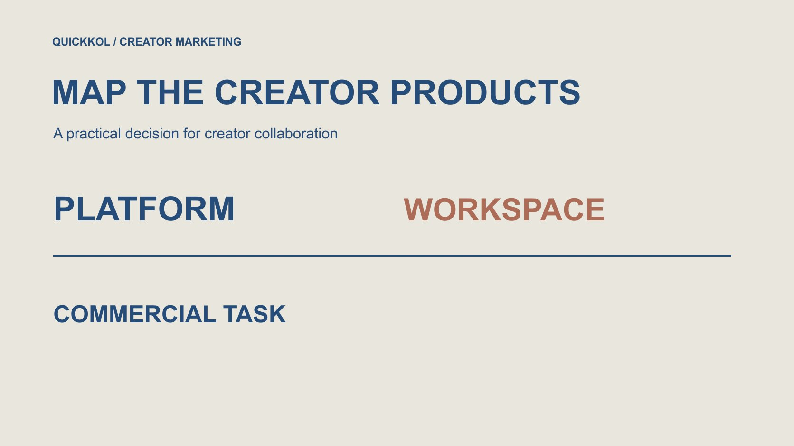
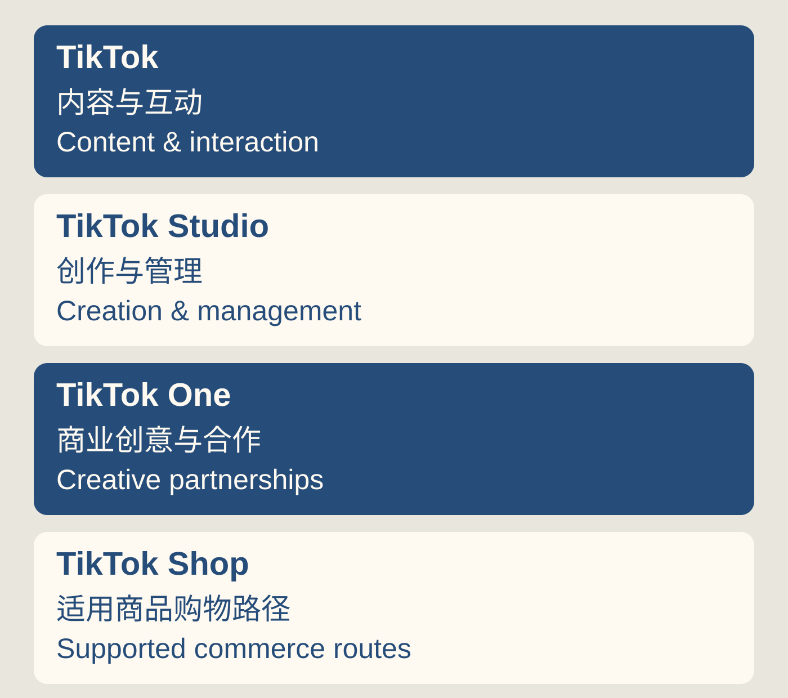

# What Is Tick Tock? Understand TikTok’s Creator Products

Status: local review draft; confirm the publication date before release.

After identifying tick tock as TikTok, distinguish the platform, Studio, One and Shop so a creator brief does not use one name for every production, partnership and commerce condition.

QuickKOL editorial graphic; not actual account metrics or a platform interface.

If what is tick tock refers to the social platform, the product name is TikTok. Influencer marketing also needs distinctions among related names: TikTok is the content and interaction platform, TikTok Studio concerns creation and content management, TikTok One concerns commercial creative work and partnerships, and TikTok Shop connects product-shopping routes in supported markets. These are not interchangeable or proof that one account qualifies for everything. Define research, production, publication or product recommendation before checking the actual route and mutual responsibilities.

## Separate the platform name from the request

A brand saying we want TikTok may mean creator production, account publication, partnership advertising or product recommendation. Expand the request into actions instead of use a platform name as the whole brief.

The [TikTok content-surfaces guide](https://www.quickkol.com/blog/what-is-tiktok-content-surfaces-brand/#answer) introduces viewing and discovery contexts; this article distinguishes related product names. Knowing a name does not decide production, publication, response or transaction ownership.

State the contribution first, such as a relevant creator demonstrating one product action, then discuss the route. The counterpart can assess real work instead of guess whether the brand also expects publication, assets and guaranteed sales. Accurate names begin the conversation while the assignment still needs definition. A useful brief should let another colleague identify the work even if the product terminology changes later, preserving the practical purpose rather than relying on a logo or tool name to carry every assumption.

## TikTok: the platform for content and interaction

[TikTok’s recommendation guide](https://support.tiktok.com/en/using-tiktok/exploring-videos/how-tiktok-recommends-content) describes personalization and several signal types across surfaces. It helps explain the viewing environment without promising an account a fixed amount of exposure or every viewer the same content order.

For creator work, the platform is the setting for expression. Research the actual action, language and question rather than an account total alone. Having an account does not establish capability for transactions, advertising production or every commercial tool.

After clarifying vocabulary, ask what viewers should understand in this assignment. Production may happen in many tools while content accuracy, usefulness and task fit need brand and creator confirmation. The destination platform cannot make that decision by itself. This keeps platform familiarity from being mistaken for product expertise, allowing the brand to assess relevant work and the creator to identify which part of the request matches their real contribution.

## TikTok Studio: creation and content management

[TikTok’s 2024 Studio announcement](https://newsroom.tiktok.com/helping-creators-bring-creativity-to-life-with-tiktok-studio?lang=en), dated May 24, introduced creation, editing, upload, management and analysis purposes while noting differences between tool routes. This supplies dated product background, not testing of every present function.

For a brand partnership, the Studio name can locate a creator’s operating work without justifying access to every private record. Confirm the report and version needed for the task rather than turn one request into entire-account access.

Check the current account, market and actual route before use. An older announced function does not establish universal present availability, and platform earnings tools are not the same thing as a brand production fee. Content management, project participation and payment still need separate understanding. This distinction helps the creator provide relevant evidence without implying that a screenshot of a management workspace proves acceptance of a commercial brief or availability for all the work the brand has imagined.

## TikTok One: commercial creative and partnership work

[TikTok One’s advertiser guide](https://ads.tiktok.com/resources/help/article/about-tiktok-one?lang=en), currently marked updated June 2026, describes creator discovery, production and commercial-project management. This is a provider capability description, not a guarantee of project outcomes or account access.

Research whether the route fits an assignment while still checking work, actual contribution and mutual conditions. Finding a creator does not establish a partnership, and seeing content inside a tool does not automatically grant every use.

The graphic separates the four names. One project may involve several routes while each still needs an owner and actual record. The name One should not make every platform task, sample and transaction seem included in one commercial arrangement. A brand can use the terminology to ask a more precise question about where work happens without making that tool responsible for the negotiation, factual verification and acceptance decisions the parties still need to complete.

A task vocabulary map, not a platform interface; confirm actual access and supported markets separately.

## TikTok Shop: products and content-led shopping

[TikTok Shop’s U.S. Creator Center guide](https://seller-us.tiktok.com/university/essay?knowledge_id=6935729397827330) describes affiliate-product discovery, content product links and a commission route. The U.S. source explains a concrete use without extending its conditions to every market and account.

A product appearing in a video does not establish a shopping route. Match the item, version, linked selection and availability. The creator can express actual experience while the brand remains responsible for accurate information and suitable transaction support.

The [TikTok Shop creator-route guide](https://www.quickkol.com/blog/tiktok-shop-creator-affiliate-content-route/#answer) further separates samples, publication and settlement. Shop, One and Studio can connect in a project without one route’s access proving another is available. Confirm actual work before scaling content. The vocabulary should help the team see the separate product and operational dependencies, not make a commerce label conceal an unfinished filming assignment or an unresolved question about what the creator is expected to deliver.

## Separate eligibility, tools and outcomes

Eligibility for a feature does not establish brand fit, and a tool supporting work does not establish agreement to perform it for this project. Eligibility, capability, willingness and actual arrangements are different questions.

Check the available route, relevant work and commercial scope separately. Without actual account testing, leave access pending; without corresponding evidence, promise no fixed distribution, earnings or purchases. A complete brief need not pretend every unknown is resolved.

For example, a handoff referring to Studio records should still name the account, content and period. The next owner should not have to guess which project a management screenshot concerns or mistake viewing that record for confirmation that a product can be purchased or advertising has been authorized.

Ordinary video publication can still leave the proposed advertising or commerce route to confirm. Conversely, an unavailable commercial route does not establish weak production capability. Separate roles from platform conditions so selection stays focused on the actual task. This allows a brand to consider a production-only assignment where appropriate rather than reject relevant work simply because an unrelated platform feature is not part of the creator’s current account.

## Give each named route a working owner

A project record can retain the product name alongside the actual task. The brand supplies facts and destinations, the creator delivers agreed expression, an operator handles applicable tools and an appropriate business team receives transaction questions.

One person can hold several roles while responsibilities remain clear. Do not assign every route to the first person replying or share private logins for cross-team convenience. Confirm suitable official access arrangements where needed.

Update the affected task when work changes rather than merely rename the platform. A product-version change concerns content and destination; a creative-use change concerns assets and scope. Accurate names help locate the issue, while the actual task record makes continuation possible. The next owner should be able to see what is confirmed without understanding every product’s history or inferring authority from the fact that someone has opened its interface.

## Test the vocabulary through a hypothetical bottle project

Suppose a brand wants a creator to show a bottle fitting into an everyday bag. TikTok is the public expression platform, and the creator can check their management route. Investigate One for a relevant commercial-production route, and separately confirm Shop for an applicable product link.

These locate tasks without requiring every product. Defined production and publication may suffice, and mentioning Shop does not automatically include samples, commission and advertising assets.

This hypothetical contains no client result. Ask whether each name serves a need, who confirms access, which actual version appears and what remains open. Clear vocabulary should return discussion to the viewer action and real product. The team can then remove an unnecessary tool requirement or identify a missing commerce check rather than let a long list of product names make an incomplete assignment appear fully planned.

## Retain specific objects in reporting

Content viewing, commercial delivery and transactions may be recorded in different places. Specify object, period, field and scope rather than add similarly named figures from several routes.

Check production through delivery, interpret post-publication observations through content and source, and describe commission through applicable records and status. A management interface displaying numbers does not establish that every commercial outcome was verified.

With incomplete information, retain a limited conclusion and next question. The brand may identify a missing product explanation or a brief change without calculating complete incremental return. Distinguishing records is more useful than one overall TikTok score hiding unlike work. It also lets the creator receive credit for an accepted contribution while a separate operational or settlement question remains open with the appropriate owner.

## Make product vocabulary serve the creator brief

The initial answer to what is tick tock is TikTok, but brand work needs more than recognizing the name. Distinguish content, management, commercial production and shopping tasks before selecting the routes actually needed.

Retain source dates and geography instead of turn an old announcement into a present access guarantee. Describe source research honestly without account testing, and keep a lead distinct from a mutually confirmed partnership.

Accurate vocabulary should reduce misunderstanding: the brand knows what it is buying, creators know their contribution and an owner knows where to verify it. Platform knowledge then serves influencer marketing instead of a list of product names unrelated to actual work. A successful handoff can state the task in plain language as well as name its tool, preserving that purpose when interfaces or product labels change later.

## Four names, different questions

| Name | Task orientation | Confirm separately |
| --- | --- | --- |
| TikTok | Content and interaction environment | Actual work and publication task |
| TikTok Studio | Creation, management and analysis | Current access route and relevant records |
| TikTok One | Commercial creative and partnerships | Contribution, scope and access |
| TikTok Shop | Applicable product-shopping route | Market, product, conditions and support |

Task distinctions based on official resources, not a full feature list, universal account qualification or performance guarantee.

## Before naming TikTok products in a brief

Connect each name to actual work.

- [ ] State the viewer task and creator contribution first.
- [ ] Separate content, management, partnership and commerce.
- [ ] Check the actual market, account and route.
- [ ] Do not infer all access from one qualification.
- [ ] Confirm scope and use mutually.
- [ ] Retain objects, sources and status in reporting.

## Research date and limitations

Sources reviewed November 17, 2026. Methods, tables and decision rules are editorial recommendations. Hypothetical examples are not actual client results or industry benchmarks. Source geography and periods are specified where relevant.

## Start creator research with a clear task

Use QuickKOL to interpret a brief, discover relevant creators and research their work and contact routes. Verify data, commercial terms and outcomes at their source.

[Explore QuickKOL](https://www.quickkol.com/#capabilities)

## Sources

- [TikTok’s recommendation guide](https://support.tiktok.com/en/using-tiktok/exploring-videos/how-tiktok-recommends-content)
- [TikTok’s 2024 Studio announcement](https://newsroom.tiktok.com/helping-creators-bring-creativity-to-life-with-tiktok-studio?lang=en)
- [TikTok One’s advertiser guide](https://ads.tiktok.com/resources/help/article/about-tiktok-one?lang=en)
- [TikTok Shop’s U.S. Creator Center guide](https://seller-us.tiktok.com/university/essay?knowledge_id=6935729397827330)
