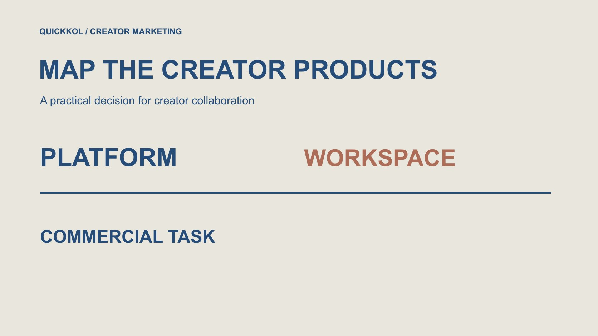
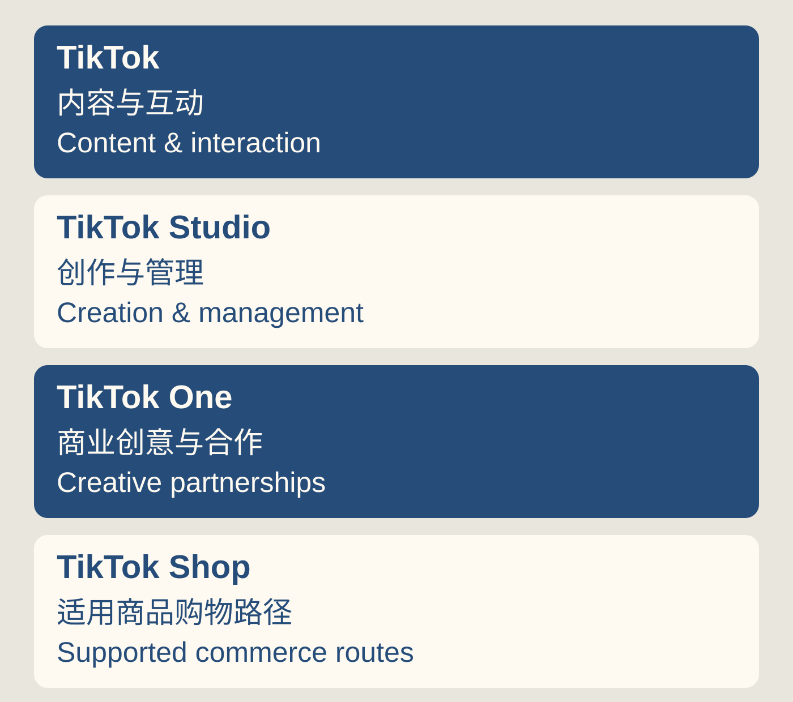

# TikTok 合作怎样分清不同产品入口

状态：本地审阅稿；正式发布日期待确认。

把 tick tock 理解为 TikTok 后，继续分清平台、Studio、One 与 Shop，避免在达人 Brief 里用一个名称代替所有制作、合作和交易条件。

QuickKOL 编辑图形；不呈现真实账号指标或平台界面。

如果搜索 what is tick tock 是想了解社交平台，其正式名称是 TikTok。对达人营销，还要分清几个相近名称：TikTok 是内容与互动平台，TikTok Studio 围绕创作与内容管理，TikTok One 围绕商业创意与合作，TikTok Shop 连接适用市场的商品购物路径。它们不能互相代替，也不表示同一账号自动具备全部资格。品牌应先确定要研究、制作、发布还是推荐商品，再核对实际入口与双方任务。

## 先把平台名称与合作请求分开

品牌说想做 TikTok，可能指请达人拍视频、在自己账号发布、合作广告或商品推荐。先把请求展开成具体动作，而不是把平台名称当作完整 Brief。

[TikTok 内容入口指南](https://www.quickkol.com/zh/blog/what-is-tiktok-content-surfaces-brand/#answer)介绍平台中的不同观看与发现情境；本篇进一步解释相关产品名称。知道一个名称，不表示已经确定谁制作、谁发布、谁回应与谁负责交易。

可以先用一句话说明需要的贡献，例如由相关创作者演示一个产品动作，再讨论适合路径。对方能评估实际工作，而不必猜品牌是否想同时购买发布、素材与销售保证。准确名词帮助开始讨论，任务本身仍需要明确。

## TikTok：内容与互动

[TikTok 的内容推荐说明](https://support.tiktok.com/en/using-tiktok/exploring-videos/how-tiktok-recommends-content)介绍不同位置的个性化与多类信号。品牌可以用它理解观看环境，不应从中得到某个账号一定曝光多少，或所有观众会按同一顺序看到内容的承诺。

对达人项目，平台是表达发生的环境。研究作品时看实际动作、语言与相关问题，不只看一个账号总数。某人有内容账号，不自动说明其能处理产品交易、广告制作或所有商业工具。

基础词汇清楚后，继续问这次要让观众理解什么。制作可以发生在很多工具里，最终内容是否准确、有用与适合任务，需要品牌和达人共同确认，不能只由发布平台决定。

## TikTok Studio：围绕创作和内容管理

[TikTok 的 2024 年 Studio 公告](https://newsroom.tiktok.com/helping-creators-bring-creativity-to-life-with-tiktok-studio?lang=en)在 5 月 24 日介绍创作、编辑、上传、管理与分析用途，并提醒不同入口的工具可能不同。这是有日期的产品背景，不是本文测试了今天所有功能。

对品牌合作，Studio 名称可以帮助定位创作者的操作工作，但不能因此要求其开放全部私人数据。需要什么记录与版本，按实际任务确认，不让一个报告请求变成整个账号访问。

使用前核对当前账号、地区与实际入口。过去公告写的某项功能，不自动证明每个人今天都可用，也不能把平台内收入工具与品牌制作费混为一项。管理内容、参与项目和获得报酬，仍要分别理解。

## TikTok One：商业创意与合作工作

[TikTok One 的广告主说明](https://ads.tiktok.com/resources/help/article/about-tiktok-one?lang=en)当前标注 2026 年 6 月更新，描述发现创作者、制作与管理商业项目等用途。这是供应商官方能力描述，不是对任何项目结果或账号访问的保证。

品牌可以研究相应路径是否适合具体任务，但仍要核对作品、实际贡献与双方条件。发现某位创作者，不等于已经达成合作；在同一工具里看见内容，也不自动取得所有使用许可。

图形将四个名称分开。一个项目可能涉及多个入口，但每项仍需要负责人和实际记录。不要因为 One 的名字，就把所有平台任务、样品和交易都假定已经包含在同一商业安排中。

这是任务词汇图，不是平台界面；实际访问与适用市场分别核对。

## TikTok Shop：商品与内容购物路径

[TikTok Shop 的美国 Creator Center 说明](https://seller-us.tiktok.com/university/essay?knowledge_id=6935729397827330)介绍联盟商品发现、内容商品链接与佣金路径。这里用美国资料解释具体用途，不把其中条件扩大到所有市场与账号。

商品出现在视频里，不表示已建立可购买路径。实物、版本、链接选择与可供情况需要对应。达人可以表达真实体验，但品牌仍负责准确商品资料与适当交易支持。

[TikTok Shop 达人路线指南](https://www.quickkol.com/zh/blog/tiktok-shop-creator-affiliate-content-route/#answer)进一步拆分样品、发布和结算。Shop 与 One 或 Studio 可以在项目中相互联系，却不能用一个入口的可用状态证明另一个入口已经具备。先把各项实际工作确认，才适合讨论扩大内容规模。

## 不要把资格、工具和结果混在一起

账号符合某项功能要求，不代表内容已经适合品牌；工具支持某项工作，也不代表对方同意为本次项目完成。资格、能力、意愿与实际安排是不同问题。

品牌可以分别核对可用入口、相关作品和合作范围。没有测试过实际账号，就写待确认；没有对应证据，不承诺固定分发、收入或购买结果。完整 Brief 不需要假装所有未知都已解决。

例如交接写在 Studio 查看成片记录，仍应指明哪个账号、哪条内容和什么时期。下一位负责人不需要猜一张管理页截图对应哪个项目，也不会把看过记录误解为商品已经可买或广告已经获准。

例如达人能够发布普通视频，品牌仍要确认拟用广告或商品路径是否适用。反过来，某项商业入口不可用，也不自动说明制作能力不足。将角色与平台条件分开，选人就更容易聚焦真实任务。

## 把每个名词连接到一个负责人

写项目记录时，可以同时保留产品名称与实际任务。品牌负责提供事实与入口，达人负责约定表达，操作人处理适用工具，交易问题由合适业务团队接收。

同一个人可以承担多个角色，但职责仍应清楚。不要把所有入口都交给最先回复的人，也不要为了跨团队方便分享私人账号登录。需要访问时，先按官方适用安排确认。

项目发生变化，更新相应任务而不是只改一个平台名称。例如商品版本变更，需要看内容与目的地；创意用途变更，需要回到素材和合作范围。命名准确帮助定位，但实际工作记录才让下一位负责人继续。

## 用一项假设水瓶合作检查词汇

假设品牌想请达人演示水瓶怎样装进日常包。TikTok 是公开表达发生的平台，创作者可核对自己的管理入口；若讨论商业制作路径，则研究 One；若需要适用商品链接，则另行确认 Shop。

这些只是任务定位，不意味着项目一定要用全部产品。可能一项清楚的制作与发布已经足够。也不能因为提到 Shop，就把样品、佣金和广告素材都默认包含。

本例没有真实客户结果。团队可以用它检查：每个名称是否对应需要、谁确认访问、哪个具体版本会出现，以及仍有什么问题。名词清楚以后，讨论应回到观众要理解的动作与真实产品。

## 报告中继续保留具体对象

内容观看、商业项目交付与商品交易记录可能来自不同位置。报告需要说明对象、时段、字段与实际范围，不把几个入口里相似名称的数字直接加在一起。

制作完成可以按交付核对；发布后观察按内容和来源解释；佣金按适用记录与状态说明。不要把某个管理界面能显示数字，写成所有商业结果已经验证。

若资料不足，保留有限结论并提出下一问。品牌可以知道需要补充商品说明或修改 Brief，而不一定能计算完整增量回报。清楚区分记录，比用一个统一 TikTok 总成绩掩盖不同工作更有帮助。

## 让产品词汇服务达人 Brief

What is tick tock 的初步答案是 TikTok，但品牌合作不能停在认出名称。继续分清内容、管理、商业制作与购物任务，再选择实际需要的入口。

保持来源日期与地区，尤其不要把旧公告的全球访问想象成当前保证。没有实际账号测试，就如实说资料研究；没有双方确认，就不把候选线索写成合作成立。

准确词汇最后应该减少误解：品牌知道采购什么，达人知道贡献什么，负责人知道去哪核对。这样平台知识才真正服务于达人营销，而不是变成一页与实际工作无关的产品名清单。

## 四个名称对应不同问题

| 名称 | 任务定位 | 仍需核对 |
| --- | --- | --- |
| TikTok | 内容与互动环境 | 具体作品与发布任务 |
| TikTok Studio | 创作、管理与分析 | 当前入口与相关记录 |
| TikTok One | 商业创意与合作 | 实际贡献、范围与访问 |
| TikTok Shop | 适用商品与购物路径 | 市场、商品、条件与支持 |

依据已读官方资料的任务区分；不是全部功能清单、统一账号资格或效果保证。

## 在 Brief 里使用 TikTok 产品名称前

每个名称对应真实工作。

- [ ] 先说观众任务与达人贡献。
- [ ] 分开内容、管理、合作与交易。
- [ ] 核对实际地区、账号和入口。
- [ ] 不从一项资格推断全部可用。
- [ ] 把范围与使用交给双方确认。
- [ ] 报告保留对象、来源与状态。

## 研究日期与使用边界

资料核验于 2026 年 11 月 17 日。文中方法、表格和决策规则为编辑建议，标为假设的示例不是实际客户结果或行业基准。外部资料的适用地区与时期按各段说明。

## 从任务开始达人研究

用 QuickKOL 理解 Brief、发现相关达人并研究作品与联系路径；数据、合作条件和结果仍需核验。

[了解 QuickKOL](https://www.quickkol.com/#capabilities)

## 来源

- [TikTok 的内容推荐说明](https://support.tiktok.com/en/using-tiktok/exploring-videos/how-tiktok-recommends-content)
- [TikTok 的 2024 年 Studio 公告](https://newsroom.tiktok.com/helping-creators-bring-creativity-to-life-with-tiktok-studio?lang=en)
- [TikTok One 的广告主说明](https://ads.tiktok.com/resources/help/article/about-tiktok-one?lang=en)
- [TikTok Shop 的美国 Creator Center 说明](https://seller-us.tiktok.com/university/essay?knowledge_id=6935729397827330)
