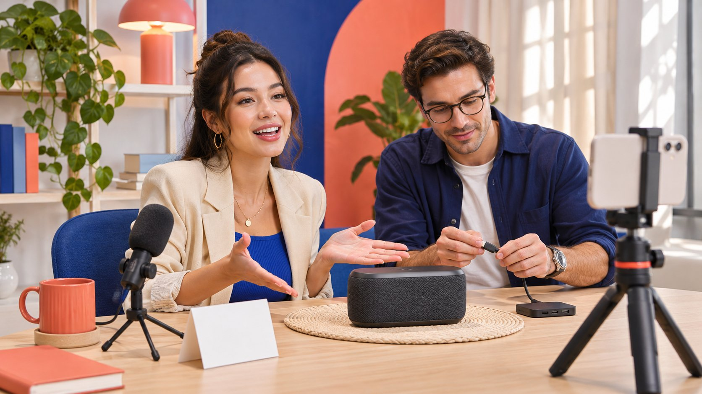

# How Do I Go Live on TikTok With a Brand Guest?

Status: local review draft; confirm the publication date before release.

A brand LIVE needs clear host and guest roles. Check actual account access, then arrange co-hosting, product questions, commercial context and unanswered-item handoff.

For a brand asking “how do I go live on TikTok,” the actual host should first confirm available LIVE access and collaboration capabilities, prepare the session, audiovisual setup and commercial context, then start through the current interface. For another creator broadcasting together, check the co-host route and acceptance. Confirm separately how a brand product specialist will participate. A successful connection does not confirm professional responsibilities. This article focuses on guest Q&A collaboration, without prescribing one global follower threshold or treating an older announcement as a guarantee of current menus.

## Choose the actual host account first

The host account determines where viewers enter, who operates session settings and which collaboration capabilities need checking. A staff member starting an arbitrary test does not establish the same options on the actual creator’s account.

The [launch-readiness guide](https://www.quickkol.com/blog/go-live-tiktok-account-readiness/#answer) handles account and location basics. Continue with the guest’s question, the creator leading the conversation and facts supplied by the brand. Define those before choosing the connection format.

The main LIVE help page did not expose its complete current instructions during this research, so this article states no fixed threshold or guaranteed menu. An authorized owner should check current official guidance and the real account interface. If the required capability is unconfirmed, retain that dependency rather than switch accounts or borrow credentials to bypass it. The invitation can remain a proposal while access is checked; the brand should not announce a confirmed guest format merely because somebody demonstrated an unrelated account successfully going live.

## Co-hosting requires actual confirmation on both sides

[TikTok’s co-host guide](https://support.tiktok.com/en/live-gifts-wallet/tiktok-live/cohost-on-tiktok-live) describes multiple creators broadcasting together. The reviewed official text explains opening +Hosts during a LIVE, sending an invitation to an appropriate creator and starting co-hosting after acceptance. Confirm actual account availability and interface.

Keep invitation sent separate from guest joined. Someone willing to discuss a collaboration is not automatically ready for the platform connection. Identify the participating accounts and who operates the real process.

The feature itself does not confirm product experience, brand authority or compensation. It handles a connection rather than the commercial arrangement. If a specialist simply sits beside the host in one physical scene, describe that accurately instead of naming a remote feature the production did not use. This gives the team a practical acceptance check: the intended people and accounts are connected in the proposed way, while the content and business responsibilities remain separately confirmed rather than inferred from an invitation status or a successful on-screen appearance.

## Keep co-host and multi-guest arrangements distinct

[TikTok’s 2022 LIVE announcement](https://newsroom.tiktok.com/enhancing-the-live-community-experience?from_seo_redirect=1&lang=en) described a Multi-Guest expansion and related live tools. It shows that different participation formats were publicly described, not that a particular account in 2026 has a stated capacity or identical buttons.

Confirm the actual arrangement instead of writing co-hosting and guest participation as one step. The brand needs an achievable expression, not necessarily the most complex feature combination.

State who should appear in which role before checking connection. If a format is unavailable, discuss a suitable alternative without silently replacing a promised guest with another host or prerecorded material. Explain changes to audience experience and work so both sides can decide. The historical announcement is background for asking the right question, not a substitute for verifying the present assignment. A proposal remains clearer when it describes the intended contribution first and lets the actual available setup determine how that contribution can appropriately be delivered.

## Give the specialist and host different work

The host makes questions understandable and sustains the conversation; the specialist answers facts they are authorized to confirm. Product familiarity does not automatically make someone a host, and an articulate creator should not guess technical answers live.

Define the specialist’s answer scope, questions needing referral and current factual-material version. Handle complex individual circumstances through an appropriate business route instead of collecting unnecessary personal information publicly.

The photograph illustrates roles and question cards rather than a broadcast that actually occurred. Rehearse one handover to check audibility, visible product detail and whether the host knows when to supply context. A successful platform connection alone does not complete the explanation task. A useful rehearsal ends with a specific observation, such as a blocked detail or an unclear term, so production can fix the actual problem instead of ask the guest to be more engaging without identifying what viewers need to understand.

Define explanation and question ownership before confirming the connection format and follow-up.

## Separate answerable questions from pending ones

Prepare common product questions without inventing audience questions as evidence of demand. Real questions appearing during the stream also do not represent everyone’s opinion or purchase intent.

The host can distinguish questions answerable now, facts needing brand confirmation and matters requiring an appropriate private route. Retain themes and necessary context without every speaker’s identity or complete chat history.

If an answer is unconfirmed, say it needs follow-up and assign who responds where. Do not turn a guess into fact to avoid a pause. A clear pending item supports collaboration better than an inaccurate immediate guarantee; the next team knows the information task instead of receiving only interaction was great. Set up that route before the event so the guest does not have to invent a response process while speaking, and the brand can fulfill an invitation to ask questions with a real person responsible for answering them.

## Make commercial context understandable during the stream

[FTC’s influencer disclosure guide](https://www.ftc.gov/business-guidance/resources/disclosures-101-social-media-influencers) emphasizes clear relationship context with an endorsement in the US and discusses periodic repetition in live streams for people seeing only part. It is not one legal determination for every market.

Confirm the actual relationships with brand and guest instead of making one opening statement carry an entire changing conversation. Viewers arriving later should understand why a recommendation or product explanation appears.

Review relationship context and product facts separately. Explaining sponsorship does not substantiate unverified performance; genuine experience does not remove relevant context. Appropriate people should check platform tools and the actual language rather than treat one button or script as proof every requirement is satisfied. The producer can assign a reminder within the conversation flow, allowing the host to restate the relationship naturally without changing the guest’s actual opinion or implying that a brief disclosure gives permission for any claim about the product.

## What if the guest cannot join?

Identify the unavailable connection without automatically interpreting it as account misconduct. Pause new commitments and choose continued hosting, rescheduling or other material under an agreed plan. Confirm the alternative with both sides.

If facts need the specialist, the host should not assume unknown answers. Retain pending questions and arrange appropriate follow-up instead of making the original schedule create the impression that expert explanation already occurred.

The [live-campaign runbook](https://www.quickkol.com/blog/creator-live-campaign-runbook/#answer) helps allocate responsibilities and exceptions. Specify what changes without the guest: which content remains deliverable and what needs another recording or publication. This does not require unconditional extra work or erase every production output because a connection failed. Clear completed and incomplete states help the next owner continue. The final status should identify the dependency, not blame a person for a technical description that the team has not actually established or treat a proposed fallback as though it was accepted automatically.

## Confirm scope for replay and later versions

A collaboration may produce replay, short cuts or other assets, but appearance does not automatically include every later use. Specify the passage, edits, account and setting, then confirm relevant conditions.

A limited guest answer should not become an unconditional recommendation. Removing the question or product version can change meaning. Review the proposed passage against the original with appropriate people, checking facts and commercial context.

Added recording or reconfirmation should become a defined task. Possessing a video file does not allow arbitrary changes of product, market or future expression. Retain versions and use decisions rather than rely on a final folder label. This lets the next editor understand why an answer needs its surrounding question or qualification, and gives the brand a concrete route to request new material when the original passage cannot accurately serve a different purpose.

## Finish the handoff through a product Q&A

Suppose a device brand invites a creator to host and a product representative to explain connection conditions. Record who operates the stream, confirms compatibility, receives unanswered questions and publishes follow-up. This is hypothetical, not a client result.

For example, a viewer asks whether the device connects to an older model. The specialist can clarify the object; if the supplied material does not cover it, route the compatibility question to the brand owner with an appropriate response path. Do not ask viewers to publish serial numbers, contacts or private information. The host can continue the confirmed demonstration while accurately retaining the unanswered item, instead of reporting an unfinished answer as a brand compatibility guarantee. The handoff then identifies the missing fact and its owner without exposing unnecessary audience data.

If the connection is unconfirmed, do not describe the program as confirmed two-person co-hosting. If an answer is pending, technical completion is not full content approval. Tie each state to the actual task so it supports the next action.

Completion means both sides can deliver a genuine Q&A under clear roles and hand unresolved matters to an appropriate owner. It guarantees no audience, sales or platform capability. The brand receives a reviewable collaboration rather than a marketing outcome supposedly completed by tapping a broadcast button. That distinction gives the host and guest a fair assignment: each knows the contribution requested and the route for a question outside that contribution, instead of inheriting every unknown simply by appearing on screen.

## Roles in a brand guest LIVE

| Role | Work | Confirm separately |
| --- | --- | --- |
| Host | Guide questions and context | Actual account and available route |
| Product guest | Answer authorized product facts | Actual experience and answer scope |
| Producer or moderator | Route questions and flag pending items | Appropriate access and operating role |
| Brand follow-up owner | Confirm unanswered matters and follow-up | Publication format and conditions |

An editorial collaboration framework, not universal eligibility, a current-feature guarantee or an actual program result.

## Before inviting a guest

Confirm platform connection and actual work separately.

- [ ] Check access on the actual host account.
- [ ] Distinguish co-host and guest arrangements.
- [ ] Define answerable facts and product version.
- [ ] Assign live questions and later receipt.
- [ ] Review commercial context in the actual expression.
- [ ] Confirm replay, changes and added work.

## Research date and limitations

Sources reviewed November 17, 2026. Methods, tables and decision rules are editorial recommendations. Hypothetical examples are not actual client results or industry benchmarks. Source geography and periods are specified where relevant.

## Start creator research with a clear task

Use QuickKOL to interpret a brief, discover relevant creators and research their work and contact routes. Verify data, commercial terms and outcomes at their source.

[Explore QuickKOL](https://www.quickkol.com/#capabilities)

## Sources

- [TikTok’s co-host guide](https://support.tiktok.com/en/live-gifts-wallet/tiktok-live/cohost-on-tiktok-live)
- [TikTok’s 2022 LIVE announcement](https://newsroom.tiktok.com/enhancing-the-live-community-experience?from_seo_redirect=1&lang=en)
- [FTC’s influencer disclosure guide](https://www.ftc.gov/business-guidance/resources/disclosures-101-social-media-influencers)
