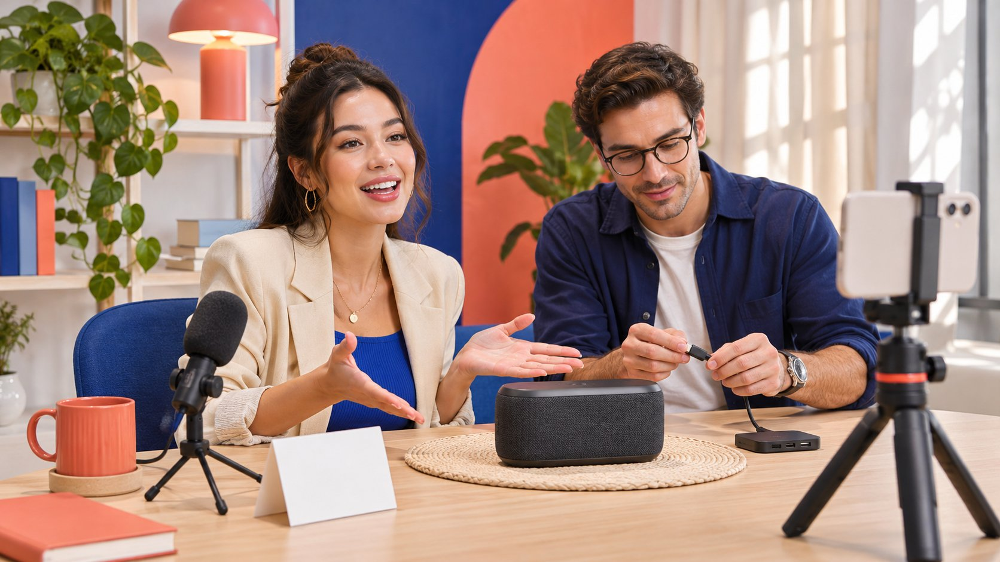
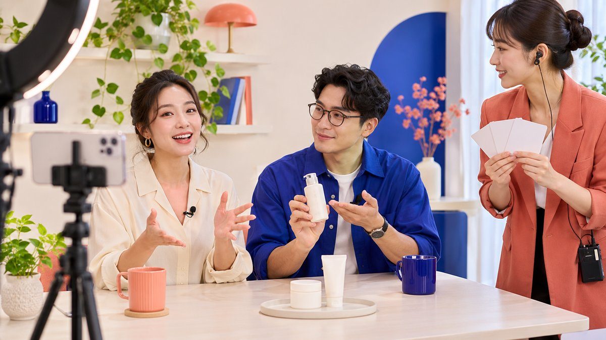

# TikTok 品牌直播怎样安排专家来宾

状态：本地审阅稿；正式发布日期待确认。

品牌直播需要清楚的主持与来宾角色。先核对实际账号可用入口，再安排共同主持、产品问答、商业背景和未回答事项的交接。

品牌问“how do I go live on TikTok”，应先由实际主持账号确认 LIVE 入口及所需合作能力可用，设置本次内容、音视频与商业背景，再按当前界面启动。邀请另一位创作者共同开播时，核对共同主持入口与对方接受状态；品牌产品专家的参与方式也要另行确认。平台连接成功不等于专业职责已确认。本文聚焦来宾问答合作，不提供所有地区通用的粉丝门槛，也不把旧公告当作当前菜单保证。

## 先确定由谁的账号主持

主持账号决定观众在哪里进入、谁能操作本场设置，以及哪些合作能力需要核对。品牌不能只让任意工作人员先开一个测试，就认为正式创作者账号也有相同入口。

[开播准备指南](https://www.quickkol.com/zh/blog/go-live-tiktok-account-readiness/#answer)处理账号与场地基础。本篇从此继续：本场来宾要回答什么问题，由哪位创作者引导，品牌提供哪些事实。先把这些写清，再决定所需连接形式。

本次研究未能读取主 LIVE 帮助页的完整当前步骤，因此不写固定门槛或保证菜单。实际执行应由获准负责人核对当前官方指引与账号界面。无法确认需要的能力时，保留待定状态，不用换账号或临时借登录来绕过依赖。

## 共同主持需要双方实际确认

[TikTok 的共同主持说明](https://support.tiktok.com/en/live-gifts-wallet/tiktok-live/cohost-on-tiktok-live)将 co-host 描述为多位创作者同时直播。所读官方正文说明，在已有 LIVE 中进入 +Hosts，可向相关创作者发送邀请，对方接受后开始共同主持。入口与可用性仍要按实际账号确认。

把邀请已发送与来宾已加入分开记录。对方愿意讨论合作，也不自动等于平台连接已经准备好。需要知道哪两个账号参与，以及由谁在正式流程中操作。

共同主持功能本身不确认来宾的产品经验、品牌权限或报酬。它解决连接方式，不替代合作安排。若只是同一场景中由专家坐在主持人旁边讲解，也应准确描述，不把画面中的两个人称作已经使用了某个远程功能。

## 共同主持与多来宾不要混写

[TikTok 的 2022 年 LIVE 公告](https://newsroom.tiktok.com/enhancing-the-live-community-experience?from_seo_redirect=1&lang=en)描述了 Multi-Guest 的扩展以及相关直播工具。这里用它说明平台曾公开支持不同参与形式，不能据此保证 2026 年某个账号可加入多少人或显示相同按钮。

不同参与方式应按实际能力确认，不把共同主持和来宾加入写成同一个步骤。品牌需要的是某种可完成的表达，不一定需要最复杂的功能组合。

提案中先写希望谁以什么角色出现，再核对连接方式。若某个形式暂不可用，可讨论适当替代，但不能未经确认就把原来的来宾承诺改成另一位主持人或预录片段。变更应说明观众体验与工作范围如何改变，让双方作出真实决定。

## 产品专家与主持人怎样分工

主持人负责把问题讲清并维持对话；产品专家负责其获准确认的事实。熟悉产品的人未必适合独立主持，善于表达的创作者也不应被要求现场猜技术答案。

给专家列清可回答范围、需要转交的问题与当前产品资料版本。若出现个别用户的复杂情况，按合适业务路径处理，不在公开直播中收集不必要私人信息。

配图用于说明分工与问题卡，不表示某场实际直播已经发生。制作时可以先试一段交接，确认专家回答能被观众听见、产品细节可见，主持人也知道何时补充背景。没有这些准备，即使平台连接成功，对话仍可能无法完成品牌原本要解释的任务。

先定义谁讲解、谁接收问题，再确认实际连接形式与后续回应。

## 区分能回答与待确认的问题

品牌可以提前整理常见产品问题，但不能预先编造观众提问来证明需求。直播中出现的真实问题，也不代表全体观众具有同样意见或购买意向。

主持人可把问题归为现场能回答、需要品牌核对和应转到适当私人渠道的事项。记录主题与必要背景即可，不必保存所有发言者身份或完整聊天历史。

如果答案尚未确认，就明确待补充，并安排谁在哪里回应。避免为了不停顿而把猜测说成事实。一个清楚的待确认事项，比错误的即时保证更便于合作；后续团队也知道要完成哪项信息工作，而不是只收到一句直播互动很好。

## 直播中的商业背景需要可理解

[FTC 的达人披露指南](https://www.ftc.gov/business-guidance/resources/disclosures-101-social-media-influencers)在美国语境下强调关系说明应与推荐内容一起清楚出现，并讨论直播中定期重复，使只看到部分的人也能理解。它不是替所有市场作统一法律判断。

品牌和来宾要确认实际关系，不能让一次开场说明承担整场不断变化的表达。观众中途进入时，仍应能理解为什么出现某项推荐或产品讲解。

关系说明与产品事实分别检查。清楚说明合作，不支持尚未证实的性能；真实体验也不免除相应背景。平台可用工具与实际语言形式由适当人员核对，不把一个按钮或一段脚本当作所有要求已满足的证明。

## 来宾无法加入时怎样处理

先确认目前只是哪项连接不可用，不把它自动解释为账号违规。暂停新增承诺，按已讨论方案决定继续主持、改期或提供其他内容；替代形式由双方确认。

如果产品事实需要该专家确认，主持人不应临时接管未知答案。可以保留待回答问题，安排适当后续，不为了完成原排期而制造已经有专家讲解的印象。

[直播操作手册](https://www.quickkol.com/zh/blog/creator-live-campaign-runbook/#answer)帮助安排职责与异常。本篇建议把来宾缺席后的范围变化写具体：哪些内容仍能完成，哪些需要另行制作或发布。它不是要求创作者无条件增加工作，也不把技术连接失败当作所有制作成果都无效。明确已完成与未完成事项，便于下一次接手。

## 单独确认回放与新版用途

直播合作可能形成回放、短片或其他素材，但本次出镜不自动包含所有后续用途。说明希望保留哪段、如何剪辑、用于哪个账号与场景，再确认相关条件。

来宾的有限回答不能被裁成无条件推荐。删去问题背景或产品版本，也可能改变意思。把拟用片段与原表达对应审阅，让适当人员确认事实与关系背景仍清楚。

需要额外录制或重新确认的部分，应当成为明确任务。品牌获得一个视频文件，不等于可以随意更换产品、市场与未来表达。保留版本和使用决定，比只在文件夹里写最终版更有助于后来团队准确复用。

## 用一次产品问答完成实际交接

假设设备品牌邀请创作者主持，并安排一位产品人员解释连接条件。记录谁操作直播、谁确认兼容信息、谁接收无法现场回答的问题，以及后续说明由谁发布。本例不是实际客户结果。

例如观众问设备能否连接某款旧型号，产品人员可以先确认问题对象；若资料没有覆盖，就将具体兼容问题交给品牌负责人，说明适当回应路径。不要要求观众公开序列号、联系方式或私人资料。主持人可以继续已确认演示，并准确保留待回答事项，而不是把一次未完成答复写成品牌已经作出兼容保证。

如果来宾连接未确认，就不要把节目写成已确定双人共同主持。如果某个答案未定，也不把成片技术完成写成全部内容通过。每个状态对应实际任务，才有助于安排下一步。

本篇的完成标准是双方能按清楚角色执行一次真实问答，并把未解决事项交给适当负责人。它不保证直播人数、销量或平台能力；品牌获得的是可以审阅的内容合作，而不是一次点击开播就自动完成的营销结果。

## 品牌来宾直播的分工

| 角色 | 具体工作 | 另行确认 |
| --- | --- | --- |
| 主持人 | 引导问题与表达背景 | 实际账号与可用入口 |
| 产品来宾 | 回答获准确认的事实 | 实际经验与回答范围 |
| 协作者 | 分流问题与提示待确认 | 适当权限与操作职责 |
| 品牌接手人 | 核对未回答事项与后续说明 | 发布形式与相关条件 |

编辑协作框架，不是全球统一资格、当前功能保证或实际节目结果。

## 邀请来宾之前

把平台连接与真实任务分别确认。

- [ ] 由正式主持账号核对入口。
- [ ] 区分共同主持与来宾方式。
- [ ] 确定可回答事实与产品版本。
- [ ] 安排现场问题与后续接收。
- [ ] 在实际表达中检查商业背景。
- [ ] 确认回放、变更与新增工作。

## 研究日期与使用边界

资料核验于 2026 年 11 月 17 日。文中方法、表格和决策规则为编辑建议，标为假设的示例不是实际客户结果或行业基准。外部资料的适用地区与时期按各段说明。

## 从任务开始达人研究

用 QuickKOL 理解 Brief、发现相关达人并研究作品与联系路径；数据、合作条件和结果仍需核验。

[了解 QuickKOL](https://www.quickkol.com/#capabilities)

## 来源

- [TikTok 的共同主持说明](https://support.tiktok.com/en/live-gifts-wallet/tiktok-live/cohost-on-tiktok-live)
- [TikTok 的 2022 年 LIVE 公告](https://newsroom.tiktok.com/enhancing-the-live-community-experience?from_seo_redirect=1&lang=en)
- [FTC 的达人披露指南](https://www.ftc.gov/business-guidance/resources/disclosures-101-social-media-influencers)
