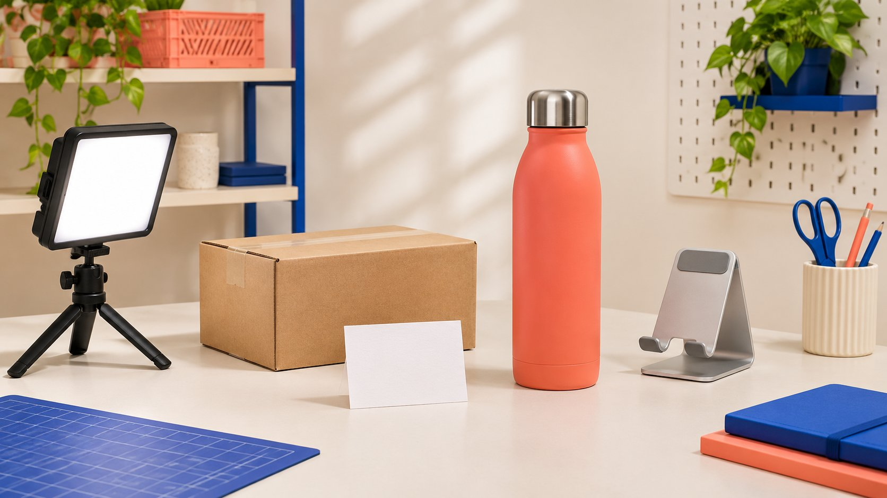
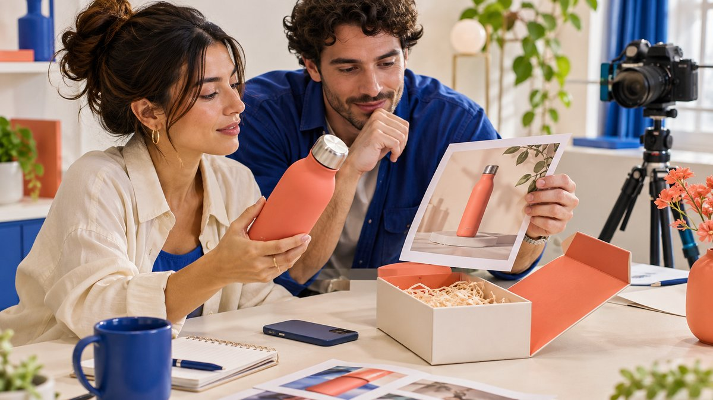

# TikTok Shop 怎样连接达人与商品

状态：本地审阅稿；正式发布日期待确认。

把 TikTok Shop 作为达人内容、实际商品与交易之间的具体路线理解，分清样品、发布任务、佣金和品牌履约。

TikTok Shop 是 TikTok 的电商体系，让适用市场中的商家、商品与内容购物路径连接起来。对达人营销，关键不只是视频里出现商品，而是实际产品、可用链接、合作任务与佣金规则能否对应。本文用美国官方 Creator Center 与样品资料解释具体路线；其他地区和账号应核对自己的适用条件。收到样品、完成发布、记录销售和获得结算是不同状态，任何一步都不自动保证下一步。品牌先明确希望达人贡献什么，再安排产品和履约。

## 从品牌任务理解 Shop

品牌可能需要达人演示产品、回答使用问题或通过适用链接推荐。先确定任务，才能判断 Shop 路线是否合适。不是所有达人合作都需要交易链接，也不是所有商品内容都意味着加入某项佣金计划。

[联盟内容角色指南](https://www.quickkol.com/zh/blog/affiliate-creator-content-partnership-ads-role-map/#answer)把制作、推荐与广告用途分开。Shop 合作同样需要明确：谁提供商品资料、谁表达真实体验、谁决定可供版本，以及谁处理交易问题。平台把路径连接起来，不表示这些职责消失。

如果目标是解释复杂产品，先确保内容能说明真实条件，再考虑适当下一步。把卖货放进任务名称，不能替代产品准备、达人能力与双方安排。一个清楚的小项目，通常比包含所有功能却无人负责的 Brief 更容易继续。

## 美国 Creator Center 提供一条具体例子

[TikTok Shop 的美国 Creator Center 说明](https://seller-us.tiktok.com/university/essay?knowledge_id=6935729397827330)介绍发现联盟商品、将商品加入短视频或 LIVE 内容及相关佣金路径。这支持理解一种实际流程，不表示所有市场、账号和商品都具有相同访问条件。

本文没有测试私人账号，也不把该说明里的门槛或样品数量当作全球现行标准。开工前查看实际账号能用的功能和当前适用要求，品牌不能承诺对方一定能在某一天开通。

研究平台资料时保留地区和日期，尤其不要把 TikTok One、普通账号工具与 Shop 当成同一项资格。品牌与达人需要的，是一条双方实际能够执行的路线，而不是看到某个平台名称就默认所有合作与交易能力都已具备。

## 把实际商品与内容选择对应

样品、内容中的产品名称和链接默认版本需要相互核对。颜色、尺寸、套装和配件不同，可能改变观众理解。视频拍摄完成，不代表链接里的选择已经正确。

品牌提供准确资料，达人依据实际体验表达。不要要求达人用另一款产品替代演示，再把链接指向没有体验过的指定款。若产品变更，说明哪些镜头仍然适用，哪些要重新确认。

假设视频展示带配件的水瓶，入口却是单独瓶身，品牌应先处理差异。可以更换入口、调整解释或重新拍摄，而不是依赖观众自己发现。这个假设说明版本问题，不是对任何具体商品的判断。

## 样品安排不等于无条件免费

[TikTok Shop 的美国样品指南](https://seller-us.tiktok.com/university/essay?course_type=1&knowledge_id=5764641632306946&role=1)区分免费样品与可退款样品，后者涉及先购买并满足适用条件。品牌和达人应查看具体订单与账号显示的要求，不把一个样品按钮理解为无条件获赠。

核验时，该页部分摘要、正文与旧文字的期限表述不一致。因此本文不转述统一天数，也不保证退款。涉及真实安排，保留订单适用条款并向平台确认疑问，不能用搜索摘要替代。

配图展示将实物与商品资料一起准备的场景。收到样品后仍需要确认是否适合体验和拍摄，发生问题沿实际支持路径处理；不要把未使用的物品写成已验证体验，也不要为了完成数量省略必要步骤。

商品、资料与内容任务需要对应，样品到件只是其中一步。

## 明确制作、发布与佣金的关系

联盟佣金按适用规则形成，不应让团队省略制作与发布安排。是否有固定报酬、需要什么内容、由哪个账号发布，以及修改由谁确认，都需要实际讨论。

达人也应知道品牌买的是什么。一项制作任务可以不包含账号发布，发布也不自动包含品牌广告复用。若品牌希望增加这些部分，回到具体用途和工作量确认，不用“Shop 合作”一个名称包揽。

记录每项已确认工作，能让双方在出现变化时讨论真正影响。佣金表现暂时不确定，不表示所有制作都没有价值；拍摄顺利，也不表示一定有人购买。不同贡献有不同完成条件，不能互相代替。

## 为商品说明提供可核对资料

达人需要能理解的资料，包括适用版本、关键使用条件与品牌可以支持的说法。不是把全部营销文案复制给对方，而是帮助其选择真实、清楚的表达。

对于无法亲自验证的性能，不要求达人把品牌资料改写成个人体验。可以准确说明资料来源或删去不适合本次内容的主张，具体表达由项目负责人确认。一个清楚的操作演示不需要包含所有卖点。

如果观众可能误解某个动作，保留必要条件。例如展示拆卸或清理时，确认实际产品是否支持这种操作。拍摄团队能做出一个画面，不表示该画面就是合适的产品说明；品牌仍需负责实际事实。

## 公开表达保留真实商业关系

[FTC 的达人披露指南](https://www.ftc.gov/business-guidance/resources/disclosures-101-social-media-influencers)在美国场景下说明付费、赠品和其他相关商业联系需要清晰表达。佣金路线同样需要看实际关系，不能因为观众可以自己点击商品，就认为无需理解推荐背景。

披露应与适用的平台要求和内容一起核对。不是只看脚本文档里是否有一句话，还要看成片、说明和实际展示。缩短视频或改写文案时，避免让商业关系消失。

披露不会把不真实体验变真实，也不会证明所有产品说法。品牌与达人要同时维护关系准确和内容准确，让观众知道为什么出现这项推荐，以及哪些条件对自己判断有用。

## 交易问题由能处理的人接住

购买相关内容可能带来物流、订单或售后问题。达人可以说明自己经历过的使用情况，但不应被要求从评论里索取私人订单资料，或替商家判断所有争议。

品牌需要给出实际支持路径和负责人，让达人能准确转交。公开评论中出现私人信息时，不把它复制进内容效果报告。营销复盘保留任务相关问题即可，订单处理使用适当渠道。

对产品缺货或入口失效，先确认当前事实与影响，再决定内容是否要说明或调整。不要让原本明确的演示长期指向无法承接的页面，也不要把每个购买问题都写成达人表达不足。

## 报告分别写清发生了什么

报告可以分别列出收到样品、完成内容、上线版本、链接活动和适用销售记录。每项按实际定义与时间范围，不把前后发生当成完整因果证明。

佣金仍待确认时，保留状态，不把预估当到账。若看不到完整购买或退款信息，说明范围；平台记录也不能自动回答没有这次合作会发生什么，因此不直接写成全部增量销售。

假设短片引来许多关于瓶盖的问题，却没有足够结算数据，团队仍可以改进说明与商品资料。这个具体发现有价值，但不能填入虚构订单或收益，让项目看起来像一个完整成功案例。

## 把 Shop 变成一项可执行合作

达人产品内容路线需要实物、信息、任务与目的地对应。[达人商业工作规划指南](https://www.quickkol.com/zh/blog/social-media-creator-revenue-capacity-planning/#answer)可以帮助拆分制作、发布、使用与佣金，避免全部压进一个含糊要求。

开始前让双方用一句话说明本次合作：展示什么产品、完成什么内容、在哪里发布、使用什么实际路径，哪些仍需确认。能回答这些问题，再讨论扩大规模或增加素材用途。

What is TikTok Shop 对 QuickKOL 读者的实用答案，是一种需要真实产品和明确职责承接的内容电商路线。平台功能提供可能，合作是否适合仍由任务、证据与双方安排决定。

## 四项状态不能混为一谈

| 状态 | 说明什么 | 不自动说明 |
| --- | --- | --- |
| 收到样品 | 物品已经到件 | 已体验、已发布或必退款 |
| 内容发布 | 某个版本实际上线 | 所有条件已完成 |
| 记录销售 | 适用规则下的记录 | 全部增量或最终结算 |
| 款项结算 | 对应款项按记录处理 | 未来收入保证 |

美国官方资料提供具体例子；实际地区、账号与订单条件需另行确认。

## 开始 Shop 达人合作之前

把平台名称转成双方明确的工作。

- [ ] 确认实际地区与账号可用路线。
- [ ] 对应样品、版本与商品选择。
- [ ] 查看具体样品条件，不承诺退款。
- [ ] 分开制作、发布、使用与佣金。
- [ ] 保留真实体验与商业披露。
- [ ] 安排交易支持与准确报告。

## 研究日期与使用边界

资料核验于 2026 年 11 月 17 日。文中方法、表格和决策规则为编辑建议，标为假设的示例不是实际客户结果或行业基准。外部资料的适用地区与时期按各段说明。

## 从任务开始达人研究

用 QuickKOL 理解 Brief、发现相关达人并研究作品与联系路径；数据、合作条件和结果仍需核验。

[了解 QuickKOL](https://www.quickkol.com/#capabilities)

## 来源

- [TikTok Shop 的美国 Creator Center 说明](https://seller-us.tiktok.com/university/essay?knowledge_id=6935729397827330)
- [TikTok Shop 的美国样品指南](https://seller-us.tiktok.com/university/essay?course_type=1&knowledge_id=5764641632306946&role=1)
- [FTC 的达人披露指南](https://www.ftc.gov/business-guidance/resources/disclosures-101-social-media-influencers)
