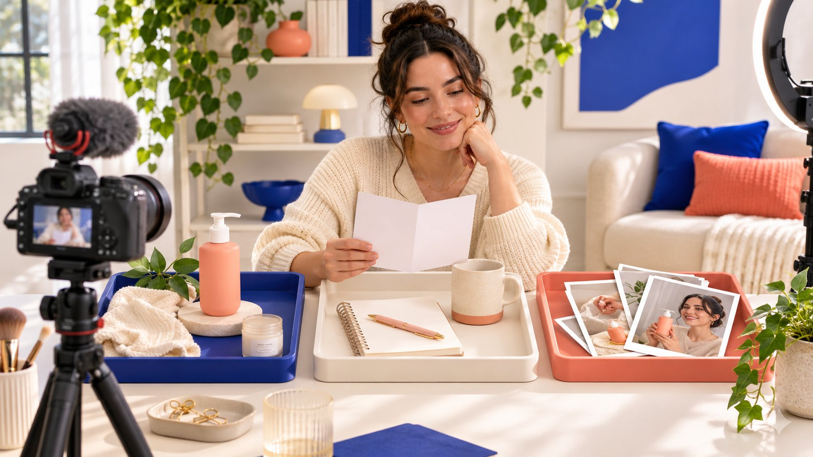

# UGC Platforms: Compare the Assignment You Need

Status: local review draft; confirm the publication date before release.

Compare UGC platforms by whether you need production, creator publication or an advertising partnership, then examine work, product inputs, revisions and use scope.

UGC platforms help brands find creators and commission content, but an assignment may deliver files only, require creator publication or include advertising participation. Define the task before comparing services. Primary descriptions from JoinBrands, Billo and Insense distinguish production from publication; a UGC label alone does not establish access to a creator audience, every material right or a sales outcome. This article compares public service descriptions without claiming private-account testing or performance rankings.

## Decide what work the brand needs to buy

Production, creator publication and advertising participation require different contributions. A brand with an advertising team but missing demonstration footage has a different purchasing question from one wanting a creator to explain the product on their own account.

The [UGC production-role guide](https://www.quickkol.com/blog/ugc-content-creator-on-camera-production-role/#answer) explains on-camera and production work. This comparison examines platform assignment structures rather than rank production capability through follower counts.

Define the viewer question, product version, files and publisher. If creator posting remains undecided, retain it as an open question instead of assuming extra exposure after ordering. A defined assignment gives platform features something meaningful to support. It also makes a proposal assessable when a service offers several routes with similar names but different obligations for the creator, the brand and the person receiving the finished material.

## JoinBrands: distinguish delivery from delivery plus posting

[JoinBrands’ creator-task guide](https://joinbrands.com/creator/) distinguishes content-only campaigns from content plus social posting. Record the actual assignment type instead of treating every video order as a creator-publication partnership.

If posting is needed, check the platform, account and corresponding task. For production only, examine relevant work, demonstration capability and file delivery. A public opportunity or feature description does not show that a particular creator has accepted this assignment.

This article does not test its account interface or promise creator totals, minimum prices or delivery times. The purchaser should confirm current inclusions in the actual task and terms. This makes the comparison about the work purchased rather than a superficial count of platform features, and helps a brand explain why it needs production alone or why publication is a necessary separate contribution.

## Billo: examine production and posting separately

[Billo’s workflow guide](https://help.billo.app/en/articles/10368596-how-does-billo-work) describes briefs, applications, brand selection, production, upload and review, and identifies posting and advertising as additional services. It is the provider's process description rather than delivery performance measured here.

[Billo’s posting-service guide](https://help.billo.app/en/articles/5344044-for-creators-do-i-need-to-post-videos-on-my-socials) further distinguishes organic posting and different advertising services. Confirm obligations in the actual order rather than combine every general statement across older help pages into one promise.

After file delivery, for example, the brand may still need an editor, publisher or advertising owner. Identify who performs the next step before a video arrives and the parties discover they used different meanings of completion. The provider's current task details matter more than a generic assumption that the word UGC includes every step from filming to audience delivery.

## Insense: confirm contribution by campaign type

[Insense’s campaign-type guide](https://help-creators.insense.pro/4523) separates product seeding, UGC without posting, social publication and creator ads. These categories answer different needs; sending a sample is not automatically purchasing a defined advertisement.

For production without posting, focus on work and demonstration capability. Publication or advertising participation additionally needs confirmation of account, timing and actual permissions. A category name guides assessment while the brief and terms determine execution.

This article verifies no individual creator's availability or advertising performance. The provider description supplies a research entry point; the brand still needs to define product, contribution and receiving arrangements. If two providers appear to offer the same output, compare the complete assignment rather than assume matching category names imply identical review steps, files, publication obligations or commercial scope.

Choose the required contribution before comparing platform services.

## Compare work against the same real brief

Give prospective services the same question, such as demonstrating retrieval from an organizer. Inspect whether work shows the action, retains conditions and explains differences rather than judge visual polish alone.

Portfolio examples may come from different assignments, so likes or editing style are not complete capability comparisons. Record relevance and unproven capability before asking the appropriate person to confirm it.

Supply real inputs: product, information and limitations to communicate. Without an opportunity for experience, do not request an experience-based conclusion; a script should not transform an aspiration in brand material into an observed result. A common brief also exposes practical differences, such as whether a provider supports the necessary setting or whether a creator would need an extra accessory, before a polished sample becomes an unrealistic expectation for the commissioned job.

## Product inputs determine whether production can start

Confirm delivery, product version, necessary accessories and when brand information will arrive. Schedule from actual readiness instead of deriving every step from payment date alone.

A digital service needs a usable environment and appropriate access even without a physical sample. Prepare a suitable demonstration setting rather than expose real customer personal records in a creator video.

When inputs change, notify the owner and identify affected work. Additional reminders cannot create product experience when the correct item has not arrived; resolve the dependency before filming and review. This gives platform support or the creator a specific issue to help with, such as a missing component or inaccessible demonstration environment, rather than an uninformative complaint that the task has not progressed despite a date appearing on the calendar.

## Read use scope in the actual terms

A platform may use short marketing language about rights, and help documents can summarize them differently. Do not select the broadest sentence as proof that every asset, likeness, music track and future use is included.

The [U.S. Copyright Office’s copyright overview](https://www.copyright.gov/what-is-copyright/) explains protection for original work. The [creator-ad permission guide](https://www.quickkol.com/blog/what-is-whitelisting-creator-ad-permissions/#answer) helps separate production, publication and later use. Examine the actual license, editing, language, channels and period, asking the provider to clarify uncertainty.

Receiving a file does not establish full operation of the creator's account or permission to make their likeness express any new claim. A defined use tells both parties what this assignment completes. Preserve the relevant terms with the order so a future operator does not have to infer permission from an old marketing screenshot or an asset sitting in a shared folder.

## Assess revisions against the commissioned task

Identify the file and issue before separating factual correction, adjustment within the brief and new creative work. Another scene, person or language can need new preparation rather than disappear into an ordinary edit request.

The purchaser should confirm current revision rounds, timing and submission route in the actual platform task. One provider's condition is not a common standard for every service, and no new claim is guaranteed acceptance.

Give the creator the information needed to identify the correct result. The brand reviews facts, the creator confirms expression and the publisher checks the final destination. A revision can end when these responsibilities have a place to land. If a comment remains subjective, ask what viewer understanding it should improve before commissioning further work that could make the video different without resolving a defined problem.

## Include the brand work needed after delivery

Keep production, samples, shipping, editing, publication, advertising and brand review visible when comparing cost. Not every item is charged by the platform, but each can affect completion.

A starting price is not the complete project cost, and more features do not automatically make a service better value. The brand needs the commissioned task completed; unused features cannot substitute for missing work.

Request scope for the actual brief before discussing price and timing. Without a current quote, preserve uncertainty rather than invent a precise total or value ranking. The comparison can still be useful by identifying which costs are confirmed, which depend on a creator or order, and which remain with the brand, making it possible to assign a budget owner without pretending every option has already been purchased or tested.

## Choose a route for one hypothetical demonstration

Suppose the brand needs an explanation of organizer retrieval. If only footage is missing, compare production and delivery. If the creator should answer viewers on their own account, add publication and response scope. If advertising uses the creator identity, confirm that service and permission separately.

These routes may use similar footage but are different purchases. Choose according to the actual objective, then check inputs and ownership rather than order because a platform name is familiar.

This example includes no client result or platform test. It shows how comparison of UGC platforms begins with one assignment and asks services to answer the same question instead of rewarding the most comprehensive homepage. The final choice should explain why the selected route completes the brand's work and what still remains outside it.

## Turn the comparison into an executable handoff

The handoff needs the selection reason, assignment, creator contribution, actual use scope and receiving owner. Separate provider feature descriptions from what has been confirmed for this order; public research is not a completed purchase.

Check files, facts and task status before observing publication or advertising performance. Production completion does not establish audience response or sales. Without the corresponding evidence, do not add a business conclusion.

A suitable UGC platform supports this assignment and leaves creator and brand knowing the next step. Defined work is more useful than an unsupported best-platform label. It also makes the comparison reusable: the next brief can change the required contribution and reassess the route rather than inherit a platform choice whose original purpose was never written down.

The handoff should also identify who confirms source files and the accepted version, preventing an editor from choosing a convenient draft that was never approved for the actual assignment.

## Read three providers by assignment

| Platform | Primary description distinguishes | Confirm for the order |
| --- | --- | --- |
| JoinBrands | Content only / content plus posting | Actual task and publishing account |
| Billo | Production plus posting and ad services | Inclusions, revisions and use terms |
| Insense | Seeding, production, posting and creator ads | Campaign type and permission |

Task comparison from public material reviewed November 17, 2026; not hands-on testing, pricing or performance rankings.

## Before choosing a UGC platform

Make the service answer a specific assignment.

- [ ] Separate production, posting and ads.
- [ ] Assess capability through relevant work.
- [ ] Confirm product and information readiness.
- [ ] Read actual use and revision terms.
- [ ] Include work remaining with the brand.
- [ ] Assign file and question owners.

## Research date and limitations

Sources reviewed November 17, 2026. Methods, tables and decision rules are editorial recommendations. Hypothetical examples are not actual client results or industry benchmarks. Source geography and periods are specified where relevant.

## Start creator research with a clear task

Use QuickKOL to interpret a brief, discover relevant creators and research their work and contact routes. Verify data, commercial terms and outcomes at their source.

[Explore QuickKOL](https://www.quickkol.com/#capabilities)

## Sources

- [JoinBrands’ creator-task guide](https://joinbrands.com/creator/)
- [Billo’s workflow guide](https://help.billo.app/en/articles/10368596-how-does-billo-work)
- [Billo’s posting-service guide](https://help.billo.app/en/articles/5344044-for-creators-do-i-need-to-post-videos-on-my-socials)
- [Insense’s campaign-type guide](https://help-creators.insense.pro/4523)
- [the U.S. Copyright Office’s copyright overview](https://www.copyright.gov/what-is-copyright/)
