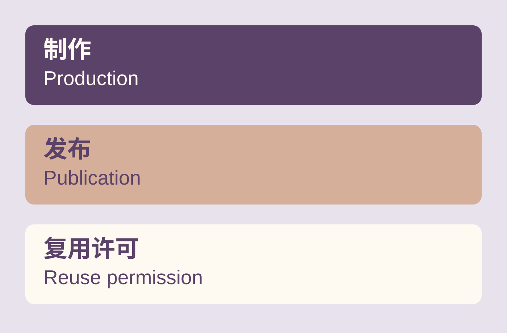

# UGC 平台怎样按任务类型比较

状态：本地审阅稿；正式发布日期待确认。

比较 UGC 平台，先分清买的是内容制作、达人发布还是广告合作，再核对作品、产品输入、修订与使用范围。

UGC platforms 通常帮助品牌寻找创作者并管理委托内容，但不同任务可能只交付文件，也可能要求达人发布或参与广告。先写明需要哪一种，再比较平台和具体服务。JoinBrands、Billo 与 Insense 的官方资料都显示制作与发布需要区分；不能仅凭 UGC 标签推断已经买到达人受众、所有素材权利或销售结果。本篇比较公开服务说明，没有对平台账户进行实际试用或给出效果排名。

## 先决定品牌要买什么工作

内容制作、达人发布和广告合作需要不同贡献。品牌已经有投放团队但缺演示素材，与希望创作者在本人账号讲解，不是同一采购问题。

[UGC 创作角色指南](https://www.quickkol.com/zh/blog/ugc-content-creator-on-camera-production-role/#answer)解释出镜与制作的工作。本篇进一步比较平台的任务结构，不按创作者粉丝数给制作能力排统一名次。

写清观众问题、产品版本、输出文件和发布方。若尚未决定是否需要达人发布，就把它留为待确认项，不在下单后默认要求额外曝光。任务明确，平台功能才有可比较的依据。

## JoinBrands：区分交文件与带发布

[JoinBrands 的创作者任务说明](https://joinbrands.com/creator/)区分只制作内容与制作后在社交账号发布的活动。因此比较时应记录具体任务类型，不把每个视频订单都当成达人发布合作。

需要达人发布，就核对实际平台、账号与对应任务；只需要制作，就看相关作品、产品演示能力和文件交付。公开页面中的机会或功能说明，不是某位创作者已经接受本次工作的证明。

本篇没有测试其后台，也不使用创作者总量、最低价格或收到内容的时间作为保证。采购人应在当前任务和条款中确认实际包含什么，再决定是否适合品牌。

## Billo：制作流程与发布服务分别看

[Billo 的工作流程指南](https://help.billo.app/en/articles/10368596-how-does-billo-work)介绍从 Brief、申请与品牌选择，到制作、上传和审阅的过程，也把发布与广告列为可增加的服务。它是供应商对流程的说明，不是本篇测得的交付表现。

[Billo 的发布服务说明](https://help.billo.app/en/articles/5344044-for-creators-do-i-need-to-post-videos-on-my-socials)进一步区分自然发布和不同广告服务。文章中的具体任务要求仍应在实际订单确认，不把所有历史帮助页中的概括拼成一个统一承诺。

例如文件交付后，品牌可能仍需安排编辑、发布或广告负责人。先说明谁完成下一步，才能避免收到一个视频后才发现双方对“完成”的理解不同。

## Insense：按活动类型确认贡献

[Insense 的活动类型指南](https://help-creators.insense.pro/4523)区分产品寄送、无需发布的 UGC、社交发布与创作者广告。不同类别回答不同需求，不能把寄送样品当成已经购买一条确定广告。

如果选择无需发布的制作任务，重点是作品与演示能力；如果需要本人发布或广告参与，则进一步确认账号、时间与实际权限。任务名称帮助判断，但实际 Brief 与条款仍决定执行内容。

本篇没有验证具体创作者档期或广告效果。供应商介绍提供研究入口，品牌仍要把产品、预期贡献与接收安排写清，才能判断服务是否对应。

先选所需贡献，再比较具体平台服务。

## 用同一份实际 Brief 比较作品

可以给候选服务相同的问题，例如演示收纳物品如何取出。看作品能否清楚展示动作、保留条件和解释差异，而不是只判断镜头是否漂亮。

不同平台的展示作品可能来自不同任务，不能直接把点赞或剪辑风格当成完整能力对比。记录作品相关之处与尚未证明的能力，再向合适的人确认。

品牌应提供真实输入，包括产品、资料和需要表达的限制。创作者没有机会体验，就不能要求真实体验式结论；脚本也不该把资料中的愿景改写成已经发生的结果。

## 产品输入决定制作能否开始

确认产品怎样到达、属于哪个版本、哪些配件需要一起使用，以及品牌何时提供资料。排期从实际准备条件出发，不能只从付款日期倒推所有工作。

数字服务也需要可使用环境与合适权限，不因没有实物就没有输入。避免让创作者使用真实客户私人资料做演示，准备与任务相符的展示环境。

如果输入变化，通知相关负责人并判断受影响任务。正确产品尚未到达时，增加提醒不会创造真实体验；先解决依赖，再安排拍摄与审阅。

## 把使用范围读到实际条款

平台页面可能用简短营销语言描述权利，帮助文档也可能有不同概括。不要挑最宽的一句话，当成所有素材、人物、音乐与未来用途都已包含。

[美国版权局的版权说明](https://www.copyright.gov/what-is-copyright/)介绍原创作品保护。[UGC 广告使用指南](https://www.quickkol.com/zh/blog/what-is-whitelisting-creator-ad-permissions/#answer)帮助把制作、发布与后续用途分开。采购时核对具体许可、修改、语言、渠道和时间，有疑问让供应商澄清。

收到文件不等于取得创作者账号的全部操作权限，也不等于可以让其形象说任何新主张。把实际用途写清，双方才知道本次合作完成什么。

## 修订按原任务判断

先指出实际文件与问题，再分清事实更正、与 Brief 一致的调整和新的创意任务。另一个场景、人物或语言，可能需要新的准备，不能全部藏在普通修改里。

当前平台任务中的轮次、时限与接收方式，应由采购负责人确认。本文不把某个平台的一项条件写成所有服务统一标准，也不保证任何新主张都会被接受。

把必要资料一起给创作者，让对方知道什么正确。品牌审阅事实，创作者确认实际表达，发布负责人检查最终目的地；每项工作都有接手位置，修订才能真正结束。

## 把品牌接手工作计入成本

比较成本时，保留制作、样品、运输、编辑、发布、广告与品牌审阅等实际项。不是每项都由平台收费，但都可能影响本次任务能否完成。

不要把一个起步价格当成全部项目费用，也不把更多功能自动视为更划算。品牌真正需要的是能完成具体任务的服务，未使用的功能不能代替缺失工作。

可以要求一份对应实际 Brief 的范围说明，再讨论费用和期限。没有当前报价时，保留未知，不编写一个看似精确的总价或平台性价比排名。

## 用同一收纳演示选择不同路径

假设品牌要解释收纳盒取放。若只缺素材，就比较内容制作与交付；若希望达人在本人账号回答观众问题，就增加发布与回应范围；若要用达人身份投放广告，再确认相应服务和许可。

三条路径可能使用相似画面，却不是同一采购。团队按实际目标选择，再核对产品输入和负责人，而不是因为某个平台名称熟悉就直接下单。

这个例子没有客户效果或平台测试。它说明 UGC platforms 的比较可以从一个任务开始，让候选服务回答同一问题，而不只是比谁的首页写得更全面。

## 把比较结果写成可执行交接

交接包含选择理由、具体任务、创作者贡献、实际使用范围和接收人。供应商功能声明与本次确认分别记录，不把公开资料自动转成已完成采购。

完成后先检查文件、事实与任务状态，再观察发布或广告表现。制作交付成功，不自动证明受众响应或销售；没有相应数据，就不补写业务结论。

适合品牌的 UGC 平台，应支持本次真实任务，并让创作者和品牌都知道下一步。清楚定义工作，比一个没有实际比较依据的最佳平台称号更有用。

交接时还应说明谁确认原始文件与最终版本，避免编辑自行选错素材。

## 按任务阅读三家供应商资料

| 平台 | 官方资料区分 | 采购时继续确认 |
| --- | --- | --- |
| JoinBrands | 只制作／制作加发布 | 实际任务与发布账号 |
| Billo | 制作流程与发布、广告服务 | 订单包含、修订与使用条款 |
| Insense | 寄送、制作、发布与创作者广告 | 活动类型与实际许可 |

基于 2026 年 11 月 17 日公开资料的任务比较，不是实际试用、价格或效果排名。

## 选择 UGC 平台前

让服务回答具体任务。

- [ ] 区分制作、发布与广告。
- [ ] 用相关作品判断能力。
- [ ] 确认产品和资料准备。
- [ ] 阅读实际用途与修订条款。
- [ ] 计算品牌仍需完成的工作。
- [ ] 指定文件和问题的接收人。

## 研究日期与使用边界

资料核验于 2026 年 11 月 17 日。文中方法、表格和决策规则为编辑建议，标为假设的示例不是实际客户结果或行业基准。外部资料的适用地区与时期按各段说明。

## 从任务开始达人研究

用 QuickKOL 理解 Brief、发现相关达人并研究作品与联系路径；数据、合作条件和结果仍需核验。

[了解 QuickKOL](https://www.quickkol.com/#capabilities)

## 来源

- [JoinBrands 的创作者任务说明](https://joinbrands.com/creator/)
- [Billo 的工作流程指南](https://help.billo.app/en/articles/10368596-how-does-billo-work)
- [Billo 的发布服务说明](https://help.billo.app/en/articles/5344044-for-creators-do-i-need-to-post-videos-on-my-socials)
- [Insense 的活动类型指南](https://help-creators.insense.pro/4523)
- [美国版权局的版权说明](https://www.copyright.gov/what-is-copyright/)
