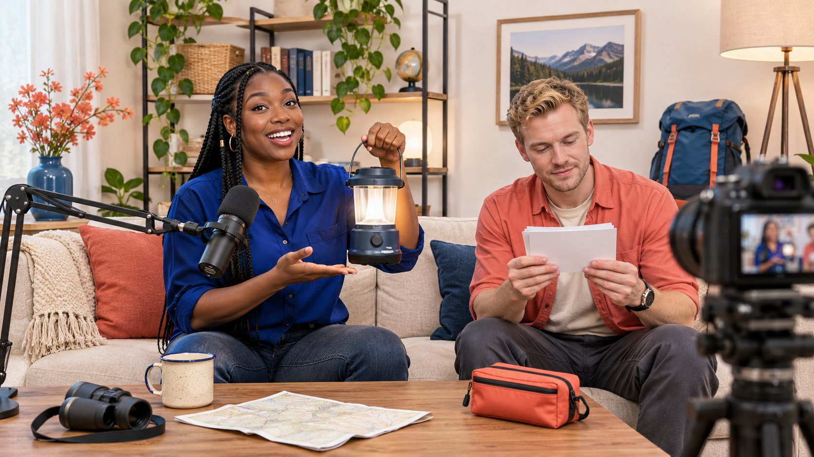
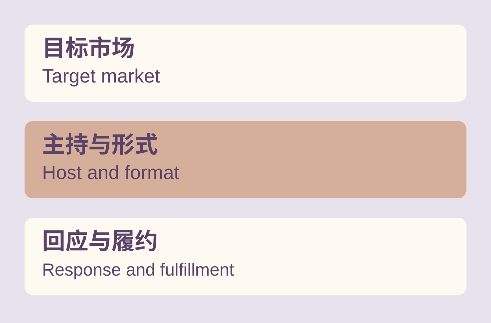

# Streamer US: Match a Livestream to a US Brand Brief

Status: local review draft; confirm the publication date before release.

Turn streamer us into a US-market broadcast brief: confirm host role, audience scope, time zone, product conditions and brand response without using nationality as audience evidence.

For streamer us research, define whether the brand needs a US-based host, content reaching US viewers or a team able to support a US-market product partnership. These are different requirements. Research work and broadcast contribution, then use appropriately authorized information for audience scope and confirm date, time zone, product availability and brand handling. Nationality, English speech or broadcast time alone cannot establish a US audience or guarantee sales. This article provides a partnership-brief method without inventing named streamers’ availability or fees.

## Specify what the US-market requirement means

Location may matter for filming at a US site; audience evidence matters when reaching a type of US viewer; commerce-oriented streaming additionally needs product and service coverage.

The [gaming-streamer partnership guide](https://www.quickkol.com/blog/gaming-youtubers-brand-partnerships/#answer) supplies related assignment context. Here the US-market requirement becomes confirmable conditions rather than one American-streamer label covering every need.

Separate essential conditions from flexible arrangements. Shipping, language, demonstration role and brand receiving hours can be discussed individually. Clarity prevents excluding a useful creator unnecessarily or treating an unsuitable person as confirmed fit. A brief might require the product to be available for a demonstration without requiring the host to hold a particular nationality, while another assignment may genuinely depend on attendance at a specific venue. Those are different research questions and should remain separate.

## Use work to investigate the broadcast contribution

A partnership may need hosting, product demonstration, guest interviewing or question handling; not every streamer supplies every role. Examine how relevant work completes the task instead of looking only at total followers.

A creator strong in gameplay commentary may help explain an experience, while an interviewer may suit a session with a brand expert. Role assessment needs work and confirmation rather than a category label alone.

Record representative public material, relevant actions and open questions. One impressive clip does not prove an entire-session capability, and an unverified repost does not establish authorship. Discovery supports an inquiry, not a signed partnership. A useful invitation can therefore name the contribution being discussed and ask what preparation it requires, allowing the streamer to identify a suitable format or explain why another role would fit better.

## Check audience scope through appropriate information

[Twitch’s discovery-analytics guide](https://help.twitch.tv/s/article/discovery?language=en_US) describes viewing sources, locations and platforms. Obtain task-relevant information through appropriate creator authorization rather than require public private-dashboard access or circulate unrelated details.

Viewing location is not nationality, and a view record need not represent unique people or permanent residence. Retain metric name, period and source before deciding whether it supports this US-market task.

If data is unavailable, preserve uncertainty and continue work research. English speech, a US-friendly schedule or residence in the US does not establish an audience-country percentage. Those questions require different evidence. A scoped summary can be enough for an initial decision if its limitations are clear; the brand does not need an unnecessary export of every available audience field merely to make a preliminary inquiry.

## Write the date and time zone together

A schedule needs more than eight in the evening. Confirm the actual date, named time zone and local times understood by both sides, rechecking daylight-saving changes instead of copying one fixed offset across dates.

Include preparation, technical checks, the content window and post-session receiving arrangements. Brand experts and support staff need availability when required, not merely the streamer being able to start.

If a brand guest becomes unavailable, establish who decides whether to postpone or narrow the demonstration. The host should not improvise unprepared specialist product answers during the session or promise unconfirmed product conditions merely to preserve the original time.

For viewers across regions, identify the market being served without promising identical simultaneous support everywhere. Clear timing enables execution without proving an audience composition or supplying a universal best-time formula. A dated schedule should identify who confirms changes, so a shifted session reaches the host, producer, brand guest and receiving team rather than only the person who originally placed it on a calendar.

## Confirm the demonstration product is actually available

Supply the actual product version, necessary accessories and accurate information. A US-market partnership also needs a route to the corresponding version rather than a demonstration disconnected from the destination.

The photograph shows a streamer and producer checking placement so an action can be completed clearly. It documents no named streamer or brand partnership; the actual content needs confirmed people and products.

If the product has not arrived or a feature does not apply, do not ask narration to supply an experience that never occurred. Resolve the input or change the task so the demonstration matches achievable work. This also helps a producer distinguish a technical setup issue from a product-readiness issue, avoiding repeated camera adjustments when the missing condition is something the brand still needs to provide.

Confirm location, audience and service coverage separately before scheduling the broadcast.

## Separate host and brand-expert answers

The host can explain observations, the brand expert confirms product facts, and orders or service matters reach someone able to act. Hosting should not require knowing every regional condition without support.

Identify answerable questions, matters needing confirmation and topics outside this session. When an immediate answer is unavailable, explain the next step rather than let live pressure create an unsupported promise.

Keep a brand receiving route after the broadcast instead of assigning ongoing product inquiries to the streamer indefinitely. A defined scope lets the creator focus on expression and helps viewers distinguish experience from information supplied by the product owner. It also gives the moderator a useful routing reference without requiring them to make product judgments beyond the role agreed for the session.

## Express the actual commercial relationship

[Twitch’s branded-content guide](https://help.twitch.tv/s/article/branded-content-policy?language=en_US) addresses relevant content involving an exchange of value and describes its disclosure tool. Platform tools and other applicable requirements need separate consideration; one enabled setting does not complete every obligation.

[FTC’s influencer disclosure guide](https://www.ftc.gov/business-guidance/resources/disclosures-101-social-media-influencers) addresses material connections and actual experience in applicable US contexts. Retain the relationship clearly without a script or logo implying results the creator has not experienced.

This article does not determine an individual's legal duties. Confirm the actual arrangement, product and publication, with suitable owners handling applicable requirements instead of leaving the host solely responsible for every question. The production brief can identify who supplies the relationship wording and who checks the actual broadcast expression, allowing commercial context to remain understandable rather than becoming an afterthought added only to an internal file.

## Confirm live, replay and short clips separately

Retaining a replay or making a short advertising edit after the session can involve different uses. Confirm inclusion, editing, languages and period rather than assume public streaming includes every reuse.

The [streamer-content permission guide](https://www.quickkol.com/blog/what-is-whitelisting-creator-ad-permissions/#answer) separates platform access from commercial scope. If a desired short edit removes important conditions, review its expression instead of checking duration alone.

Retain the confirmed version and arrangement. A viewer-created clip is not automatically an advertising asset for the brand; obtaining a file or link establishes access without resolving all uses. This allows replay planning to happen before the session, helping production capture what the brand actually needs while giving the streamer a specific proposal to assess rather than a broad request for unrestricted future control of their live appearance.

## Read one-stream observations within their scope

[Twitch’s stream-summary guide](https://help.twitch.tv/s/article/stream-summary) describes single-stream records including viewing, follows, chat activity and clips. It helps inspect one broadcast without making every metric unique viewers or proving all changes came from the brand segment.

Record the actual broadcast version, content window and data scope. Whole-stream records differ from a branded segment, while live, replay and clip views cannot simply be added as unique reach.

Check brand business records separately and avoid sales or incremental causation claims without the necessary evidence. A report can show completed work, observed actions and unknowns together; limited conclusions can still improve the next assignment. For example, a recurring product question can support a clearer explanation next time without becoming proof that the session increased purchase intent across the entire US market.

## Work through a hypothetical US-market demonstration

Suppose a brand wants a live demonstration of a desk lamp available to US customers. Research creators who explain desk equipment, then check relevant audience information and the product route without inferring audience from residence.

Confirm date, time zone, product receipt and demonstration action. Brand staff answer product facts and other matters enter a support route. If replay and clips are needed, define their scopes separately.

This hypothetical has no named agreement, actual audience count or sales. It connects the market, host contribution and brand handoff so a researcher can make a specific inquiry rather than merely request an American streamer. The owner can assess each dependency before release and identify what remains unconfirmed, making the session plan practical without pretending a candidate has already accepted the work.

## Handoff market research to an execution owner

The final record should include work, role, market conditions, confirmation source and next action. Separate public leads, personal confirmation and execution rather than turn candidates into signed partners.

Influencer-marketing research for streamer us can begin with the market assignment instead of an unverified fame ranking. The brand needs a reason for contact, preparation requirements and question owners; the creator needs to understand the accepted work.

Those distinctions turn research into an executable collaboration. Tools and sources support discovery, contribution and confirmation determine the next step, and evidence supports performance conclusions. A useful final recommendation leaves an owner able to proceed with a specific inquiry or resolve a missing condition, rather than a general list whose relationship to the US-market assignment remains unexplained.

## Separate US-market requirements

| Requirement | Appropriate evidence | Not a substitute |
| --- | --- | --- |
| Host location | Appropriate host or team confirmation | Nationality or audience geography |
| Audience scope | Authorized information with source and period | English speech or stream time |
| Execution | Dated schedule, time zone and roles | A universal best-time formula |
| Product and service | Actual version, destination and owner | Identical conditions in every market |

Partnership-brief framework, not a named-streamer list, audience guarantee or client result.

## Before a US-market streaming inquiry

Turn market needs into confirmable conditions.

- [ ] Separate location, audience and service coverage.
- [ ] Research relevant work and roles.
- [ ] Retain audience source and period.
- [ ] Confirm date, time zone and product readiness.
- [ ] Assign brand-fact and support owners.
- [ ] Confirm live, replay and clip scope separately.

## Research date and limitations

Sources reviewed November 17, 2026. Methods, tables and decision rules are editorial recommendations. Hypothetical examples are not actual client results or industry benchmarks. Source geography and periods are specified where relevant.

## Start creator research with a clear task

Use QuickKOL to interpret a brief, discover relevant creators and research their work and contact routes. Verify data, commercial terms and outcomes at their source.

[Explore QuickKOL](https://www.quickkol.com/#capabilities)

## Sources

- [Twitch’s discovery-analytics guide](https://help.twitch.tv/s/article/discovery?language=en_US)
- [Twitch’s branded-content guide](https://help.twitch.tv/s/article/branded-content-policy?language=en_US)
- [FTC’s influencer disclosure guide](https://www.ftc.gov/business-guidance/resources/disclosures-101-social-media-influencers)
- [Twitch’s stream-summary guide](https://help.twitch.tv/s/article/stream-summary)
