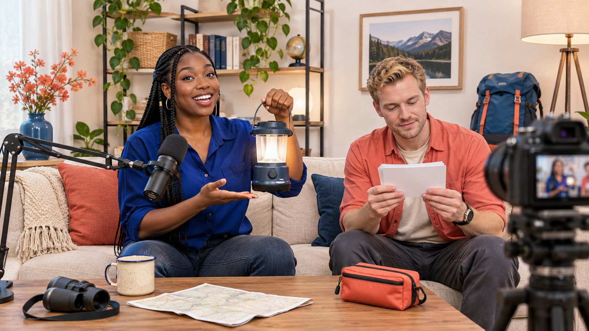
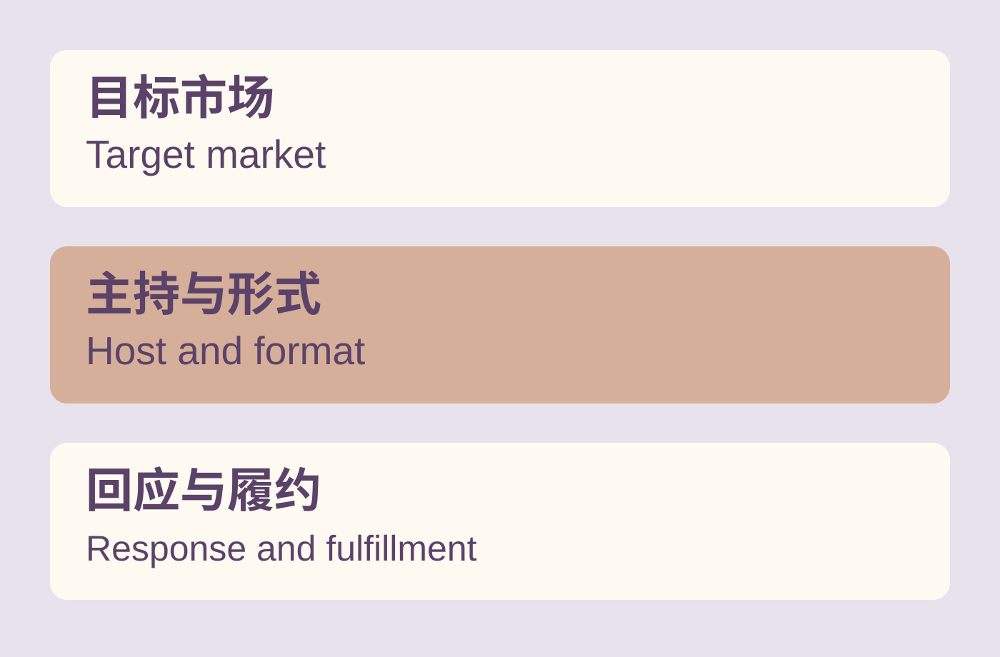

# 美国市场直播怎样选择创作者

状态：本地审阅稿；正式发布日期待确认。

把 streamer us 转成美国市场直播合作 Brief：分别确认主播角色、观众范围、时区、商品条件与品牌回应，不用国籍代替受众证据。

搜索 streamer us 时，品牌先明确要找住在美国的主播、面向美国观众的内容，还是能支持美国市场商品合作的团队。这三项不能互相代替。研究具体作品和直播贡献，再用适当授权数据核对观众范围，确认日期、时区、产品可用性和品牌接收安排。国籍、英语表达或直播时间都不能单独证明美国受众，也不能保证某场合作带来销售。本篇提供合作 Brief 方法，不编造具名主播档期与报价。

## 把美国市场要求写具体

如果产品需要到美国场地拍摄，所在地可能重要；如果主要目标是某类美国观众，受众资料更相关；如果是直播导购，商品和服务范围也要确认。

[游戏直播合作指南](https://www.quickkol.com/zh/blog/gaming-youtubers-brand-partnerships/#answer)提供相关任务背景。本篇把美国市场要求拆成可确认条件，不用“美国主播”一个标签覆盖所有需求。

先写本次必须条件与可灵活安排的部分。例如产品寄送、语言、演示角色与品牌接收时间可以分别讨论。条件越明确，初步研究越不容易把合适创作者排除，或把不符合实际任务的人当作已经适合。

## 作品先证明直播贡献

直播合作可能需要主持、产品演示、采访嘉宾或回应观众，不是所有主播都擅长全部角色。研究相关作品怎样完成任务，而不只看频道总关注。

一位擅长游戏解说的创作者，可能适合解释体验；另一位擅长访谈，可能更适合主持品牌专家。角色判断需要作品和本人确认，不能仅从内容类别推断。

记录有代表性的公开作品、相关动作与待确认事项。不要把一个精彩片段当成整场能力证明，也不从未经核验的转载判断原作者身份。发现线索支持邀请，不等于已经达成合作。

## 用适当资料核对观众范围

[Twitch 的发现分析说明](https://help.twitch.tv/s/article/discovery?language=en_US)介绍观看来源、地区与设备等信息。品牌需要由创作者适当授权提供与任务有关的资料，不要求公开私人后台或传播无关信息。

地区观看记录不等于国籍，也不一定是独立人数或长期居住地。保留指标名称、时间范围与来源，再讨论它是否支持本次美国市场任务。

没有相关数据时可以保留未知，先研究作品。不能因为主播用英语、在美国时间开播或本人住在美国，就补写美国观众占比；实际受众需要不同证据。

## 日期与时区一起写进安排

直播时间不能只写晚上八点。确认实际日期、时区名称与双方看到的本地时间，涉及夏令时变化时重新核对，不把某个固定时差复制到所有日期。

排期同时包括准备、技术检查、正式内容与结束后的接收。品牌专家或支持人员要在需要的时候在线，不只是主播一个人能开播。

如果品牌嘉宾临时无法参加，事先确认由谁决定延期或缩小演示范围。主持人不应临时替代尚未准备的专业回答，也不必为了守住原时间而承诺自己无法确认的产品条件。

如果观众跨地区，说明本次主要服务范围，不承诺所有人都能同时获得相同支持。清楚时间帮助团队执行，但不会单独证明该时段拥有某种受众，也不是最佳发布时间的统一公式。

## 演示产品先确认真实可用

品牌提供实际产品版本、必要配件与准确资料。美国市场合作也要说明观众能在哪里了解或购买对应版本，不让演示与商品入口脱节。

配图展示主播与制片检查摆位，重点是动作能否清楚完成。它不是任何具名主播或品牌的合作证明，正式内容需要真实确认的人与产品。

如果产品尚未到达，或某项功能还没适用，不要求主播用台词补出已经体验的结果。先解决输入或调整任务，让演示对应实际可以完成的工作。

地点、观众与服务范围分别确认，再安排实际直播。

## 主持与品牌专家分别回答

主播可以解释自己的观察，品牌专家确认产品事实，订单或服务问题交给能处理的人。不要要求主持人凭空知道所有地区条件。

事先列出可以回答、需要确认与不在本次范围的问题。无法立即回答时说明下一步，不让现场压力变成未经支持的承诺。

品牌接收路径应在直播后仍然有效，持续产品咨询不必无限交给主播。明确范围让创作者能专注表达，也让观众知道哪些回答来自体验、哪些来自负责产品的人。

## 商业关系按实际内容表达

[Twitch 的品牌内容指南](https://help.twitch.tv/s/article/branded-content-policy?language=en_US)把价值交换下的相关内容纳入品牌内容，并介绍披露工具。平台工具与其他适用要求需要分别考虑，不把打开一个选项当成全部义务已经完成。

[FTC 的达人披露指南](https://www.ftc.gov/business-guidance/resources/disclosures-101-social-media-influencers)说明适用美国情境下商业关系和真实体验的表达。内容应清楚保留关系，不能由脚本或品牌标志暗示已体验未体验的结果。

本文不判断个人具体法律责任。团队应确认实际合作、产品与发布安排，再由合适负责人处理适用要求，不把经验不足的主持人留作所有问题的唯一承担者。

## 直播、回放与短剪辑分别确认

直播结束后保留回放或制作广告短片，可能涉及不同用途。合作确认应说明是否包含、怎样修改、哪些语言和时间，不能因为直播公开就默认全部复用。

[主播内容许可指南](https://www.quickkol.com/zh/blog/what-is-whitelisting-creator-ad-permissions/#answer)帮助区分平台操作权限与商业范围。品牌需要的短剪辑如果移除重要条件，也应重新检查表达，而不是只看时长合适。

保留具体确认版本与使用安排。观众制作的片段不自动成为品牌可投放广告素材；文件或链接能够取得，只解决可访问性，不解决所有用途。

## 单场记录按同一口径阅读

[Twitch 的单场直播概览](https://help.twitch.tv/s/article/stream-summary)介绍单场观看、关注、聊天与片段等记录。它帮助查看一场内容，不意味着每个指标都是独立观众，也不证明变化全部来自品牌环节。

记录实际直播版本、内容窗口与数据范围。全场数字和品牌部分不同，直播观看、回放与短片也不能未经区分直接相加成触达人数。

品牌业务数据另行核对，没有完整证据就不补写销售或增量因果。报告可以同时说明完成了什么、观察到什么和仍未知什么，有限结论仍然可以支持下一次任务改进。

## 美国市场演示怎样安排

假设品牌希望为美国可购买的桌面灯安排直播。先研究擅长桌面设备讲解的创作者，再核对相关观众资料与商品路径，不从本人所在地直接补出受众。

双方确认日期、时区、产品到件与演示动作；品牌人员在场回答产品事实，其他问题进入支持路径。回放和短剪辑如果需要，分别说明范围。

这个假设没有具名合作、实际观众数或销量。它展示如何把市场、主持贡献与品牌接手连接起来，让研究者能提出具体邀请，而不是只要求找一位美国主播。

## 把市场研究交接给能执行的人

最终清单应包含作品、角色、市场条件、确认来源与下一步。公开线索、本人确认和实际执行分别记录，不把候选人写成已经签约。

Streamer us 的达人营销研究，可以从市场任务开始，而不依赖未经核验的知名榜单。品牌需要知道为什么联系、如何准备和谁接住问题，创作者需要知道实际接受的工作。

保留这些边界，研究才会进入可执行合作。工具与资料帮助发现，明确贡献与实际确认决定下一步，表现结论则由对应证据支持。

## 把美国市场条件分开核对

| 条件 | 合适依据 | 不应代替 |
| --- | --- | --- |
| 主播所在地 | 本人或团队适当确认 | 国籍与观众地区 |
| 观众范围 | 有来源和时期的授权资料 | 英语或开播时间 |
| 执行安排 | 具体日期、时区与角色 | 统一最佳时间公式 |
| 商品服务 | 实际版本、入口与接收人 | 所有市场相同条件 |

合作 Brief 框架，不是具名主播名单、受众保证或实际客户结果。

## 接洽美国市场直播前

把市场要求变成能确认的条件。

- [ ] 区分所在地、观众与服务范围。
- [ ] 研究相关作品与实际角色。
- [ ] 保留观众资料的来源与时期。
- [ ] 确认日期、时区与产品准备。
- [ ] 安排品牌事实与支持接收人。
- [ ] 分别确认直播、回放与短剪辑。

## 研究日期与使用边界

资料核验于 2026 年 11 月 17 日。文中方法、表格和决策规则为编辑建议，标为假设的示例不是实际客户结果或行业基准。外部资料的适用地区与时期按各段说明。

## 从任务开始达人研究

用 QuickKOL 理解 Brief、发现相关达人并研究作品与联系路径；数据、合作条件和结果仍需核验。

[了解 QuickKOL](https://www.quickkol.com/#capabilities)

## 来源

- [Twitch 的发现分析说明](https://help.twitch.tv/s/article/discovery?language=en_US)
- [Twitch 的品牌内容指南](https://help.twitch.tv/s/article/branded-content-policy?language=en_US)
- [FTC 的达人披露指南](https://www.ftc.gov/business-guidance/resources/disclosures-101-social-media-influencers)
- [Twitch 的单场直播概览](https://help.twitch.tv/s/article/stream-summary)
