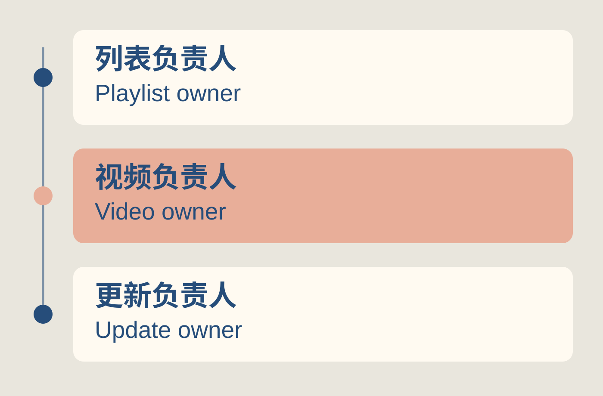

# Make a YouTube Playlist for a Multi-Creator Release

Status: local review draft; confirm the publication date before release.

For a brand playlist containing several creators’ videos, assign video, playlist and update owners before creation, visibility checks and maintenance of late or unavailable entries.

On desktop YouTube, open the intended video’s watch page, choose More, Save and Create new playlist, enter a name, select visibility and click Create. A multi-creator brand project also needs each video’s actual URL, release conditions and owner. Creating the list does not establish that every item is public, permanently accessible or available for brand re-editing. Answering how do you make a playlist on YouTube therefore includes both creation and ownership of later updates, so viewers receive an accurate, maintained collection.

## Define why these creator videos belong together

A brand can organize demonstrations, interviews or experiences from one project in a playlist while explaining what viewers should find. Adding every video naming the brand does not establish a complete partnership series.

The [YouTube playlist-learning guide](https://www.quickkol.com/blog/youtube-playlist-creator-learning-sequence/#answer) concerns content order; this article concerns maintenance across multiple video owners. The brand may own the list while different creators manage its entries, making handoff important.

List intended videos and roles, distinguishing visible, unreleased and unconfirmed items. A project schedule is not the actual playlist; planned content should not be introduced publicly as already watchable. A defined theme also helps decide whether a later entry belongs. The [channel-collaboration ownership guide](https://www.quickkol.com/blog/create-youtube-channel-kol-series-ownership/#answer) addresses responsibility for the whole channel, which is distinct from maintaining a list. The team should be able to explain the collection without claiming that every included creator agreed to a wider campaign role or that every relevant video in the category has been covered by the brand’s selection.

## Create through the official desktop route

[YouTube’s playlist-creation guide](https://support.google.com/youtube/answer/57792?hl=en) gives the computer route: open the target video’s watch page, choose More, then Save and Create new playlist; enter the name, select visibility and click Create. Interface language depends on the account, and no private account was tested here.

Use a name and description matching the actual theme rather than accumulate creator names and keywords. Confirm the appropriate creating account and where the next owner can find the list; convenience does not require collecting everyone’s login credentials.

After creation, check the actual URL and title. A saved message can confirm an operation while the collection still needs inspection. If a function is not visible, consult applicable help and the current interface instead of repeat an old screenshot’s instructions or claim an identical route on every device. The practical handoff should identify the list created, not merely state that somebody completed a tutorial.

## Choose visibility around the actual sharing need

[YouTube’s playlist-visibility guide](https://support.google.com/youtube/answer/3127309?hl=en) describes public, private and unlisted options. People with an unlisted link can share it, so it is not a confidentiality guarantee for internal collaboration information. Define the sharing need first.

Inspect within a suitable scope before release under confirmed conditions. Public titles and descriptions should not expose unreleased project details. Record visibility changes so one person does not assume internal review while another distributes the link.

List visibility and access to each video are separate checks. Follow the intended sharing route item by item instead of assume a public list makes every entry playable. For a restriction, ask the relevant video owner rather than infer private motives from an unavailable message. A list can be structurally complete while its viewing experience remains incomplete, which is why release review should concern what the intended viewer can actually reach.

## Separate playlist ownership from video ownership

The playlist owner manages a collection without becoming the original producer of every video in it. Describe actual creator appearance, production or publication roles rather than expand the relationship through the collection page.

Video owners handle their work and release arrangements; the brand’s playlist owner maintains topic, entries and the sharing route. The update owner may be the same person or someone else, provided everyone knows where a change belongs.

The diagram separates these responsibilities without requiring three job titles for every project. It prevents list management from being treated as authority over all videos, rights and responses. A few clear responsibilities are more executable than an assignment simply owned by everyone. The handoff should also distinguish adding an already public video from commissioning new creator work, because the collection itself does not answer what the brand has actually purchased or what further use each person has agreed.

Several creators can share a collection while original work and updates retain clear owners.

## Maintain the title, description and entries

[YouTube’s playlist-editing guide](https://support.google.com/youtube/answer/6083634?hl=en) describes changing titles and descriptions, reordering and removing entries. Maintain the actual collection rather than create an untraceable replacement whenever a video changes.

Check public wording after editing. If a planned three-creator series has only two released entries, do not describe all three as complete. A title should not preserve the appearance of progress while leaving viewers to discover the gap.

Retain the reason and observation date, especially when the link appears on a brand page or collaboration post. A short note explains why an entry changed and helps the next owner maintain it. Removing a playlist entry and deleting the original work are different operations; confirm the object before acting. Maintenance should update the audience-facing collection and relevant project record together so one accurately reflects what the other says has been released.

## Handle a late video through the actual promise

When one creator’s video is unfinished or unreleased, ask whether the current list can still help viewers independently. If so, explain its present scope; if the missing item undermines the main explanation, discuss a delay or changed introduction.

Do not fill the count with unconfirmed or unrelated videos. Planned content can remain in project records without a placeholder being presented as a completed deliverable. The brand should not promise a new publication time for the creator without confirmation.

A change can affect introductions and links elsewhere. Give an update owner responsibility for affected locations and necessary communication. Limit revision requests to real effects rather than require every creator to remake completed work unconditionally because another entry is late. A precise change record helps distinguish an incomplete collection from a completed creator assignment that remains usable within the revised public scope.

## Respond when a released entry becomes unavailable

Record the route, time and visible state before contacting the relevant owner. A missing entry alone does not justify publicly accusing a creator of deletion or breach; actual access conditions need checking.

If access cannot immediately be restored, decide whether to remove the entry, adjust the description or use an appropriate alternative. A substitute still needs to serve the task rather than share a similar title. Return commercial questions to the actual agreement.

After restoration, follow the viewer route again and check order and context. A returned video with a description still announcing its absence can mislead too. Maintenance aims to represent the current collection accurately rather than present every change as a new campaign. A project note should retain the observed limitation without inventing a cause, letting the brand respond to the practical viewing problem while the appropriate owner investigates it separately.

## Rehearse the handoff through a hypothetical series

Suppose three creators demonstrate storage, cleaning and everyday placement. The brand manages the list, each creator owns their video, and a project editor checks new entries and public wording. This is hypothetical, not a client result.

The first and third videos are released while the second awaits a product-fact check. Decide whether the two form a suitable current collection and describe it accurately; do not announce a complete three-step series and fill the gap with unrelated content.

After confirmation, the update owner adds the actual URL, checks access and revises the description. Changes to other creators’ introductions depend on actual effects. This small rehearsal reveals missing responsibility before release rather than afterward. It also lets the team assess each deliverable individually, keeping one unfinished factual question from obscuring the work already completed and the viewing experience the brand can responsibly offer now.

## Retain the object when reporting list and video records

A list, individual video and channel can have different observation records. [YouTube’s Advanced Mode guide](https://support.google.com/youtube/answer/9717005?hl=en) describes viewing and comparing different objects. Identify the source and scope rather than add every listed video’s totals into deduplicated viewers.

Record accessible entries, maintenance and applicable viewing observations without claiming that the list caused all growth. Creator distribution, other routes and the content itself can affect activity; retain limitations where records are missing.

If the objective is helping viewers locate an explanation, inspect the route and content accuracy first. Business outcomes need corresponding evidence rather than collection completion becoming a claim of definite revenue. Organization can have a clear acceptance criterion of its own. This allows the team to recognize a useful, maintained viewer route while separately assessing any stronger performance claim through the sources and methods needed to support it.

## Connect creation steps to ongoing maintenance

How do you make a playlist on YouTube can begin with a few creation steps, but a multi-creator brand project still needs video ownership, updates and responses to change. One creation action does not complete ongoing maintenance.

Define the theme, create through the applicable route, check each item’s sharing scope and hand over updates. Keep the public description accurate without list inclusion expanding original roles or use permissions. Another content request returns to a defined creator assignment.

The list then becomes a usable viewer collection and a manageable partnership route. Another owner should know what exists, what is pending and what happens next. That is a completed handoff, with creation, release and later maintenance understood as connected responsibilities rather than an assumption that a saved URL will remain a complete campaign experience forever.

## Four states in a multi-creator playlist

| State | Confirm | Next action |
| --- | --- | --- |
| Before creation | Theme, account and owner | Create through applicable official steps |
| Before sharing | Actual entries and access | Check the public description |
| Late entry | Whether the current set serves the task | Update scope and promises |
| Changed entry | Visible state and actual effects | Assign the owner and recheck |

Editorial maintenance framework, without distribution guarantees or treating list management as ownership of original videos.

## Before sharing a multi-creator playlist

Start with actual entries and owners.

- [ ] Define the theme and current scope.
- [ ] Retain actual video and playlist URLs.
- [ ] Distinguish list and video visibility.
- [ ] Assign late and unavailable entry handling.
- [ ] Keep title and description accurate.
- [ ] Hand over updates and later observations.

## Research date and limitations

Sources reviewed November 17, 2026. Methods, tables and decision rules are editorial recommendations. Hypothetical examples are not actual client results or industry benchmarks. Source geography and periods are specified where relevant.

## Start creator research with a clear task

Use QuickKOL to interpret a brief, discover relevant creators and research their work and contact routes. Verify data, commercial terms and outcomes at their source.

[Explore QuickKOL](https://www.quickkol.com/#capabilities)

## Sources

- [YouTube’s playlist-creation guide](https://support.google.com/youtube/answer/57792?hl=en)
- [YouTube’s playlist-visibility guide](https://support.google.com/youtube/answer/3127309?hl=en)
- [YouTube’s playlist-editing guide](https://support.google.com/youtube/answer/6083634?hl=en)
- [YouTube’s Advanced Mode guide](https://support.google.com/youtube/answer/9717005?hl=en)
