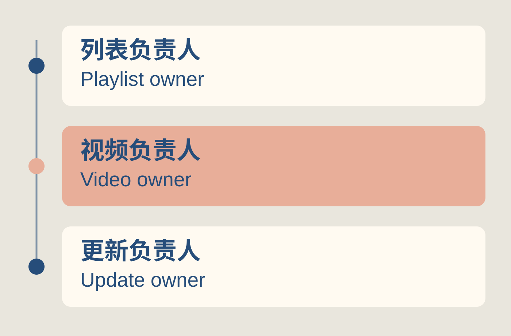

# 多位达人视频怎样维护播放列表

状态：本地审阅稿；正式发布日期待确认。

把多个达人视频放进同一品牌播放列表时，先安排视频、列表与更新负责人，再创建、检查可见性并维护晚到或无法访问的条目。

在 YouTube 桌面端，可打开希望加入的视频观看页，选择 More、Save、Create new playlist，填写名称、选择可见性，再点击 Create。多达人品牌项目还要确认每条视频的真实地址、上线条件和负责人。列表创建完成，不表示所有视频都已公开、永久可访问或可以由品牌重新剪辑。回答 how do you make a playlist on YouTube，除了创建步骤，还应安排列表所有者与后续更新，让观众在发布后看到一组准确、有人维护的内容。

## 先说明这组达人视频为何放在一起

品牌可以用播放列表组织同一项目的不同演示、采访或体验，但应说明观众进入后需要找到什么。不要只把所有带品牌名的视频加入，再称为完整合作系列。

[YouTube 列表学习路径指南](https://www.quickkol.com/zh/blog/youtube-playlist-creator-learning-sequence/#answer)讨论内容顺序；本篇关注多个视频负责人共同发布时怎样维护。列表可以属于品牌，而每条视频由不同达人管理，这就需要明确交接。

先列出拟用视频与角色，区分已经可见、尚未上线和仍待确认。项目进度表不是实际播放列表，计划中的内容不应在公开介绍中被说成全部已经可以观看。一个明确主题也有助于后续判断新条目是否真的属于同一集合。[频道协作所有权指南](https://www.quickkol.com/zh/blog/create-youtube-channel-kol-series-ownership/#answer)则讨论整个频道的责任，不应与一个列表的管理混淆。

## 按官方桌面路径创建列表

[YouTube 的播放列表创建说明](https://support.google.com/youtube/answer/57792?hl=en)给出电脑路径：打开目标视频观看页，选择 More，再到 Save 和 Create new playlist；输入名称，设置可见性，点击 Create。界面语言按实际账号显示，本文未测试私人账号。

名称与说明可以围绕真实主题，不必堆叠达人和关键词。先确认用哪个合适账号创建，并让后续负责人知道到哪里找到；不要为了方便把每个人的登录凭证集中转交。

创建后核对实际列表地址与标题。收藏成功提示可以说明操作结果，但仍需要查看列表里是什么。遇到无法找到的功能，先查看适用帮助与当前界面，不凭旧截图反复操作或声称所有设备路径完全相同。

## 可见性按真实分享需求选择

[YouTube 的播放列表可见性说明](https://support.google.com/youtube/answer/3127309?hl=en)介绍公开、私密与不公开。知道链接的人可以分享不公开列表，因此不要把它当成对内部合作资料的保密保证。实际分享需求应先明确。

品牌可以先在适合的范围检查，再按确认条件发布。对外列表标题和说明不应暴露尚未公开的项目细节。可见性变化也需要负责人记录，避免一个人以为仍在内部审阅，另一个人已经转发。

列表的可见性与每条视频是否可访问是两个检查。用实际准备分享的路径逐条查看，不因为列表公开就默认所有内容都能播放。遇到限制，联系对应视频负责人了解情况，而不是从一个不可用提示推断私人动机。

## 分开列表所有者与视频所有者

列表负责人可以管理集合，但不能因为某视频在其中，就把自己写成原作品制作人。达人实际出镜、制作或发布角色，应按真实工作说明，不让集合页面扩大合作关系。

视频负责人决定其相关工作与上线安排，品牌列表负责人维护主题、条目与分享路径。更新负责人可能是同一个人，也可能另有安排；重要的是大家知道遇到变化找谁。

图形把三个职责分开。它不是要求每个项目都设置三个岗位，而是避免一个人管列表后被默认为可以处理全部视频、权利与回应。少量明确职责，比一个只有所有人都负责的任务名更容易执行。

多人视频可以进入同一集合，原作品与更新责任仍各自明确。

## 维护标题、说明与条目

[YouTube 的播放列表编辑说明](https://support.google.com/youtube/answer/6083634?hl=en)介绍修改标题和说明、调整顺序及移除条目。品牌可以据此维护真实集合，不必在每条视频变化时都重建一个无法追踪的新列表。

编辑内容时，核对公开说明是否仍准确。例如原计划有三位达人，实际只上线两位，就不能继续写三条已完整发布。不要用标题维持表面进度，让观众自己发现缺失。

保留修改原因与观察日，尤其当链接已用于品牌页面或合作帖。一个简单记录可以说明条目为何调整，帮助下一位负责人继续维护。删除某条列表记录与删除原作品不是同一个动作，操作前应确认处理对象。

## 晚到视频先更新承诺

某位达人还未完成或未公开时，先问现有列表是否仍能独立帮助观众。如果可以，说明当前范围；如果缺失内容会破坏主要解释，就讨论延后或调整公开介绍。

不要为了凑齐条目，加入未经确认或与主题无关的视频。计划中的内容可以留在项目记录，不需要用占位视频冒充正式交付。品牌也不应在未确认时替达人承诺新的上线时间。

实际变化可能影响其他内容里的介绍和链接。由更新负责人检查相关位置，通知需要知道的人。把工作限制在真实受影响的部分，不要求所有达人因为一个条目晚到就无条件重做全部已经完成的内容。

## 条目无法播放时怎样继续

先记录发生在哪个入口、什么时间、看到什么状态，再联系相关负责人。不要仅凭列表里少了一条，就公开指责达人删片或违约；实际访问条件需要核对。

如果暂时无法恢复，确认是否移除条目、调整说明或提供合适替代内容。替代内容也需要对应原任务，不是找一个相近标题就加入。涉及真实商业安排，回到双方确认的工作。

恢复后重新走一遍观众路径，检查顺序与上下文。某个视频回来了，列表说明却仍写缺失，也可能造成误解。维护的目标是准确展示当前集合，而不是把每次变化都包装成一次新的营销活动。

## 用一个假设系列演练交接

假设品牌安排三位达人分别演示收纳、清理和日常摆放。列表由品牌管理，每位达人负责自己的视频，项目编辑负责检查新条目与公开说明。本例没有真实客户结果。

第一、第三条已经上线，第二条还在确认产品事实。团队可以判断现有两条是否构成适合的当前集合，并准确说明；不能写完整三步系列，再用一个无关视频填空。

第二条确认后，更新负责人添加实际地址、核对可访问性并调整说明。其他达人是否需要修改介绍，由真实影响决定。这个小演练能发现职责缺口，而无需等到所有内容都上线后才追问谁维护列表。

## 分开报告列表与视频

列表、单条视频与频道可能有不同观察记录。[YouTube 的高级模式说明](https://support.google.com/youtube/answer/9717005?hl=en)介绍按不同对象查看和比较。报告时需要具体来源与范围，不把列表里的全部视频数值简单相加成去重观众。

品牌可以记录实际可访问条目、维护情况与适用观看记录，但这些不自动证明列表造成全部增长。达人各自分发、其他入口与内容本身都可能影响观察，缺少资料时保留限制。

如果目标是让观众找到相关说明，先看路径与内容是否准确。业务结果需要另外对应证据，不因为集合已经整理好就宣称全部合作带来确定收入。完成组织任务，本身可以有清楚的验收。

## 让创建步骤进入持续维护

How do you make a playlist on YouTube 可以从几步创建开始，但品牌多达人项目需要继续知道每条视频由谁负责、何时更新与怎样处理变化。一次创建不是长期维护自动完成。

先明确主题，按适用路径建立列表，逐条检查分享范围，再交接更新责任。公开介绍保持真实，收藏视频不扩大原作品角色或使用权限。需要新内容时，重新讨论具体达人任务。

这样列表既是观众可以使用的集合，也是品牌能够持续管理的合作入口。下一位负责人知道当前有什么、什么待确认与接下来做什么，才算真正完成交接。

## 多达人列表的四种状态

| 状态 | 需要确认 | 继续动作 |
| --- | --- | --- |
| 待创建 | 主题、账号与负责人 | 按适用官方路径建立 |
| 准备分享 | 实际条目与可访问性 | 核对公开说明 |
| 条目晚到 | 当前集合能否独立成立 | 更新范围与承诺 |
| 条目变化 | 可见状态与真实影响 | 由对应负责人处理并复查 |

编辑维护框架；不保证分发效果，不把列表管理当作原视频所有权。

## 分享多达人播放列表之前

从真实条目与负责人开始。

- [ ] 明确集合主题与当前范围。
- [ ] 保存实际视频与列表地址。
- [ ] 区分列表与视频可见性。
- [ ] 约定晚到与无法播放的处理。
- [ ] 保持标题与说明准确。
- [ ] 交接更新与后续观察责任。

## 研究日期与使用边界

资料核验于 2026 年 11 月 17 日。文中方法、表格和决策规则为编辑建议，标为假设的示例不是实际客户结果或行业基准。外部资料的适用地区与时期按各段说明。

## 从任务开始达人研究

用 QuickKOL 理解 Brief、发现相关达人并研究作品与联系路径；数据、合作条件和结果仍需核验。

[了解 QuickKOL](https://www.quickkol.com/#capabilities)

## 来源

- [YouTube 的播放列表创建说明](https://support.google.com/youtube/answer/57792?hl=en)
- [YouTube 的播放列表可见性说明](https://support.google.com/youtube/answer/3127309?hl=en)
- [YouTube 的播放列表编辑说明](https://support.google.com/youtube/answer/6083634?hl=en)
- [YouTube 的高级模式说明](https://support.google.com/youtube/answer/9717005?hl=en)
