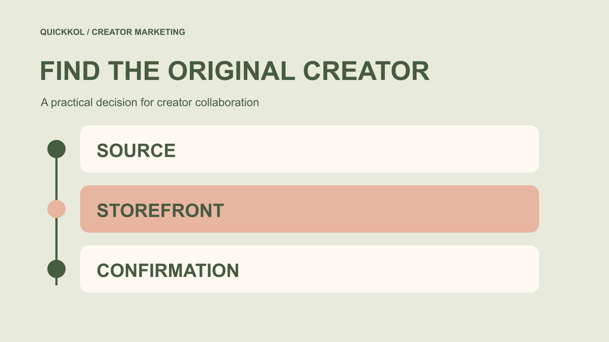
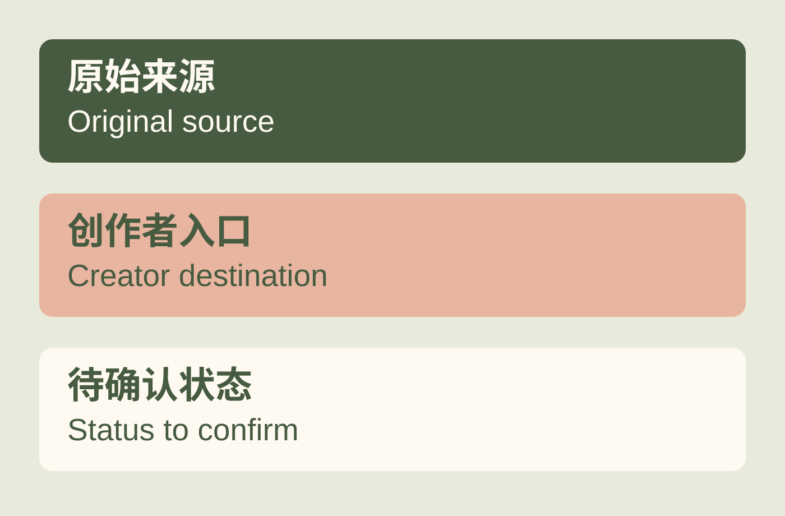

# Find an Amazon Creator You Previously Followed

Status: local review draft; confirm the publication date before release.

Recover an Amazon creator through saved work, creator-owned public channels and a verified storefront, then assess the current partnership task.

QuickKOL editorial graphic; not actual account metrics or a platform interface.

To find an Amazon creator you previously followed, start with a saved storefront link, relevant work or the Amazon destination shared on a creator-owned public channel, then check identity and marketplace. Use a following list if your current account offers one; this article has not verified a universal shopping-account list path. Recovering a page does not establish that you still follow it or that the creator fits a partnership. For an influencer-marketing team, preserve the source and relevant work, then build a candidate record against the brief.

## Identify the work you actually remember

Before searching, narrow the memory to useful clues: the work, where you encountered it and what the creator demonstrated. Remembering a product does not mean everyone recommending that product is the person you seek.

Perhaps you recall a creator explaining storage in a small kitchen rather than simply presenting a shopping list. That contribution can help identify the work and explain why the brand might research it again.

Check saved links, bookmarks or public-work records already available to you. Recovering one creator does not require a colleague to export an entire private shopping history; a relevant fragment can provide a starting point.

The result may remain a hypothesis: possibly a kitchen creator from a particular channel, still to be confirmed. That is more reliable than entering the first similar result as a known identity. Keep the original clue separate from the conclusion so another researcher can assess how much of the connection has actually been established.

## Confirm the recommendation page from its source

[Amazon’s influencer-program guide](https://affiliate-program.amazon.com/help/node/topic/GTP6NKQ2GXPZL7AT/) describes a dedicated recommendation page and custom address. It helps identify the page type without guaranteeing that an old saved link still works.

Inspect the actual destination: a creator page, brand Store, individual product or another site. A product page can recover a product clue without identifying the person who originally recommended it.

[Amazon’s 2026 program introduction](https://www.aboutamazon.com/news/retail/how-amazon-influencer-program-works) also describes recommendations through creator pages and content. Brands can research that public work without treating program participation as willingness to accept any assignment.

Express the source relationship in one checkable sentence: a particular work on this creator-owned channel links to this storefront. This is easier to hand off than an address without context. Keep the date of the check, because the relationship between a public post and its destination can change after the original content was saved.

## Cross-check through creator-owned channels

If you remember another public channel belonging to the creator, inspect whether its current profile or relevant work supplies the Amazon destination. Prioritize the actual source rather than a matching picture in search results.

Names, language and subject matter help a check but do not guarantee identity. A repost or aggregation page should lead you back to the original author's own connection, not become the assumed business counterpart.

The [Amazon creator-page handoff article](https://www.quickkol.com/blog/amazon-store-front-kol-listing-handoff/#answer) explains how to preserve public routes in a project. Here the recovery task has a narrower question: each additional source should establish a specific connection rather than merely increase the number of links collected.

Leave the relationship pending if it cannot be established. Research into visible work can continue, but a guess should not travel into a formal invitation, permission request or published shortlist. This protects the usefulness of a promising lead while keeping an unresolved identity question visible to the next owner.

After recovering the public route, assess identity, following and partnership relevance separately.

## Keep Amazon service contexts separate

[Amazon’s Live creator guide](https://affiliate-program.amazon.com/help/node/topic/GE3Y6X7JFDSTFA7C) describes following and notification options around livestreams. That establishes one way to keep up with a creator, not a complete unified following list for every shopping account.

[Amazon Music’s profile guide](https://digprjsurvey.amazon.com/csad/help/node/T8J9ByrxyYYYFfux6S) concerns a separate music service. Its Following area is not a complete shopping-creator result and cannot confirm a storefront follow by substitution.

Record the marketplace and service used. A similarly named page in another market needs an actual creator-owned connection rather than an assumption that every marketplace shares identical pages and functions.

For a complete personal-follow query, the account holder should inspect the controls and help actually available now. This recovery method concerns a particular public lead, not an unverified account-export feature. The distinction lets a brand recover relevant work while avoiding a false claim that the research has reconstructed every creator the account holder ever followed.

## Separate page recovery from follow confirmation

Finding the right page completes a stage of identity research. Present following, historical following and notification status each need corresponding evidence instead of being inferred from recovery.

If the memory is only of viewing content, record a previously viewed creator rather than rewrite it as confirmed following history. Viewing, saving, buying and following are different actions.

A team record can separate page, source, identity check, relevant work and pending questions. Unknowns remain unknown instead of forcing a definite answer to make a row look complete.

Suppose you recover a page with a clear equipment demonstration but cannot establish whether you still follow it. Relevant-work assessment can continue without repeatedly opening a private account to add certainty that the brand task does not need. A well-scoped record explains exactly what was recovered and avoids burdening future decisions with an inaccurate account-history claim.

## Return to the contribution the brand needs

Recovering a familiar name can feel like completing selection. Return to the current brief: demonstration, explanation, experience comparison or content intended for a brand-owned channel?

The [creator-shortlist workflow](https://www.quickkol.com/blog/creator-shortlist-workflow/#answer) helps turn public leads into project candidates. Attach work relevant to the requested contribution and conditions to discuss instead of retaining only the statement that you followed the person before.

If the brand needs a clear cleaning demonstration, static product displays do not yet establish task fit. Conversely, a smaller body of work with relevant explanation can justify a conversation without becoming proof of campaign success.

Write why this creator merits contact before deciding what additional information to request. Relevance sets the research direction; personal familiarity merely reminds you that the lead exists. This also helps a colleague who has never encountered the creator evaluate the recommendation using the work rather than relying on the original researcher's memory.

## Confirm commercial context and content use separately

A public storefront does not give a brand the right to use a creator's image, voice or demonstration. Research can retain necessary attribution; reposting, editing or paid use needs a separate scope agreement.

The [U.S. Copyright Office’s copyright overview](https://www.copyright.gov/what-is-copyright/) explains protection for original expression. The practical recommendation here is to record work research separately from asset permission so a link in a research document does not later become an assumed reusable asset.

[FTC’s influencer disclosure guide](https://www.ftc.gov/business-guidance/resources/disclosures-101-social-media-influencers) also explains clear disclosure of material relationships in applicable US contexts. Retain the public context of affiliate links or commercial notices without accusing an individual from missing information.

For a paid assignment, discuss actual content, compensation, publication and permission. Having followed someone before, or being able to view their page now, does not replace an agreement for this collaboration. Recovery makes an informed inquiry possible; it does not complete the commercial or creative decisions on either side.

## Complete a hypothetical recovery record

Imagine that a saved piece of content leads back to a kitchen creator's channel, which publicly links to an Amazon recommendation page. You check the destination and relevant demonstration without confirming a current follow in your account.

Hand off those facts: original work source, destination visible on the observation date, relevance to the project and assignment conditions still to confirm. Do not label the person an Amazon-verified partner or present the record as a complete following list.

The next owner can inspect comparable work before asking about availability and collaboration format. If the source changes later, update that route instead of interpreting one broken link as retirement or an account problem.

This is a hypothetical record, not a client result. It shows the useful brand-side endpoint of how to find who you follow on Amazon: recover a credible lead while keeping identity, following and partnership assessment in their proper places. The handoff should let someone continue the research without needing access to your memory or your personal shopping account.

## Set a useful stopping point for an unresolved lead

When the original work is unavailable and the link no longer reaches a known page, identify the part that could not be recovered. Do not assemble changing search results into an identity without a source or let recovery indefinitely consume time intended for researching other relevant creators.

Give the lead a specific next step: ask the original researcher for public work still in their records, or use a business route supplied by the creator to ask whether the page has changed. One scoped inquiry is more useful than adding many similarly named people to an outreach queue.

If the project does not require this particular person, return to the contribution and research other candidates. An unresolved historical lead does not establish a shortage of suitable creators or failure of an entire platform's discovery functions.

The stopping point should support a work decision: recovered leads enter work assessment, pending ones receive an owner, and irrelevant ones are archived. Retaining the original scope prevents the same unresolved result being rediscovered next month as an apparently new confirmed finding. This is also a practical use of limited research time. A record of where the search stopped also helps a colleague avoid repeating identical checks, while leaving room for genuinely new evidence to reopen the lead later.

## Different clues in creator recovery

| Clue | Can establish | Still to check |
| --- | --- | --- |
| Saved work | The content originally seen | Current author and route |
| Creator-owned link | A public source connection | Current destination and marketplace |
| Recovered page | Work visible that day | Current following and partnership terms |
| Relevant demonstration | Reason to continue research | Assignment, permission and availability |

A research method, not universal account navigation or complete follow-export instructions.

## Handoff after recovering a creator

Retain only connections actually established.

- [ ] Record the original work and source.
- [ ] Check the creator-owned public route.
- [ ] Distinguish marketplace, service and object.
- [ ] Do not equate page recovery with confirmed following.
- [ ] Explain the specific connection to the brief.
- [ ] Confirm permission and commercial terms explicitly.

## Research date and limitations

Sources reviewed November 18, 2026. Methods, tables and decision rules are editorial recommendations. Hypothetical examples are not actual client results or industry benchmarks. Source geography and periods are specified where relevant.

## Start creator research with a clear task

Use QuickKOL to interpret a brief, discover relevant creators and research their work and contact routes. Verify data, commercial terms and outcomes at their source.

[Explore QuickKOL](https://www.quickkol.com/#capabilities)

## Sources

- [Amazon’s influencer-program guide](https://affiliate-program.amazon.com/help/node/topic/GTP6NKQ2GXPZL7AT/)
- [Amazon’s 2026 program introduction](https://www.aboutamazon.com/news/retail/how-amazon-influencer-program-works)
- [Amazon’s Live creator guide](https://affiliate-program.amazon.com/help/node/topic/GE3Y6X7JFDSTFA7C)
- [Amazon Music’s profile guide](https://digprjsurvey.amazon.com/csad/help/node/T8J9ByrxyYYYFfux6S)
- [U.S. Copyright Office’s copyright overview](https://www.copyright.gov/what-is-copyright/)
- [FTC’s influencer disclosure guide](https://www.ftc.gov/business-guidance/resources/disclosures-101-social-media-influencers)
