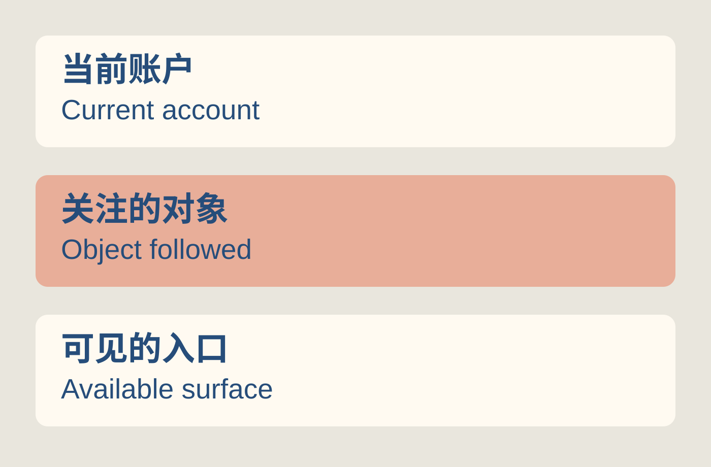

# See Who You Follow on Amazon: Check the Context

Status: local review draft; confirm the publication date before release.

When checking Amazon follows, distinguish shopping creators, brands and Amazon Music, then use verified public work for creator research rather than treating a personal following record as a complete partner list.

To see who you follow on Amazon, return to the account, marketplace and service used originally, then inspect the following controls actually offered in its current profile or account area. If a shopping account has no visible list, an Amazon Music list is not a substitute, and recommendations do not establish following. This article has not verified one fixed menu path for every shopping account; use current account help where needed. Brands can continue through a verified creator page, but a personal follow is not audience, partnership or fit evidence.

## Identify the account used for the follow

One person may use different devices, marketplaces or services. Before looking, establish that the current account is the one originally used instead of assuming a matching name or picture proves it.

Inspect your own account or one you are authorized to handle. Brand research generally does not need a colleague's private shopping history; relevant public work and links are enough for sharing a candidate lead.

Define the task: recovering one previously followed creator differs from reviewing a visible set of follows. The first can continue through a specific page; the second needs an actual list rather than search results assembled into an apparently complete set.

For project context, retain marketplace, service and observation time without credentials or unrelated purchases. This is enough for another researcher to understand scope without making the whole creator-selection process depend on one person's continuing access to a private account. It also prevents an account mismatch from being misreported as a creator disappearing or an earlier follow having been removed.

## Distinguish creators, brands and music profiles

[Amazon’s influencer-program guide](https://affiliate-program.amazon.com/help/node/topic/GTP6NKQ2GXPZL7AT/) describes creators establishing a recommendation page with a dedicated address. Such a page supports work and product recommendations and should not automatically be treated as a merchant's brand page.

[Amazon’s 2021 Brand Follow announcement](https://advertising.amazon.com/resources/whats-new/brand-follow) concerns the US feature at that time, including shopping entry points then available. It is historical context, not a guarantee that every current surface and menu is unchanged, nor current instructions for a complete creator-following list.

[Amazon Music’s profile guide](https://digprjsurvey.amazon.com/csad/help/node/T8J9ByrxyYYYFfux6S) separately describes music profiles, follows and playlists. Finding Following in that service does not answer the shopping-creator question.

Record object type before interpreting an entry. Brands, creators and music profiles can all offer useful material while answering different partnership-research questions. Treating similar follow wording as one function removes meaning from the record. A simple classification allows the next owner to understand whether the lead concerns a creator's original work, a brand destination or a separate service profile before investing further research.

## Use the available controls instead of an old screenshot

In the correct service, inspect whether the current profile or account area actually offers a following route. If available, open it and check the objects shown. If not, an older tutorial's button is not proof it must appear for you.

The public material reviewed here does not establish one complete path for every shopping account, so no fixed click sequence is invented. Account help or official support can establish what the present service offers instead of a brand researcher inferring it.

If you already have a verified creator page, inspect any currently visible status while keeping it scoped to this observation. One button does not establish every historical follow; recommendations and purchase records are different evidence.

Retain a checkable conclusion: public routes found, visible status and unresolved items. A limited true result is more useful than an apparently complete invented list. It allows the researcher to move into relevant work without delaying the whole assignment until a personal account exposes information the public documentation has not promised it will provide.

## Keep the identity of a creator you find

An entry can include display name, actual page URL, source and relevant work. Similar names alone do not identify one person, and a brand Store should not be mixed with a creator page through a matching picture.

The [Amazon creator-route guide](https://www.quickkol.com/blog/amazon-storefront-creator-brand-program-routes/#answer) distinguishes recommendation pages and partnership stages. A lookup result is a research entry point, not confirmation of fit for this brief or willingness to accept an invitation.

If a page comes from a creator-owned public channel, retain that connection. A search result or repost needs further checking; do not fill identity or business-contact gaps with guesses.

A candidate record can be short while still letting another researcher return to the same work. Discussion then concerns contribution rather than an unverifiable impression of having followed someone before. Record when the source link was checked and which work it supports. If that page changes later, the team can distinguish an outdated route from a changed assessment. Keeping a source relationship also helps when a creator uses different names across services, allowing the team to confirm the connection instead of assuming matching spelling is necessary or sufficient.

Identify what is being viewed before handing a public lead to creator research.

## A personal follow is a starting point for research

Following someone because their content is interesting does not qualify them for every brand assignment. Return to the brief and inspect relevant products, settings, explanation and on-camera contribution.

The [creator-shortlist workflow](https://www.quickkol.com/blog/creator-shortlist-workflow/#answer) turns leads into relevant candidates. Start with the page found, retaining visible work and conditions to discuss instead of personal preference becoming a partnership conclusion.

You may have followed a home creator for years while the assignment requires a clear equipment demonstration. Examine relevant work rather than omit assessment because the name feels familiar.

Following also does not establish audience geography, purchasing ability or support for the brand. Those questions need appropriate evidence and confirmation rather than your own action. The original follow can still be valuable as a memory aid, provided the next recommendation explains the actual work supporting it and makes the remaining inquiry clear to the person responsible for selecting partners.

## Record found, confirmed and pending separately

Finding a page, confirming identity, checking follow status and choosing to contact are different tasks. Record them separately so found does not imply every condition is complete.

If the page is confirmed but the following list is unavailable, retain that result instead of marking not followed or unfollowed. An unknown is not zero and a spreadsheet format should not force certainty.

Continue public-work research while necessary information is pending. Not every partnership decision requires the researcher's historical follow status; a reliable entry point may be sufficient for the actual assignment.

Give pending items a next action, such as checking a source, asking the account holder to inspect their own controls or using current service help. Failure alone does not explain what can continue. A scoped note keeps the team moving without turning an unavailable personal-account feature into a reason to invent data or abandon relevant creator work already found.

## Organize three hypothetical lookup results

Suppose a lookup finds a home-creator page, a brand Store and a follow entry in a music profile. Record them separately rather than count three influencers.

The creator page can lead to work research; the Store can supply a product and brand destination; the music entry concerns that service and remains separate from shopping research. Similar names do not independently connect identities across services.

For an organizer-explanation assignment, continue through relevant creator work rather than send invitations to every result in arbitrary order. If suitable work is absent, retain the research question.

This hypothetical contains no real account finding. It shows how a lookup becomes a useful, limited handoff with object type, relevance and unconfirmed status. A team can use the creator lead without misdescribing the other entries, and the researcher can explain why a result was retained as background rather than promoted into a confirmed candidate.

## Share public leads rather than a private history

For continued research, share the public page, relevant work, source and task. Unrelated follows, orders or account information need not travel with the lead.

If a screenshot genuinely supports status checking, retain only the relevant part and its date and scope. It is not a complete permanent proof for everyone or material that needs to become a public blog case.

Maintain a separate project list rather than depend on a colleague's private following history for ongoing work. That list records project candidates and decisions without pretending to be a complete Amazon export.

Assign the next work check or business inquiry. A follow lookup recovers a lead while the creator and brand confirm collaboration; personal history does not automatically become permission for every subsequent contact or use. This gives a project an independent, usable record and lets a researcher hand it off without continuing to expose their account for routine questions.

## Update only the conclusion affected by a change

On another visit, the page, name or entry point may differ. Establish the change before updating the corresponding record; one unavailable view does not prove retirement, a cancelled partnership or an account problem.

For recovering a particular creator, retain the confirmed public route and relevant work instead of repeatedly investigating personal follow status. A complete account query still belongs with the account holder and current service controls.

The brand-side answer to how to see who you follow on Amazon has two layers: what the account actually exposes and what a public object contributes to creator research. Keeping them separate prevents conclusions exceeding evidence.

End with an executable next step rather than an unscoped list: research relevant work, confirm an identity connection or prepare a specific inquiry. A useful closing record makes clear which of these actions is appropriate now and which remains dependent on information that has not yet been verified.

## Different followed objects answer different questions

| Object | Useful next action | Does not establish |
| --- | --- | --- |
| Creator page | Research public work and contribution | A confirmed partnership |
| Brand Store | Inspect product and brand destination | A personal follow of a creator |
| Music profile | Interpret follows in that service | Shopping-creator following list |
| Unavailable control | Retain uncertainty and check current help | A true zero or an unfollow |

Research framework; no claim that all shopping accounts offer the same complete list or menus.

## Before handing off lookup results

Keep the right object and scope with each record.

- [ ] Confirm account, marketplace and service.
- [ ] Separate creators, brands and music profiles.
- [ ] Record only the currently visible status.
- [ ] Retain public sources and relevant work.
- [ ] Separate personal records and project lists.
- [ ] Identify unknowns and the next research action.

## Research date and limitations

Sources reviewed November 18, 2026. Methods, tables and decision rules are editorial recommendations. Hypothetical examples are not actual client results or industry benchmarks. Source geography and periods are specified where relevant.

## Start creator research with a clear task

Use QuickKOL to interpret a brief, discover relevant creators and research their work and contact routes. Verify data, commercial terms and outcomes at their source.

[Explore QuickKOL](https://www.quickkol.com/#capabilities)

## Sources

- [Amazon’s influencer-program guide](https://affiliate-program.amazon.com/help/node/topic/GTP6NKQ2GXPZL7AT/)
- [Amazon’s 2021 Brand Follow announcement](https://advertising.amazon.com/resources/whats-new/brand-follow)
- [Amazon Music’s profile guide](https://digprjsurvey.amazon.com/csad/help/node/T8J9ByrxyYYYFfux6S)
