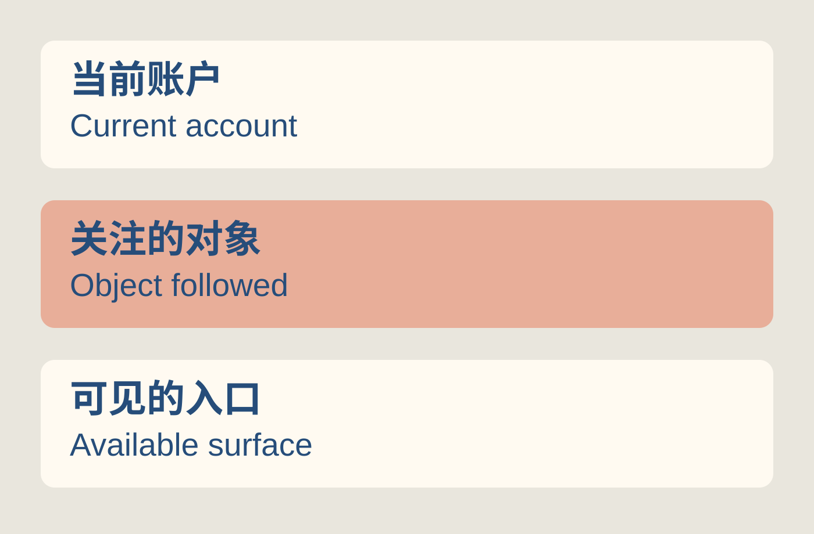

# Amazon 关注查询：确认对象

状态：本地审阅稿；正式发布日期待确认。

查找 Amazon 已关注对象时，先区分购物创作者、品牌与 Amazon Music，再把实际找到的公开作品用于达人研究，不把私人关注记录当成完整合作名单。

要查看自己在 Amazon 关注谁，先回到当时使用的账户、站点与服务，再查看当前个人资料或账户中实际提供的关注入口。如果购物账户没有显示列表，不能用 Amazon Music 的关注名单代替，也不能从推荐商品推断关注。本文没有核验一个适用于所有购物账户的固定菜单路径；需要时使用当前账户内帮助确认。品牌研究可以从找到的创作者主页继续，但个人关注状态不是受众、合作关系或适合性的证明。

## 先确认关注发生在哪个账户

同一个人可能在不同设备、站点或服务中查看 Amazon。查询前先确认当前登录的是当时使用的账户，而不是因为名字或头像相似就默认一致。

只查看自己或已经获准处理的账户。品牌研究通常不需要同事交出私人购物记录；如果需要分享候选线索，提供相关公开作品和链接即可。

把任务写清：你是在找回一位曾关注的创作者，还是想整理自己可见的一组关注对象？前者可以从具体主页继续，后者需要实际可见的列表，不能靠搜索结果补成全部。

记录账户背景时，只需项目相关的站点、服务与观察时间，不保留登录凭据或无关购买内容。这样的记录足以帮助团队理解查询范围，也不会让后续达人研究依赖某个人持续打开私人账号。

## 区分创作者、品牌和音乐资料

[Amazon 的创作者项目说明](https://affiliate-program.amazon.com/help/node/topic/GTP6NKQ2GXPZL7AT/)介绍创作者可以建立带专用地址的推荐页面。这种页面服务作品和商品推荐，不应与商家品牌页面自动视为同一对象。

[Amazon 的 2021 年品牌关注公告](https://advertising.amazon.com/resources/whats-new/brand-follow)讲的是当年美国 Brand Follow，包括当时不同购物入口。这是历史背景，不是今天所有入口和菜单都保持相同的保证，也不提供创作者完整关注列表的当前步骤。

[Amazon Music 的个人资料说明](https://digprjsurvey.amazon.com/csad/help/node/T8J9ByrxyYYYFfux6S)则明确讨论音乐服务的个人资料、关注和播放列表。即使在音乐资料找到 Following，也不能由此回答购物创作者关注情况。

因此，每条结果先记录对象类型。品牌、创作者和音乐个人资料可以都有有价值内容，但对达人合作研究提出的问题不同。把相似的关注字样当成同一功能，容易让后续记录失去实际含义。

## 按当前实际入口查看，不套旧截图

回到正确服务后，查看当前个人资料或账户区域是否实际提供关注入口。若有，打开它并核对显示对象；若没有，不把一篇旧教程中的按钮当成自己一定也应该看到的功能。

本次公开资料没有建立一个适用于所有购物账户的完整统一路径，因此这里不编写固定点击顺序。账户内帮助或官方支持可以确认当前服务实际提供什么，而不是由品牌研究者推断。

如果你已经有某位创作者的真实主页，可以查看当前页面可见的状态，但状态仍只属于这次查看。不要从一个按钮截图推导全部历史关注，也不把页面推荐或购买记录当成同一证据。

查询结束留下能复核的结论：找到了哪些公开入口，什么状态可见，哪些无法确认。一个有限但真实的结果，比强行拼出一份表面完整的名单更便于继续工作。

## 为找到的创作者保留正确身份

一条记录可以包括显示名称、实际主页地址、来源和相关作品。名称相似不能单独确认同一个人，品牌 Store 与创作者页面也不能只凭头像混在一起。

[Amazon 创作者路径指南](https://www.quickkol.com/zh/blog/amazon-storefront-creator-brand-program-routes/#answer)帮助区分推荐页面和品牌合作环节。这里的查询结果只是一个研究入口，不说明该人已适合本次 Brief 或愿意接受邀请。

如果主页地址来自创作者自己公开的渠道，保留这个来源关系。若只是一个搜索结果或二次转发，继续核验，不替未知部分写入真实身份或商业联系。

候选记录可以很简短，但应让另一位研究者回到同一作品。同时记录来源核验日期，以及该链接支持的具体作品。页面以后变化时，团队可以区分入口过期与作品判断变化。这样后续讨论围绕实际贡献，而不是围绕“我以前好像关注过”这一句无法核对的印象。

先知道正在查看什么，再把公开线索交给达人研究。

## 个人关注只是研究起点

你可能因为某个内容有趣而关注，不代表创作者适合任何品牌任务。回到具体 Brief，检查作品是否涉及需要的产品、场景、解释方式或出镜贡献。

[达人名单工作流](https://www.quickkol.com/zh/blog/creator-shortlist-workflow/#answer)帮助把线索变成相关候选。这里可以从已找到的主页开始，记录实际能看到的作品与仍需讨论的条件，不把个人喜好当成合作结论。

例如你长期关注一个家居创作者，但本次任务需要清楚演示器具操作。需要研究其是否有相关作品，而不是因为已经熟悉这个名字就省略判断。

关注状态也不说明创作者受众的地区、购买能力或对品牌的支持。那些问题需要合适资料和实际确认，不能由自己的一个关注动作代替。

## 分别记录找到、确认和待处理

找到主页、确认身份、核对关注与决定接洽，是不同工作。可以分别标注，避免一个“已找到”让团队以为全部条件都完成。

若只确认主页存在，但无法查看关注列表，就保留这个具体结果，不写成未关注或已经取消。未知不是零，也不应由后续表格格式强迫改成明确答案。

团队可以先继续研究公开作品，等待必要信息再做后续决定。并不是所有合作筛选都必须知道研究者本人的历史关注状态，实际任务可能只需要一个可靠入口。

给每个待处理事项安排下一步，例如核对来源、请账户持有人自行查看，或向当前服务帮助确认。避免只写失败，却没有说明哪一项还可以继续。

## 用三个不同结果整理一次查询

假设一次查询找到一个家居创作者页面、一家品牌 Store，以及一个音乐资料中的关注条目。三者分别记录，不合计为三位达人。

家居创作者可以继续看作品；品牌 Store 可以作为商品与品牌入口；音乐资料只说明该服务里的对象，需要与购物研究分开。即使名字相似，也不能直接跨服务连接身份。

如果本次需要达人解释收纳方法，研究者选择相关创作者作品继续，而不是从全部结果里按任意顺序发邀请。没有合适作品，就保留待研究。

这个假设没有真实账户结果。它展示一次查询怎样形成有用而有限的交接，让下一位负责人知道每条记录是什么、为什么相关，以及哪些状态尚未确认。

## 共享公开线索，不共享整份私人历史

当团队需要继续研究时，交付公开主页、相关作品、来源与任务即可。没有必要把个人账户截图中的其他关注、订单或资料一并传播。

如果一次截图确实用于核对状态，只保留与任务有关的部分，说明时间与范围。它不是对所有人长期有效的完整证明，也不需要成为公开博客案例。

研究负责人可以建立独立项目清单，不依赖某个同事的私人关注列表持续维护。这个清单记录本项目的候选和判断，不冒充 Amazon 导出的全部关注。

交接说明谁负责下一次作品核验或商务询问。关注查询帮助找回线索，实际合作仍由有关创作者与品牌共同确认，不能从私人历史自动转成已经授权接洽。

## 后续变化只更新对应结论

以后再次查看时，页面、名称或入口可能不同。先确认实际变化，再更新对应记录，不因为一次看不到就推断创作者退出、取消合作或发生账号问题。

如果只是为了找回某位创作者，保留已确认公开入口与项目相关作品，通常比反复追查个人关注状态更有用。需要完整账户查询时，仍由实际账户持有人按当前服务确认。

How to see who you follow on Amazon 的品牌侧答案，应保持两个层次：账户里实际能查看什么，以及找到的公开对象能为达人研究提供什么。清楚区分，结果才不会越过证据。

最终给出能执行的下一步，而不是一份没有范围的名单：继续研究相关作品、确认身份关系，或完成具体邀请。

## 不同关注对象支持不同问题

| 对象 | 可以继续做什么 | 不能直接说明 |
| --- | --- | --- |
| 创作者页面 | 研究公开作品与相关贡献 | 合作已确认 |
| 品牌 Store | 查看商品与品牌入口 | 某位达人的个人关注 |
| 音乐资料 | 在对应服务理解关注 | 购物创作者关注名单 |
| 入口不可见 | 保留未知并核对当前帮助 | 真实零或取消关注 |

研究框架；没有宣称所有购物账户都提供同一完整列表或菜单。

## 把查询结果交接之前

让每条记录保留正确对象和范围。

- [ ] 确认实际账户、站点与服务。
- [ ] 区分创作者、品牌和音乐资料。
- [ ] 只记录当前实际可见状态。
- [ ] 保存公开来源与相关作品。
- [ ] 把个人记录与项目清单分开。
- [ ] 明确未知与下一项研究。

## 研究日期与使用边界

资料核验于 2026 年 11 月 18 日。文中方法、表格和决策规则为编辑建议，标为假设的示例不是实际客户结果或行业基准。外部资料的适用地区与时期按各段说明。

## 从任务开始达人研究

用 QuickKOL 理解 Brief、发现相关达人并研究作品与联系路径；数据、合作条件和结果仍需核验。

[了解 QuickKOL](https://www.quickkol.com/#capabilities)

## 来源

- [Amazon 的创作者项目说明](https://affiliate-program.amazon.com/help/node/topic/GTP6NKQ2GXPZL7AT/)
- [Amazon 的 2021 年品牌关注公告](https://advertising.amazon.com/resources/whats-new/brand-follow)
- [Amazon Music 的个人资料说明](https://digprjsurvey.amazon.com/csad/help/node/T8J9ByrxyYYYFfux6S)
