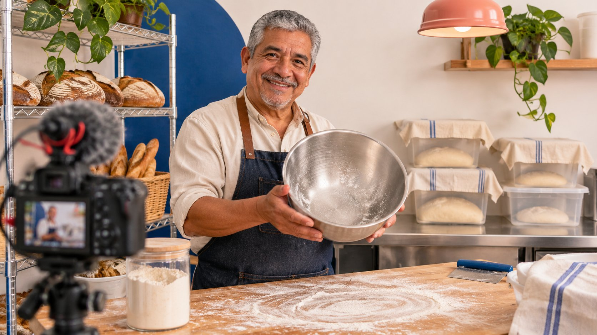
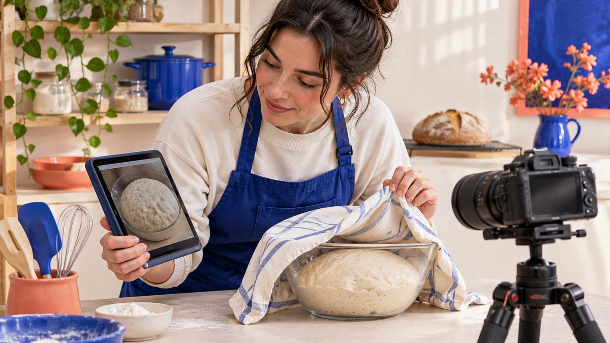

# Bread Baker: Creator Production

Status: local review draft; confirm the publication date before release.

A bread-creator partnership needs a visible process: identify continuous actions, explain waiting stages and define the product role in the actual production.

For a bread baker partnership, define the process viewers need to understand and the product role before selecting a creator, supplying inputs and planning shots. Bread content involves stages, so edited running time does not measure preparation, waiting or filming work. Record product version, relevant states and continuity so editing clarifies what happened without changing it. This article concerns brand-content production with bread creators, not recipes, food-safety guidance, universal fermentation timings or proof of general product performance.

## Choose a creator for the process to explain

A brand may need to show how equipment fits an actual process or explain a relationship between an action and an observation. Define that task before examining work rather than simply find someone who appears able to bake.

[The Perfect Loaf’s official introduction](https://www.theperfectloaf.com/about/) provides a named research lead: Maurizio Leo has developed a content project around bread and related teaching. Continue to relevant public work without assuming agreement, audience percentages or suitability for every product.

The [famous-baker research guide](https://www.quickkol.com/blog/famous-bakers-creator-demonstration-shortlist/#answer) covers different expression roles. This article focuses on process filming and how a creator makes stages understandable, not a popularity order built from follower totals.

A candidate record should identify the work supporting the next inquiry. Where a capability has not appeared, leave it open for confirmation. The creator can then explain preparation and limitations instead of the brand promising immediate production on their behalf. This makes selection relevant to the actual content problem and keeps a familiar name from replacing the practical question of what needs to be shown.

## Translate the objective into a visible action

Quality is not a shot instruction. Specify what viewers need to see: how equipment is used, which detail needs a close view and which conditions make the image understandable.

List the action separately from the product claim. A shot can show one use without proving performance across every recipe, superiority to every competitor or long-term durability. The brand supplies support for its claims while the creator presents observations accurately.

Invite a better expression from the creator. If the original idea cannot be achieved in the actual process, change the task instead of using editing to manufacture a continuous event that never happened.

The brief should produce an assessable explanation, not only mood adjectives. Identify essential information and areas for creative freedom so photography and editing know which choices can change and which conditions remain. A useful proposed shot can then be accepted for the understanding it provides, rather than because it resembles an attractive reference while failing to show the product's actual role.

## Preparation is more than a sample-delivery record

Check equipment version, accessories, setting, necessary ingredients and brand information. Define who supplies each input, readiness and the contact for issues before filming rather than assign every last-minute arrangement to the creator by default.

Receipt does not establish familiarity. Allow appropriate experience and preparation instead of assuming a short finished video takes only the same time to produce.

If the product changes, tell the producer and editor which details differ. Older footage may remain usable as background or become unsuitable for the central demonstration. File availability is not a reason to combine it without review.

A readiness note can identify missing information and its confirmer. Discovering absent facts only during editing can require another discussion of expression; identifying the dependency earlier is more useful than asking the creator to guess. The brand then has a concrete action it can complete before the production date, rather than treating the creator's filming capacity as the only factor controlling delivery.

## Record waiting stages instead of hiding them

A bread process can cross several states. Ask the creator which actions need live capture and which transitions can use state photographs or accurate explanation, without supplying one duration for all production.

When footage jumps between states, viewers should understand that time passed rather than that a product instantly completed the whole process. Pace should not erase waiting and attribute the resulting change to equipment.

Record container, batch, observation time and visible state as needed for this content, without exposing unrelated working information. The record supports editing rather than becoming a recipe or universal operating standard.

Account for real limits on repeating a shot. Once the process continues, the prior state may not be immediately available. Identify essential camera positions before discovering that the central action is missing at the end. This makes preparation a production decision with a reason, rather than asking the creator to repeat an entire process merely because an optional detail was requested after the available moment had passed.

## Check continuity against the actual process

Containers, dough, equipment and setting can help distinguish stages. Editors need to know what belongs to one process and what is a supplementary demonstration, rather than assemble one action because colors happen to match.

The photograph shows a creator comparing a reference image with the current state. Retain concise batch and material records so every team member need not ask the creator to reconstruct the details.

If another batch supplies an insert, identify its role. A shot showing equipment appearance differs from one implying a process result; a supplementary image should not accidentally become the central proof.

Review complete actions and transitions before music and pacing. This resolves meaning before a polished edit creates a misleading sequence. A practical review can mark a transition needing explanation, giving the editor a focused correction instead of requiring every cut to be reversed or the creator to defend the whole shoot from memory.

Keep states and corresponding material together so editing preserves the actual process.

## Keep actual experience and conditions in the explanation

[FTC’s influencer disclosure guide](https://www.ftc.gov/business-guidance/resources/disclosures-101-social-media-influencers) explains actual experience and commercial connections in applicable US contexts. Creators should not describe product results they have not experienced, and brands should not expand one observation into a general promise.

Explain what was used, what was observed and the conditions needed to understand it. Without support, this result should not become an outcome everyone can obtain.

The brand supplies factual material while the creator confirms expression. These reviews complement each other; one approval does not complete every task. Check commercial context with the actual version rather than leave it only in the brief.

If a conclusion needs more experience, complete an accurate process explanation and retain the other question for research. Advertising confidence does not justify removing an important condition. This lets the brand commission a useful demonstration without asking the creator to become the sole source of evidence for a broader performance statement that the footage and experience cannot independently establish.

## Distinguish wording edits from repeating the process

An unclear term may need a verbal clarification, while a missing central action may require filming again. Identify the file and moment, then explain the intended understanding instead of calling every comment a small edit.

Repeating process content can involve preparation, waiting and restoring the setting. Agree on work, timing and related fees rather than estimate cost only from extra seconds in the final video.

With limited resources, prioritize necessary factual correction and the most useful addition together. Limitations do not justify an invented action or leave the creator guessing which comment is a release condition.

Retain the target version and status for each revision. Earlier approval does not cover a continuously changing file. The publisher needs the accepted version rather than a conversation full of files called final. A defined request also gives the creator room to suggest a practical alternative that explains the issue without unnecessarily repeating the entire production process.

## Separate tutorial references from reuse of the work

The [U.S. Copyright Office’s copyright overview](https://www.copyright.gov/what-is-copyright/) describes protection for original video, photographs and written expression. Studying a public tutorial's explanation does not permit direct commercial use of its images or footage.

The [creator-material permission guide](https://www.quickkol.com/blog/what-is-whitelisting-creator-ad-permissions/#answer) separates production, creator publication and later advertising. Define files, languages, editing and display rather than infer unlimited uses from one shoot.

For a short edit of longer content, check permission and whether the expression remains accurate. Removing waiting context, conditions or commercial information can change the original work instead of being a purely technical export.

Match delivered material to actual use. Reporting a link need not require all raw footage; discuss appropriate access when later editing is genuinely needed. This prevents every file in a shared folder becoming apparently cleared material and gives the creator a concrete request to assess if the brand later wants another format or channel beyond the original assignment.

## Handoff a hypothetical mixing-bowl assignment

Suppose a brand wants a creator to explain a mixing bowl's role in one production. Confirm the actual product, visible action, stage records and shoot arrangements without promising a better bread result in advance.

The creator records relevant states, photography makes the action clear and editing preserves the passage of time. The brand reviews facts, the creator reviews experience and expression, and the publisher uses the accepted version and accurate destination.

Acceptance can establish a clear process, retained conditions and matching files. Performance needs separate observations; production completion does not establish audience growth or increased sales.

This hypothetical is not a client result. It makes bread baker a defined influencer-marketing assignment: relevant work supports selection, real inputs enable production, a clear handoff supports publication and improvement returns to the question still needing explanation. The final record should identify the task completed and the next owner, leaving future decisions based on what happened rather than a polished video being treated as proof of every hoped-for outcome.

## Four records for process content

| Record | Purpose | Do not infer |
| --- | --- | --- |
| Product version | Identify the actual item shown | Identical performance across versions |
| Stage and state | Explain progression | One universal duration |
| Batch and shot | Check continuity and inserts | Similar images proving one process |
| Accepted version | Enable accurate publication handoff | Business success from completed production |

Editorial production framework, not a recipe, food-safety or performance-testing standard.

## Before filming bread-creator content

Prepare the actual process before expression.

- [ ] Define the action viewers need to see.
- [ ] Discuss contribution through relevant work.
- [ ] Check product, accessories and information.
- [ ] Plan waiting-stage and state records.
- [ ] Preserve continuity and experience.
- [ ] Confirm revisions, use and handoff owner.

## Research date and limitations

Sources reviewed November 18, 2026. Methods, tables and decision rules are editorial recommendations. Hypothetical examples are not actual client results or industry benchmarks. Source geography and periods are specified where relevant.

## Start creator research with a clear task

Use QuickKOL to interpret a brief, discover relevant creators and research their work and contact routes. Verify data, commercial terms and outcomes at their source.

[Explore QuickKOL](https://www.quickkol.com/#capabilities)

## Sources

- [The Perfect Loaf’s official introduction](https://www.theperfectloaf.com/about/)
- [FTC’s influencer disclosure guide](https://www.ftc.gov/business-guidance/resources/disclosures-101-social-media-influencers)
- [U.S. Copyright Office’s copyright overview](https://www.copyright.gov/what-is-copyright/)
