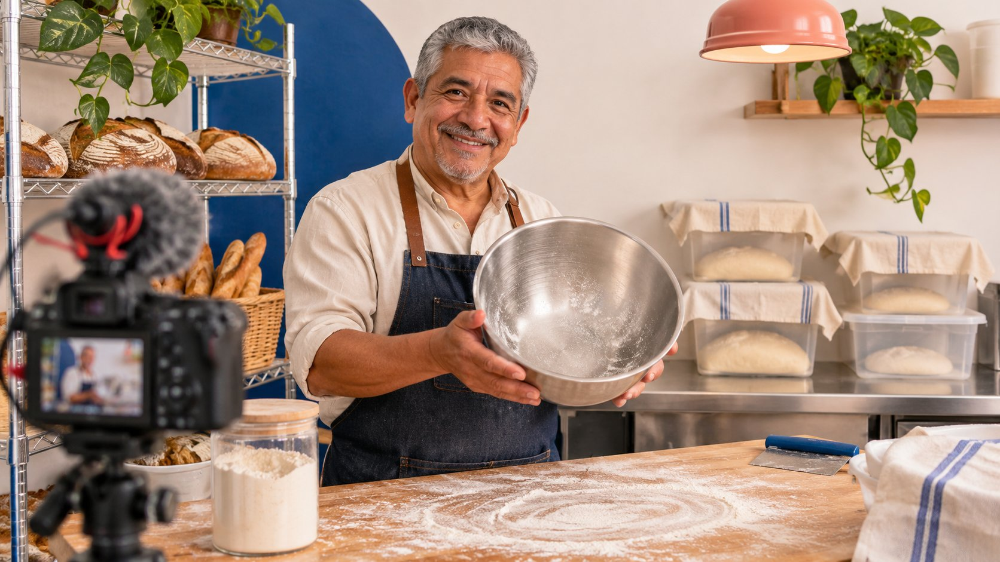
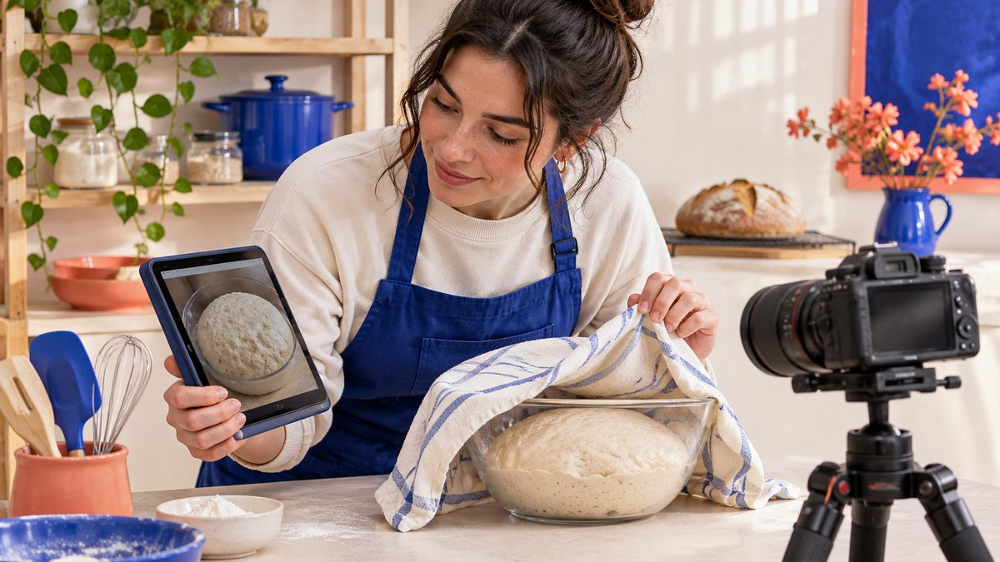

# 面包创作者合作怎样拍清制作过程

状态：本地审阅稿；正式发布日期待确认。

面包创作者合作要先规划能看见的过程：哪些动作需要连续记录，哪些等待阶段需要说明，以及产品在真实制作中承担什么角色。

品牌与 bread baker 合作，先定义需要观众理解的过程和产品角色，再安排相关创作者、真实输入与镜头。面包制作涉及多个阶段，短视频的时长不能代替实际准备、等待和拍摄工作量。记录产品版本、关键状态与连续性，让剪辑清楚但不改变实际发生的事情。本文讨论面包创作者的品牌内容制作，不提供配方、食品安全或统一发酵时间建议，也不把某项演示当成普遍性能证明。

## 从需要解释的过程选择创作者

品牌可能需要展示器具怎样进入实际制作，也可能需要解释一个动作与观察的关系。先明确任务，再研究创作者的相关作品，不只寻找一位看起来会做面包的人。

[The Perfect Loaf 的官方介绍](https://www.theperfectloaf.com/about/)提供一个具名研究入口：Maurizio Leo 以面包与相关教学作品建立内容项目。品牌可以继续查看适合本次问题的公开作品，但这不说明他已经接受合作、拥有某种受众比例或适用于所有产品。

[知名烘焙创作者研究指南](https://www.quickkol.com/zh/blog/famous-bakers-creator-demonstration-shortlist/#answer)讨论多种表达角色。本篇聚焦过程拍摄，重点是创作者怎样把多个阶段讲清，而不是按粉丝总数排列知名度。

候选记录应能说明哪项作品支持下一次询问。若需要的能力没有在作品中出现，就保留待确认，给创作者机会解释实际准备与限制，不替对方承诺可以即时完成。

## 把品牌目标改写为可见动作

不要只写“展示品质”。说明观众需要看见什么，例如器具怎样被使用、哪个细节需要近景，以及哪些条件影响对画面的理解。

实际动作与产品主张分开列。镜头能展示一次使用，不自动证明对全部配方都有效、优于所有竞品或长期耐用。品牌要提供能够支持其主张的资料，创作者负责真实呈现自己的观察。

可以让创作者提出更好的表达方法。若原想法无法在真实制作中完成，先调整任务，不要求通过剪辑制造没有发生的连续过程。

Brief 的结果应是一项能审阅的解释，而不是只有情绪形容词。明确必须保留的产品信息与允许自由表达的部分，摄影和剪辑才知道哪些选择能改变，哪些条件需要保留。

## 制作准备不只是一份寄样记录

核对器具版本、配件、场景、必要原料与品牌资料。由谁提供、何时可用和出现问题找谁，应在拍摄前说明，不把所有临时安排默认为创作者负责。

实际产品到件不等于创作者已经熟悉。需要体验和准备时给出合适空间，不能按成片只有几十秒就推断整个工作只占同样时间。

如果产品换版，告诉制作人与编辑哪些细节不同。旧素材可能仍适合背景，也可能不再适合关键演示，不能只因为文件可以打开就继续混用。

准备记录还可以说明哪些资料暂缺，谁负责确认。等到剪辑才发现缺少必要事实，往往需要重新讨论表达；早些说明依赖，比让创作者用猜测补齐更有效。

## 等待阶段需要记录而非隐藏

面包过程可能跨越多个状态。拍摄计划应由创作者按实际工作说明哪些动作需要现场记录，哪些阶段可以用状态照片或准确说明连接，不提供一个适用于所有制作的固定时间。

如果画面从一个状态跳到另一个，观众仍应理解这是时间推进，不是产品即时完成全部过程。不能为了节奏把等待删成不存在，再把变化归因于器具。

可以记录容器、批次、时间点和可见状态，信息只服务本次内容，不公开无关工作资料。记录用于编辑核对，不应被误作一套食谱或统一操作规范。

计划也要留出重新拍摄某个镜头的现实限制。过程已经继续后，未必能立即回到刚才状态；需要提前判断关键机位，而不是等到最后才发现缺少主动作。

## 连续性先看实际发生的过程

画面里的容器、面团、器具与背景可能帮助识别不同阶段。编辑需要知道哪些属于同一次过程，哪些是补充演示，不能只按颜色相似就接成同一动作。

正文配图展示创作者对照参考影像检查当前状态。正式工作可以保留简短批次记录与对应素材，不必让每个人都重新询问创作者全部细节。

如果为了补拍而使用另一批材料，说明它承担什么作用。一个仅展示器具外观的镜头，和一个暗示过程结果的镜头，所需核对不同；不要让补充画面意外成为关键证明。

审阅可以先看完整动作和转场，再讨论音乐与节奏。这样能先解决意义是否正确，而不是在漂亮剪辑完成后才发现观众会误解发生顺序。

把状态与对应素材记录在一起，帮助编辑保留真实过程。

## 讲解保留真实体验与条件

[FTC 的达人披露指南](https://www.ftc.gov/business-guidance/resources/disclosures-101-social-media-influencers)在适用美国语境下说明真实体验与商业关系的重要性。创作者不能谈论未体验的产品结果，品牌也不应要求将一次观察扩大为普遍承诺。

讲解可以说明本次使用了什么、观察到什么以及哪些条件影响理解。没有可靠依据时，不把“这次表现如何”改成“任何人都能得到同样结果”。

品牌提供事实资料，创作者确认自己的表达。两项审阅互相补充，不由一方批准就推断全部任务已完成。商业关系说明也随实际版本检查，而不是只存在于 Brief 中。

如果结论仍需更多经验，可以先完成准确的过程说明，把其他问题保留待研究。没有必要为了让广告显得肯定，就要求创作者删掉会影响理解的重要条件。

## 修订时区分文字与过程重做

某个术语不清楚可能只需补充解释，缺少关键动作可能需要重新拍摄。把问题对应到具体文件与位置，再说明希望观众理解什么，不要把全部意见都叫小改。

过程型内容的重拍可能涉及重新准备、等待和场景恢复。实际工作范围、时间与相关费用由双方确认，不按最终增加几秒画面就推断成本。

如果预算或时间有限，可以共同选择必要事实更正与最重要补充。不能用资源有限要求虚构动作，也不要让创作者猜哪一项意见是真正发布条件。

每轮修订保留目标版本与确认状态。旧批准不自动适用于继续变化的内容，发布人需要知道最终选用哪一个，而不是从聊天顺序寻找叫 final 的文件。

## 教程参考与作品复用分别安排

[美国版权局的版权说明](https://www.copyright.gov/what-is-copyright/)介绍原创视频、照片与文字表达等作品的保护。查看一份公开教程研究讲解方法，不意味着品牌可以把其中镜头或图片直接用作商业素材。

[达人素材许可指南](https://www.quickkol.com/zh/blog/what-is-whitelisting-creator-ad-permissions/#answer)帮助区分内容制作、本人发布与后续广告使用。明确本次需要的文件、语言、编辑与显示范围，不从一个拍摄任务推断无限用途。

若品牌希望把较长内容剪成短片，需要检查实际许可与表达是否仍准确。删掉等待说明、关键条件或商业背景，可能改变原本内容，不是简单技术导出。

交付时让素材与实际用途对应。报告作品链接不一定需要所有原始素材；需要后续编辑时，再讨论合适范围和接手方式，避免文件夹中的所有内容都被视为已确认可用。

## 用一项搅拌盆合作交接制作

假设品牌希望创作者说明搅拌盆在某次制作中的角色。双方先核对实际产品、需要看清的动作、阶段记录与拍摄安排，不预先承诺更好的面包结果。

创作者记录关键状态，摄影师拍清动作，编辑保留时间推进语境。品牌审阅事实，创作者审阅体验与表达，发布人使用确认版本和准确入口。

验收可以说明过程是否清楚、条件是否保留和文件是否对应。表现需要另有观察，不能由制作完成直接补出受众增长或销售提升。

这个假设不是客户成绩。Bread baker 主题由此成为具体达人营销任务：相关作品支持选择，真实输入支持制作，清楚交接支持发布，下一次改进则回到实际仍需解释的问题。

## 过程内容的四项制作记录

| 记录 | 作用 | 不应推断 |
| --- | --- | --- |
| 产品版本 | 确认画面使用的实际物品 | 所有版本性能相同 |
| 阶段与状态 | 说明过程怎样推进 | 固定通用制作时间 |
| 批次与镜头 | 核对连续性与补拍 | 相似画面就是同一次过程 |
| 确认版本 | 让发布人准确接手 | 制作完成即业务成功 |

编辑制作框架，不是面包配方、食品安全或性能测试标准。

## 开拍面包达人内容前

先准备真实过程，再安排表达。

- [ ] 明确观众需要看清的动作。
- [ ] 按相关作品讨论创作者贡献。
- [ ] 核对产品、配件与资料。
- [ ] 安排等待阶段与状态记录。
- [ ] 保留连续性与真实体验。
- [ ] 确认修订、用途与接手人。

## 研究日期与使用边界

资料核验于 2026 年 11 月 18 日。文中方法、表格和决策规则为编辑建议，标为假设的示例不是实际客户结果或行业基准。外部资料的适用地区与时期按各段说明。

## 从任务开始达人研究

用 QuickKOL 理解 Brief、发现相关达人并研究作品与联系路径；数据、合作条件和结果仍需核验。

[了解 QuickKOL](https://www.quickkol.com/#capabilities)

## 来源

- [The Perfect Loaf 的官方介绍](https://www.theperfectloaf.com/about/)
- [FTC 的达人披露指南](https://www.ftc.gov/business-guidance/resources/disclosures-101-social-media-influencers)
- [美国版权局的版权说明](https://www.copyright.gov/what-is-copyright/)
