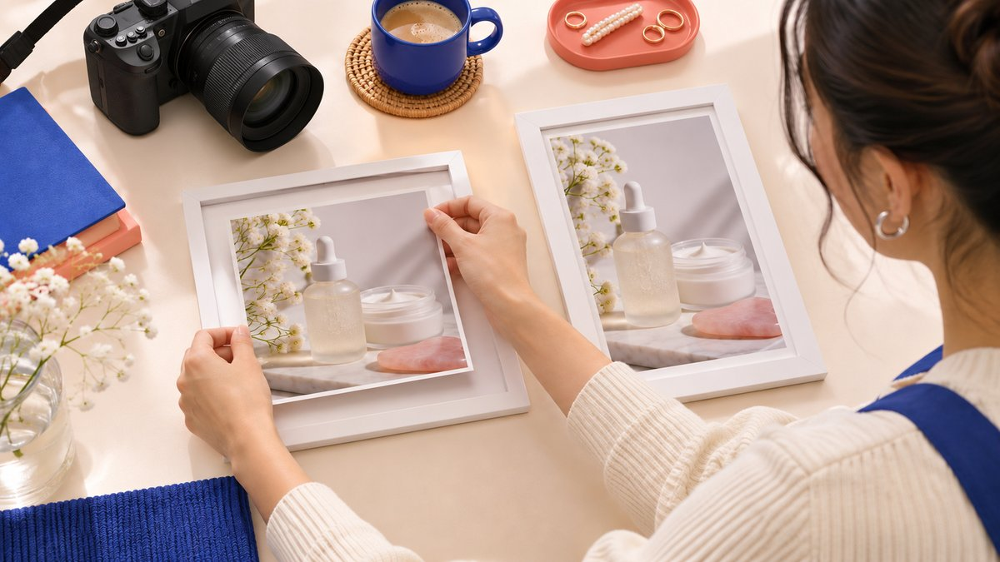

# Canva 帖子模板怎样接收达人素材

状态：本地审阅稿；正式发布日期待确认。

给 Instagram 帖子模板定义清楚的照片、标题与说明位置，让品牌复用版式时仍然保留创作者的真实作品和适用条件。

达人合作使用 Canva Instagram post templates 时，先确定这条帖子需要解释什么，再选择能容纳实际照片与文字的版式。明确主图、标题、创作者说明和必要条件分别放在哪里，不必把全部信息都塞进图片。模板可以复用构图，不能复用他人的体验或自动提供素材授权。替换真实作品后检查裁切、文字可读性、型号与来源，再交付明确版本；具体 Canva 素材和客户设计用途按当前许可确认。

## 从实际信息选择模板

先列出读者需要理解的内容，再看模板。是一张创作者使用照片配一句解释，还是需要对比两个不同条件？版式应当容纳这个任务，而不是先决定漂亮布局再删掉重要信息。

同一个模板可能适合新品介绍，却不适合过程说明。若关键动作需要完整画面，就不要让装饰边框或大标题占去它必须使用的位置。

[Canva 达人素材包文章](https://www.quickkol.com/zh/blog/canva-instagram-templates-creator-kit-rights/#answer)帮助理解整组资产的合作安排。本篇集中在一条帖子内部：每个位置放什么，为什么放，以及替换素材后需要重新检查什么。

可以先用真实内容做一个样本，而不是一直用演示文字判断。模板演示里的短标题和理想照片，不一定符合这位创作者的实际作品。

## 把版式位置与内容责任连起来

主图来自哪位创作者、标题由谁写、产品事实由谁确认，需要能在工作记录里找到。不要让模板中的每个位置都被当成编辑可以随意填入的空格。

例如创作者照片提供实际场景，标题概括问题，文案说明条件。创作者可以确认自己的体验，品牌核对型号与规格，设计者负责信息如何呈现。

这些信息不一定全部放进图片。公开文案和图片可以共同完成说明，但要避免某项重要条件只留在内部文件里，读者实际看不到。

把内容责任与视觉位置连接起来，可以减少后续误会。一句个人引语不能因为版式位置需要更短，就由设计者改成更强的产品结论。

## 照片裁切要保留作品中的关键关系

把照片放进模板后，先看产品、手部动作与场景是否仍然有意义。一个原图能解释使用方式，裁掉关键部件以后可能只剩装饰。

可以准备不同构图方案，而不是把每张照片都挤进同样形状。若需要新的角度，说明为什么现有画面不够，再与创作者讨论补充范围。

[Adobe 的产品摄影指南](https://www.adobe.com/creativecloud/photography/type/product-photography.html)讨论角度、产品细节与拍摄准备。对于模板工作，实际启发是先知道必须看见什么，再决定图片位置，不从布局反推可以删除哪些真实信息。

照片裁切也不应暗示另一种体验。只展示结果却省略必要条件时，检查文案是否仍清楚说明，避免图形完整却让人误解作品。

替换真实照片以后重新检查裁切，不让模板位置删除必要信息。

## 引语与标题不能由占位文字变成事实

模板中的“最喜欢”“立即见效”或其他演示用语，不是这位创作者的实际结论。替换素材时也要替换全部占位文字，不因句子符合版式就保留。

如果使用个人引语，请本人确认原意与适用条件。压缩文字可以讨论，但不应删除让句子成立的关键背景，或把一次体验写成永远适用的承诺。

品牌标题可以概括作品的问题与内容，避免包装成实际没有完成的评测。例如一张携带照片不能自动说明已经比较所有竞品或验证全部性能。

审稿可以逐项检查：谁说的，依据是什么，读者会怎样理解。对不确定内容，先确认再制作最终版，比通过设计让它看起来可信更重要。

## 按真实尺寸检查文字可读性

图片中的文字不要只在放大的编辑画布上检查。用实际手机展示尺寸看标题、条件和引语是否清楚，确认背景没有干扰阅读。

[W3C 的文字对比度说明](https://www.w3.org/WAI/WCAG22/Understanding/contrast-minimum.html)强调文字与背景之间有足够对比。这里将网页可访问性原则作为编辑参考，不把一个模板宣称为经过 Instagram 官方认证。

如果文字放不下，先判断哪些应放到公开文案，而不是持续缩小字号。也可以调整版式或改用多张内容，但不要让必要条件变成几乎看不清的装饰。

保留不同背景可用的文字方案。多人达人合作不需要所有图片一模一样，但需要读者都能理解这条作品实际说什么。

## Canva 素材与创作者原作分别核对

[Canva 的素材授权说明](https://www.canva.com/licensing-explained/)区分不同内容与用途，并说明不能把素材库内容当成可独立再分发的自有资产。使用模板，不代表里面全部元素都没有限制。

列出实际使用的照片、图形、字体和其他内容，再按来源确认。创作者自己提供的照片，不因为被上传到 Canva，就自动受同一份素材库许可覆盖。

模板演示中有图片，不代表品牌必须保留。用自己的实际作品替换时，继续确认授权渠道、期限与修改范围，尤其是计划用于品牌广告的版本。

不要把“可以导出”与“可以用于本次用途”混成同一结论。制作完成之前核对实际内容，比交付后才发现素材条件不适合更容易处理。

## 区分成品与可编辑模板交付

合作需要的是导出的图片、可编辑设计，还是可继续给其他人复用的模板，要提前说明。它们涉及不同工作，也可能需要不同许可核对。

[Canva 的内容许可协议](https://www.canva.com/policies/content-license-agreement/)中，客户设计转交有具体条件。不能把一份客户成品可以交付，理解为所有素材都能拆出来转给任意其他项目使用。

如果品牌需要长期复用，请设计者说明可更换的部分、素材来源与需要重新检查的条件。不要只交一个链接，让下一位负责人猜测哪些内容可动、哪些属于创作者。

[美国版权局的版权说明](https://www.copyright.gov/what-is-copyright/)也帮助区分作品可见与获得使用权。设计文件的访问方式不应代替双方对修改、转载和使用范围的明确约定。

## 用一次产品照片替换检查模板

假设一条帖子要展示创作者如何使用桌面物品。演示模板原来是一张正面产品图，而实际照片同时包含手部动作与关键配件，直接填入会裁掉动作。

先调整图片位置或选择更合适布局，再安排标题。文案可以说明本次使用条件，不必把所有信息写在照片上。创作者核对体验，品牌核对事实，设计者检查呈现。

这只是编辑假设，没有客户效果数字。它展示选择模板时应该检查什么，而不是证明某一款版式能提高互动。

如果一个模板始终无法容纳需要的信息，可以换模板。复用的目的在于减少不必要重复，不是让实际作品为一个先选好的框架不断妥协。

## 把版本交给能继续执行的人

完成后注明导出文件、文案、目标账户与实际用途，保留需要的素材来源和修改说明。不要让几份相近文件同时都叫最终版。

[Canva Story 序列文章](https://www.quickkol.com/zh/blog/canva-story-templates-creator-sequence/#answer)提醒另一种内容形式有不同信息安排。单张帖子模板不应自动变成 Story 或其他格式的完整交付，需要按实际任务检查。

发布负责人确认收到哪一版，创作者也应知道公开表达是否仍符合自己确认的内容。若之后更换照片或文案，回到受影响部分核对。

交接可以很简洁，关键是可执行。让新负责人知道能发布什么、哪里还需确认，比给出大量没有版本关系的设计链接更有用。

## 复用结构，重新判断每次内容

下一次可以从同一结构开始，但重新检查作品、人物、产品和用途。模板节省布局工作，不自动确认新项目的事实与体验。

复盘时记录哪些位置经常容纳不下内容、哪些裁切重复造成问题，以及哪些元素可以简化。改进模板应来自真实制作需要，不是不断加入更多必填装饰。

不要把版式统一直接写成营销成功。实际合作结果仍需对应作品与观察，模板本身不能保证浏览、关注或购买。

Canva Instagram post templates 在达人营销中的价值，是让准确作品更容易整理与交接，同时保留创作者的贡献。模板有用与否，最终要看它是否帮助观众理解这次内容。

## 帖子模板中的内容位置

| 位置 | 负责的信息 | 替换后检查 |
| --- | --- | --- |
| 主图 | 展示真实场景与动作 | 裁切与型号 |
| 标题 | 概括实际问题 | 是否超出作品 |
| 引语 | 保留本人真实表达 | 原意与适用条件 |
| 公开文案 | 补充背景与必要说明 | 是否与图像一致 |
| 交接记录 | 版本、来源与用途 | 下一位是否能执行 |

内容位置不代表全部必须塞进图片，也不提供任何版式表现保证。

## 使用帖子模板的最终检查

让版式承接真实作品，而不是替作品写结论。

- [ ] 先确定这条帖子解释什么。
- [ ] 为每个内容位置安排确认者。
- [ ] 检查真实照片与裁切。
- [ ] 替换全部占位文字。
- [ ] 核对许可、用途与可编辑交付。
- [ ] 交付清楚版本与公开文案。

## 研究日期与使用边界

资料核验于 2026 年 11 月 18 日。文中方法、表格和决策规则为编辑建议，标为假设的示例不是实际客户结果或行业基准。外部资料的适用地区与时期按各段说明。

## 从任务开始达人研究

用 QuickKOL 理解 Brief、发现相关达人并研究作品与联系路径；数据、合作条件和结果仍需核验。

[了解 QuickKOL](https://www.quickkol.com/#capabilities)

## 来源

- [Adobe 的产品摄影指南](https://www.adobe.com/creativecloud/photography/type/product-photography.html)
- [W3C 的文字对比度说明](https://www.w3.org/WAI/WCAG22/Understanding/contrast-minimum.html)
- [Canva 的素材授权说明](https://www.canva.com/licensing-explained/)
- [Canva 的内容许可协议](https://www.canva.com/policies/content-license-agreement/)
- [美国版权局的版权说明](https://www.copyright.gov/what-is-copyright/)
