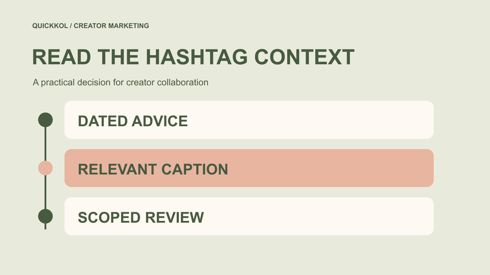
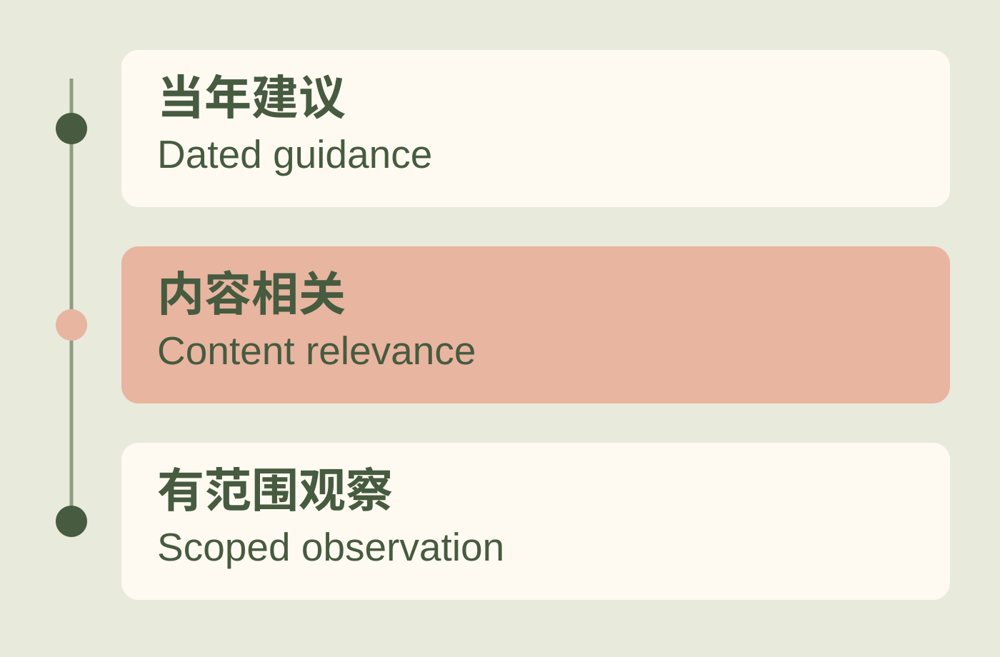

# Facebook Hashtags in 2025: Read the Context

Status: local review draft; confirm the publication date before release.

Read Meta’s 2025 up-to-five hashtag advice in its original-content and relevant-caption context, then decide which labels belong in a creator post.

QuickKOL editorial graphic; not actual account metrics or a platform interface.

For facebook hashtags strategy 2025 how many to use, Meta’s July 2025 Portuguese guidance discusses relevant, high-quality captions and groups link-free captions, minimal capitalization and up to five hashtags in a performance observation. That supports a dated recommendation, not a claim that five wins, six triggers a restriction or every account has a universal hard limit in 2026. For creator partnerships, retain accurate labels relevant to the work, then review caption meaning, commercial context and actual outcomes instead of filling a quota with unrelated popular terms.

## Answer the count question with its scope

For a retrospective of 2025 official advice, record up to five together with its source date. That provides a starting point without inventing a more precise optimal number.

[Meta’s 2025 original-content guidance](https://about.fb.com/br/news/2025/07/combatendo-conteudo-nao-original-para-proteger-e-elevar-criadores-no-facebook/amp/) does not present an isolated hashtag-count experiment in that passage. Links, capitalization and hashtag count appear together, so the statement cannot be separated into a universal causal result for creator posts.

Changing four labels to five is therefore not automatically an optimization, and six should not automatically be described as a violation. A current content or account issue needs current evidence and actual status information.

This article supports a caption decision between brand and creator: count follows relevance and communication needs, with historical advice kept in its period. It does not upgrade an older number into a permanent platform rule. A useful answer should let the team act without creating certainty that the source itself does not establish.

## Relevant labels describe the work rather than replace it

A hashtag can describe a subject, setting or campaign, but it cannot supply a creator contribution missing from the work. Make the content understandable before deciding which labels it needs.

For a creator explaining storage trade-offs in a small kitchen, labels should concern that work. A popular entertainment term does not belong automatically because it might bring exposure.

A brand may request a genuinely useful campaign tag, explaining what activity it organizes. Making every brand, category, season and imagined audience mandatory can leave a caption difficult to read.

Deciding which words are accurate with the creator is more useful than copying a high-view post. Hashtags are part of written expression, while the work must still communicate why it deserves attention. If removing a label leaves the content's purpose unclear, improve the explanation itself rather than assume an additional keyword will do that work for the reader.

## The anti-spam context is not a numeric penalty line

[Meta’s 2025 anti-spam announcement](https://about.fb.com/br/news/2025/04/reduzindo-conteudo-com-spam-no-facebook/) discusses long, distracting captions, excessive hashtags and text unrelated to the media in its April context. Read these as described behaviors, not an isolated number.

It does not support diagnosing a particular creator's account from the hashtag count on one post. In a brand discussion, identify the actual issue, such as labels unrelated to the subject, instead of claiming to have proved platform enforcement.

If distribution status matters, the account holder should inspect the current notices and controls offered to them. Retain uncertainty when evidence is unavailable rather than turn caption review into speculation about a person.

The immediate editorial action is to remove irrelevant material while keeping necessary context. That is advice about communication, not a promise that deleting a particular item will immediately restore or increase distribution. It also gives the creator a specific change they can evaluate rather than a vague claim that an algorithm dislikes their post.

Up to five belongs to the dated advice, not a performance guarantee for every account.

## Review the ordinary-language caption first

Temporarily remove the hashtags. Can a reader still understand the demonstration, the creator's experience and the product's role? If not, revise the ordinary caption first.

Explain actual conditions, key steps and limits not covered by the media. One generic compliment followed by labels cannot supply all of that information.

The [Facebook original-content review article](https://www.quickkol.com/blog/facebook-2025-original-creator-content-review/#answer) connects captions with the work's contribution. Here the concern is the text of one partnership post: each sentence should be useful, and mentioning the brand does not automatically make a sentence necessary.

The creator's voice can differ from the brand's usual style if facts, commercial context and agreement remain clear. Review should resolve real issues rather than turn every sentence into identical advertising language. This gives the creator room to make the explanation readable while allowing the brand to identify specific facts that must not be omitted or changed.

## Give every retained hashtag a reason

Ask what each label does: describe the particular subject, organize a real campaign or help identify genuinely related work? A label without a reasonable role need not remain to satisfy a count.

One meaning does not necessarily need several similar spellings. Brand and creator can check duplication rather than move every candidate into the final caption.

If an activity specifies a dedicated tag, confirm spelling and purpose before considering category or setting terms. Do not promise that it creates a complete searchable record or captures every participant.

The final count can be below the historical recommendation's ceiling. This article proposes no replacement universal optimum; it asks for a content-based reason for each retained word. Count is the result of selection, not the objective that drives it. A short explanation beside a requested campaign tag also helps a new editor understand why that particular item should survive a later caption revision.

## Do not make readers infer commercial context from topic tags

A brand hashtag identifies a subject without necessarily explaining a commercial relationship. The presence of a brand name does not establish that readers understand payment, gifts or another connection.

[FTC’s influencer disclosure guide](https://www.ftc.gov/business-guidance/resources/disclosures-101-social-media-influencers) explains clear disclosure of material relationships in applicable US contexts. Check the actual relationship and format rather than treat an internal partnership record as public notice.

When reducing labels, check that necessary relationship information has not been removed accidentally. Editing should improve clarity, not make commercial context harder to see.

A standard sentence in a template also does not end review. The work, caption and publishing format may differ, so creator and brand should inspect the actual presentation. That inspection belongs with the final content rather than a separate document no reader will encounter. The aim is to preserve understandable context while giving the creator enough flexibility to communicate naturally about the particular work.

## Reassess hashtags when adapting across platforms

A caption brought from Instagram or TikTok may retain its subject without carrying every hashtag automatically. Work format and audience context can differ by platform.

Check media crop, completeness of explanation and whether mentions still identify the correct account before editing labels. Changing count alone cannot repair an adaptation that has lost its context.

For licensed creator material, confirm the permitted Facebook use. Platform guidance, asset permission and caption relevance should not collapse into one unexplained ready-to-publish conclusion.

Give the executing owner an explicit Facebook version. Similar work can reuse research, but public wording should match this publication instead of relying on someone's memory of what to delete for each platform. The record can be brief: approved asset, caption, retained labels and publication destination. That is enough to make the version executable without inventing a different creative assignment or requiring the creator to repeat work already covered by the agreement.

## Do not attribute every outcome change to hashtags

When comparing two works, retain subject, creator, format, publishing time and observation period. Hashtag count is one possible difference and usually cannot explain the result alone.

The [social-engagement definition article](https://www.quickkol.com/blog/social-media-engagement-rate-monthly-explanation/#answer) helps state metric scope. Views, interactions and link actions answer different questions; a higher number does not independently prove a hashtag strategy.

Frame a finding as a question for further observation: perhaps the more relevant caption deserves another test. If many other conditions changed, explain the limited comparison instead of selecting the most attractive explanation.

Feedback to the creator should identify wording that improved understanding and questions still needing clarification. Without isolating evidence, do not attribute a change to how many labels an individual used. The team can make a sensible editorial choice while remaining honest that its project observations do not establish a general causal rule for every Facebook account or content category.

## Complete the decision with a hypothetical caption

Imagine a creator demonstrating small-kitchen storage while the original brand caption requires several unrelated activity terms. Keep the clear use explanation first, then consider two genuinely relevant setting labels and any campaign tag with a real purpose.

This does not recommend an identical number for every post. The example shows selection from content rather than adding words to approach five; the final choice requires judgment about the actual work.

Before publication, check commercial context, account identity and asset version. Afterward, record the real post and observation period without writing its result in advance.

If performance later differs from expectations, review the work and distribution context rather than immediately blame one missing label. Hashtag decisions belong within creator-marketing judgment, not as a universal formula replacing it. The useful outcome of the caption review is a version the creator can stand behind and the brand can explain, with no misleading claim that its label count guarantees reach.

## Keep the historical conclusion open to proper updating

This article answers a search question containing 2025. Historical advice can remain available while publication today still requires current rules and account information; an older article should not replace that check.

If a new official count recommendation appears, record its source and date before updating the affected passage. New information need not invalidate every editorial judgment about relevance, genuine experience and clear commercial context.

The team can hand off a scoped conclusion: use the dated up-to-five advice as context, select according to the work's relevance and make no claim that a fixed count controls distribution. That is more useful for collaboration than an unsourced number.

For influencer marketing, the central questions remain whether readers understand the creator's contribution and whether the brand participates accurately. Hashtag count can organize expression but cannot answer those questions on its own. Retain that distinction when the note is copied into a future brief, so a historical recommendation does not become an invented mandatory condition.

## Questions before retaining a hashtag

| Candidate | Reason to retain | Avoid |
| --- | --- | --- |
| Subject label | Accurately describes the work | Unrelated popularity terms |
| Setting label | Helps explain the setting | Duplicate meanings |
| Campaign tag | A real organizational purpose | Claiming complete participant capture |
| Brand tag | The brand is actually relevant | Substituting for clear commercial context |

Editorial selection framework; no new universal optimal count is proposed.

## Confirm a Facebook creator caption

Let labels support the actual information in the work.

- [ ] Record the date of the 2025 advice.
- [ ] Read the ordinary caption first.
- [ ] Explain each label’s purpose.
- [ ] Check commercial context and asset use.
- [ ] Retain the specific Facebook version.
- [ ] Avoid single-factor attribution in review.

## Research date and limitations

Sources reviewed November 18, 2026. Methods, tables and decision rules are editorial recommendations. Hypothetical examples are not actual client results or industry benchmarks. Source geography and periods are specified where relevant.

## Start creator research with a clear task

Use QuickKOL to interpret a brief, discover relevant creators and research their work and contact routes. Verify data, commercial terms and outcomes at their source.

[Explore QuickKOL](https://www.quickkol.com/#capabilities)

## Sources

- [Meta’s 2025 original-content guidance](https://about.fb.com/br/news/2025/07/combatendo-conteudo-nao-original-para-proteger-e-elevar-criadores-no-facebook/amp/)
- [Meta’s 2025 anti-spam announcement](https://about.fb.com/br/news/2025/04/reduzindo-conteudo-com-spam-no-facebook/)
- [FTC’s influencer disclosure guide](https://www.ftc.gov/business-guidance/resources/disclosures-101-social-media-influencers)
